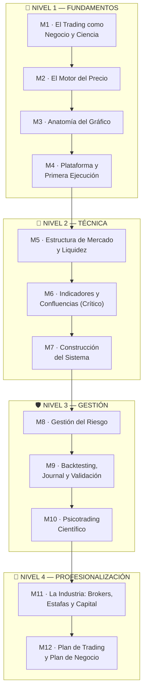

# 🎓 SYLLABUS Maestro — Programa de Formación Integral en Trading (FIT-12)

> **Documento rector del repositorio.** Los agentes construyen, enseñan y auditan únicamente según este temario.
> Cualquier cambio de estructura requiere actualizar este documento y el `Registro de Versiones`.

| Campo | Detalle |
|---|---|
| 📋 Programa | FIT-12 — Formación Integral en Trading (12 módulos · 4 niveles) |
| 📅 Versión | 1.1 · 24 de octubre de 2026 |
| 🧩 Estructura | 4 niveles × 3 módulos · cada módulo = lecciones + laboratorio + misión + evaluación |
| 🌍 Enfoque | Universal (sin contexto geográfico; fiscalidad por principios) |
| 🗣️ Idioma | Español natural + terminología técnica en inglés (glosario al primer uso) |
| 🔬 Fuentes | Informe [`analisis_cursos.md`](../00-analisis/analisis_cursos.md) (cursos TradingLab 003 y 004 + 9 vacíos cubiertos) |
| 🤖 Construcción | Paso a paso por agentes IA según [`agents.md`](../../../agents.md) — un sprint por módulo |

---

## 1. Filosofía del Programa

Este programa existe para transformar el trading de una actividad intuitiva o ludópata en un **negocio financiero cuantitativo, sistemático y repetible**. Tres principios rectores gobiernan todo el contenido:

1. **La esperanza matemática es la brújula.** Todo el programa orbita la ecuación $E = (P_w \times W) - (P_l \times L)$. Un sistema sin esperanza positiva demostrada no se opera, sin importar qué tan "bonito" se vea en el gráfico.
2. **La regla 85/15 (heurística):** la técnica es aproximadamente el 15 % del resultado; la psicología y la gestión del riesgo son el 85 %. Por eso el programa dedica un nivel completo a Gestión antes de Profesionalización, y por eso cada módulo tiene componentes de riesgo y de conducta.
3. **Preservación antes que ganancia.** El capital es el inventario del negocio. Primero se aprende a no perder; después, a ganar; al final, a escalar.

**Regla de oro pedagógica:** cada concepto se enseña con el **"por qué" antes que el "cómo"**, con analogías intuitivas y con entrenamiento deliberado (hacer, no solo mirar).

## 2. Perfil de Egreso — 8 Competencias

Al graduarse, el estudiante será capaz de:

1. **Leer el gráfico nativamente** sin dependencia de indicadores: velas, estructura, ciclos, soportes/resistencias y liquidez institucional.
2. **Operar la estructura** con protocolo multitemporal (top-down) y nomenclatura unificada (PA clásico ↔ SMC).
3. **Diseñar un sistema de trading formal** con reglas explícitas y esperanza matemática calculada.
4. **Dimensionar el riesgo con matemática exacta** (position sizing, asimetría de drawdown, riesgo de cartera correlacionada, frenos de emergencia).
5. **Validar sistemas con backtesting científico** (N ≥ 100) y **auditar su propia operativa** con journal profesional y revisiones periódicas.
6. **Gestionar su psicotrading** con protocolos concretos (miedos de Douglas, avaricias, pérdida ≠ error, dicotomía del control, rutina).
7. **Navegar la industria sin ser presa**: brokers (A/B-Book), estafas (binarias, martingala, MLM, gurús), prop firms (estadísticas, reglas finas, matriz de riesgo) y fiscalidad por principios.
8. **Operar un negocio de trading**: Plan de Trading documental, KPIs, política de capital y hoja de ruta de escalado a 12 meses.

## 3. Arquitectura Curricular

| Nivel | Módulos | Propósito | Duración sugerida |
|---|---|---|---|
| 🧱 N1 Fundamentos | M1–M4 | Entender el negocio, el mercado y tocar la plataforma | 4 semanas |
| 📐 N2 Técnica | M5–M7 | Leer estructura institucional y construir el Sistema v1.0 | 3 semanas |
| 🛡️ N3 Gestión | M8–M10 | Proteger capital, validar estadísticamente, dominar la mente | 3 semanas |
| 💼 N4 Profesionalización | M11–M12 | Navegar la industria y operar como negocio | 2 semanas |

> **Ritmo:** 1 módulo = 1 semana a ~7-10 h/semana. El ritmo real lo fija la aprobación de la **evaluación de cada nivel**, no el calendario.

## 4. Formato Estándar de Módulo

Todo módulo se construye con la plantilla [`PLANTILLA_MODULO.md`](../03-recursos/plantillas/PLANTILLA_MODULO.md) y contiene:

- **Encabezado de trazabilidad** (módulo, nivel, fuentes 003/004, aporte propio)
- **6–8 lecciones** con: concepto → por qué → cómo → analogía → ejemplo gráfico → error común
- **1 laboratorio práctico** (hacer con las manos, en TradingView/hoja de cálculo)
- **1 misión evaluada** (entregable verificable por el agente auditor)
- **Evaluación de graduación** con criterios objetivos
- **Glosario del módulo** (términos nuevos + término inglés)

## 5. 🧱 NIVEL 1 — FUNDAMENTOS

### Módulo 1 · El Trading como Negocio y Ciencia
> **Trazabilidad:** 003 · M1.1–1.4, M7.5 · 004 · M1.1, M10 · **Aporte propio:** mapa de 3 dimensiones (estilos × mercados × vehículos), contrato anti-ludopatía.

**Objetivo:** instalar la mentalidad correcta antes de tocar un gráfico. El estudiante termina este módulo sabiendo qué es el trading, qué NO es, qué le espera y con qué estilo de vida se alinea.

| # | Lección | Contenido esencial |
|---|---|---|
| 1.1 | Qué es realmente el trading | Comercio/especulación como provisión de liquidez; diferencia con inversión; el trader como pequeño proveedor de liquidez ante el flujo institucional |
| 1.2 | Las 5 mentiras de la industria | "Ganarás mucho", "playa y libertad", "una hora al día", "rentable en 3 meses", "el fondeo te da el capital" — desmontaje con la realidad de cada una |
| 1.3 | El mapa completo: 3 dimensiones | Estilos (Position/Swing/Day/Scalp/Algo) × Mercados (Forex/Cripto/Acciones/Índices/Commodities/Bonos) × Vehículos (Spot/CFD/Futuros/Opciones/ETFs); cómo elegir tu coordenada según tu vida |
| 1.4 | La esperanza matemática | $E = (P_w \times W) - (P_l \times L)$; por qué el Win Rate engaña; fractalidad autosimilar (no idéntica) y el costo del ruido en timeframes bajos *(cifras del curso fuente: ilustrativas)* |
| 1.5 | La curva de aprendizaje real | Analogía médica (12-17 años hasta operar un corazón); las 4 fases del trader (incompetencia inconsciente → competencia inconsciente); por qué 12 meses es la prueba mínima de consistencia |
| 1.6 | Expectativas y presupuesto | Cuánto cuesta formarse (tiempo y dinero), cuánto puede esperarse (rangos realistas), el dinero "quemable" y la regla de no financiar la vida con trading en formación |

- 🧪 **Laboratorio:** Auditoría personal — capital disponible, horas semanales reales, tolerancia a la pérdida, coordenada tentativa (estilo × mercado) justificada.
- 🎯 **Misión:** Redactar la **Carta de Expectativas** (1 página: qué espero, qué me comprometo a no hacer, monto quemable) + firma simbólica del *contrato anti-ludopatía*.
- ✅ **Criterio de graduación:** Carta completa + quiz de 10 preguntas (mapa de 3 dimensiones y esperanza matemática) con ≥ 8 aciertos.

### Módulo 2 · El Motor del Precio
> **Trazabilidad:** 003 · M1.4–1.5 · 004 · M2.4 · **Aporte propio:** calendario macro aplicado y correlación intermercados (vacío 4 y 5).

**Objetivo:** entender por qué el precio se mueve: subasta, liquidez, sesiones y el calendario macro que mueve todo en cadena.

| # | Lección | Contenido esencial |
|---|---|---|
| 2.1 | La mecánica de subasta | Bid vs Ask; compradores agresivos (takers) vs vendedores pasivos (makers); cómo nace cada tick |
| 2.2 | Oferta y demanda | Por qué sube y baja el precio; el ejemplo pedagógico del mercado (caso melocotones de 003 actualizado); desequilibrio y expansión |
| 2.3 | Liquidez | Qué es, quién la provee, por qué los grandes la necesitan y por qué cazan los stops del minorista |
| 2.4 | Forex y sus sesiones | Pares, pips, sesiones Sydney/Tokio/Londres/NY, solapamiento Londres-NY, ciclo de volumen diario; el reloj del trader en TU huso horario |
| 2.5 | Personalidad de cada mercado | Índices (US30/US100/US500), oro XAU/USD, cripto 24/7: volatilidad, horarios y comportamiento típico de cada uno |
| 2.6 | Calendario macro e intermercados | NFP, IPC, FOMC: qué miden, cuándo salen, cómo operar (o no operar) alrededor; cadena causal DXY ↔ oro ↔ acciones ↔ cripto ↔ tasas |

- 🧪 **Laboratorio:** Construir el **reloj de sesiones** personalizado + marcar en el calendario los 5 eventos macro de la semana entrante con su hora local.
- 🎯 **Misión:** Observación pura: 3 sesiones de Londres-NY en vivo (sin operar) con registro de comportamiento de volumen y volatilidad.
- ✅ **Criterio de graduación:** Misión de observación completa + quiz de sesiones/eventos macro ≥ 8/10.

### Módulo 3 · Anatomía del Gráfico
> **Trazabilidad:** 003 · M2.1–2.6 · 004 · M1.5, M3.3–3.4 · **Aporte propio:** catálogo de patrones con fiabilidad evidenciada.

**Objetivo:** leer el gráfico desnudo: velas, ciclos, niveles y confirmaciones. Sin indicadores todavía — primero el precio.

| # | Lección | Contenido esencial |
|---|---|---|
| 3.1 | Velas japonesas | OHLC, cuerpo vs mechas, qué significa cada vela en contexto; fractalidad real: qué contiene una vela semanal/diaria/horaria; historia (Homma, Dojima) |
| 3.2 | Los 4 ciclos del mercado | Acumulación → markup → distribución → markdown; teoría de Dow (impulso + pullback); etapas de Weinstein como el mismo mapa operativo |
| 3.3 | Soportes y resistencias | Zonas de holgura, no líneas; estáticos, diagonales y dinámicos; fortaleza por número de toques; memoria de mercado |
| 3.4 | Confirmación en 3 pasos | Ruptura → cierre fuera del nivel → confirmación; principio de polaridad (throwback/pullback); falsos rompimientos y por qué existen |
| 3.5 | Patrones elementales | Envolventes, martillo/estrella, doji; cuñas, triángulos, doble techo/suelo — catálogo con fiabilidad real y contexto de uso |
| 3.6 | Rangos vs tendencias | El mercado pasa ~70 % del tiempo en rango *(aproximación)*; identificar el régimen ANTES de buscar setups; el vaivén (whipsaw) como asesino silencioso |

- 🧪 **Laboratorio:** Marcar ciclos y zonas S/R en 10 gráficos históricos de 5 mercados diferentes (Bar Replay).
- 🎯 **Misión:** Bitácora de **20 niveles** identificados con su resultado posterior (respetado/roto) — primer contacto con la estadística visual.
- ✅ **Criterio de graduación:** Bitácora de 20 niveles completa + análisis de un gráfico en vivo evaluado por el agente (rubric: ciclos, zonas, régimen).

### Módulo 4 · Plataforma y Primera Ejecución
> **Trazabilidad:** 003 · M1.6, M4.3–4.4 · 004 · M5.1–5.5 · **Aporte propio:** protocolo de demo ordenado y el stop como ley desde el día uno.

**Objetivo:** dominar la herramienta y ejecutar las primeras órdenes en demo con control total de la mecánica (no de la estrategia: eso viene en N2).

| # | Lección | Contenido esencial |
|---|---|---|
| 4.1 | TradingView profesional | Cuenta, gráficos, escalas, layouts multitemporales, watchlists, alertas, Bar Replay, atajos esenciales |
| 4.2 | Tipos de órdenes | Market, Limit, Stop, Stop-Limit, OCO: qué hace cada una, cuándo usarla, ejemplos de entrada y salida |
| 4.3 | El costo real de operar | Spread bid-ask, slippage, comisiones, swap: cómo se calculan y cómo se comen la esperanza (con números) |
| 4.4 | Largos y cortos | Mecánica del short selling (préstamo, recompra), borrow fees, short squeeze; asimetría "suben en escalera, caen en ascensor" |
| 4.5 | Cuenta demo | Configuración realista, primera órdenes en EUR/USD y XAU/USD, lectura del panel de posiciones |
| 4.6 | El Stop Loss como ley | Qué es, por qué toda posición lo lleva desde hoy, colocación básica por estructura (mínimo del swing / máximo del swing) |

- 🧪 **Laboratorio:** Ejecutar en demo las 3 órdenes básicas + una OCO completa (entrada limit + SL + TP).
- 🎯 **Misión:** **10 operaciones demo** registradas con captura, tipo de orden y justificación (la entrada puede ser simple; lo que se evalúa es la mecánica impecable: SL siempre puesto).
- 📖 **Recurso:** [`La Receta de tu Primera Operación`](../03-recursos/laboratorio/receta-primera-operacion.md) — guía práctica de 12 pasos (de abrir la demo a revisar el journal) con receta maestra en EUR/USD y fichas de variación para XAU/USD e índices. Los pasos 0–2 (cuenta demo, tour de plataforma, observación) pueden anticiparse como familiarización sin operar; los pasos 3–11 se ejecutan con este módulo. El objetivo de la receta es la **primera operación procesada** (SL puesto, registrada, revisada) — no "ganar el primer dólar" (veto CRO: ese marco queda reservado para la Fase 4, tras M9–M12, con riesgo micro).
- ✅ **Criterio de graduación:** 🏆 **Evaluación Nivel 1:** examen teórico integrador (30 preguntas) ≥ 80 % + misión 4 completa + checklist de ejecución sin violaciones (cero operaciones sin SL).

## 6. 📐 NIVEL 2 — TÉCNICA

### Módulo 5 · Estructura de Mercado y Liquidez Institucional
> **Trazabilidad:** 004 · M2.2, M3.1, M3.5 · 003 · M3.5 (crítica SMC) · **Aporte propio:** nomenclatura unificada PA clásico ↔ SMC (vacío de coherencia D1 del informe).

**Objetivo:** leer el mapa del dinero grande: tendencia, quiebres, liquidez y desequilibrios, con un solo vocabulario coherente.

| # | Lección | Contenido esencial |
|---|---|---|
| 5.1 | Tendencia y estructura | HH/HL/LH/LL; pauta de Dow como unidad (impulso + pullback);swing highs/lows relevantes vs ruido |
| 5.2 | BOS y CHoCH | Quiebre de estructura (continuación) y cambio de carácter (reversión); confirmación por cierre; mapa unificado: lo que PA clásico llama "ruptura de nivel", SMC lo llama BOS — mismo fenómeno |
| 5.3 | Liquidez operable | Pools de liquidez, equal highs/lows, stop hunts (liquidity grabs), por qué el precio "va a buscar" los niveles obvios |
| 5.4 | Imbalances y FVG | El gap de 3 velas; desequilibrio como imán y como zona de entrada; mitigación |
| 5.5 | Order blocks y zonas institucionales | Qué son, qué evidencia real existe detrás, cómo usarlos con criterio y sin misticismo (contexto de la crítica de 003) |
| 5.6 | Top-Down Analysis | Protocolo de 3 capas: sesgo en 4H/D → zonas en 1H/15M → gatillo en 5M; confluencia como filtro de calidad |

- 🧪 **Laboratorio:** Análisis top-down completo de 5 mercados (EUR/USD, GBP/USD, XAU/USD, US100, BTC/USD) con plantilla.
- 🎯 **Misión:** **15 análisis estructurales** documentados (etiquetando BOS/CHoCH/liquidez/FVG) con el resultado posterior anotado.
- ✅ **Criterio de graduación:** 15 análisis completos + quiz de estructura ≥ 8/10.

### Módulo 6 · Indicadores y Confluencias — Catálogo Crítico
> **Trazabilidad:** 004 · M4.1–4.5 · 003 · M3.3–3.4 · **Aporte propio:** radar de fiabilidad por evidencia (incl. etiqueta pseudocientífica para lo exógeno), regla del máximo 3 indicadores.

**Objetivo:** usar indicadores como medidores (no oráculos), conocer los sistemas de canal clásicos y desarrollar el radar que separa herramienta de marketing.

| # | Lección | Contenido esencial |
|---|---|---|
| 6.1 | Filosofía del indicador | El precio es primero; el indicador mide/deriva, no predice; indicador adelantado no existe |
| 6.2 | Medias móviles | SMA vs EMA; el sistema 20/50/200 (filtro macro + soporte dinámico + gatillo); golden/death cross y sus límites |
| 6.3 | Volatilidad y canales | ATR (stops dinámicos y tamaño de rango), Bollinger ±2σ (squeeze, walking the bands), Donchian y las Tortugas |
| 6.4 | Momentum y osciladores | RSI, Estocástico, MACD; sobrecompra/sobreventa en contexto de régimen; divergencias (el uso más honesto) |
| 6.5 | Volumen y perfil | VWAP, Volume Profile horizontal, zonas de alto volumen institucional |
| 6.6 | Fibonacci, Elliott y armónicos | Uso pragmático de retrocesos (50-61.8 % de descuento), límites de la subjetividad de Elliott, por qué los armónicos exigen disciplina estadística extrema |
| 6.7 | Etapas de Weinstein | El filtro macro de 4 etapas: prohibido comprar en Etapa 4; integración con el mapa de ciclos del M3 |
| 6.8 | Radar de fiabilidad | Clasificación final: herramientas con evidencia / herramientas contextuales / marketing (incl. ciclos lunares, indicadores que repintan); regla del dashboard máximo de 3 herramientas |

- 🧪 **Laboratorio:** Construir el **dashboard de confluencias** personal (máx. 3 herramientas) y probarlo en 50 movimientos históricos.
- 🎯 **Misión:** Informe comparativo: 3 herramientas evaluadas sobre el mismo mercado (acierto/fallo documentado en tabla).
- ✅ **Criterio de graduación:** Dashboard definido con justificación + informe de misión + quiz ≥ 8/10.

### Módulo 7 · Construcción del Sistema de Trading
> **Trazabilidad:** 003 · M3.1–3.2, M3.6 · **Aporte propio:** catálogo de arquetipos de setup, estadística de rachas, criterios de robustez.

**Objetivo:** salir del Nivel 2 con un **Sistema v1.0 escrito** — la primera versión formal del negocio.

| # | Lección | Contenido esencial |
|---|---|---|
| 7.1 | Filosofía vs Estrategia vs Sistema | Definiciones formales; por qué "veo una vela en soporte" no es un sistema |
| 7.2 | Componentes del sistema | Mercado, temporalidad, régimen, setup, gatillo de entrada, stop, salidas, gestión post-entrada, filtros, horario |
| 7.3 | Arquetipos de setup | Ruptura + retesteo; pullback en tendencia; reversión en rango; sweep + reversal (liquidez); ventajas y contexto óptimo de cada uno |
| 7.4 | Esperanza aplicada | Simulación de combinaciones WR × R:B (tabla de expectativa); demostración numérica de por qué 40 % de acierto con 1:2 es negocio |
| 7.5 | Métricas y rachas | Profit Factor (>1.5 objetivo), Max DD, curva de capital; estadística de rachas: cuántas pérdidas seguidas son *esperables* con tu WR (fórmula y tabla) |
| 7.6 | Criterios de robustez | N mínimo, simplicidad (menos reglas = menos overfitting), no ajustar mirando el resultado (data-mining bias) |

- 🧪 **Laboratorio:** Redactar el **Sistema v1.0** en 1 página (mínimo 5 reglas explícitas) usando la plantilla.
- 🎯 **Misión:** **30 repeticiones del setup** elegido en Bar Replay con registro de resultado (R ganado/perdido).
- ✅ **Criterio de graduación:** 🏆 **Evaluación Nivel 2:** Sistema v1.0 aprobado por el agente auditor (completitud de componentes) + 30 repeticiones documentadas + examen estructural ≥ 80 %.

## 7. 🛡️ NIVEL 3 — GESTIÓN

### Módulo 8 · Gestión del Riesgo — el módulo que paga las cuentas
> **Trazabilidad:** 003 · M4.5, M6.5 · 004 · M6.1–6.5 · **Aporte propio:** riesgo de cartera y correlación de posiciones (vacío 1), protocolo de frenos en cascada.

**Objetivo:** blindar el capital con matemática exacta. Al terminar, el estudiante sabe exactamente cuánto puede perder HOY y por qué es imposible perder más.

| # | Lección | Contenido esencial |
|---|---|---|
| 8.1 | Preservación de capital | El dinero como inventario del negocio; el enfoque defensivo del profesional |
| 8.2 | Asimetría del drawdown | Tabla completa de recuperación (−10 %→+11 %, −25 %→+33 %, −50 %→+100 %); por qué el gran daño es irreversible |
| 8.3 | La regla del 1 % y position sizing | Fórmula universal con ejemplo desglosado; por qué solo la distancia al stop está en riesgo; calculadora |
| 8.4 | Apalancamiento real | Margen, lotaje, pip value; por qué el apalancamiento no define el riesgo (lo define el stop); micro-lotes |
| 8.5 | Riesgo de cartera y correlación | EUR/USD + GBP/USD = doble exposición USD; riesgo agregado vs nominal; límite de exposición simultánea por correlación |
| 8.6 | Frenos de emergencia | Daily Max Loss (−2 %), límite semanal, freno tras 2 pérdidas consecutivas, protocolo de apagado (cerrar plataforma) — en cascada y por escrito |

- 🧪 **Laboratorio:** Construir la **calculadora de position sizing** (hoja de cálculo con pestaña de correlación).
- 🎯 **Misión:** 20 escenarios de sizing resueltos a mano (mental math) verificados contra la calculadora.
- ✅ **Criterio de graduación:** Calculadora funcional + 20 escenarios correctos (≥ 18/20) + examen de riesgo ≥ 90 % (este módulo exige nota alta).

### Módulo 9 · Backtesting, Journal y Validación
> **Trazabilidad:** 004 · M7.1–7.3 · 003 · M6.6 · **Aporte propio:** journal con campos/etiquetas de error estandarizados y protocolo de revisión semanal (vacío 3), advertencia de data-mining (D6 del informe).

**Objetivo:** obtener convicción estadística sobre el Sistema v1.0 y montar el sistema de auditoría propia que sostendrá la carrera.

| # | Lección | Contenido esencial |
|---|---|---|
| 9.1 | Epistemología del backtesting | Por qué N ≥ 100; ceguera (Bar Replay sin ver el futuro); sesgos: supervivencia, data-mining, look-ahead |
| 9.2 | Protocolo de backtesting manual | Paso a paso: cómo registrar, qué contar como setup válido, cuándo parar |
| 9.3 | Métricas del reporte | WR, R:B medio, E, Profit Factor, Max DD, curva de capital, distribución de rachas |
| 9.4 | Forward testing en demo | La transición honesta: backtest → demo forward (mismo sistema, datos en vivo) → y solo después, real micro |
| 9.5 | El Journal profesional | Campos mínimos (fecha, mercado, setup, captura, R planificado, R real, etiqueta de error, estado emocional pre/post); pérdida ≠ error como etiqueta central |
| 9.6 | Revisión semanal y mensual | Protocolo de auditoría propia: qué medir, qué preguntas hacerse, cuándo modificar el sistema (y cuándo NO) |

- 🧪 **Laboratorio:** **Backtesting ciego de 100 operaciones** del Sistema v1.0 con el journal completo.
- 🎯 **Misión:** Reporte estadístico del sistema (todas las métricas) + 3 conclusiones documentadas sobre qué ajustar en v1.1.
- ✅ **Criterio de graduación:** 100 operaciones registradas + reporte completo + revisión semanal simulada con el agente.

### Módulo 10 · Psicotrading Científico
> **Trazabilidad:** 003 · M5.1–5.6 · 004 · M7.4–7.5, M9, M10.2–10.4 · **Aporte propio:** diario emocional estructurado y protocolo de temperatura pre-sesión.

**Objetivo:** conocer la propia máquina y operar con ella: neurobiología, miedos, avaricias, sesgos y rutina de alto rendimiento.

| # | Lección | Contenido esencial |
|---|---|---|
| 10.1 | Neurobiología del riesgo | Amígdala, cortisol, secuestro emocional, corteza prefrontal; por qué el cerebro no está diseñado para el trading |
| 10.2 | Los 5 miedos (Mark Douglas) | Equivocarse, perder, quedarse fuera, devolver ganancias, lo desconocido; los axiomas de la incertidumbre y la mentalidad probabilística |
| 10.3 | Las 5 avaricias | FOMO, perseguir trades, sobreapalancamiento, exceso de riesgo, overtrading — señales tempranas de cada una |
| 10.4 | Pérdida ≠ Error | La distinción que define la carrera; por qué una ganancia fuera de plan es más peligrosa que una pérdida en plan |
| 10.5 | Sesgos cognitivos | Confirmación, exceso de confianza, anclaje, revancha (tilt); antídotos concretos por sesgo |
| 10.6 | Estoicismo operativo | Dicotomía del control: procesos (controles) vs resultados (no controlados); serenidad ante la varianza |
| 10.7 | Rutina y hábitos | Sueño y corteza prefrontal; ventana de ejecución (máx ~3 h en picos); fatiga decisional; inacción estratégica como posición; protocolo post-mercado |

- 🧪 **Laboratorio:** Diario emocional estructurado + protocolo de **temperatura pre-sesión** (sueño, estrés, apego al resultado).
- 🎯 **Misión:** **10 sesiones** (demo forward) con checklist emocional pre/post y etiquetado de errores.
- ✅ **Criterio de graduación:** 🏆 **Evaluación Nivel 3:** 100 backtests validados (M9) + 10 sesiones con journal completo + entrevista socrática de graduación con el agente (casos de tilt, FOMO y pérdida en plan).

## 8. 💼 NIVEL 4 — PROFESIONALIZACIÓN

### Módulo 11 · La Industria: Brokers, Estafas y Capital Externo
> **Trazabilidad:** 003 · M4.1–4.2, M6.1–6.6 · 004 · M8.1–8.5 · **Aporte propio:** due diligence universal sin marcas, reglas finas de prop firms (vacío 6), fiscalidad por principios (vacío 7), tier list como snapshot.

**Objetivo:** elegir infraestructura con criterio forense y entender el negocio de quien te ofrece capital (o te vende humo).

| # | Lección | Contenido esencial |
|---|---|---|
| 11.1 | Brokers de verdad | A-Book vs B-Book; regulación estricta (FCA, BaFin, ASIC, SEC) vs offshore; los 5 pilares de selección (regulación, ejecución, costos, retiros, soporte) — criterios universales, no marcas |
| 11.2 | Radar de estafas | Opciones binarias (esperanza negativa demostrada), bots martingala, academias MLM, gurús con lujo alquilado, indicadores que repintan; protocolo de verificación regulatoria |
| 11.3 | Prop firms: el negocio real | Modelo de ingresos por fees; estadísticas (92 % de desafíos fracasan — CEO de FTMO; ~0.07 % éxito neto — datos filtrados MFF); riesgo regulatorio y colapsos históricos (MFF, TFT, True Forex Funds) |
| 11.4 | Reglas finas de las prop firms | Drawdown diario (5 %) y total (10 %), *consistency rules*, restricción de noticias, límites de lotaje, políticas de copiado: lo que realmente desaprueba cuentas |
| 11.5 | Matriz de riesgo para evaluaciones | Riesgo dinámico 0.25-0.50 % según drawdown consumido; rachas esperables vs límites de la firma; cuando la matemática dice "todavía no" |
| 11.6 | Cuándo intentar una evaluación | El criterio honesto: 6-12 meses de consistencia documentada (journal + métricas); usar la prop firm para capitalizarse, no ser su producto |
| 11.7 | Fiscalidad por principios | Capital vs actividad económica; llevar registro de todas las operaciones; declarar siempre; "verifica tu jurisdicción con un profesional" — sin nombres de modelos de un solo país |

- 🧪 **Laboratorio:** Due diligence de 3 brokers + 3 prop firms con la matriz de criterios (misma rúbrica para todos, sin publicidad).
- 🎯 **Misión:** Informe de elección con justificación puntual por criterio + plan de capitalización (propio vs fondeo) a 12 meses.
- ✅ **Criterio de graduación:** Informe completo defendido en sesión socrática con el agente.

### Módulo 12 · Plan de Trading y Plan de Negocio
> **Trazabilidad:** 004 · M6.5, M10.1–10.5 · 003 · M7.3–7.4 · **Aporte propio:** plantilla de Plan de Trading de 10 secciones, KPIs de negocio, política de capital y retiros (vacíos 2 y 8).

**Objetivo:** consolidar todo en dos documentos operativos y salir con el negocio montado, no con "conocimiento".

| # | Lección | Contenido esencial |
|---|---|---|
| 12.1 | El Plan de Trading documental | Las 10 secciones obligatorias (identidad, coordenada, mercados, sistema, riesgo, rutina, journal, revisión, psicología, reglas de excepción); plantilla incluida |
| 12.2 | La rutina semanal del trader | Pre-mercado (checklist), ejecución (ventana), post-mercado (journal), revisión semanal (auditoría) y mensual (métricas) |
| 12.3 | KPIs del negocio | E, PF, Max DD, horas invertidas vs retorno, costos totales; el dashboard mensual de un solo vistazo |
| 12.4 | Gestión patrimonial | Separación de cuentas (supervivencia vs trading), política de retiros, capital de crecimiento, qué hacer con un mes ganador (y con uno perdedor) |
| 12.5 | Hoja de ruta a 12 meses | Fases con criterios de avance: formación → backtest → demo → real micro → evaluación prop; la regla de "no se sube de fase sin criterio cumplido" |
| 12.6 | Biblioteca esencial | Elder (*Vivir del Trading*), Van Tharp, Douglas (*Trading in the Zone*), Steenbarger, Rotella — qué aporta cada uno y orden de lectura |
| 12.7 | Graduación y mejora continua | El compromiso de proceso; cómo seguir aprendiendo sin nomadear (regla anti-719-combinaciones) |

- 🧪 **Laboratorio:** Redactar el **Plan de Trading v1.0** completo (10 secciones) con el Sistema v1.1 ya validado.
- 🎯 **Misión final:** Examen integral del programa (50 preguntas transversales) + **defensa del plan** en sesión socrática extendida con el agente.
- ✅ **Criterio de graduación:** 🏆 **Certificación interna FIT-12:** plan aprobado + examen ≥ 85 % + journal demostrando 12 semanas de operativa documentada.

---

## 9. Matriz de Trazabilidad Curricular

| Módulo propio | Fuentes 003/004 | Aporte propio (vacíos) | Evaluación |
|---|---|---|---|
| M1 Negocio y Ciencia | 003 M1, M7.5 | Mapa 3D + contrato anti-ludopatía | Quiz + Carta |
| M2 Motor del Precio | 003 M1.4-1.5 · 004 M2.4 | Macro aplicado + intermercados (V4, V5) | Observación + quiz |
| M3 Anatomía del Gráfico | 003 M2 · 004 M1.5, M3.3-3.4 | Catálogo con fiabilidad | Bitácora 20 niveles |
| M4 Plataforma y Ejecución | 003 M1.6, M4.3-4.4 · 004 M5 | Stop como ley desde día 1 | 🏆 Examen N1 |
| M5 Estructura y Liquidez | 004 M2.2, M3 · 003 M3.5 | Nomenclatura unificada | 15 análisis |
| M6 Indicadores Críticos | 004 M4 · 003 M3.3-3.4 | Radar de evidencia | Dashboard + informe |
| M7 Sistema de Trading | 003 M3.1-3.2 | Arquetipos + rachas + robustez | 🏆 Sistema v1.0 |
| M8 Gestión del Riesgo | 003 M4.5, M6.5 · 004 M6 | Correlación de cartera (V1) + frenos | 🏆 Examen ≥ 90 % |
| M9 Backtesting y Journal | 004 M7 | Journal estandarizado (V3) + data-mining | 100 backtests |
| M10 Psicotrading | 003 M5 · 004 M7.4-7.5, M9-M10 | Diario emocional + temperatura | 🏆 Entrevista N3 |
| M11 La Industria | 003 M4, M6 · 004 M8 | Due diligence universal + reglas finas (V6, V7) | Informe defendido |
| M12 Plan y Negocio | 004 M6.5, M10 · 003 M7.3-7.4 | Plan 10 secciones + KPIs (V2, V8) | 🏆 Certificación FIT-12 |

*(V# = vacío curricular correspondiente, véase [`analisis_cursos.md` § 7](../00-analisis/analisis_cursos.md))*

## 10. Sistema de Evaluación y Graduación

- **Por módulo:** misión evaluada por el agente auditor con rúbrica pública + quiz breve (≥ 80 % salvo M8 que exige ≥ 90 %).
- **Por nivel:** evaluación integradora (🏆) que combina examen teórico, entregables acumulados y una entrevista socrática con el agente.
- **Certificación interna FIT-12:** solo se emite con journal demostrando 12 semanas de operativa documentada + Plan de Trading aprobado + examen final ≥ 85 %.
- **Registro de progreso:** el estado de cada módulo vive en el `README.md` del repositorio (tabla de estado) y en el `worklog.md`.

## 11. Roadmap de Construcción (para los agentes)

| Sprint | Entregable | Estado |
|---|---|---|
| Sprint 0 | Estructura del repo + `agents.md` + `SYLLABUS.md` + análisis de cursos | ✅ Hecho |
| Sprint 1 | Módulo 1 completo (6 lecciones + lab + misión + evaluación) | ✅ Hecho |
| Sprint 1.5 | Recurso: `La Receta de tu Primera Operación` + integración en M4 (v1.1 del temario, aprobado por el estudiante) | ✅ Hecho |
| Sprint 2 | Módulo 2 completo + plantilla de journal v0 (CSV) | ✅ Hecho |
| Sprint 3 | Módulo 3 completo + glosario maestro v1 | ✅ Hecho |
| Sprint 4 | Módulo 4 + examen Nivel 1 (30 preguntas + entrevista socrática + checklist) | ✅ Hecho |
| … | Un sprint por módulo, según avance real del estudiante | 🔜 Sprint 5 (M5) |

## 12. Glosario Vivo

El glosario maestro se construye incrementalmente en [`docs/03-recursos/glosario.md`](../03-recursos/glosario.md) — cada módulo añade sus términos al finalizar el sprint. Regla: primera aparición de un término técnico = español + término inglés en cursiva + definición breve al pie del módulo.

## 13. Registro de Versiones

| Versión | Fecha | Cambios |
|---|---|---|
| 1.0 | 2026-10-24 | Syllabus inicial: 4 niveles, 12 módulos, matriz de trazabilidad, sistema de evaluación y roadmap de sprints |
| 1.1 | 2026-10-24 | Temario aprobado por el estudiante · Integrado el recurso transversal "La Receta de tu Primera Operación" en M4 (con veto CRO al marco "primer dólar": objetivo = primera operación procesada en demo) |
| 1.2 | 2026-10-24 | N1 completo: M3 y M4 publicados (Sprints 2-4 ejecutados); examen integrador N1 creado en docs/03-recursos/evaluaciones/; glosario maestro a 111 entradas |

