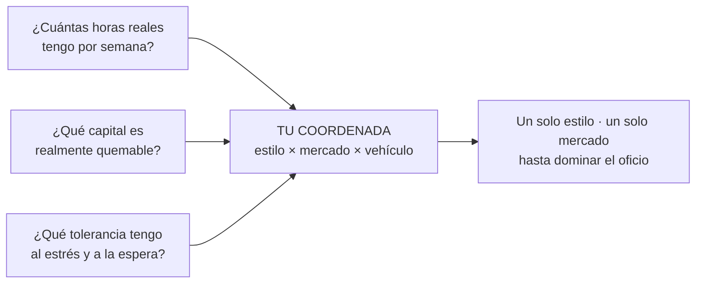

# Lección 1.3 · El mapa completo: 3 dimensiones

| Campo | Detalle |
|---|---|
| ⏱️ Duración estimada | 45–60 min de estudio |
| 🧱 Módulo | [M1 · El Trading como Negocio y Ciencia](README.md) |
| ⬅️ Anterior | [Lección 1.2 · Las 5 mentiras de la industria](leccion-1-2.md) |
| ➡️ Siguiente | [Lección 1.4 · La esperanza matemática](leccion-1-4.md) |

---

## Por qué importa

"Trader" no es una profesión única: es un espacio de cientos de oficios distintos. Cuando alguien dice "soy trader", todavía no ha dicho casi nada — falta saber qué estilo maneja, en qué mercado y con qué vehículo. El principiante que elige sin mapa no elige: **adopta el estilo que le mostró la última publicidad** (normalmente scalping de cripto con apalancamiento, porque es lo más espectacular de filmar), sin preguntarse si su vida, su capital y su huso horario lo permiten. Esta lección te entrega el mapa completo — estilos × mercados × vehículos — y un método para elegir **una** coordenada provisional que sí encaje con tu realidad. Esa coordenada se afinará en el laboratorio de este módulo y se convertirá en decisión firme dentro de tu Plan de Trading (Módulo 12).

## Concepto

La actividad de trading se describe con tres dimensiones independientes. La primera es el **estilo**, definido por el tiempo que mantienes posiciones y, en consecuencia, por el ritmo de vida que exige. La segunda es el **mercado** — el universo de activos donde operas, cada uno con su horario, liquidez y personalidad. La tercera es el **vehículo** — el instrumento concreto con el que tomas exposición al precio: el mismo activo puede operarse de cinco formas distintas, con apalancamientos, costos y perfiles de riesgo muy diferentes.

La aritmética del mapa: 5 estilos × 6 mercados × 5 vehículos = **150 coordenadas base**; al multiplicar por enfoques técnicos y variantes de gestión, el espacio práctico se acerca al millar. La cifra que usamos como lema en este programa: de unas 720 combinaciones posibles, **719 son incorrectas para ti** *(heurística)* — no porque sean inválidas en abstracto, sino porque no encajan con TU vida. Tu trabajo no es probarlas todas: es encontrar la tuya y explotarla en profundidad. El nomadeo entre coordenadas (cambiar de estilo o mercado cada pocas semanas) reinicia la curva de aprendizaje cada vez y es una de las causas más comunes de abandono — el Módulo 12 lo formaliza como la "regla anti-719-combinaciones".

### Dimensión 1 — Los 5 estilos

| Estilo | Posiciones abiertas | Decisiones por semana | Tiempo de trabajo típico | Riesgo *overnight* | Perfil de vida compatible |
|---|---|---|---|---|---|
| **Position** (semanas–meses) | 1–5 | 1–3 | 1–3 h/semana + revisión dominical | Alto (fin de semanas, gaps) | Quien tiene empleo exigente y quiere análisis profundo sin pantallas diarias |
| **Swing** (días–2 semanas) | 2–8 | 3–10 | 30–60 min/día + 2 h de revisión semanal | Alto | Empleo + trading: revisa temprano o tarde, opera la estructura de H4/D1 |
| **Day** (horas, cierra todo) | 3–10 al día de sesión | 15–40 | 15–25 h/semana en ventana fija | Nulo | Jornada parcial o completa dedicada; disciplina de horario de bolsa |
| **Scalp** (segundos–minutos) | Decenas al día | 50–200 | 25–40 h/semana de máxima concentración | Nulo | Tiempo completo, tolerancia alta al estrés, costos de transacción críticos |
| **Algo / automatizado** | Según diseño | Ejecuta software | 20+ h de desarrollo inicial, luego supervisión | Según diseño | Perfil programador-estadístico; auditar el sistema es el oficio |

> [!TIP]
> Las analogías de oficio del programa: el **position trader** es el agricultor (siembra y confía en la estación); el **swing trader** es el arquitecto (diseña, visita la obra cada día); el **day trader** es el mesero de turno (intensidad por horas, nada queda para mañana); el **scalper** es el cirujano (segundos de ejecución perfecta, años de entrenamiento); el **algo trader** es el ingeniero de procesos (construye la máquina y la vigila).

### Dimensión 2 — Los 6 mercados

| Mercado | Horario | Liquidez | Volatilidad típica | Notas para la formación |
|---|---|---|---|---|
| **Forex** (divisas) | 24/5 | Altísima en pares *majors* | Media | Pocos pares dominantes (EUR/USD, GBP/USD, USD/JPY); el recomendado para formación en demo |
| **Cripto** | 24/7 | Alta pero fragmentada entre exchanges | Alta | Fines de semana con banca cerrada y baja liquidez: cuidado con movimientos extremos |
| **Acciones** | Por sesión de bolsa | Alta en grandes compañías | Variada | Menos apalancamiento natural; exige seleccionar entre miles de títulos |
| **Índices** (US30, US100, US500…) | Derivados casi 24/5 | Muy alta | Alta | Comportamiento "macro" limpio, sin riesgo de empresa individual |
| **Commodities** (oro, petróleo…) | Por sesión con pausas | Media-alta | Alta en metales y energía | El oro (XAU/USD) opera casi 24/5 y es de los más seguidos |
| **Bonos** | Por sesión | Altísima en futuros de deuda | Baja-media | El mercado que fija el costo del dinero; clave para entender macro (Módulo 2) |

### Dimensión 3 — Los 5 vehículos

| Vehículo | Apalancamiento típico | Costos principales | Vencimiento | Cuándo se usa en FIT-12 |
|---|---|---|---|---|
| **Spot** (contado) | Natural (1:1) | Spread/comisión | No | Base conceptual del precio; referencia de todo lo demás |
| **CFD** | Alto (limitado según regulador) | Spread + *swap* nocturno | No | Vehículo de práctica en demo para N1–N2: operación fraccionaria y SL nativo |
| **Futuros** | Alto (vía margen) | Comisión + *tick* mínimo | Sí (*rollover*) | Profesional: tamaño estandarizado; se cubre en M11 |
| **Opciones** | Apalancamiento no lineal | Prima + spreads de *strike* | Sí | Instrumento avanzado con asimetría estructural: después del programa base |
| **ETF** | 1:1 | Comisión baja | No | Vehículo de inversión pasiva, no de trading activo (recuerda la Lección 1.1) |

> [!WARNING]
> El vehículo amplifica o amortigua el riesgo del estilo. Un sistema perfectamente válido en demo con CFD puede volverse inviable con futuros por el tamaño mínimo de contrato, o letal con apalancamiento excesivo. Vehículo y riesgo se eligen juntos (Módulo 8).

## Analogía

Piensa en medicina: nadie es "médico" genérico — se eluye pediatría, cardiología o traumatología tras años de ruta, y el médico rural que intenta cubrirlo todo termina refiriendo cada caso difícil al especialista. El trading funciona igual: el scalper de índices en apertura de Nueva York y el position trader de divisas en gráfico mensual comparten vocabulario, pero casi nada del oficio diario — horarios, herramientas, frecuencia de decisiones, tipo de estrés. Por eso cambiar de coordenada cada mes no es "explorar": es reiniciar la residencia médica una y otra vez, pagando la matrícula cada vez.

## Cómo se hace: elegir tu coordenada en 4 pasos

**Paso 1 — Audita tus horas reales.** No las que te gustaría tener: las que hay. Durante una semana normal, anota cuántos bloques de tiempo concentrado tienes y a qué horas del día (con tu huso horario real). Una ventana de 90 minutos concentrados a una hora fija vale más que cinco horas dispersas.

**Paso 2 — Audita tu capital y define el quemable.** Según la Lección 1.6 (la lees después, pero aplica el principio ya): solo es capital de trading aquel cuya pérdida total no cambia tu vida. El tamaño del quemable condiciona el vehículo: con capital de formación pequeño, los CFD en demo primero y en micro-lotes después son la ruta realista; los futuros exigen tamaño de contrato que probablemente no encaje aún.

**Paso 3 — Audita tu tolerancia con honestidad.** Dos preguntas diagnósticas: ¿puedes mirar una posición perdiendo 1R (tu riesgo definido) sin cerrarla antes de tiempo? ¿Puedes no mirar el gráfico un fin de semana sabiendo que hay posición abierta? Si la segunda te genera ansiedad insomne, el riesgo *overnight* del swing es un precio real que debes contar.

**Paso 4 — Cruza y elige UNA coordenada tentativa.** Ejemplo con números cerrados *(ilustrativo)*: estudiante con empleo de oficina de 40 h/semana (9:00–18:00, huso horario alejado de Nueva York), 8–10 h reales libres repartidas en noches y fin de semana, capital quemable de 1 000, tolerancia media al estrés. El cruce elimina: scalping (no hay ventanas de concentración compatibles), day trading de sesión americana (cae dentro de su jornada laboral). El resultado natural: **swing trading** en gráficos H4/D1 sobre **Forex majors o índices**, vía **CFD en demo**, con 30–60 min de revisión diaria y 2 h de revisión dominical. Nada impide migrar más adelante — pero con criterio cumplido, no con aburrimiento.

## Error común

El error rey es elegir por adrenalina o por publicidad: el scalping de cripto en directo parece un deporte extremo y seduce exactamente a quien menos horas y tolerancia tiene — la combinación de más ruido, más costos relativos y más decisiones por hora es la peor posible para un principiante (la Lección 1.4 cuantifica el problema del ruido). El segundo error es el nomadeo: tres semanas de swing, un mes de scalping, dos de opciones… cada cambio reinicia a cero el reconocimiento de patrones del mercado concreto y la estadística propia. Regla del programa: **mínimo tres meses en una coordenada antes de juzgarla, y ningún cambio sin datos del journal que lo justifiquen.** El tercer error es confundir el vehículo con el estilo: operar "day" con CFD no te hace más seguro que con futuros si el apalancamiento efectivo es igual — el riesgo lo fija tu tamaño, no la etiqueta del instrumento.

## Conexión cuantitativa

La coordenada determina dos variables que entran directo en la ecuación del negocio: la **frecuencia** de operaciones y el **costo por operación**. La esperanza total del negocio es $E_{negocio} = N \times E_{por\ operación}$, donde $N$ es el número de operaciones del período. El scalping multiplica $N$ por decenas al día — y también multiplica el pago de spread y el número de decisiones donde puedes errar; el position trading lo divide a pocas al mes, pero hace que cada operación pese mucho más y exija paciencia estadística para juzgar el sistema (habrá meses sin señal). Por eso no existe "el mejor estilo" en abstracto: existe el estilo cuya frecuencia, costos y exigencias de tiempo encajan con tu vida y con tu capacidad actual de mantener $E_{por\ operación} > 0$ después de costos. Elegir la coordenada es, literalmente, diseñar la estructura de costos y de frecuencia de tu negocio antes de fabricar el producto.

---

## 🎯 Puntos clave

1. El mapa tiene 3 dimensiones independientes: estilo (tiempo de exposición) × mercado (universo de activos) × vehículo (instrumento con el que tomas exposición).
2. De ~720 combinaciones, 719 son incorrectas para ti *(heurística)*: tu vida — horas, capital quemable, tolerancia, huso horario — selecciona la coordenada, no la publicidad.
3. Empleo + horario rígido apunta naturalmente a swing en H4/D1; tiempo completo y alta tolerancia habilitan day/scalp; programación habilita algo.
4. El vehículo amplifica o amortigua el riesgo: se elige junto con el tamaño de posición, nunca por separado.
5. Regla anti-nomadeo: una coordenada, mínimo tres meses, cambios solo con datos del journal que lo justifiquen.

## 🔄 Autoevaluación rápida

1. Clasifica en las 3 dimensiones: "mantengo compras de EUR/USD por 5–8 días usando CFD". ¿Estilo, mercado, vehículo?
2. Un amigo trabaja de noche y descansa de día, tiene 25 h/semana libres y alta tolerancia al estrés. ¿Qué coordenada exploraría y cuál descartaría de entrada?
3. ¿Por qué el scalping es estructuralmente el estilo más hostil para un principiante, independiente de su talento?

Ver respuestas

1. Swing trading · mercado Forex · vehículo CFD. La duración de días define el estilo; el par define el mercado; el instrumento, el vehículo.
2. Sus ventanas nocturnas pueden coincidir con la sesión de Asia o el cierre de EE. UU.: day trading de índices o Forex en esas sesiones es coherente. Descartaría position trading solo si su objetivo declarado es la actividad intensiva — aunque con 25 h de tolerancia alta, day/scalp de sesión nocturna es la exploración razonable.
3. Combina la mayor frecuencia de decisiones (más oportunidades de errar) con el mayor costo relativo de transacción (spread fijo contra movimientos pequeños — Lección 1.4) y la mayor exigencia de ejecución psicológica. El talento no modifica la estructura de costos.

