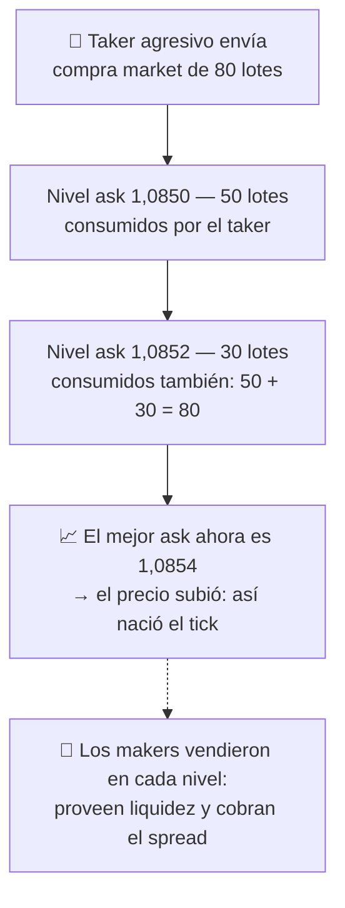

# Lección 2.1 · La mecánica de subasta

| Campo | Detalle |
|---|---|
| ⏱️ Duración estimada | 35–45 min de estudio |
| 🧱 Módulo | [M2 · El Motor del Precio](README.md) |
| ⬅️ Anterior | — (primera lección del módulo) |
| ➡️ Siguiente | [Lección 2.2 · Oferta y demanda](leccion-2-2.md) |

---

## Por qué importa

Cada vez que pulsas "comprar" o "vender", tu orden entra en una subasta electrónica que funciona igual en Tokio, Londres o Nueva York. Quien no entiende esa subasta no entiende tres cosas que le cuestan dinero desde la primera operación: por qué compró a un precio y el gráfico muestra otro un poco peor, por qué cerrar inmediatamente una posición implica una pérdida pequeña aunque el precio no se movió, y por qué el mismo setup cuesta menos de operar a las 10 de la mañana que a las 11 de la noche. El spread no es un detalle técnico: es el alquiler de tu local comercial, se paga en cada operación y aquí vas a ver exactamente quién lo cobra y por qué.

## Concepto

En cualquier mercado hay dos precios simultáneos, no uno:

- **Bid** (*bid*): el precio más alto al que alguien, ahora mismo, te **compra** — cuando tú vendes, vendes al bid.
- **Ask** (*ask / offer*): el precio más bajo al que alguien, ahora mismo, te **vende** — cuando tú compras, compras al ask.

La diferencia entre ambos es el **spread** (*spread*): la distancia mínima entre compradores y vendedores dispuestos a operar. Dentro del libro de órdenes (*order book*, o DOM — *depth of market*) hay una fila de precios con cantidades: arriba del precio actual los vendedores esperando (ask), debajo los compradores esperando (bid).

Y hay dos formas de participar en la subasta:

1. **Taker (comprador agresivo).** Envía una orden *market*: no espera, **come** las órdenes que están en el libro y paga el spread. Aporta urgencia, quita liquidez.
2. **Maker (vendedor pasivo).** Envía una orden *limit*: espera en una fila a un precio concreto, **provee** liquidez y es quien vende el spread. No mueve el precio hasta que alguien con urgencia paga su precio.

**Cómo nace cada tick:** el "precio" que ves en el gráfico es el registro del último acuerdo. Sube cuando una orden taker de compra consume todos los lotes disponibles al mejor ask y tiene que pagar el siguiente nivel — es decir, cuando la urgencia de comprar supera la paciencia de los que venden. Baja por el espejo: urgencia de vender contra paciencia de los que compran. El precio no "es" nada en un instante dado: es la huella que dejan las órdenes agresivas al chocar contra el muro pasivo.

**Visual — así nace un tick** (taker de 80 lotes contra el libro):

## Analogía

Piensa en el mostrador de cambio de divisas de un aeropuerto. La pizarra dice: "Compra EUR 1,05 — Vende EUR 1,10". Esos dos números son el bid y el ask del cambista. Si cambias dólares por euros y enseguida te arrepientes y los vuelves a cambiar, saldrás con menos dinero **aunque el euro no se haya movido un centavo**: pagaste el bid-ask del mostrador dos veces. El cambista no especuló con tu dinero — cobró por *estar ahí* con liquidez lista a las tres de la madrugada. Un bróker de forex hace exactamente eso, solo que con spreads de fracciones de centavo en lugar de 5 %. Y como en el aeropuerto: a las 3 a. m. hay un solo mostrador abierto (spread enorme); a mediodía hay veinte compitiendo (spread mínimo). La hora del día cambia el peaje.

## Cómo se hace: ver el spread como costo con números cerrados

Cotización típica de EUR/USD en sesión líquida *(ilustrativo)*: bid 1,0850 / ask 1,0852 → spread de 2 pips (un pip en EUR/USD = 0,0001).

Compras 1 lote al ask (1,0852) y el precio **no se mueve**. Cierras al instante: vendes al bid (1,0850). Resultado: **−2 pips** (−20 $ con un lote estándar). El mercado no hizo nada; el peaje sí.

**El viaje asimétrico.** Tu entrada long quedó en ask 1,0852 y tu SL/TP se miden sobre el bid (el precio donde te ejecutan al cerrar):

- Para que el TP a +30 pips se ejecute, el bid debe subir desde 1,0850 hasta 1,0882: el mercado debe **recorrer 32 pips**.
- Para que el SL a −30 pips se ejecute, el bid debe bajar desde 1,0850 hasta 1,0822: al mercado le basta con **recorrer 28 pips**.

Mismo trade, mismo riesgo nominal de 30 pips: el camino hacia la ganancia es 4 pips más largo que el camino hacia la pérdida (2 × spread). En un objetivo de 30 pips, el spread se come $2/30 \approx 6{,}7\%$ del recorrido bruto. Con el mismo spread y un objetivo de 8 pips (scalping), sería $2/8 = 25\%$ — la razón estructural por la que el programa desaconseja el scalping hasta tener estadística propia (conecta con el impuesto del ruido de la [Lección 1.4](../mod-01-negocio-trading/leccion-1-4.md)).

**Taker vs maker en la práctica:** la entrada *limit* de tu receta de primera operación es un intento de operar como maker (esperas el precio en tu zona); la salida por SL es inevitablemente taker (cuando salta, alguien te está comprando la posición con urgencia). No puedes ser maker en las salidas de emergencia — por eso el costo total por operación se calcula con el spread completo, ida y vuelta.

## Error común

El error clásico del principiante es creer que "el precio" es uno y que comprar y vender es gratis. De ahí salen dos consecuencias caras: **(1)** mirar el gráfico, ver 1,0850 y no entender por qué su compra se ejecutó en 1,0852 ("¡me robaron!": no te robaron, pagaste el ask); **(2)** elegir horarios y mercados por comodidad y no por costo — el mismo setup a las 23:00 en un par exótico puede pagar 5–10 pips de spread *(ilustrativo)* frente a 1–2 en el solapamiento de Londres-NY, lo que destruye la esperanza antes de que el análisis importe. El segundo error, primo del primero, es pensar que ser siempre maker ("pongo limit y espero") es gratis: el maker paga en otro cambio — se queda sin la operación justo cuando el mercado corre sin él. Taker y maker son dos formas de pagar; no existe el asiento gratis en la subasta.

## Conexión cuantitativa

El spread entra directo en la ecuación del programa: $E_{neto} = E_{bruto} - \text{costos por operación}$. Con la fórmula de la [Lección 1.4](../mod-01-negocio-trading/leccion-1-4.md), un sistema con $E_{bruto} = +0{,}10R$ y un costo de 0,08R queda en $+0{,}02R$ — marginal; el mismo sistema con el doble de spread queda en pérdida. Esta es la primera palanca cuantitativa que controlas como negocio: **elegir cuándo y dónde operas determina el costo fijo de cada venta**, antes de acertar o fallar nada. En la Lección 2.4 verás que la hora del día no es un detalle: es una variable de costos tanto como el bróker elegido.

---

## 🎯 Puntos clave

1. Hay dos precios, no uno: compras al **ask**, vendes al **bid**; la diferencia es el **spread** — el peaje de cada operación.
2. **Taker** = urgencia, come el libro, paga el spread. **Maker** = paciencia, provee liquidez, vende el spread. Toda operación tiene al menos un taker.
3. Cada tick es la huella de órdenes agresivas consumiendo el libro: urgencia compradora mueve el precio arriba; urgencia vendedora, abajo.
4. El viaje del long es asimétrico: para ganar 30 pips el mercado debe recorrer 32; para perder 30 basta con 28 (spread × 2 de diferencia).
5. El spread es proporcionalmente más grave cuanto más corto es tu objetivo: 2 pips sobre 30 = 6,7 %; sobre 8 = 25 %.
6. $E_{neto} = E_{bruto} - \text{costos}$: elegir cuándo y dónde operar es elegir tu costo fijo antes de acertar nada.

## 🔄 Autoevaluación rápida

1. La cotización muestra bid 1,0900 / ask 1,0903. Compras market y cierras 5 segundos después sin que el precio se mueva. ¿Cuánto perdiste en pips y quién lo cobró?
2. Tu sistema apunta a objetivos de 20 pips con un spread de 2 pips ida y vuelta. ¿Qué porcentaje del objetivo se lleva el peaje? ¿Y si el objetivo fuera de 10 pips?
3. Tu amigo dice: "siempre pongo órdenes limit, así no pago spread y soy más inteligente que los takers". ¿Qué le falta a su razonamiento?

Ver respuestas

1. Perdiste 3 pips (el spread). Lo cobró el lado maker del mercado / el proveedor de liquidez: compraste al ask 1,0903 y vendiste al bid 1,0900. Es el costo de haber estado en la mesa, aunque el precio no se moviera.
2. $2/20 = 10\%$ del objetivo con 20 pips; $2/10 = 20\%$ con 10 pips. Cuanto más corto el objetivo, más pesa el costo fijo — mismo efecto del impuesto de ruido de la Lección 1.4, y motivo para no encoger objetivos sin encoger también el mercado donde se paga el spread.
3. Le falta el otro lado del cambio: ser maker implica **no participating cuando el mercado corre** — tus limit se quedan sin llenar en los movimientos buenos (riesgo de oportunidad) y llenan justo cuando el precio te alcanza en los malos (selección adversa). No existe el asiento gratis: el maker no paga el spread en dinero, lo paga en qué operaciones consigue. Un sistema honesto calcula su E asumiendo el spread de ida y vuelta, entre o con limit.

