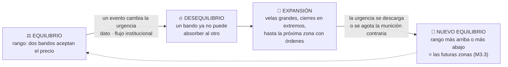

# Lección 2.2 · Oferta y demanda

| Campo | Detalle |
|---|---|
| ⏱️ Duración estimada | 40–50 min de estudio |
| 🧱 Módulo | [M2 · El Motor del Precio](README.md) |
| ⬅️ Anterior | [Lección 2.1 · La mecánica de subasta](leccion-2-1.md) |
| ➡️ Siguiente | [Lección 2.3 · Liquidez](leccion-2-3.md) |

---

## Por qué importa

"¿Por qué sube el precio?" parece una pregunta de respuesta obvia, y la respuesta obvia — "porque hay más compradores que vendedores" — es **falsa**, y esa falsedad produce errores operativos concretos: perseguir movimientos creyendo que "hay mucha gente comprando", confundir volumen con dirección, y no entender por qué el precio a veces se dispara al volver a una zona donde "no había nada". La oferta y demanda reales explican tendencias, rangos, expansiones y el comportamiento de las zonas que marcarás en tu gráfico desde el Módulo 3. Esta lección te da el modelo mental correcto del motor: todo lo demás (liquidez, sesiones, estructura) es este motor funcionando a distintas escalas.

## Concepto

**El precio es el único punto donde la oferta y la demanda acuerdan.** No "empujan" el precio desde fuera: se encuentran en él. Dos hechos elementales generan todo movimiento:

1. **Exceso de demanda a un precio** (hay más órdenes de compra dispuestas que de venta): el precio sube hasta encontrar vendedores suficientes — el equilibrio se restablece **más arriba**.
2. **Exceso de oferta a un precio**: el precio baja hasta encontrar compradores — el equilibrio se restablece **más abajo**.

La frase trampa: en toda transacción hay **exactamente un comprador y un vendedor** — siempre se intercambian las mismas cantidades de compradores y vendedores por contrato. Lo que cambia no es el *número* de participantes sino su **urgencia**: el precio sube cuando los compradores están dispuestos a pagar más (takers agresivos, Lección 2.1) y los vendedores suben sus ask o retiran sus órdenes. "Hay más compradores que vendedores" es imposible; "los compradores son más urgentes que los vendedores" es lo que pasa en toda tendencia.

**Desequilibrio y expansión.** Cuando un lado del mercado recibe un motivo nuevo (un dato, un flujo institucional grande, un cambio en expectativas de tasas), el lado contrario no puede absorberlo al precio actual: el precio **se expande** con velocidad hasta la próxima zona donde haya órdenes esperando. Esas zonas donde quedó "pedido sin servir" — interés de compra que no se llenó en la caída previa, o de venta que no se llenó en la subida previa — son la **demanda residual** y la **oferta residual** que luego verás como soportes y resistencias (M3). El precio vuelve a ellas como el agua vuelve al hueco: ahí está el pedido pendiente.

**Equilibrio y rango.** Cuando ningún lado tiene urgencia dominante, el precio oscila en un rango: cada excursión arriba encuentra vendedores que recortan el movimiento; cada excursión abajo encuentra compradores. El rango no es "el mercado sin energía": es dos bandos equilibrados aceptando el precio actual — y su rotura (cuando un lado finalmente cede) es la señal de que el desequilibrio llegó para quedarse, al menos temporalmente.

**Visual — el bucle motor del precio:**

## Analogía

El caso del mercado agrícola — el de los melocotones, actualizado. Un pueblo compra melocotones cada semana; hay un precio donde la fila de compradores y los cajones de vendedores se equilibran. Una helada arrasa media cosecha: a ese precio ahora hay más compradores con dinero que cajones con fruta — no "más personas": las mismas, con más urgencia y menos producto. El precio sube hasta que algunos compradores desisten (demanda destruida por precio) y algunos productores de zonas vecinas meten camiones extra (oferta atraída por precio). Nuevo equilibrio, más alto. Ahora el detalle operativo: los productores de la zona vecina que **quisieron vender a los nuevos precios pero ya llegaron tarde** — cajones que se quedaron sin plaza — son tu demanda/oferta residual: cuando la helada se repite, el precio ni siquiera necesita una helada fuerte para dispararse de nuevo, porque arriba hay camiones esperando a ese precio. En el gráfico, esos "camiones esperando" son las zonas que marcarás con rectángulos. La lección del caso para tu operativa: los movimientos fuertes nacen de **desequilibrios** (eventos que cambian la urgencia de un lado), no de "mucho volumen" — un volumen enorme en rango puede ser pura rotación sin dirección.

## Cómo se hace: leer un movimiento con el modelo correcto

**Escenario con números cerrados *(ilustrativo)*.** EUR/USD en rango entre 1,0800 y 1,0860 durante tres semanas. Observa tres estados:

1. **Rango (equilibrio):** el precio toca 1,0860 y retrocede; toca 1,0800 y retrocede. Interpretación correcta: en 1,0860 hay vendedores dispuestos (oferta residual del quiebre anterior) y en 1,0800 hay compradores dispuestos. Ningún bando tiene urgencia superior. El volumen puede ser alto: es rotación, no dirección.
2. **Desequilibrio (evento):** el BCE anuncia algo que cambia expectativas de tasas. Los compradores nuevos no aceptan el rango: en dos sesiones el precio atraviesa 1,0860 con velas de cuerpo completo y cierres arriba. Interpretación: la oferta residual de 1,0860 **se consumió** (alguien se llevó todos los "cajones" que esperaban ahí); lo que queda arriba es camino libre hasta la siguiente zona con órdenes (1,0940, el máximo del quiebre de hace dos meses).
3. **Retorno a la zona:** semanas después el precio regresa a 1,0860 **desde arriba**. La pregunta operativa del Módulo 3 será: ¿hay demanda residual nueva que defienda la zona (que ahora funciona como soporte) o el nivel ya está gastado? Esto se responde observando **cómo** vuelve el precio (rápido y con energía = el desequilibrio sigue vivo; lento y con velas pequeñas = no queda nadie).

**El error que este modelo corrige:** un principiante ve el volumen alto del punto 1 y compra "porque hay mucha actividad". El modelo correcto le dice: actividad ≠ urgencia direccional; lo que marca el desequilibrio es **dónde falla el precio** (no logra avanzar en una zona) y **cómo se expande** (velas grandes, cierres en extremos, retrocesos mínimos). Estos síntomas serán tu "radar de expansión" en M3.

## Error común

El error clásico es razonar con la frase falsa: "sube porque hay más compradores que vendedores, entonces si el volumen sube, seguirá subiendo". Consecuencias operativas: comprar tardíos en el clímax de un movimiento (la urgencia ya se descargó en el precio), y no distinguir el volumen de rotación (en rango) del volumen de expansión (con dirección). El segundo error es ignorar **dónde** queda la orden pendiente: marcar soportes/resistencias por "líneas que se ven bonitas" en vez de preguntarse qué interés sin servir quedó en esa zona y de qué lado. La prueba rápida: si no puedes explicar en una frase *quién tiene pedidos pendientes en esta zona y por qué no los sirvió todavía*, no tienes una zona — tienes una línea decorativa.

## Conexión cuantitativa

Todo sistema del programa explota una de las dos caras de este motor: los sistemas de continuación (ruptura, tendencia) operan la **expansión** — necesitan desequilibrio sostenido, y por eso dependen del régimen (M3: el mercado pasa la mayor parte del tiempo en rango *(aproximación)*); los sistemas de reversión operan el **retorno a zonas** de oferta/demanda residual — necesitan que el desequilibrio se agote. En términos de la ecuación del programa: el régimen determina qué lado de $P_w \times W$ estás alimentando. Operar un sistema de expansión en un mercado en rango es cobrar el seguro de un incendio que no ocurre: cada falso rompimiento te cobra 1R. Por eso la primera pregunta de tu análisis diario en la [receta de primera operación](../../03-recursos/laboratorio/receta-primera-operacion.md) es exactamente esta: **¿tendencia o rango?** — el régimen antes que la dirección.

---

## 🎯 Puntos clave

1. El precio es el punto donde oferta y demanda acuerdan; sube/baja solo cuando un lado es **más urgente** que el otro.
2. En cada transacción hay un comprador y un vendedor: "más compradores que vendedores" es imposible; urgencia desigual es lo real.
3. **Desequilibrio → expansión:** el precio corre hasta la próxima zona con órdenes esperando. **Equilibrio → rango:** dos bandos aceptando el precio.
4. Las órdenes que no se llenaron quedan como oferta/demanda **residual**: el precio vuelve a buscarlas — son tus futuras zonas (M3).
5. Volumen alto ≠ dirección: en rango es rotación; la señal de expansión es *cómo* falla o avanza el precio, no cuánto se opera.
6. Tu primera decisión operativa siempre es el **régimen** (tendencia vs rango): decide qué tipo de sistema tiene derecho a ganar hoy.

## 🔄 Autoevaluación rápida

1. Un colega analiza: "el EUR/USD subió 100 pips con volumen récord — claramente hay más compradores que vendedores, seguirá subiendo". Corrige su frase y da la interpretación correcta.
2. El precio queda 10 minutos "clavado" en 1,0860 sin avanzar pese a llegar muchas órdenes de compra. ¿Qué te dice eso sobre la zona y sobre el desequilibrio?
3. En un rango largo, ¿por qué un volumen alto NO es argumento para anticipar la rotura? ¿Qué sí lo sería?

Ver respuestas

1. Frase falsa: en toda transacción hay un comprador y un vendedor — nunca hay "más" de unos que de otros. Interpretación correcta: hubo compradores **más urgentes** (pagaron asks sucesivos, Lección 2.1) que consumieron la oferta disponible en el camino. El volumen récord mide actividad, no garantiza continuación: si ese volumen apareció en velas de clímax con retrocesos grandes, puede ser descarga de urgencia (clímax) en vez de expansión sostenida. Lo que dice "sigue subiendo" es si la oferta residual arriba ya se consumió y quedan zonas vacías.
2. Que lleguen muchas órdenes de compra y el precio no avance significa que en ese nivel hay **oferta esperando en cantidad** (vendedores pasivos absorbiendo a los takers). La zona tiene oferta residual activa; el desequilibrio comprador de hoy no fue suficiente para consumirla. Síntoma de rango/rechazo en 1,0860 — no de acumulación para romper (eso se infiere del comportamiento posterior, no del estancamiento).
3. Porque el volumen en rango es rotación entre bandos equilibrados: puede subir semanas sin producir rotura. Argumento válido para anticipar rotura: (a) disminución del recorrido en cada oscilación (los retrocesos se acortan: la oferta/ demanda del lado contrario se agota), (b) el precio vuelve cada vez menos veces a la zona contraria, (c) velas de expansión contra el borde del rango con cierre fuera + confirmación (eso ya es M3.4). Aun así, la estadística del programa recuerda: la mayoría de las roturas de rango fallan en el primer intento — por eso se opera con confirmación y no por anticipación.

