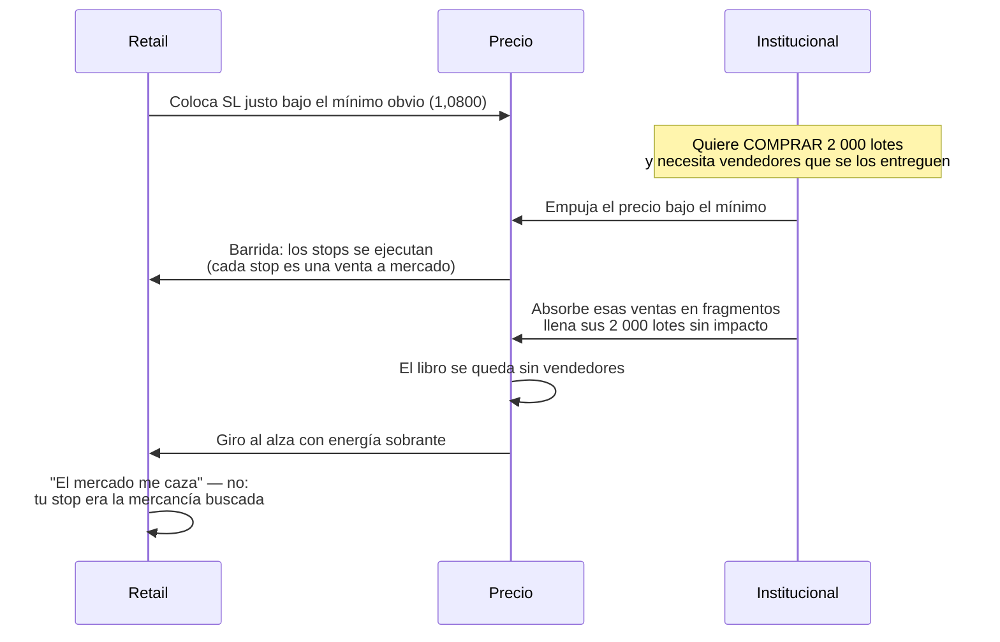

# Lección 2.3 · Liquidez

| Campo | Detalle |
|---|---|
| ⏱️ Duración estimada | 40–50 min de estudio |
| 🧱 Módulo | [M2 · El Motor del Precio](README.md) |
| ⬅️ Anterior | [Lección 2.2 · Oferta y demanda](leccion-2-2.md) |
| ➡️ Siguiente | [Lección 2.4 · Forex y sus sesiones](leccion-2-4.md) |

---

## Por qué importa

Hay una pregunta que todo principiante se hace tarde o temprano: "¿por qué el precio siempre barre mi Stop Loss y DESPUÉS gira a mi favor?". La respuesta no es mala suerte, ni un algoritmo que te vigila personalmente: es **liquidez** — la propiedad del mercado que los grandes operadores necesitan y que tu Stop Loss, colocado donde los coloca todo el mundo, fabrica gratis para ellos. Entender liquidez transforma tu operativa en tres niveles: dónde colocas el SL (estructura, no número redondo), por qué los quiebres de mínimos/máximos obvios a veces son "barridas" que se revierten, y por qué el volumen de tu cuenta no mueve el mercado pero el de una mesa institucional sí necesita buscar contrapartida. Esta lección explica al depredador antes de que conozcas sus mapas (M5).

## Concepto

**Liquidez** (*liquidity*) es la capacidad de ejecutar un tamaño grande de forma inmediata, a un precio justo y sin mover el mercado. Tiene dos caras:

- **Liquidez de costo:** qué tan ancho es el spread (Lección 2.1). Mercado líquido = spread mínimo.
- **Liquidez de profundidad:** cuánto volumen puede absorberse cerca del precio actual sin desplazamiento (*slippage*). Un libro con 500 lotes en cada nivel absorbe una orden grande; un libro con 5 lotes la dispara.

**Quién la provee.** Los *market makers* (creadores de mercado) y los grandes participantes pasivos ponen órdenes limit a ambos lados del precio, cobrando el spread a cambio de estar siempre disponibles. Los institucionales — fondos, mesas de bancos — son en su mayoría **consumidores** de liquidez: necesitan ejecutar tamaños que el libro suelto no puede absorber sin impacto.

**El problema del grande.** Para comprar 2 000 lotes de EUR/USD, comprarlos de golpe "a mercado" los sube él mismo: paga peores precios en cada nivel que consume (impacto de mercado). La solución institucional es **fragmentar** la orden y llenarla donde haya mucha contrapartida concentrada. ¿Dónde se concentra la contrapartida? Exactamente donde el retail coloca sus órdenes:

1. **Stops:** los SL de los compradores viven bajo los mínimos recientes; los de los vendedores, sobre los máximos. Miles de cuentas independientes ponen sus stops en niveles parecidos ("justo debajo del mínimo de ayer", "en el número redondo") — una reserva concentrada de órdenes de venta esperando ser ejecutadas.
2. **Órdenes pendientes:** limit de compra acumulados bajo zonas visibles, limit de venta sobre zonas visibles.

**La barrida (*stop hunt / liquidity sweep*).** Un institucional que quiere COMPRAR en tamaño necesita a alguien vendiéndole. Bajo un mínimo obvio hay una mina: stops de venta + quiebres que atraen vendedores agresivos. Empujar el precio un poco bajo ese mínimo **detona esa liquidez**: los stops se convierten en ventas a mercado, los quiebres atraen más ventas cortas — y toda esa venta tiene un comprador paciente que la está absorbiendo en fragmentos. Cuando el libro se vacía de vendedores, el precio gira con energía sobrante. El mínimo "se respetó a medias": se rompió lo justo para llenar al comprador grande, y esa rotura falsa queda en el gráfico como *sweep* o *falso rompimiento* (M3.4 le pondrá nombre de patrón; M5 lo integrará en estructura).

**Nota de honestidad:** no toda rotura de mínimo es una barrida institucional deliberada — a veces es simplemente un quiebre real que se confirma. La lección operativa no es "todos los mínimos son cebo": es que **los mínimos/máximos obvios concentran liquidez, y eso cambia las probabilidades de qué pasa ahí**. Tu ventaja es colocarte del lado estadístico, no adivinar la intención de nadie.

**Visual — la anatomía de una barrida, segundo a segundo:**

## Analogía

La ballena y el estanque. Un pez pequeño puede girar en cualquier dirección sin levantar una ola: el agua no se entera (tu cuenta de 2 000 $). Una ballena que quiere virar necesita **agua profunda**: si gira en un estanque de medio metro, se quedará encallada en el fondo (tu orden de 2 000 lotes a mercado en un libro fino). ¿Y cómo consigue profundidad la ballena? Va a donde el agua se acumula. En los mercados, el "agua" se acumula en los lugares que todo el mundo mira: mínimos y máximos recientes, números redondos, bordes de rango — porque ahí es donde millones de decisiones independientes convergen sin coordinarse. La ballena no "odia" a los peces pequeños ni los persigue: simplemente necesita nadar donde hay agua, y el agua se junta donde los pequeños ponen sus órdenes. Si tú conoces el mapa de dónde se junta el agua, dejas de poner tu casa (SL) justo en la orilla por donde la ballena pasa a respirar.

## Cómo se hace: el cálculo del institucional, con números cerrados

**Escenario *(todas las cifras ilustrativas, mecánica real)*.** Una mesa quiere comprar 2 000 lotes de EUR/USD. El libro alrededor del precio muestra profundidad típica de 40–80 lotes por nivel en el ask.

- **Opción A — comprar a mercado ahora:** consumiría ~25–50 niveles. Impacto estimado: el precio sube ~10–15 pips solo por su propia compra. Costo de impacto: si el recorrido medio que quería capturar es 40 pips, se comió un cuarto de su beneficio antes de empezar.
- **Opción B — esperar el retroceso a la zona de liquidez:** bajo el mínimo de la semana en 1,0800 hay (estimado) 3 000 lotes en stops de venta + vendedores por quiebre. El precio barre 1,0802 → 1,0795: la rotura detona los stops (ventas a mercado), la mesa absorbe los 2 000 lotes **entre 1,0800 y 1,0793** sin mover el precio más allá del propio barrido. El stop de esa mesa: 1,0778 (bajo la nueva estructura del barrido), y el objetivo: 1,0860.
- **Resultado del barrido:** en 15 minutos el precio toca 1,0793 y gira. El retail que compró el quiebre pierde; el retail que tenía el SL "justo debajo del mínimo de ayer" perdió la posición; la mesa entró donde había vendedores que pagar por su compra.

**Lo que tú aprendes del escenario:** el SL bajo el mínimo obvio de ayer fue la mercancía. Un SL colocado por **estructura del barrido** (bajo 1,0778, el nuevo mínimo del impulso de venta) no estaba en la zona de la ballena — estaba detrás de ella. La diferencia entre ambos SL son 5 pips y una idea de liquidez. En el Módulo 8 esto se formaliza como colocación por estructura, y la [receta de primera operación](../../03-recursos/laboratorio/receta-primera-operacion.md) ya lo insinúa en su Paso 4: la invalidación va donde *tu idea muere*, no donde *duele un número redondo*.

## Error común

El primero es el victimismo: "el mercado me caza los stops, alguien me espía la cuenta". Nadie ve tu cuenta de 2 000 $; lo que ven es la **estadística de miles de cuentas** que ponen stops donde los pones tú. El antídoto no es esconderse: es dejar de colocar stops en los depósitos de liquidez obvios (números redondos exactos, 3–5 pips bajo el mínimo obvio que todo el gráfico ve) y colocarlos donde tu análisis de estructura diga que la idea está muerta — aunque eso signifique arriesgar 28 pips en vez de 15 (y calcular el lote en consecuencia, Paso 5 de la receta). El segundo error es el espejo: "entonces TODO quiebre es falso, vendo siempre las roturas". Falso y peligroso: los quiebres reales existen y son los que alimentan las tendencias (Lección 2.2). La diferencia observacional — barrida y vuelta rápida con energía vs quiebre con cierre sostenido fuera del nivel y retroceso que respeta el nivel roto — es contenido del Módulo 3.4. Antes de tener ese criterio, la regla del programa es simple: **sin posición en la ventana de datos macro y sin anticipar quiebres**.

## Conexión cuantitativa

La liquidez no entendida destruye $E$ por dos puertas. **Puerta 1 — el WR real cae respecto al backtest:** stops colocados en zonas de liquidez elevan la frecuencia de "SL tocado y giro a favor" — cada uno es una pérdida de 1R que el backtest contaba como ganadora (el histórico no siempre distingue tu nivel exacto de stop). **Puerta 2 — el slippage agranda $L$:** cuando tu SL ejecuta dentro de una barrida (mucho movimiento, libro desbalanceado), puedes salir 3–10 pips peor que tu nivel *(ilustrativo)*: una pérdida de 1R se vuelve 1,2R–1,5R. En la ecuación $E = (P_w \times W) - (P_l \times L)$, ambos efectos empujan hacia abajo y no aparecen en el backtest ingenuo. El programa los neutraliza con: colocación por estructura (M8), tamaño que sobreviva el slippage, y la regla de no estar en el mercado en ventanas de datos (Lección 2.6) — donde las barridas y los saltos se concentran.

---

## 🎯 Puntos clave

1. Liquidez = ejecutar tamaño inmediato sin mover el precio; se mide en ancho de spread y profundidad de libro.
2. Los institucionales son consumidores de liquidez: fragmentan sus órdenes y van a donde hay contrapartida concentrada.
3. La contrapartida se concentra donde el retail pone sus órdenes: stops bajo mínimos/sobre máximos obvios y números redondos.
4. La **barrida** detona esa liquidez para llenar una orden grande — es ingeniería de ejecución, no conspiración contra tu cuenta.
5. Tu defensa: SL por **estructura** (donde tu idea muere), nunca en el depósito de liquidez obvio ni en números redondos.
6. No todo quiebre es barrida: los quiebres reales alimentan tendencias. Sin criterio de confirmación (M3.4), la regla es no anticipar.

## 🔄 Autoevaluación rápida

1. ¿Por qué un fondo con 2 000 lotes que comprar NO puede simplemente apretar "comprar a mercado", aunque el mercado sea el más líquido del mundo?
2. Tu SL está en 1,0800 (exacto) y el mínimo visible de ayer fue 1,0802. ¿Qué dos problemas tiene esa colocación y qué le preguntarías a tu análisis antes de moverlo?
3. El precio rompe un mínimo importante y en 20 minutos vuelve por encima de él. ¿Qué dos lecturas son posibles y qué las distingue?

Ver respuestas

1. Porque su propia orden consumiría decenas de niveles del libro: pagaría peores precios en cada nivel (impacto de mercado, ~10–15 pips en el ejemplo) y se comería una parte del beneficio antes de estar posicionado. Los grandes fragmentan y llenan donde hay contrapartida concentrada — que es justo donde el retail acumula stops y pendientes.
2. Problema 1: está en un **número redondo** (nivel psicológico con liquidez extra). Problema 2: está a 2 pips del mínimo obvio de ayer — el depósito clásico de stops de la masa; su stop es parte de la mina que la barrida viene a detonar. La pregunta a tu análisis: ¿dónde muere realmente mi idea? Si tu escenario era "compra en soporte, invalidada si pierde la zona", el SL va **bajo la estructura del barrido potencial** (bajo el mínimo del impulso que rompería), no pegado al nivel visible — y el lote se recalcula con el Paso 5 de la receta para que el riesgo siga siendo 1 %.
3. Lectura 1 — barrida: rotura que detona liquidez bajo el mínimo, el comprador institucional llena ahí, el precio gira con energía (vuelta rápida, velas de reacción fuertes). Lectura 2 — quiebre real con *throwback*: el precio rompe, retrocede a retestear el nivel roto (ahora resistencia→soporte por polaridad) y continúa. Lo que distingue: el **cierre** y el comportamiento del retesteo — barrida = cierre vuelve rápido dentro + giro con impulso; quiebre sano = cierre sostenido fuera del nivel, retroceso lento que respeta el nivel y continuación. El criterio de confirmación en 3 pasos (M3.4) formaliza esta lectura; sin él, no se anticipa nada.

