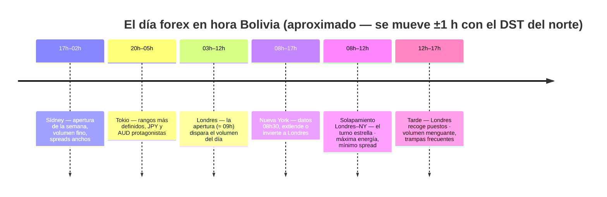

# Lección 2.4 · Forex y sus sesiones

| Campo | Detalle |
|---|---|
| ⏱️ Duración estimada | 45–60 min de estudio (incluye construir tu reloj de sesiones en el laboratorio) |
| 🧱 Módulo | [M2 · El Motor del Precio](README.md) |
| ⬅️ Anterior | [Lección 2.3 · Liquidez](leccion-2-3.md) |
| ➡️ Siguiente | [Lección 2.5 · Personalidad de cada mercado](leccion-2-5.md) |

---

## Por qué importa

El forex abre domingo por la tarde y cierra viernes por la tarde — pero no es un mercado uniforme de 120 horas: es cuatro turnos de fábrica que se pasan la posta alrededor del planeta, con un pico de actividad cuando Londres y Nueva York coinciden. Para tu operativa esto no es cultura general: **la hora del día determina el spread que pagas, la volatilidad que puedes capturar y el ruido que te confunde**. El mismo setup ejecutado en el solapamiento Londres-NY y a las 11 de la noche son dos negocios distintos con el mismo nombre. Y hay una ventaja geográfica que casi nadie te cuenta: tu huso horario (Bolivia, UTC-4) coincide con el de Nueva York durante la mayor parte del año — el turno más importante del mercado pasa en tus horas normales de vigilia, no de madrugada.

## Concepto

**Los pares.** En forex siempre compras una moneda vendiendo otra: EUR/USD a 1,0850 significa 1 euro cuesta 1,0850 dólares. La primera moneda es la **base**, la segunda la **cotización** (*quote*). Familias:

- **Majors:** el dólar con las grandes economías (EUR/USD, USD/JPY, GBP/USD, USD/CHF, USD/CAD, AUD/USD, NZD/USD) — máxima liquidez, spreads mínimos.
- **Minors/crosses:** sin dólar (EUR/GBP, EUR/JPY, GBP/JPY) — líquidos, spreads algo mayores.
- **Exóticos:** mayor + moneda emergente (USD/MXN, USD/TRY) — spreads anchos, movimientos violentos, costos que devoran sistemas *(el programa los evita durante la formación)*.

**El pip** (*pip, percentage in point*): la unidad mínima convencional de movimiento. En EUR/USD y la mayoría de pares es la cuarta decimal (0,0001); en los pares con yen, la segunda (0,01). Ojo con la **pipette** (la quinta decimal que muestran los brókeres: 0,00001 = décima de pip) — no confundas 15 pips con 15 pipettes al fijar tu SL: un error de ×10 en el riesgo.

**El lote.** 1 lote estándar = 100 000 unidades de la base → en EUR/USD, 1 pip = 10 $. Mini (0,1) = 1 $/pip. Micro (0,01) = 0,10 $/pip. La receta de tu primera operación ya usó esto en su Paso 5: el lote no se elige, **se calcula**.

**Las sesiones** (horarios aproximados en UTC; se mueven ±1 h con el horario de verano del norte):

| Sesión | UTC (aprox.) | Bolivia UTC-4 (aprox.) | Carácter |
|---|---|---|---|
| 🇦🇺 Sídney | 21:00–06:00 | 17:00–02:00 | Apertura de la semana; volumen fino, spreads anchos |
| 🇯🇵 Tokio | 00:00–09:00 | 20:00–05:00 | Rangos más definidos; JPY y AUD protagonistas |
| 🇬🇧 Londres | 07:00–16:00 | 03:00–12:00 | La apertura (≈ 09:00 Bolivia) dispara el volumen del día; expansiones y barridas de la sesión asiática |
| 🇺🇸 Nueva York | 12:00–21:00 | 08:00–17:00 | Datos de EE. UU. (08:30 Bolivia); continua el impulso o invierte el de Londres |

**El solapamiento Londres–NY (≈ 12:00–16:00 UTC = 08:00–12:00 Bolivia)** es el turno estrella: el mayor volumen y los menores spreads del día. Los datos del BIS (encuesta trienal 2022 *(snapshot)*) lo explican: Reino Unido concentra ≈ 38 % del volumen global de divisas y EE. UU. ≈ 19 % — cuando ambos turnos coinciden, el libro está más lleno. Después del cierre de Londres (≈ 16:00 UTC), el volumen se desinfla: los movimientos de última hora son trampas frecuentes para principiantes.

**Visual — tu día forex, en tu reloj (Bolivia, UTC-4):**

**El ciclo típico del día** (patrón, no ley): la sesión asiática construye un rango → la apertura de Londres lo rompe o barre sus extremos (liquidez, Lección 2.3) → la dirección de Londres se extiende o se invierte en Nueva York con los datos → el cierre de Londres sella el recorrido y la tarde se aplaca. Conocer este guion no te da señales: te da **expectativas correctas** sobre qué tipo de comportamiento puede ocurrir a cada hora.

## Analogía

El mercado global de divisas es una feria permanente de cuatro turnos. El turno de madrugada (Sídney-Tokio) es un mercado de barrio: pocos puestos, precios que solo se mueven si llevas el carro lleno, y el vendedor te cobra más margen porque no hay competencia al lado (spreads anchos, rangos finos). A las 09:00 hora Bolivia abren los almacenes grandes de Londres: entran camiones, el pasillo se llena, los precios empiezan a moverse de verdad y el margen del vendedor se encoge a fuerza de competencia (volumen máximo, spreads mínimos). A las 08:00–12:00 Bolivia coinciden los almacenes de Londres y los de Nueva York: la feria entera en pie — ese es tu horario de oro. A las 13:00 hora Bolivia, Londres empieza a recoger puestos: la feria sigue abierta pero vaciándose, y los últimos remates a veces se pagan caros. Operar fuera de tu horario de oro no es imposible — es **pagar alquiler más alto por un local con menos clientes**.

## Cómo se hace: tu reloj de sesiones y el valor del pip, con números cerrados

**1. Ancla tu reloj.** Bolivia es UTC-4 todo el año (sin horario de verano). Nueva York es UTC-4 en su horario de verano y UTC-5 en invierno boreal; Londres oscila entre UTC+0 y UTC+1. Consecuencia práctica: durante la mayor parte del año tu reloj y el de NY coinciden; en invierno del norte todo el bloque de EE. UU. se desfasa una hora. Regla del programa: **las horas se confirman en el calendario económico cada semana**, no se memorizan de una vez para siempre.

**2. El valor del pip en dinero.** EUR/USD comprado con 1 lote estándar: 1 pip = 10 $. Ejemplo cerrado: entras long en 1,0850 y el TP está en 1,0890 — 40 pips de recorrido:
- 0,01 lote (micro): 40 × 0,10 $ = **4 $**
- 0,10 lote: 40 × 1 $ = **40 $**
- 1 lote: 40 × 10 $ = **400 $**

Con riesgo fijo del 1 % sobre 2 000 $ (20 $) y un SL de 25 pips: $20 / (25 \times 10) = 0{,}08$ lotes — el mismo cálculo del Paso 5 de la receta. En pares con yen la cuarta decimal no existe: USD/JPY en 150,00 → 1 pip = 0,01 → con 1 lote (100 000 unidades), 1 pip ≈ 100 000 × 0,01 / 150 ≈ **6,67 $** *(el valor del pip en pares no-USD-quoted depende del tipo de cambio; tu plataforma lo calcula — tú solo debes saber que NO es siempre 10 $)*.

**3. Elegir ventana de operativa.** Con la agenda del laboratorio (auditoría personal de M1) sobre la mesa: si tus bloques de energía alta son 08:00–12:00 Bolivia, tu ventana natural ES el solapamiento Londres-NY — capital y horario coinciden. Si solo tienes noches, tu ventana real es Tokio (rangos) o el final de NY — y eso condiciona el estilo: los sistemas de ruptura de rango asiático tienen su hábitat en la apertura de Londres; los de rango puro, en Asia. Tu reloj personal no es una limitación estética: es una **variable del diseño de tu sistema** (M7).

## Error común

El primero: **operar horas muertas por disponibilidad** — el spread de EUR/USD en la madrugada puede duplicarse o triplicarse *(ilustrativo)* y el rango se encoge: pagas más peaje por recorridos más cortos, la combinación exacta que hunde $E$ (Lección 2.1). El segundo: **confundir pipette con pip** al fijar SL/TP — un SL "de 15" que en realidad son 15 pipettes (1,5 pips) muere con el primer respiro del mercado; uno "de 15" que en realidad son 150 pips multiplica ×10 tu riesgo real. Verifica siempre con el calculador de tamaño de tu plataforma ANTES de enviar la orden. El tercero: creer que "forex cierra a medianoche" y quedar atrapado en los fines de semana (el mercado cierra viernes ≈ 18:00 Bolivia y reabre domingo ≈ 18:00 Bolivia, con **gap** de apertura: el precio de lunes puede saltar respecto al de viernes — riesgo *overnight* que la receta y el M8 gestionan con reglas de no-permanencia).

## Conexión cuantitativa

La hora del día entra en la ecuación como costo y como varianza. **Como costo:** mismo sistema, objetivo 30 pips — en el solapamiento paga ~1,5 pips de spread (5 % del objetivo); en la madrugada paga ~4 pips (13 %) *(ilustrativo)*: la diferencia de horario cuesta 8 puntos porcentuales de $E$ bruto sin tocar un solo parámetro técnico. **Como varianza:** fuera de las sesiones líquidas, los movimientos finos y sin energía alimentan el *whipsaw* (el vaivén que mata sistemas de ruptura). Esta es la segunda palanca de negocio que controlas sin tocar el sistema: **mercado líquido + sesión líquida + ejecución disciplinada** — y es gratis, solo exige respetar el reloj. En el laboratorio de este módulo construyes tu reloj personal y lo dejas pegado junto a la pantalla; en la misión lo validas con observación en vivo.

---

## 🎯 Puntos clave

1. En forex compras una moneda vendiendo otra: base/quote; majors, minors y exóticos se diferencian por liquidez y costo.
2. Pip = 0,0001 (pares con yen: 0,01); lote estándar = 10 $/pip en EUR/USD, micro = 0,10 $/pip — el lote **se calcula**, nunca se elige a ojo.
3. Cuatro sesiones alrededor del sol; el solapamiento Londres–NY (08:00–12:00 Bolivia aprox.) concentra el mayor volumen y los menores spreads.
4. Londres ≈ 38 % y NY ≈ 19 % del volumen global *(BIS 2022, snapshot)* — por eso su coincidencia es el turno estrella.
5. Ciclo típico: Asia construye rango → Londres lo rompe o lo barre → NY extiende o invierte → cierre de Londres desinfla la tarde.
6. Tu huso (UTC-4) coincide con NY la mayor parte del año: tu horario de oro está en tu vigilia normal. Las horas se verifican cada semana por DST.

## 🔄 Autoevaluación rápida

1. Compras USD/JPY con 1 lote en 150,00 y cierras en 150,35. ¿Cuántos pips ganaste y aproximadamente cuántos dólares (con el valor de pip aproximado de la lección)?
2. Tu agenda solo da bloques de estudio de 21:00 a 23:00 Bolivia. ¿Qué sesión estás viendo, qué carácter tiene, y qué implicación tiene para el tipo de sistema que podría funcionar ahí?
3. El viernes a las 17:30 Bolivia tienes una posición long en EUR/USD con +25 pips. ¿Qué riesgo corres si la mantienes durante el fin de semana y cuál es la práctica del programa?

Ver respuestas

1. 150,35 − 150,00 = 0,35 → en USD/JPY 1 pip = 0,01 → **35 pips**. Valor del pip: 100 000 × 0,01 / 150 ≈ 6,67 $ → ganancia ≈ 35 × 6,67 ≈ **233 $** (aproximación; el valor exacto varía con el tipo de cambio y lo calcula la plataforma).
2. 21:00–23:00 Bolivia ≈ fin de Nueva York / inicio de Sídney–Tokio: volumen decreciente, spreads que se ensanchan, rangos finos. Implicación: los sistemas de ruptura y expansión están fuera de su hábitat (necesitan el motor de Londres-NY); un sistema de rango/reversión es más coherente con esa ventana — o mejor: usar esos bloques para estudio/análisis y journal, y ejecutar en los 2-4 h del solapamiento si tu vida lo permite. La ventana horaria es una variable de diseño del sistema (M7), no un detalle.
3. Riesgo *overnight* de fin de semana: el mercado cierra viernes ≈ 18:00 Bolivia y no puedes salir hasta el domingo por la noche; noticias del fin de semana (geopolítica, decisiones de bancos centrales, quiebras) se descuentan en el **gap** de apertura — tu SL no te protege dentro del gap: puedes abrir lunes 40 pips por debajo de tu stop y perder 2R por una posición "de 1R". Práctica del programa: no mantener posiciones durante el fin de semana durante toda la formación (y después, solo si el plan lo contempla explícitamente con tamaño reducido).

