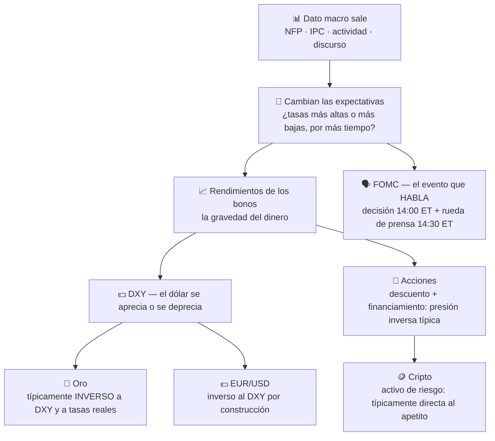

# Lección 2.6 · Calendario macro e intermercados

| Campo | Detalle |
|---|---|
| ⏱️ Duración estimada | 45–60 min de estudio |
| 🧱 Módulo | [M2 · El Motor del Precio](README.md) |
| ⬅️ Anterior | [Lección 2.5 · Personalidad de cada mercado](leccion-2-5.md) |
| ➡️ Siguiente | — (cierra el módulo; vuelve al [README](README.md) para laboratorio, misión y quiz) |

---

## Por qué importa

Hay días en que tu análisis, tu zona y tu setup importan menos que un número que se publica en Filadelfia a las 08:30. Los datos macro (empleo, inflación, decisiones de tasas) cambian en minutos las expectativas que sostienen TODOS los precios a la vez — y un trader que no mira el calendario es un conductor que cruza cruces sin mirar el semáforo: puede salir ileso diez veces y perderlo todo en la undécima. Esta lección te da las tres piezas: **qué** eventos mueven el mercado y cuándo salen (en tu hora), **cómo** se encadenan entre activos (la cadena causal que une tasas, DXY, oro, acciones y cripto), y **qué hacer** tú durante esos eventos — que, durante toda la formación, es la misma respuesta: no estar dentro.

## Concepto

**La cadena causal — el gráfico eléctrico del mundo.** El motor último de casi todo es la **tasa de interés** (el precio del dinero) y su expectativa:



Un dato de inflación más alta de lo esperado → el mercado espera tasas más altas por más tiempo → los rendimientos suben → el dólar se aprecia → el oro (que no paga interés y se cotiza en dólares) típicamente cae → las acciones (más caras de financiar, descuento a tasas mayores) típica presión a la baja → la cripto (activo de riesgo y liquidez) típicamente cae. La palabra operativa es **típicamente**: estas son correlaciones de régimen normal, no leyes físicas.

**Los tres eventos que mueven la semana** (hora del Este de EE. UU.; durante el horario de verano del norte, la hora de Bolivia coincide con la del Este; en invierno boreal, +1 h — verifica cada semana):

| Evento | Qué es | Cuándo | Hora de salida | Comportamiento típico |
|---|---|---|---|---|
| **NFP** (*Non-Farm Payrolls*) | Empleo no agrícola de EE. UU.: el termómetro de la economía más importante | Primer viernes del mes | 08:30 ET | Movimientos de decenas de pips en segundos *(ilustrativo)*; spread se multiplica; zigzag violento antes de definir dirección |
| **IPC/CPI** (*Consumer Price Index*) | Inflación al consumidor: el dato que la Fed dijo que mira | Mensual, ~mediados de mes | 08:30 ET | Igual de violento que NFP; su sorpresa recalibra la ruta completa de tasas |
| **FOMC** (decisión de la Fed) | Tasa de interés + comunicado + rueda de prensa de Powell | 8 veces al año (calendario oficial) | Decisión 14:00 ET · rueda de prensa 14:30 ET | Doble evento: el número y luego el matiz verbal; whipsaw clásico — el primer movimiento suele corregirse mientras se digiere el comunicado |

**Intermercados — el mapa de correlaciones típicas** *(régimen normal, no leyes)*:

| Par de activos | Correlación típica | Lógica |
|---|---|---|
| DXY ↔ oro | Inversa | El oro se cotiza en dólares: dólar fuerte = oro más caro para el resto del mundo |
| Rendimientos bonos ↔ oro | Inversa | El oro no paga interés: tasas reales altas suben el costo de oportunidad de tenerlo |
| DXY ↔ EUR/USD | Inversa (por construcción) | El EUR pesa ~58 % en el índice |
| Tasas esperadas ↔ acciones | Inversa (típica) | Mayor tasa de descuento + costo de financiamiento = valoraciones bajo presión |
| Apetito de riesgo ↔ cripto | Directa (típica) | La cripto opera como activo de riesgo/liquidez en regímenes normales |

**Los dos avisos de honestidad que hacen profesional a esta lección:** (1) las correlaciones **cambian de signo por régimen** — en pánicos de liquidez "todo se vende a la vez" (oro y acciones caen juntos porque todos necesitan dólares/caja); (2) en ciertos regímenes, "mala noticia económica = buenas noticias para acciones" (si implica tasas antes/bajas). Por eso el programa usa el calendario para **protección** (no estar dentro) y para **contexto** (entender el día), jamás para adivinar el número.

## Analogía

El mercado es una flota de barcos amarrados al mismo muelle — el muelle es la tasa de interés. Las amarras son las expectativas. Cada dato macro es un mar de fondo que levanta o baja el muelle entero: no importa cuán firme esté tu barco (tu análisis técnico de XAU/USD) — si el muelle sube, todos los barcos suben con él; si se hunde, todos bajan. El trader que ignora el calendario elige su barco mirando solo el casco, sin preguntarse qué hará el agua esta tarde. Y el FOMC es el almirante hablando por megafono a la flota entera: no solo importa QUÉ dice, importa CÓMO lo dice — por eso los piratas prudentes sacan las velas (cierran o reducen posición) mientras habla, en vez de apostar a adivinar la frase.

## Cómo se hace: el protocolo de semana con eventos, paso a paso

**Lunes, 10 minutos — armar el mapa de la semana:**

1. Abre un calendario económico (cualquiera con filtros de impacto y conversión a tu huso).
2. Filtra **alto impacto** para USD (y la moneda de tu par principal). Anota en tu journal: día, evento, **hora Bolivia**, consenso esperado.
3. Marca en tu reloj de sesiones (laboratorio de este módulo) las ventanas rojas: **15 minutos antes y después** de cada evento de alto impacto — mínimo. Para FOMC: desde 30 min antes de la decisión hasta 30 min después de la rueda de prensa.

**Protocolo de cada evento (la regla del programa):**

```text
REGLA MACRO DE FORMACIÓN — no negociable
1. Sin posiciones abiertas dentro de la ventana roja del evento.
2. Si hay posición: cerrarla o (solo si el plan de M8 lo permite y falta poco)
   asegurar el SL y REDUCIR tamaño — nunca dejar tamaño completo con SL apretado.
3. No se "opera el dato": no adivinas el número ni compras el primer spike.
4. El spread en la ventana roja está multiplicado (de ~1,5 pips a 10–20
   *(ilustrativo)*): entrar ahí es pagar ×10 el peaje con la visibilidad ×0.
5. Después del evento: dejar pasar el zigzag de digestión y leer el gráfico
   CON el dato ya dentro — el setup de post-evento llega con confirmación (M3.4).
```

**Ejemplo cerrado del costo de ignorar la regla** *(ilustrativo, mecánica real)*: posición long de 0,08 lotes en EUR/USD con SL de 25 pips = 20 $ de riesgo. NFP a las 08:30 Bolivia. El dato sorprende: el precio salta 60 pips en 40 segundos **sin tocar tu SL exacto** — el salto pasa por encima (gap intra-vela) y tu SL ejecuta con *slippage* a 38 pips: −30,4 $ en vez de −20 $ (1,5R por una posición de 1R). Dos minutos después el precio vuelve a tu entrada original: la pérdida no era necesaria — era la matrícula de no mirar el calendario. El mismo trade, cerrado el martes a las 08:15, habría tenido las mismas probabilidades sin el semáforo en rojo.

## Error común

El primero: **operar el dato por adrenalina** — "el NFP va a ser malo, vendo antes de que salga". Ese trade tiene esperanza negativa estructural: el consenso ya está en el precio, la sorpresa es 50/50, el spread de la ventana te cobra ×10 y el zigzag posterior puede barrer ambas direcciones. Es la lotería con peaje. El segundo: **el "ya pasó" prematuro** — cerrar la ventana 30 segundos después del número: el FOMC tiene DOS eventos (decisión y rueda de prensa) y el post-NFP tiene reversión de digestión; la ventana cerrada tarde es la barata. El tercero, más sutil: **usar el intermercados como señal de trading** — "el DXY sube, entonces vendo oro AHORA". Las correlaciones típicas son contexto probabilístico, no gatillos: se usan para entender el día y para cuestionar tu setup ("¿mi long de oro tiene sentido si los rendimientos están subiendo con fuerza?"), nunca como sistema en sí mismo. La regla que ata todo: en formación, el calendario solo autoriza dos acciones — **alejarte del mercado** y **explicarte lo que ya pasó**.

## Conexión cuantitativa

Los eventos macro atacan los tres términos de $E$ a la vez. **$L$:** el slippage intra-vela puede convertir 1R en 1,3R–1,5R — tu pérdida media deja de ser la presupuestada. **Costos:** el spread de ventana multiplica el peaje (Lección 2.1) justo cuando tu visibilidad es mínima. **$P_w$:** el zigzag de digestión convierte la dirección "correcta" en moneda al aire en el minuto 2 — tu acierto deja de depender del análisis. Sumadas: operar ventanas rojas es operar con $E$ confiscado. En cambio, la semana con calendario revisado protege la distribución completa de resultados por cero costo: es la única mejora de $E$ del programa que se consigue **sin operar**. Cuando en M8 construyas los frenos en cascada, la ventana macro será un freno automático más; cuando en M9 audites tu journal, verás cuántas de tus peores operaciones nacieron en una ventana roja que no miraste.

---

## 🎯 Puntos clave

1. La cadena causal: dato → expectativas de tasas → rendimientos → DXY → oro/acciones/cripto. "Típicamente", no siempre: las correlaciones cambian por régimen.
2. Los tres eventos que mueven la semana: NFP (primer viernes, 08:30 ET), IPC (~mediados de mes, 08:30 ET), FOMC (8 al año, 14:00 ET + rueda 14:30 ET). En verano del norte, hora del Este = hora de Bolivia.
3. La regla macro de formación: sin posiciones en la ventana roja (15 min antes/después; FOMC: 30/30 con rueda incluida).
4. Nunca se opera el dato: consenso ya en precio, sorpresa 50/50, spread ×10, zigzag de digestión.
5. El intermercados es contexto, no señal: explica y cuestiona setups; no dispara entradas.
6. La revisión del calendario es la única mejora de $E$ del programa que se logra sin operar — 10 minutos de lunes protegen la semana.

## 🔄 Autoevaluación rápida

1. El IPC de EE. UU. sale muy por encima del consenso. Recorre la cadena causal completa y nombra el efecto típico en: rendimientos, DXY, oro, EUR/USD y acciones. ¿Qué palabra califica todo ese pronóstico y por qué?
2. Tienes un long de oro con +15 pips "de seguridad" (SL a −20) y a las 08:25 Bolivia sale el NFP. ¿Qué ordena la regla macro del programa y qué riesgo corre tu SL exacto durante el evento?
3. Tu amigo operó el FOMC "y le fue bien: adivinó la dirección". ¿Qué le responderías con la lógica de esperanza (no con la moralina)?

<details>
<summary>Ver respuestas</summary>

1. IPC > consenso → expectativa de tasas más altas/más tiempo altas → rendimientos de bonos suben → DXY se aprecia → oro típicamente cae (no paga interés, más caro en dólares), EUR/USD típicamente cae (dólar fuerte), acciones con presión a la baja (descuento y financiamiento). Todo el pronóstico se califica con **típicamente**: en regímenes anómalos (pánico de liquidez, Fedhawk invertida) los signos pueden cambiar — por eso es contexto de protección, no sistema de señales.
2. La regla ordena: cerrar la posición antes de la ventana (15 min antes = 08:15) o, si el plan lo permite, asegurar SL y reducir tamaño — con posición de +15 pips lo limpio es salir y dejar el evento pasar. Riesgo del SL exacto durante NFP: el precio puede saltar en gap intra-vela SIN ejecutar en tu nivel exacto (slippage de 5–15 pips) → pérdida de 1,5R o más; y el spread de ventana hace que el "SL de 20" se dispare peor en la ejecución. La protección del SL no es absoluta en saltos: solo el no-estar-dentro lo es.
3. Que su resultado es una observación de varianza, no una estrategia: con sorpresa 50/50, spread ×10 y zigzag post-dato, la $E$ de operar el dato es negativa ANTES de su suerte; una muestra de 1 (o de 20) no estima nada (N ≥ 100, Lección 1.4). Con suficientes amigos operando FOMC, siempre habrá alguno que lo adivine 3 veces seguidas (igual que el bot de la Lección 1.4): es fotografía del ganador, no evidencia de esperanza. Y el día que su suerte se agote, operará el dato con el mismo convencimiento y el doble de tamaño — el final clásico de la estrategia sin E.

</details>
