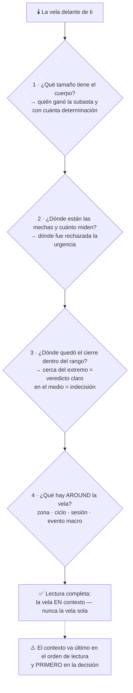

# Lección 3.1 · Velas japonesas

| Campo | Detalle |
|---|---|
| ⏱️ Duración estimada | 40–50 min de estudio |
| 🧱 Módulo | [M3 · Anatomía del Gráfico](README.md) |
| ⬅️ Anterior | — (primera lección del módulo) |
| ➡️ Siguiente | [Lección 3.2 · Los 4 ciclos del mercado](leccion-3-2.md) |

---

## Por qué importa

El gráfico de velas es el alfabeto del trader: toda la técnica posterior — ciclos, zonas, patrones, estructura (M5) — se escribe con estas letras. Leerlas mal produce los dos errores fundacionales del principiante: ver "señales" en velas sueltas sin contexto, y no entender que una vela NO es un instante sino un **resumen de una subasta completa**. Una vela diaria es la fotografía comprimida de 24 horas de órdenes; saber qué comprime — cuerpo, mechas, posición del cierre — es lo que convierte un dibujo bonito en información operativa. Y hay una promesa que esta lección cumple mejor que cualquier otra: después de ella, tu gráfico desnudo (sin indicadores) empezará a hablarte.

## Concepto

**Anatomía.** Cada vela resume cuatro precios de su período: **OHLC** — *Open* (apertura), *High* (máximo), *Low* (mínimo), *Close* (cierre). De ahí salen sus dos componentes:

- **Cuerpo:** de la apertura al cierre. Mide **quién ganó la subasta** del período: cuerpo alcista (verde/hueco) = el cierre quedó arriba de la apertura; cuerpo bajista (rojo/lleno) = al revés. El tamaño del cuerpo mide la **determinación**: cuerpo grande = un bando dominó todo el período; cuerpo pequeño = equilibrio.
- **Mechas** (o sombras): del cuerpo al máximo y al mínimo. Miden **el viaje rechazado**: dónde la urgencia de un bando fue a buscar precio y fue devuelta. Mecha inferior larga = los vendedores empujaron abajo y los compradores los devoraron (la compra agresiva devolvió el precio); mecha superior larga = el espejo. La mecha es la cicatriz del rechazo.

**El cierre es el precio más importante de los cuatro.** Es el veredicto final del período: el último acuerdo con toda la información disponible. Por eso casi todos los niveles y confirmaciones del programa se evalúan en **cierres**, no en toques intra-vela (un toque del nivel que luego cierra dentro puede ser una barrida, Lección 2.3; un cierre fuera del nivel es un acuerdo del mercado entero).

**Fractalidad real.** El mercado es fractal y las velas lo demuestran con matemática literal: **cada vela contiene a su vez un gráfico completo**. Abre la vela diaria de ayer en H1 y tendrás 24 velas con su propia historia de subasta; la vela H1 se abre en M15 y hay otras 4 dentro; y así hasta los segundos. Esto tiene una consecuencia operativa dura que ya conoces de la [Lección 1.4](../mod-01-negocio-trading/leccion-1-4.md): el patrón "encajona" pero el ruido y los costos **no se encajonan proporcionalmente** — la misma formación visual paga peajes relativos mayores cuanto más bajo el marco. Las velas te dejan ver lo mismo en todas las escalas; la estadística te dice en cuáles conviene operar.

**Historia mínima** (contexto, no adorno): las velas nacieron en el Japón del siglo XVIII para arroz en el mercado de Dojima (Osaka) — considerado el primer mercado de futuros organizado del mundo. Munehisa Homma, comerciante de arroz de Sakata, sistematizó la lectura de patrones de precio y sentimiento; su manual es el ancestro directo de lo que haces tú hoy con EUR/USD. La tradición llegó a Occidente con Steve Nison (1991). La lección de fondo: el análisis de precio lleva 300 años funcionando sobre el mismo motor — la subasta que estudiaste en M2.

**Visual — el método de lectura en 4 preguntas (siempre en este orden):**

## Analogía

Cada vela es el **acta de un partido** comprimida en una línea. El cuerpo es el marcador final (quién ganó y por cuánto); las mechas son los momentos en que el perdedor estuvo ganando y el público se levantó de la silla antes de que el resultado volviera a su cauce. Una vela con cuerpo enorme y mechas mínimas: partido aplastante, dominio de principio a fin. Una vela doji (apertura ≈ cierre, cuerpo casi nulo): empate con prórroga — la subasta quedó en tablas y el veredicto se posterga al siguiente período. Y como en el fútbol, **el acta sin contexto no dice nada**: un 2-1 puede ser un triunfo cómodo, una remontada heroica o un partido aburrido decidido en el descuento. La misma vela alcista es "confirmación" en un nivel de demanda con expansión y "nada" a mitad de rango sin energía. Primero el contexto (ciclos, zonas — esta lección y las siguientes), después la vela: nunca al revés.

## Cómo se hace: leer una vela en 4 preguntas, con el día real descompuesto

El método del programa para leer CUALQUIER vela, en orden fijo:

1. **¿Qué color/tamaño tiene el cuerpo?** → quién ganó el período y con cuánta determinación.
2. **¿Dónde están las mechas y cuánto miden respecto al cuerpo?** → dónde fue rechazada la urgencia. Mechas en la parte inferior = reacción compradora abajo (protección de demanda); arriba = reacción vendedora.
3. **¿Dónde quedó el cierre dentro del rango?** → cerca del extremo = veredicto claro; en el medio = indecisión (el cierre es el 60 % de la lectura).
4. **¿Qué hay AROUND la vela?** (nivel, tendencia, sesión, evento) → el contexto que decide si la vela significa algo.

**Descomposición con números cerrados.** Vela diaria de XAU/USD: Open 4 000,0 · High 4 024,0 · Low 3 994,0 · Close 4 020,0. Cuerpo: 4 020 − 4 000 = **+20 $** (alcista, determinación media-alta). Mecha superior: 4 024 − 4 020 = 4 $ (rechazo leve arriba). Mecha inferior: 4 000 − 3 994 = **6 $** (rechazo abajo). Cierre a 26/30 del rango (cerca del máximo): veredicto comprador claro. Lectura completa: el día abrió, los vendedores probaron 3 994 y fueron absorbidos (mecha inferior 6 $), el precio expandió al alza y **cerró pegado al máximo**: los compradores aún tenían urgencia al cierre — la subasta no se descargó dentro del día. Para el sesgo del día siguiente, esa vela pesa más que tres señales de indicador; y si además cerró sobre una zona de demanda H4 marcada (Lección 3.3), las preguntas del análisis diario de tu [receta](../../03-recursos/laboratorio/receta-primera-operacion.md) ya tienen respuesta: régimen + zona + dirección.

**El ejercicio fractal (hazlo, no lo leas):** abre la misma vela diaria en M15. Mira cómo el "cuerpo" se desarma en horas de compra, un tramo de mecha inferior se vuelve la caída de las 09:30 (¿un dato? — revisa tu calendario de M2), y el cierre pegado al máximo es la sesión de Nueva York acumulando. La vela D1 es la sinopsis; las velas internas son la película.

## Error común

El error rey: **la vela aislada como señal** — "martillo = compro". Un martillo (mecha inferior larga, cuerpo pequeño arriba) en una zona de demanda H4 después de una expansión bajista que se agota: tiene sentido probabilístico (rechazo documentado donde había compradores esperando). El mismo martillo en medio de un rango, sin zonas cerca, en sesión muerta: es ruido con forma bonita. La regla del programa: **nunca se opera una vela; se opera una vela EN un contexto**. El segundo error: olvidar que la vela cierra cuando cierra — operar "el momento" intra-vela (ver el precio tocar un nivel y anticipar el cierre) es apostar al resultado de una subasta en curso; las confirmaciones del programa trabajan en cierres (Lección 3.4). El tercero, herencia de M1: saltar a M1/velas de 5 minutos a "ver mejor la entrada" — el micro-marco muestra más velas y más ruido; tu marco de análisis (H4/D1 en esta formación) es una decisión tomada, no un capricho de zoom.

## Conexión cuantitativa

Las velas alimentan directamente tu ecuación vía $P_w$: leer bien cuerpo/mechas/cierre en contexto es lo que separa entradas con confirmación de entradas por antojo — y cada entrada confirmada frente a anticipada es, estadísticamente, menos barridas sufridas (Lección 2.3) y menos falsos arranques pagados. Además, la vela te da la **estructura de invalidación**: tu SL va tras el extremo de la vela de reacción (bajo la mecha inferior de un martillo en demanda, con margen), no tras un número redondo — SL que muere donde tu idea muere, calculado con la fórmula del Paso 5 de la receta. Y el tamaño del rango de la vela (High − Low) es la semilla de la noción de volatilidad por período que usarás como ADR (Lección 3.6 y M8): la vela que lees es también el dato que dimensiona.

---

## 🎯 Puntos clave

1. Toda vela resume OHLC: el **cuerpo** mide quién ganó la subasta del período; las **mechas**, dónde fue rechazada la urgencia.
2. El **cierre** es el veredicto del período: las confirmaciones del programa se evalúan en cierres, no en toques.
3. Fractalidad literal: cada vela contiene un gráfico completo de marco menor — pero el ruido y los costos relativos crecen al bajar (Lección 1.4): el marco de análisis H4/D1 ya está decidido.
4. Lectura en 4 preguntas: cuerpo → mechas → posición del cierre → contexto alrededor. El contexto va último en el orden de lectura y primero en la decisión.
5. Nunca se opera una vela suelta: la misma formación es señal en una zona y ruido en el vacío.
6. Historia: Dojima y Homma (siglo XVIII) — el análisis de precio opera sobre el mismo motor desde hace 300 años.

## 🔄 Autoevaluación rápida

1. Vela: Open 1,0850 · High 1,0855 · Low 1,0820 · Close 1,0823 en EUR/USD. Descompón cuerpo, mechas, veredicto del cierre y qué te dice sobre el día.
2. ¿Por qué el programa evalúa rupturas y confirmaciones en el CIERRE de la vela y no en el toque del nivel? Conéctalo con la Lección 2.3.
3. Tu compañero opera "martillos" en velas de 5 minutos sin mirar nada más. Nombra los tres problemas de su método con lo que sabes hasta aquí.

Ver respuestas

1. Cuerpo: 1,0823 − 1,0850 = **−27 pips** (bajista, determinación alta). Mecha superior: 1,0855 − 1,0850 = 5 pips (rechazo leve arriba). Mecha inferior: 1,0823 − 1,0820 = 3 pips (casi nula). Cierre a 3/35 del rango = pegado al mínimo: veredicto vendedor claro, la urgencia bajista NO se descargó en el día (cerró en el extremo). Sesgo operativo: presión vendedora vigente al cierre — buscar largos "porque ya cayó mucho" sería pelear contra el veredicto; el precio aspira a la siguiente zona de demanda por debajo.
2. Porque el toque intra-vela puede ser una **barrida de liquidez** (Lección 2.3): la rotura momentánea detona stops y vuelve. El cierre, en cambio, es el acuerdo final de la subasta completa: un cierre fuera del nivel implica que la urgencia superó al nivel Y sobrevivió al período. Evaluar en cierres filtra exactamente los falsos rompimientos que el retail paga; el detalle de ruptura → cierre fuera → confirmación es la Lección 3.4.
3. (a) Sin contexto: una vela no es señal; el mismo martillo es probable en demanda y ruido en el vacío — su $P_w$ no existe sin el "dónde". (b) Marco de 5 minutos: maximiza el impuesto del ruido y del spread relativo (Lección 1.4/2.1) — su ganancia típica por operación es la más pequeña frente a un costo fijo constante. (c) Sin invalidación estructural ni estadística: vela a vela sin journal ni N ≥ 100, su "funciona" es la memoria de los aciertos — la varianza hablando, no el sistema.

