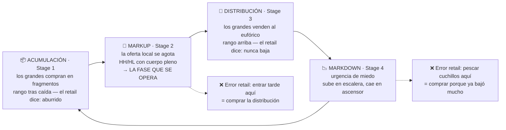

# Lección 3.2 · Los 4 ciclos del mercado

| Campo | Detalle |
|---|---|
| ⏱️ Duración estimada | 40–50 min de estudio |
| 🧱 Módulo | [M3 · Anatomía del Gráfico](README.md) |
| ⬅️ Anterior | [Lección 3.1 · Velas japonesas](leccion-3-1.md) |
| ➡️ Siguiente | [Lección 3.3 · Soportes y resistencias](leccion-3-3.md) |

---

## Por qué importa

"¿Por dónde empiezo a mirar un gráfico?" es la pregunta operativa más frecuente del principiante, y la respuesta profesional no es un indicador: es **ubicar el mercado en su ciclo**. Todo mercado financiero — desde el arroz de Dojima hasta el NAS100 — recorre los mismos cuatro estados: acumula, expande, distribuye, colapsa. Saber en cuál estás cambia absolutamente todo: qué setups existen hoy, qué lado tiene la urgencia (M2.2), cuánto dura la prórroga para entrar y — sobre todo — **cuándo la respuesta correcta es no operar**. Esta lección te da el mapa de vuelo del gráfico; sin él, cada vela es un aviso de excursión; con él, sabes si estás despegando, crucero, turbulencia o aterrizaje.

## Concepto

**Los cuatro ciclos** (la secuencia se repite en todos los marcos y en todos los mercados):

1. **Acumulación** (*accumulation*): rango lateral tras una caída. Los grandes compran en fragmentos (Lección 2.3) sin mover el precio: absorben la venta que llega, manteniendo el precio "aburrido" a propósito. El retail ve un mercado muerto; el institucional ve un almacén llenándose. Síntomas: rango angosto tras tendencia bajista, volumen que no cesa, rechazos repetidos en la misma zona baja.
2. **Markup** (*markup/expansión*): la acumulación se termina — alguien quemó toda la oferta disponible a ese precio (M2.2) — y el precio expande con velas de cuerpo pleno y retrocesos mínimos. Es la fase que el retail reconoce tarde ("ya subió mucho") y el profesional opera desde el inicio con confirmaciones.
3. **Distribución** (*distribution*): el espejo de la acumulación, arriba. Los grandes venden su inventario en fragmentos absorbiendo la compra del retail que llega tarde al festival. El precio oscila en rango alto con movimientos nerviosos; el sentimiento público está en su máximo ("nunca baja"). El institucional ya no es comprador: es el vendedor del techo.
4. **Markdown** (*markdown/colapso*): el inventario se vendió y el precio baja con urgencia — más rápido que subió, porque la urgencia del miedo supera a la de la codicia (asimetría conocida: "suben en escalera, caen en ascensor"). La fase termina donde el precio ya es "tan barato que alguien vuelve a comprar en tamaño" — y el ciclo reinicia en acumulación.

**Dow y el impulso + pullback.** Charles Dow (la base de todo el análisis técnico moderno) describió la tendencia no como una línea recta sino como una secuencia de **impulsos y correcciones**: el precio avanza en empujones con retrocesos que respetan la estructura. En tendencia alcista sana: máximos y mínimos ASCENDENTES sucesivos (HH/HL — *higher high / higher low*). La tendencia muere cuando esa secuencia se rompe (el precio falla en hacer HH y hace un LL — *lower low*): la primera ruptura de estructura es la señal del cambio de ciclo, mucho antes de que el "gráfico bonito" lo admita. Esta es la gramática que el M5 (estructura de mercado) formalizará con nombres como BOS/CHoCH.

**Weinstein: el mismo mapa con etapas.** Stan Weinstein llamó a las cuatro fases **Stage 1** (acumulación), **Stage 2** (markup), **Stage 3** (distribución), **Stage 4** (markdown), y añadió la regla operativa que el programa hereda: *opera Stage 2, quédate fuera de Stage 1, y sal antes de Stage 4*. La concordancia entre Dow, Weinstein y la microestructura de M2 no es casualidad: es el mismo fenómeno (urgencia, inventario, liquidez) visto desde tres alturas.

**Visual — la rueda del mercado (gira sin parar, en todos los marcos):**

## Analogía

La vida de un espectáculo. **Acumulación:** los organizadores llenan la sala a precio de preventa — silenciosamente, sin que nadie hable del evento. **Markup:** se agota, las entradas revenden a precio creciente, la fila empuja. **Distribución:** los primeros organizadores/vendedores salen vendiendo su inventario al público eufórico que llegó tarde — cada comprador nuevo paga a un vendedor viejo que sale. **Markdown:** se acaba el show, la gente sale de golpe por la misma puerta, y el precio de reventa colapsa hasta que alguien vuelve a ver "oportunidad" y empieza a acumular para el próximo evento. El retail pierde comprando en distribución — cuando el evento es portada de prensa — y vendiendo en markdown — cuando la sala se vacía. El profesional hace lo aburrido: compra cuando la sala está vacía y nadie habla del tema, y vende cuando hay fila de eufóricos a quien dársela.

## Cómo se hace: clasificar el ciclo en 3 preguntas, con un caso cerrado

Antes de cualquier análisis, tres preguntas en orden:

1. **¿Hay tendencia definida en H4/D1, o rango?** (secuencia HH/HL vs LL/LH — *lower high* — o solapamiento).
2. **¿Desde dónde viene el precio?** (¿tras una caída larga? → acumulación posible; ¿tras una subida larga con sentimiento eufórico? → distribución posible).
3. **¿Qué está haciendo la ESTRUCTURA ahora mismo?** (¿respeta mínimos ascendentes? ¿acaba de romperlos? ¿lleva N sesiones sin progresar en un rango?).

**Caso cerrado (EUR/USD, ilustrativo con mecánica real).** Tras caer de 1,10 a 1,05 en seis semanas (markdown), el precio pasa tres semanas entre 1,0480 y 1,0540 (rango del 1,2 % — acumulación). El sentimiento en redes: "el euro está muerto". En la semana 4, una vela D1 cierra en 1,0565 **fuera** del rango (Lección 3.4 le pondrá criterio de confirmación) y las siguientes dos semanas construyen HH/HL hasta 1,0680: markup iniciado. Tu operativa por ciclo: en acumulación → observar y marcar zonas (la misión de este módulo); en markup temprano → buscar largos en retrocesos a demanda (el setup por excelencia del programa); en distribución → recoger beneficios y no renovar largos aunque "parezca que sigue"; en markdown → no pescar cuchillos (no comprar "porque ya bajó mucho"). La mayoría de las pérdidas del principiante no vienen de leer mal una vela: vienen de **comprar distribuciones** (entrada tarde del markup, cuando el institucional ya vende) y de **no distinguir acumulación de continuo debilitamiento**.

**Y el anti-error más rentable:** si las tres preguntas no tienen respuesta clara, el ciclo es **indeterminado** — y ese es un resultado válido y frecuente. La receta de tu primera operación lo dice en su Paso 3: "no hay setup y hoy no se opera" es una respuesta con nombre. En cuatro ciclos, solo dos (markup temprano, markdown en reversión) ofrecen setups con ventaja para tu estilo de formación; los otros dos son de observación. No operar ES operar el ciclo.

## Error común

El primero: **querer capturar el giro exacto** — entrar en la rotura del rango de acumulación "porque en algún momento explotará", sin confirmación, pagando los falsos arranques (el retail paga la mayoría de las primeras roturas: el estadístico de roturas fallidas de la Lección 3.4 lo cuantificará). El antídoto del programa: confirmación en cierres + expectativa de retesteo. El segundo: **confundir duración con fase** — "lleva subiendo 3 semanas, está maduro para caer" (las tendencias duran más de lo que la intuición tolera; el ciclo se lee por estructura y comportamiento, no por cronómetro). El tercero: **aplicar el ciclo al marco equivocado** — ver "distribución" en un rango de H1 dentro de un markup D1 impecable: sin definir primero tu marco de análisis (H4/D1 en esta formación), el ciclo se vuelve un espejismo fractal (Lección 3.1). Primero el marco, después el ciclo, después la vela.

## Conexión cuantitativa

El ciclo es la máquina que genera los regímenes que tu $E$ necesita. Un sistema de continuación (comprar retrocesos en markup) tiene su $P_w$ alimentada SOLO en Stage 2: operado en acumulación, produce una serie de falsos arranques de 1R cada uno; operado en distribución, compra exactamente donde el institucional vende — el peor vecindario posible. Esto explica estadísticamente por qué el mismo setup "funciona unas semanas y luego deja de funcionar": no se rompió el sistema, cambió el ciclo — y es la razón por la que el M9 auditará tu journal POR REGÍMEN, separando tus operaciones según el estado del mercado en que nacieron. En formación, la consecuencia práctica es inmediata: tu bitácora de 20 niveles (misión de este módulo) exige clasificar el ciclo de cada nivel ANTES de anotarlo — estás entrenando el músculo que protegerá tu esperanza entera.

---

## 🎯 Puntos clave

1. Todo mercado recorre 4 ciclos: **acumulación → markup → distribución → markdown** — en todos los marcos y mercados.
2. Acumulación = los grandes compran en fragmentos sin mover el precio; distribución = los grandes venden al público que llega tarde.
3. Dow: la tendencia es impulso + pullback con HH/HL (alcista) o LL/LH (bajista); muere cuando la secuencia se rompe.
4. Weinstein = el mismo mapa con regla heredada: opera Stage 2, evita Stage 1, sal antes de Stage 4.
5. Clasifica el ciclo con 3 preguntas: ¿tendencia o rango? ¿desde dónde viene? ¿qué hace la estructura ahora? — y acepta "indeterminado" como respuesta válida.
6. "No operar" es la respuesta correcta en la mitad del ciclo: la mayoría de pérdidas del principiante son compras de distribución y cuchillos de markdown.

## 🔄 Autoevaluación rápida

1. Un amigo te dice: "EUR/USD lleva 3 semanas subiendo, ya está muy estirado — seguro cae". ¿Qué error de esta lección está cometiendo y qué debería mirar en su lugar?
2. El precio rompe AL ALZA el rango de una posible acumulación por primera vez. ¿Por qué el programa no entra inmediatamente en esa rotura? ¿Qué esperaría su protocolo?
3. En tu marco H4, el mercado lleva 10 sesiones entre 1,0840 y 1,0880 tras una caída de 3 semanas. Nombra el ciclo candidato, los dos síntomas que lo confirmarían y la actitud operativa correcta.

Ver respuestas

1. Confunde **duración con fase**: el ciclo no se lee por cronómetro ("lleva mucho, toca caer") sino por estructura y comportamiento — las tendencias duran más que la intuición. Debería mirar: ¿la secuencia HH/HL sigue intacta en H4/D1? ¿hay señales de distribución (rango nervioso arriba, roturas de mínimos que se recuperan, sentimiento eufórico)? Mientras los impulsos sigan con pullbacks ordenados y sin ruptura de estructura, el supuesto "estiramiento" no es argumento para cortos — es argumento para no renovar largos tardíos, como mucho.
2. Porque la primera rotura de un rango falla con frecuencia (el retail la paga: es donde el precio busca liquidez y donde la urgencia puede agotarse justo en el nivel obvio — Lecciones 2.3 y 3.4). El protocolo del programa: esperar el **cierre fuera del nivel** (acuerdo del período entero) + la **confirmación/retesteo** posterior; solo entonces el setup de continuación tiene su estadística a favor. Entrar en la primera mecha roturadora es apostar al resultado de una subasta en curso.
3. Ciclo candidato: **acumulación** (rango angosto tras markdown). Síntomas confirmatorios: (a) rechazos repetidos con mechas en la zona baja del rango y sin progresión bajista, (b) volumen sostenido sin ceder + sentimiento público negativo ("ya está muerto"). Actitud operativa correcta: **observar y marcar** — esta es fase de la misión, no de entrada; los largos por confirmación llegan si se produce rotura con cierre fuera + retesteo sano (Stage 2 incipiente). Comprar "porque es barato" dentro del rango sería anticipar sin confirmación.

