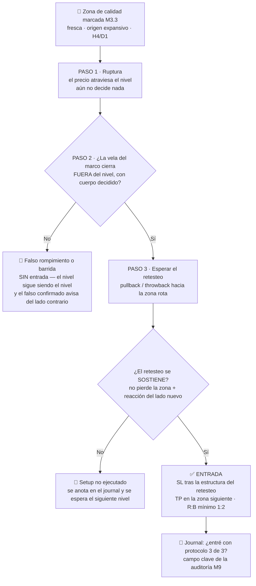

# Lección 3.4 · Confirmación en 3 pasos

| Campo | Detalle |
|---|---|
| ⏱️ Duración estimada | 45–60 min de estudio |
| 🧱 Módulo | [M3 · Anatomía del Gráfico](README.md) |
| ⬅️ Anterior | [Lección 3.3 · Soportes y resistencias](leccion-3-3.md) |
| ➡️ Siguiente | [Lección 3.5 · Patrones elementales](leccion-3-5.md) |

---

## Por qué importa

El nivel está marcado. El precio lo alcanza. Y ahora — ¿entras o esperas? Esta es la bifurcación donde el principiante paga su matrícula más cara: entrar en el primer toque sin criterio significa comprar exactamente donde la liquidez se barrida (M2.3) y donde la mayoría de las roturas fallan. La **confirmación en 3 pasos** es el protocolo del programa para convertir "el precio llegó a mi zona" en "el mercado me está mostrando que el interés de mi zona sigue vivo": ruptura del nivel → cierre fuera → confirmación con reacción. Cuesta entrar un poco más tarde y algo peor de precio; a cambio filtra la mayoría de los falsos rompimientos — y en la ecuación del programa, un $P_w$ unos puntos mayor vale infinitamente más que 2 pips de entrada. Esta lección también formaliza el falso rompimiento como fenómeno, no como mala suerte.

## Concepto

**El protocolo de 3 pasos** (para una rotura de resistencia; el espejo vale para soporte):

1. **Ruptura:** el precio atraviesa el nivel. Paso necesario, insuficiente: aquí todavía puede ser una barrida (Lección 2.3) — el toque intra-vela no decide nada.
2. **Cierre fuera del nivel:** la vela (o mejor, el H4/D1 según tu marco) **cierra** más allá del nivel con cuerpo decidido. El cierre es el acuerdo final de la subasta completa (M3.1): un cierre fuera implica que la urgencia superó al nivel y **sobrevivió al período**. Este es el filtro que elimina la mayoría de las mechas roturadoras.
3. **Confirmación — el retesteo:** tras el cierre fuera, el precio suele volver al nivel roto (polaridad) y **reacciona desde él**: en el caso alcista, la RESISTENCIA rota se convierte en SOPORTE — el precio vuelve abajo, toca la zona y NO la pierde (mínimo del retroceso por encima del nivel, con reacción compradora visible). Esa reacción es la luz verde: el mercado probó el nuevo suelo y lo sostuvo.

**El principio de polaridad** (*polarity*): un nivel roto con confirmación **cambia de bando**. La resistencia que cedió y se sostuvo en el retesteo opera como soporte (ahí están los compradores que "se perdieron" el tren esperando el retesteo + los vendedores que quedaron atrapados y cubren en la zona, generando compra). El soporte que cedió con cierre decidido opera como resistencia para los rebotes (los compradores tardíos atrapados venden para salir en el empate). Esta simetría es la razón por la que los mejores retesteos son entradas con estadística superior: **el nivel ya demostró funcionar en ambas direcciones**.

**Los nombres del retorno:** al retroceso tras la rotura se le llama **pullback** (en tendencia) o **throwback** (al origen de la rotura). No es un defecto del mercado: es la digestión — los stops de los primeros rompedores se ejecutan, los impacientes salen, y el institucional llena lo que faltaba en la zona (M2.3). Un mercado que no retrocede tras romper (expansión pura) existe, pero no lo perseguimos: sin retesteo, tu entrada queda sin el paso 3 y la receta lo prohíbe.

**El falso rompimiento** (*false breakout / fake*): el precio atraviesa el nivel, **no logra el cierre decidido fuera** (o cierra fuera y en la siguiente vela vuelve dentro con fuerza), y gira al otro lado. No es un error del mercado — es su mecanismo de recolección: detrás de todo nivel obvio hay stops y entradas del retail (M2.3), y atravesar el nivel unas velas es la forma más eficiente de detonarlos. Tres datos operativos: (a) son la mayoría de las primeras roturas de un rango; (b) el antídoto EXACTO es el protocolo de 3 pasos — el falso no sobrevive al paso 2 ni al paso 3; (c) cuando el falso se confirma como tal (vuelta decidida al interior del rango), ES un setup del lado contrario con estadística excelente — el barrido que se revierte es precisamente la huella del comprador grande (Lección 2.3). Con el tiempo aprenderás a operar el falso; en formación, la regla es solo dejar que te filtre a ti.

**Visual — el árbol de decisión completo del protocolo:**

## Analogía

El protocolo de 3 pasos es el **control de aeropuerto en tres filtros**. Paso 1 — el pasaporte existe (el precio tocó/cruzó el nivel): cualquiera puede mostrar un pasaporte; no vuela por eso. Paso 2 — el sello de entrada (el CIERRE fuera del nivel): el documento fue verificado por la autoridad competente — la subasta completa de un período votó y decidió. Paso 3 — la puerta de embarque (el retesteo que se sostiene): hasta los pasajeros con sello pueden no subir; la puerta confirma que el vuelo REALMENTE despega con ellos dentro. El falso rompimiento es el pasajero con pasaporte falso bien hecho: pasa el primer filtro con apariencia impecable y cae en el segundo o en el tercero. El retail entra en el paso 1 ("¡ya rompió!"); el programa exige los tres filtros — y por eso su lista de pasajeros es más corta, pero vuela.

## Cómo se hace: el protocolo con números y un caso completo

**Caso cerrado (EUR/USD, ilustrativo con mecánica real).** Resistencia marcada en zona 1,0850–1,0856 (dos reacciones previas, origen expansivo, H4). El precio sube desde 1,0790:

- **Martes, vela H4 #1:** toca 1,0852 y cierra en 1,0845 → toque sin cierre fuera: **no hay nada que decidir todavía**. (El principiante compra el toque; el programa no.)
- **Martes, vela H4 #2:** atraviesa y cierra en **1,0861** — 5 pips más allá del borde de zona, con cuerpo pleno: **paso 2 cumplido**. Ahora, y solo ahora, existe un estado de "rotura por confirmar".
- **Miércoles–jueves:** el precio retrocede (throwback) hasta 1,0854, toca la zona rota desde arriba y cierra la vela de reacción en 1,0866 con mecha inferior sobre la zona: **paso 3 cumplido** — la resistencia rota se sostuvo como soporte.
- **Entrada:** en el retesteo, ~1,0858 (cuando la reacción es visible). **SL estructural:** bajo el mínimo del retroceso y de la zona, 1,0844 (14 pips). **TP:** siguiente resistencia, 1,0902 (44 pips). R:B = 44/14 ≈ **3,1** — sobra al mínimo del programa (1:2). **Lote:** con riesgo 1 % de 2 000 $ = 20 $: $20/(14 \times 10) = 0{,}14$ lotes (Paso 5 de la receta).

Compara el "antes": quien compró el toque de 1,0852 el martes entró 6 pips mejor... con un SL por debajo del nivel obvio (1,0843 — dentro del depósito de stops), expuesto al throwback que tocó 1,0854 (¡lo habría sacado con el primer respiro!) y sin saber si la rotura era real. El protocolo te cuesta 6 pips de precio y te compra: cierre confirmado + retesteo sostenido + SL en estructura + R:B verificado. Ese intercambio es positivo por definición estadística.

**Y el caso del falso, visto con el mismo protocolo:** vela que atraviesa 1,0852 y **cierra en 1,0848** (dentro de la zona) → paso 2 no cumplido → no hay rotura, no hay entrada, no hay decisión: el nivel sigue siendo resistencia y el falso acaba de filtrarte a ti. La disciplina del paso 2 es lo único que separa tu cuenta de esa trampa — sin saber NADA de análisis adicional.

## Error común

El primero: **anticipar el paso 2** — comprar la rotura intra-vela "para no perder el tren". Es la apuesta más popular del retail y su matrícula: sin cierre, la rotura es una hipótesis en curso de subasta; el tren que se pierde por esperar el cierre suele volver al andén (retesteo) — y el que no vuelve, no era tu setup (el mercado "sin retroceso" se persigue cero veces en formación). El segundo: **cerrar el paso 3 por impaciencia** — la confirmación no tiene plazo fijo, pero tampoco es eterna: si tras el cierre fuera el precio NO retestea y se aleja más de ~1R del nivel, la ventana del setup cerró (el retesteo lejano ya no es retesteo, es otro nivel). El tercero: **el espejo vicioso** — usar el protocolo para justificar entradas en cualquier lado ("si cierro fuera ya está"): el protocolo opera SOLO sobre zonas con calidad del gradiente de la Lección 3.3 (frescas, pocos toques, origen expansivo, H4/D1). Confirmación sobre zona basura es confirmación de ruido.

## Conexión cuantitativa

El protocolo ataca tu $P_w$ por la puerta más barata del programa. Cada filtro elimina una familia de fallos con costo conocido: el paso 2 elimina las barridas intra-vela (M2.3), el paso 3 elimina las roturas sin seguimiento. El trade-off es matemático y favorable: pierdes pips de entrada (un costo pequeño y fijo) y ganas probabilidad (multiplicativa sobre cada operación futura). Además ordena tus términos: SL en la estructura del retesteo (no en el nivel obvio), TP en la zona siguiente (no en "un número"), y el R:B se calcula con datos — como en el caso: 3,1 con lote 0,14 y riesgo 20 $. En M5, este protocolo será la base de lectura de la estructura (BOS: ruptura de estructura confirmada); en M9, cada operación de tu journal llevará el campo "¿entré con protocolo de 3 pasos?" — porque será una de las variables con mayor correlación con tus rachas de error. El falso rompimiento, por su parte, pasará de pesadilla a instrumento: pero primero, deja que te filtre.

---

## 🎯 Puntos clave

1. Protocolo: **ruptura → cierre fuera del nivel → confirmación por retesteo que se sostiene**. Tres filtros, ninguna excepción.
2. El toque intra-vela no decide nada: puede ser una barrida (M2.3). El **cierre** es el acuerdo de la subasta completa.
3. **Polaridad:** el nivel roto y confirmado cambia de bando (resistencia→soporte y viceversa) — por eso el retesteo es la entrada con mejor estadística.
4. El retorno tiene nombre (pullback/throwback) y función (digestión + llenado institucional); la expansión sin retesteo no se persigue.
5. El **falso rompimiento** es mecanismo de recolección, no mala suerte: no sobrevive a los pasos 2–3, y más adelante será setup del lado contrario.
6. El protocolo opera solo sobre zonas de calidad (Lección 3.3): confirmación sobre zona basura = ruido confirmado.

## 🔄 Autoevaluación rápida

1. La vela H4 atraviesa tu resistencia (zona 1,0850–1,0856), toca 1,0858 y cierra en 1,0852. ¿Qué paso del protocolo se cumplió y cuál falta? ¿Qué HACES exactamente?
2. ¿Por qué el retesteo da entradas con mejor estadística que la rotura directa? Explica con polaridad y con quién está comprando/vendiendo en cada caso.
3. El precio cierra fuera de tu nivel, pero en las siguientes 6 velas H4 se aleja 60 pips sin volver. ¿Qué paso no llegó y qué decide el protocolo? ¿Qué NUNCA haces en formación?

Ver respuestas

1. Paso 1 cumplido (ruptura intra-vela hasta 1,0858). Paso 2 NO: el cierre en 1,0852 quedó DENTRO de la zona (1,0850–1,0856) — la vela no cerró decididamente más allá del nivel. Acción correcta: **nada** — no hay rotura, no hay entrada; el nivel sigue siendo resistencia y observas la siguiente vela. Este patrón exacto es el candidato a falso rompimiento (barrida + cierre dentro): tu protocolo acaba de filtrarte.
2. En la rotura directa compras contra los vendedores que aún defienden el nivel, sin saber si el cierre sobrevivirá (tu probabilidad incluye a todos los falsos). En el retesteo post-confirmación: (a) el cierre fuera ya ocurrió — el filtro 2 está descontado; (b) por polaridad, en la zona rota hay compradores nuevos (los que esperaban el retesteo) y cubrimiento de vendedores atrapados: el bando a tu favor está documentado por el propio mercado; (c) tu SL va tras la estructura del retesteo (menos expuesto a barridas que el nivel obvio original). Pagas pips de precio y cobras probabilidad: intercambio positivo por definición.
3. No llegó el paso 3 (confirmación) — y con 60 pips de alejamiento (~4R desde el nivel en el ejemplo de la lección), la ventana del retesteo cerró: lo que vuelve ahora ya no es retesteo, es otra zona. Decisión del protocolo: **setup no ejecutado** — se anota en el journal como "oportunidad válida no capturada" y se espera el siguiente nivel; se acepta como costo estructural del filtro. Nunca se persigue la expansión pura ("entrar ahora porque ya subió"): sin paso 3 no hay entrada del programa — perseguir es pagar el peor precio sin ninguno de los filtros que justifican el riesgo.

