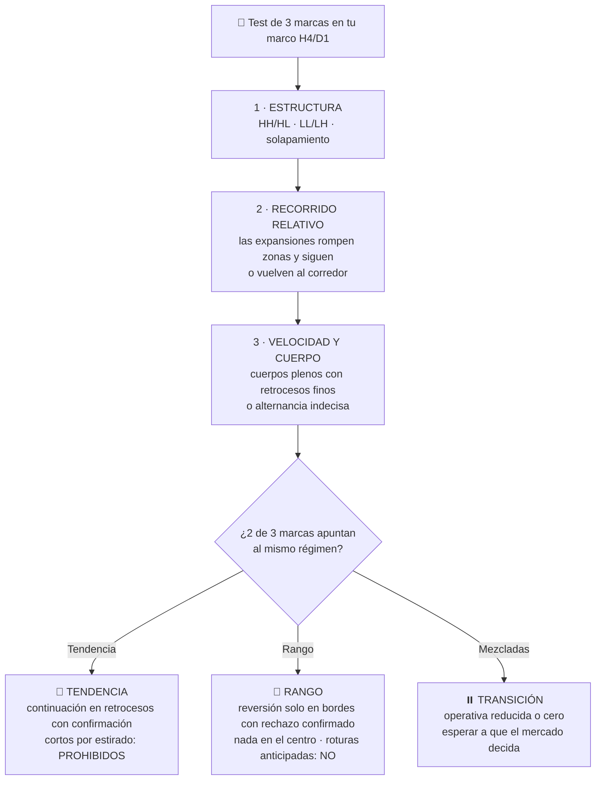

# Lección 3.6 · Rangos vs tendencias

| Campo | Detalle |
|---|---|
| ⏱️ Duración estimada | 40–50 min de estudio |
| 🧱 Módulo | [M3 · Anatomía del Gráfico](README.md) |
| ⬅️ Anterior | [Lección 3.5 · Patrones elementales](leccion-3-5.md) |
| ➡️ Siguiente | — (cierra el módulo; vuelve al [README](README.md) para laboratorio, misión y quiz) |

---

## Por qué importa

Cierra el módulo la lección que decide TODO lo anterior: antes de buscar setup, hay que saber en qué régimen está el mercado — porque los mismos movimientos que alimentan un sistema de tendencia matan a un sistema de rango, y al revés. La proporción aproximada duele: el mercado pasa la mayor parte del tiempo en rango *(aproximación, ~70 % en la literatura)* — es decir, la mayoría del tiempo, la respuesta correcta a "¿qué opero?" es "nada todavía". Y el asesino silencioso de cuentas de principiante tiene nombre: el **whipsaw** (el vaivén), la secuencia de falsas roturas de rango que cobra 1R a cada comprador de rompimiento hasta vaciarlos. Esta lección te enseña a clasificar el régimen ANTES de buscar setups, a sobrevivir al rango y a entender por qué "hacer nada" es la posición más rentable del catálogo.

## Concepto

**El régimen** (*market regime*) es el estado estructural del mercado en tu marco de análisis: **tendencia** (secuencia HH/HL o LL/LH sostenida — M3.2), **rango** (precio oscilando entre dos zonas sin progresión direccional) o **transición** (uno transformándose en el otro). No es decoración: es el permiso operativo. Cada sistema pertenece a un régimen:

| | Sistema de continuación/tendencia | Sistema de rango/reversión |
|---|---|---|
| Hábitat | Markup/markdown con impulsos sanos | Rango estable con bordes respetados |
| Alimenta su $P_w$ con | Expansión (desequilibrio, M2.2) | Equilibrio entre bandos |
| Muere en | Rango (whipsaw en los bordes) | Expansión (la rotura real que no respeta el borde) |
| Síntoma de que está fuera de hábitat | Serie de falsos arranques + retrocesos que se comen el impulso | Roturas de borde que NO vuelven |

**Por qué el rango domina el tiempo.** El precio es una subasta que busca equilibrio (M2.2): la mayoría de las horas, ningún bando tiene urgencia dominante sostenida — el equilibrio es el estado natural y la expansión es el evento. De ahí la aproximación de la literatura (~70 % del tiempo en rango *(aproximación — varía por instrumento, marco y período)*): si tu sistema solo prospera en tendencia y no distingue el régimen, tu sistema está fuera de su clima ~7 de cada 10 unidades de tiempo.

**El whipsaw, el asesino silencioso.** El rango maduro tiene bordes obvios (todo el mundo los ve — M2.3). El vaivén típico: rotura del borde → attract de compradores tardíos → giro → barrida de sus stops → retorno al interior → y de nuevo. Cada ciclo cobra: 1R a quien compró la rotura, 1R a quien compró el giro, otra vez a quien re-compró la siguiente rotura. El whipsaw no es mala suerte: es la forma del rango de recolectar a los impacientes. Tres defensas del programa: (1) **clasificar el régimen antes de buscar setups** — en rango, la rotura anticipada NO existe como setup; (2) **operar el interior del rango solo con reversión en bordes confirmados** (rechazo con vela de contexto en la zona, M3.3+M3.5) y nunca en el centro (el centro del rango no tiene borde: ahí el precio no "reacciona", camina); (3) **esperar la rotura madura** — cierre fuera + retesteo sostenido (M3.4) — aceptando que la mayoría de roturas primeras NO pasarán el filtro, y que eso es el filtro trabajando a tu favor.

**Cómo clasificar el régimen en la práctica — el test de las 3 marcas:**

1. **Estructura:** ¿los últimos swings H4/D1 hacen HH/HL (tendencia alcista), LL/LH (bajista) o solapan sin progresión (rango)?
2. **Recorrido relativo:** ¿las últimas 3–5 expansiones rompen zonas con cierre y siguen (tendencia), o vuelven al interior del mismo corredor (rango)?
3. **Velocidad y cuerpo:** ¿velas de cuerpo pleno en la dirección dominante con retrocesos finos (tendencia) o alternancia de cuerpos pequeños sin dirección clara (rango)?

Dos de tres señales iguales → régimen clasificado. Señales mezcladas → **transición** — el régimen más peligroso y el más honesto de nombrar: en transición, el protocolo del programa es reducir o eliminar la operativa (el Setup que nace en transición hereda la incertidumbre de ambos regímenes).

**Visual — el clasificador de régimen, de las 3 marcas a la conducta:**

## Analogía

El rango es un **trampolín con paredes elásticas** y la tendencia es la **puerta abierta**. En el rango, el precio rebota entre dos paredes que todo el mundo ve: cada rebote deja a una camada de compradores de la rotura atrapada en el borde, y la pared — como toda zona muy visitada (M3.3) — se gasta un poco más con cada choque. El whipsaw es la sucesión de rebotes falsos justo antes de que la pared ceda: los últimos que compran "la rotura" compran el peor precio de todo el ciclo. La tendencia es lo contrario: la pared rompió y el precio camina — ahí los retrocesos son andenes para subir, no paredes. El arte del clasificador: saber si estás en la sala con paredes elásticas (reversión en bordes, nada de roturas anticipadas) o en la puerta abierta (continuación en retrocesos). Y la transición es el momento en que la pared tiembla: puede ceder o aguantar — el profesional deja de apostar hasta que la física del cuarto se decide.

## Cómo se hace: el régimen en tu análisis diario, con caso cerrado

El Paso 3 de tu [receta de primera operación](../../03-recursos/laboratorio/receta-primera-operacion.md) — "¿tendencia o rango?" — ahora tiene método completo:

**Caso A — rango (EUR/USD, ilustrativo):** H4 muestra 8 sesiones entre 1,0820 y 1,0870: swings que solapan, expansiones que vuelven, cuerpos alternados. Test de 3 marcas: estructura sin progresión ✓, recorridos que vuelven ✓, cuerpos indecisos ✓ → **rango confirmado**. Reglas del día: bordes 1,0820/1,0870 operables SOLO con rechazo confirmado en zona (vela de contexto + M3.4 para la salida si se rompe); centro del rango (1,0840–1,0850): tierra de nadie — no hay setups ahí porque no hay bordes cerca; roturas anticipadas: prohibidas. Si el borde rompe con cierre H4 fuera → suspende la lógica de rango y abre el protocolo de rotura (M3.4): el régimen puede estar cambiando.

**Caso B — tendencia (XAU/USD, ilustrativo):** H4 acumula HH/HL limpios desde 3 940: cada retroceso respeta el mínimo anterior y retoma. Test: estructura ascendente ✓, expansiones que rompen zonas y siguen ✓, cuerpos plenos con retrocesos finos ✓ → **tendencia alcista confirmada**. Reglas del día: buscar largos en retrocesos a demanda con protocolo de confirmación; cortos "porque está estirado": prohibidos (Lección 3.2 — la duración no es argumento); la invalidación del sesgo: la ruptura de estructura (precio hace LL bajo el último HL con cierre decidido).

**Caso C — transición (ambos, ilustrativo):** el rango de 1,0820–1,0870 rompe arriba con cierre en 1,0881, PERO el retesteo no llega y al día siguiente el precio vuelve a 1,0865 con vela de cuerpo grande bajista. Marcas mezcladas: la estructura empezó a romper (alcista) pero el comportamiento del retorno es de rango (bajista) → **transición**: el protocolo dice operativa reducida o cero, y esperar que el mercado decida (nueva rotura con confirmación, o rechazo que restaura el rango). El costo de esperar: cero. El costo de no esperar: 1R por intento, repetido.

## Error común

El primero: **buscar setups primero y el régimen después** — el orden de la receta existe porque el régimen es el permiso: operar rupturas en rango y reversión en tendencia es ejecutar el sistema correcto en el clima equivocado, la forma más frecuente de "un buen sistema que no funciona". El segundo: **el sesgo de tendencia** — la creencia de que "siempre hay una tendencia por capturar" y que no operar en rango es perder tiempo: con ~70 % del tiempo en rango *(aproximación)*, el que fuerza tendencia opera mayoritariamente fuera de su hábitat; el que respeta el rango convierte el 70 % del tiempo en observación barata y el 30 % en operativa con clima a favor. El tercero: **el whipsaw como demanda de "mejores señales"** — tras 3 falsas roturas, la respuesta del principiante es buscar el indicador que "filtre mejor"; la respuesta del programa es clasificar el régimen y respetar el protocolo: el problema no era la señal, era el clima.

## Conexión cuantitativa

El régimen es el multiplicador invisible de tu ecuación: no aparece en $E = (P_w \times W) - (P_l \times L)$ pero decide cuánto vale cada término. Operar tu sistema fuera de hábitat reduce $P_w$ sin que ningún parámetro técnico cambie — y lo hace en rachas (el rango cobra por corrida, no por trade), que es exactamente el patrón que en el M9 hará parecer "que el sistema se rompió" cuando lo que pasó es que el clima cambió. Por eso la misión de este módulo (bitácora de 20 niveles) exige anotar el régimen de cada nivel, y por eso en M9 tu journal llevará el campo "régimen al entrar": separar tu estadística por régimen es la auditoría que distingue "sistema malo" de "sistema bueno en mal clima" — la diferencia entre tirar un sistema funcional y ajustar su calendario de uso. El régimen es, en resumen, la variable que convierte tu técnica en negocio: la técnica elige el setup; el régimen decide si ese setup tiene derecho a existir hoy.

---

## 🎯 Puntos clave

1. Tres regímenes: **tendencia, rango, transición** — clasificar ANTES de buscar setups (el permiso operativo).
2. El rango domina el tiempo (~70 % *(aproximación)*): la mayoría del tiempo la respuesta correcta es observar; forzar tendencia es operar fuera de hábitat.
3. El **whipsaw** es el mecanismo de cobro del rango: falsas roturas + barridas de bordes obvios — no es mala suerte, es diseño de recolección (M2.3).
4. En rango: reversión solo en bordes con rechazo confirmado; nada en el centro; roturas anticipadas prohibidas. En tendencia: continuación en retrocesos con protocolo; cortos "por estirado" prohibidos.
5. Test de 3 marcas (estructura, recorrido relativo, velocidad/cuerpo): 2 de 3 clasifican; mezcladas = **transición** → operativa reducida o cero.
6. Cada sistema tiene hábitat: tu $P_w$ vive en el régimen correcto y muere fuera — el journal (M9) auditará tu estadística POR régimen.

## 🔄 Autoevaluación rápida

1. EUR/USD H4: 3 roturas del borde superior de un rango en 10 días, todas devueltas al interior. ¿Qué fenómeno es, a quién está cobrando y cuál es tu conducta con la cuarta rotura?
2. Aplica el test de 3 marcas a: "XAU/USD hace HH/HL desde hace 12 sesiones, las últimas 3 expansiones rompieron zonas con cierre y siguieron, cuerpos plenos al alza con retrocesos finos". ¿Clasificación y reglas del día?
3. ¿Por qué "no operar en rango" no es perder tiempo sino la posición con mejor esperanza del catálogo, dado el ~70 % *(aproximación)*?

Ver respuestas

1. Es el **whipsaw**: el rango maduro cobrando a los compradores de cada rotura (atracción de tardíos + barrida de sus stops + retorno). Conducta con la cuarta rotura: la trata con MÁS escepticismo, no menos — roturas anticipadas prohibidas; solo interesa si cumple el protocolo completo (cierre H4 decidido fuera + retesteo que se sostiene, M3.4), porque tras dos fallas el borde está más consumido y la probabilidad de la rotura real aumenta, pero SOLO se opera con el filtro completo — y el falso confirmado (vuelta decidida al interior) es en sí el rechazo de borde operable del lado contrario.
2. Estructura: HH/HL sostenidos → tendencia ✓. Recorrido: expansiones que rompen zonas con cierre y continúan → tendencia ✓. Velocidad/cuerpo: cuerpos plenos con retrocesos finos → tendencia ✓. Clasificación: **tendencia alcista** (3/3). Reglas del día: largos en retrocesos a demanda con confirmación; invalidación del sesgo = ruptura de estructura (LL bajo el último HL con cierre decidido); cortos "porque está estirado" prohibidos — la duración no es argumento (M3.2).
3. Porque en rango tu sistema de tendencia está fuera de hábitat: su $P_w$ cae (falsas roturas) y el cobro llega en rachas (whipsaw) — operar ahí es comprar varianza sin esperanza. Con ~70 % del tiempo en rango *(aproximación)*, la "no posición" del rango es la que preserva el capital y la estadística para el ~30 % con clima a favor: esperanza de la cartera = Σ(E por régimen × frecuencia) — y el término negativo de operar en rango se elimina gratis, sin tocar el sistema. Además cada día de observación documentada (misión) suma el reconocimiento de régimen que sostendrá todo el programa.

