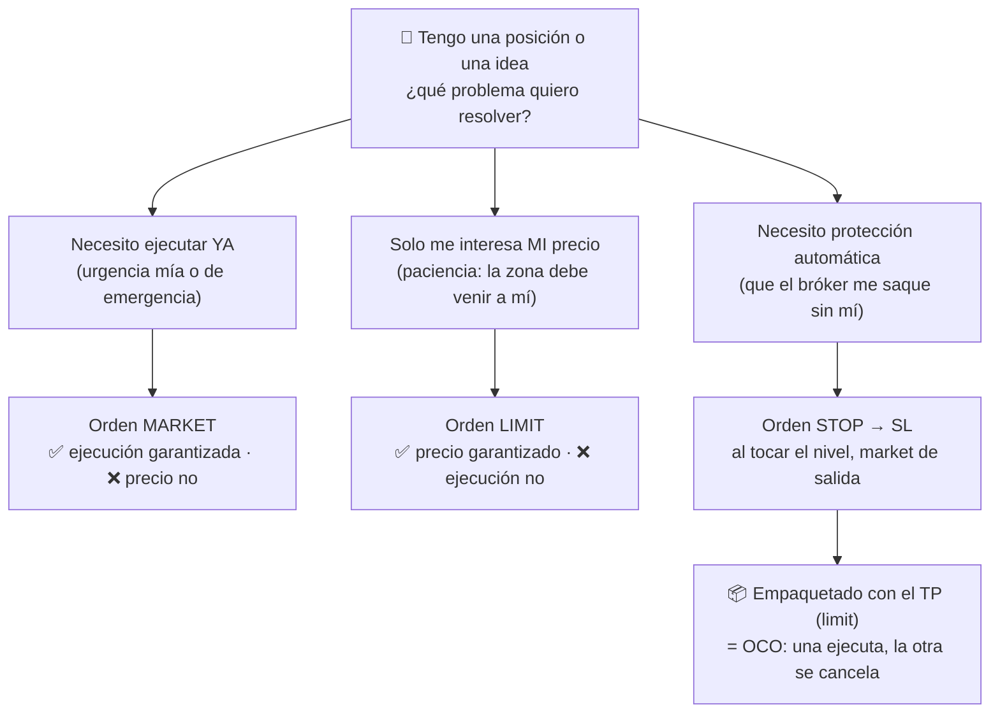

# Lección 4.2 · Tipos de órdenes

| Campo | Detalle |
|---|---|
| ⏱️ Duración estimada | 45–60 min de estudio |
| 🧱 Módulo | [M4 · Plataforma y Primera Ejecución](README.md) |
| ⬅️ Anterior | [Lección 4.1 · TradingView profesional](leccion-4-1.md) |
| ➡️ Siguiente | [Lección 4.3 · El costo real de operar](leccion-4-3.md) |

---

## Por qué importa

Tu análisis puede ser impecable y tu gestión de riesgo perfecta — pero lo único que el mercado recibe de ti es una orden, y una orden mal elegida ejecuta algo distinto de lo que tu plan decía. Cada tipo de orden existe para resolver un problema concreto: urgencia (quiero entrar ya), precio (solo a este nivel) o protección (ciérrame si va contra mí). Confundirlos no es un error de novato simpático: es la diferencia entre "mi SL estaba en 1,0794" y "no salí hasta 1,0811 porque usé el tipo equivocado". El programa estandariza el uso: entradas paciente = *limit*, salidas de emergencia = *stop*, objetivo de ganancia = *limit*, y todo el paquete amarrado en una *OCO*. Al terminar esta lección tendrás que saber decir, para cualquier escenario, qué orden corresponde y qué garantiza (y qué NO garantiza) cada una.

## Concepto

Hay 5 tipos que el programa usa (los nombres están en inglés porque así aparecen en todas las plataformas):

1. **Market** (*market order*): ejecuta **ya**, al mejor precio disponible en ese instante. Garantiza ejecución, NO garantiza precio (paga el spread y, si el mercado corre, slippage — [Lección 4.3](leccion-4-3.md)). Uso: entradas cuando tu urgencia es real y salidas de emergencia.
2. **Limit** (*limit order*): ejecuta **solo a tu precio o mejor**. Garantiza precio, NO garantiza ejecución (si el precio nunca llega, te quedas fuera). Uso: entradas paciente en zona (tu rol maker de la [Lección 2.1](../mod-02-motor-del-precio/leccion-2-1.md)) y salida en el objetivo (TP).
3. **Stop** (*stop order / stop-market*): está dormida hasta que el precio **toca** tu nivel; al tocarlo, dispara una market. Garantiza participación en el movimiento, no el precio exacto. Uso: **Stop Loss** y entradas por ruptura confirmada.
4. **Stop-Limit** (*stop-limit order*): al tocar el nivel dispara una *limit* (no una market). Da control de precio pero puede **no ejecutarse** si el precio atraviesa el nivel tan rápido que nadie llena tu limit. Uso: entradas de ruptura en mercados finos; **nunca como SL** (ver error común).
5. **OCO** (*one-cancels-other*): dos órdenes emparejadas — al ejecutarse una, la plataforma cancela la otra. Es como el bróker implementa SL+TP sobre una posición abierta: toca el TP → cancela el SL; toca el SL → cancela el TP.

**Tabla de garantías** (la que hay que saber de memoria):

| Orden | ¿Garantiza ejecución? | ¿Garantiza precio? | Rol en el programa |
|---|---|---|---|
| Market | ✅ sí | ❌ no | salidas de emergencia |
| Limit | ❌ no | ✅ sí | entrada en zona + TP |
| Stop | ✅ al tocar el nivel | ❌ no | **SL** + entrada de ruptura |
| Stop-Limit | ❌ puede quedarse sin llenar | ✅ la limit, sí | entradas de ruptura finas (avanzado) |
| OCO | ✅ una de las dos | ✅ la que toque | paquete SL+TP de toda posición |

**El detalle que conecta con M2:** tu TP es una *limit* (el precio tiene que **llegar** — nadie te ejecuta la ganancia con urgencia) y tu SL es un *stop* (al tocar, el mercado te saca con urgencia). Por eso el viaje de tu operación es asimétrico ([Lección 2.1](../mod-02-motor-del-precio/leccion-2-1.md)): el objetivo se alcanza con recorrido +spread y el stop se dispara con recorrido −spread.

**Visual — qué orden usar según el problema:**

## Analogía

Reservar mesa en un restaurante. La orden **market** es entrar y comer donde haya: garantizado que cenas ya, al precio que pongan. La **limit** es la reserva: "solo como si hay mesa a las 21:00 en la terraza" — si no se da, te vas a otra parte (sin cena, pero sin sobrepago). El **stop** es el detector de humos: no analiza, no negocia, no espera tu confirmación — suena y actúa. Y el **stop-limit** es un detector que, al sonar, llama a un cerrajero que además tiene que estar disponible: si la casa arde entera en cinco minutos, el cerrajero no llega y te quedas dentro. Protecciones que pueden no ejecutarse no son protecciones: son promesas.

## Cómo se hace: montar la OCO de la receta con números cerrados

El caso maestro de la [Receta de tu Primera Operación](../../03-recursos/laboratorio/receta-primera-operacion.md), ahora con nombre de orden para cada pieza:

- **Escenario:** EUR/USD en regímen definido por tu análisis M3; zona de soporte marcada en **1,0820–1,0824** *(ilustrativo)*.
- **Entrada:** *buy limit* en **1,0824** (el borde superior de la zona: donde el precio suele agotar el impulso vendedor al retestear). Es tu rol maker: esperas al precio.
- **Stop Loss:** *stop* (de venta) en **1,0794** — 30 pips bajo la entrada, 4 pips tras el mínimo del swing local (colocación por estructura: [Lección 4.6](leccion-4-6.md)).
- **Take Profit:** *limit* (de venta) en **1,0884** — 60 pips sobre la entrada, en la resistencia opuesta. R:B nominal = 60/30 = **2,0** ✓ (estándar mínimo del programa).
- **Montaje:** la plataforma toma la posición + SL + TP como paquete OCO. Si el precio sube y toca 1,0884 → tu limit de venta ejecuta la ganancia y el SL se cancela solo. Si cae y toca 1,0794 → el stop te saca con −30 pips (−18 $ con el lote de 0,06 de la receta) y el TP se cancela solo.
- **Comprobación del viaje (M2.1):** para cobrar el TP el bid debe subir 62 pips desde su punto de partida; para que salte el SL le basta bajar 28. Misma operación, caminos distintos.

**Qué NO montar:** entrada con *market* "para no perderme el movimiento" cuando tu plan decía limit en zona — cada cambio de tipo de orden en caliente es una violación del plan, y la misión M-4 lo registra como tal.

## Error común

El más caro de todos: **usar stop-limit como Stop Loss "para controlar el slippage"**. Si el precio atraviesa tu nivel con un gap o en una noticia, la limit que dispara puede quedarse sin llenar — y sigues dentro de una posición que ya no querías tener, sin protección. El SL es la única orden del programa donde la ejecución importa más que el precio: prefieres −30,5 pips reales a una promesa de −30 que puede convertirse en −80. El segundo error es **confundir la dirección de los stops de entrada**: el *buy stop* se pone **por encima** del precio actual (compra en ruptura al alza) y el *sell stop* por debajo — ponerlos al revés ejecuta en el segundo que los colocas. El tercero es **no revisar que la OCO quedó montada**: entrada manual + SL olvidado = la violación número 1 del checklist de la misión M-4 (cero operaciones sin SL).

## Conexión cuantitativa

Cada tipo de orden tiene un perfil de riesgo de ejecución distinto, y ese perfil entra directo en la esperanza: $E_{neto} = E_{bruto} - \text{costos}$. El slippage del SL es un costo que solo existe cuando pierdes: con SL de 30 pips y slippage típico de 1 pip en mercado líquido *(ilustrativo)*, tu pérdida real media es 31 pips — un 3,3 % de R adicional en cada fallo. Pero sin SL (o con un stop-limit que no llena), la cola de pérdidas se abre: la misma operación puede cerrar −60, −100 o más pips cuando llega un dato macro ([Lección 2.6](../mod-02-motor-del-precio/leccion-2-6.md)). Un sistema con E bruto +0,10R y SL fiable sigue teniendo E positivo con el slippage incluido; el mismo sistema sin SL no tiene E **definible** — porque su peor operación no está acotada. La OCO no es una comodidad de la plataforma: es el mecanismo que convierte tu E teórica en la E real que puedes sostener.

---

## 🎯 Puntos clave

1. Market: garantiza ejecución, no precio — urgencia y emergencias. Limit: garantiza precio, no ejecución — paciencia en zonas y TP.
2. Stop: al tocar el nivel dispara market — el mecanismo del SL y de las entradas por ruptura. Stop-Limit dispara una limit: puede NO ejecutarse — prohibido como SL.
3. OCO = SL (stop) + TP (limit) emparejados: una ejecuta, la otra se cancela. Toda posición del programa nace con OCO montada.
4. El viaje asimétrico de M2.1 se explica por los tipos: el TP es limit (el precio tiene que llegar), el SL es stop (el mercado te saca).
5. Buy stop va por encima del precio, sell stop por debajo — invertirlo ejecuta al instante.
6. El SL es la única orden donde ejecución > precio: −30,5 reales vence a la promesa de −30 que puede acabar en −80.

## 🔄 Autoevaluación rápida

1. ¿Qué garantiza y qué no garantiza una orden limit? Da un uso de entrada y uno de salida en el programa.
2. ¿Por qué montar el SL como stop-limit es violar la ley del stop? Descríbelo con un gap de 20 pips.
3. Tu plan: entrada limit 1,0824, SL 1,0794, TP 1,0884. ¿Qué orden es cada pieza y qué pasa en la plataforma si toca primero el 1,0794?

Ver respuestas

1. Limit garantiza **precio** (se ejecuta solo a tu nivel o mejor) y NO garantiza ejecución (si el precio nunca llega, cero fills). Entrada: *buy limit* en el borde de una zona de soporte — rol maker, el precio debe venir a ti. Salida: TP como *limit* de venta en la resistencia opuesta — cobras la ganancia sin urgencia.
2. El stop-limit, al tocar el nivel, lanza una *limit* que exige un contraparte a ese precio o mejor. Con un gap de 20 pips el mercado ya está 20 pips más allá: tu limit queda fuera de mercado, nadie la llena a tu precio, y la posición sigue abierta mientras el precio corre. El stop simple habría ejecutado a mercado con slippage acotado (~1 pip). Protección que puede no ejecutarse no es protección: es promesa.
3. Entrada: *buy limit* 1,0824. SL: *stop* de venta 1,0794. TP: *limit* de venta 1,0884. Si el bid baja y toca 1,0794, el stop dispara la venta a mercado (−30 pips nominales, −18 $ con 0,06 lotes) y la OCO cancela automáticamente el TP de 1,0884: la operación queda cerrada y limpia en el historial.

