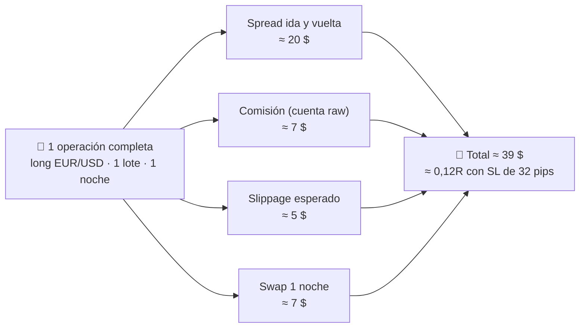

# Lección 4.3 · El costo real de operar

| Campo | Detalle |
|---|---|
| ⏱️ Duración estimada | 45–60 min de estudio |
| 🧱 Módulo | [M4 · Plataforma y Primera Ejecución](README.md) |
| ⬅️ Anterior | [Lección 4.2 · Tipos de órdenes](leccion-4-2.md) |
| ➡️ Siguiente | [Lección 4.4 · Largos y cortos](leccion-4-4.md) |

---

## Por qué importa

La [Lección 2.1](../mod-02-motor-del-precio/leccion-2-1.md) te enseñó el spread como peaje. El peaje completo tiene cuatro cabinas: **spread, comisión, slippage y swap** — y la mayoría de los principiantes solo ve la primera. El resultado es el clásico sistema "rentable en papel y perdedor en la cuenta": la esperanza que calculaste era bruta, pero la que cobra el bróker es neta. Los costos no negocian contigo, no descansan cuando pierdes y se aplican **a todas las operaciones — incluidas las malas**. Un sistema que opera 20 veces al mes con un costo de 0,10R por operación paga 2R al mes solo en peajes: si su ventaja bruta es 0,15R por operación, el costo se come dos tercios. Esta lección pone número a cada cabilla del peaje, porque el primer trabajo de un negocio es conocer su estructura de costos al céntimo ([Lección 1.6](../mod-01-negocio-trading/leccion-1-6.md)).

## Concepto

Los cuatro costos de toda operativa, en orden de visibilidad:

1. **Spread** (*spread*): la diferencia bid-ask que pagas en cada ida y vuelta ([Lección 2.1](../mod-02-motor-del-precio/leccion-2-1.md)). Se paga **siempre**, en cada operación. Varía por horario y por instrumento (mínimo en el solapamiento Londres–NY, [Lección 2.4](../mod-02-motor-del-precio/leccion-2-4.md)).
2. **Comisión** (*commission*): cargo fijo del bróker por operación, típico de cuentas *raw/ECN*: p. ej. **7 $ por lote ida y vuelta** *(ilustrativo)*. Las cuentas *standard* dicen "sin comisión" pero cobran spreads más anchos: **nadie opera gratis** — el costo está en el precio o en la factura, nunca en ninguno.
3. **Slippage** (*slippage*): diferencia entre el precio que pediste y el que obtuviste. Ocurre cuando el mercado se mueve entre tu clic y la ejecución: noticias, aperturas, gaps. Es intermitente pero concentrado: cero slippage en 95 % de las operaciones y 3–10 pips en la que coincide con un dato macro *(ilustrativo)*.
4. **Swap / rollover** (*swap / overnight fee*): interés diario por mantener la posición abierta **overnight**, derivado del diferencial de tasas entre las dos divisas. Puede ser negativo o positivo según la dirección y el par. Los **miércoles se cobra triple** (por el fin de semana que viene: el mercado liquida el interés de sábado y domingo ese día). En oro y CFDs de índices existe también, generalmente negativo en ambos sentidos.

**Visual — anatomía del costo de una operación** (1 lote estándar EUR/USD, 1 noche en el mercado *(todas las cifras ilustrativas, tu bróker manda)*):

## Analogía

Importar mercancía para tu tienda. El costo real no es lo que pagas al fabricante: es fabricante **+ flete + aduana + almacén + mermas**. Un importador que presupuesta solo el precio del fabricante quiebra con pedidos "rentables en papel". En trading: fabricante = precio de entrada; flete y aduana = spread y comisión (los pagas en cada envío, sí o sí); mermas = slippage (no siempre ocurre, pero cuando el puerto está caótico, muerde); almacén = swap — pagas por cada noche que la mercancía duerme en el depósito, y algunos miércoles te cobran el fin de semana entero de golpe. El negocio se planifica con el costo total, nunca con el precio de catálogo.

## Cómo se hace: el costo completo de tu operación tipo, en números cerrados

Tu operación estándar del programa (lote **0,06**, SL **30 pips**, TP **60 pips** — la receta). Con 0,06 lotes, cada pip vale 0,6 $ (0,06 × 10 $/pip). El truco de claridad: los costos en **pips** no dependen del tamaño — 2 pips de spread son 2 pips con 0,06 o con 5 lotes; solo el ticket en $ escala:

| Costo | Cálculo | En $ (0,06 lote) | Pips equiv. |
|---|---|---:|---:|
| Spread (2 pips) | 2 × 0,6 $/pip | 1,20 $ | 2,0 |
| Comisión (cuenta standard: 0) | — | 0 $ | 0,0 |
| Slippage medio esperado | 0,5 × 0,6 $/pip | 0,30 $ | 0,5 |
| Swap (1 noche, long EUR/USD) *(ilustrativo)* | 0,06 × (−7 $) | 0,42 $ | 0,07 |
| **Total** | | **≈ 1,92 $** | **≈ 2,6** |

Con cuenta *raw* (spread 0,8 pips + comisión 7 $/lote round-turn × 0,06 = 0,42 $): spread 0,48 $ + 0,42 $ + slippage 0,30 $ + swap 0,42 $ ≈ **1,62 $** — más barata en este caso; la comparación correcta siempre es **todo incluido**, nunca una partida aislada.

**El peso relativo — la métrica que sí importa** (en pips, tamaño-invariante):

- Contra el **TP** (60 pips): 2,6/60 = **4,3 % del objetivo**.
- Contra el **SL** (30 pips): 2,6/30 ≈ **0,09R de costo por operación** — este es el $c$ que entra en la fórmula de E.
- Con un TP de 10 pips (scalping), los mismos 2,6 pips serían **26 % del objetivo** — la razón matemática por la que el programa prohíbe scalping hasta tener estadística propia ([Lección 1.4](../mod-01-negocio-trading/leccion-1-4.md)).

**Y la factura mensual** *(números cerrados, en tu tamaño real)*: 20 operaciones/mes × 1,92 $ ≈ **38 $/mes de peajes** — el 4,3 % de cada objetivo, cobrado 20 veces. La escala no lo cura: en R el peaje es igual (0,09R) con 2 000 $ o con 200 000 $, porque el costo vive en los pips y tu ventaja también. Con E bruto +0,20R, el peaje se queda el **43 % de tu ventaja bruta** (0,09/0,20) — y por eso el programa primero valida mecánica en demo (N1) y construye ventaja medida en N2-N3 con $E_{neto}$ sobre TU journal: este cálculo honesto, con tus propios números, es la entrega central de M9.

## Error común

**(1) Comparar brókers solo por el spread** — el bróker "más barato" con spread 1,2 + comisión 7 $/lote pierde frente a uno de 2,0 sin comisión en operaciones cortas, y gana en operativa larga: el costo correcto se compara como **todo incluido**. **(2) Ignorar el swap en planes de swing** — "mantengo hasta que gane" también paga almacén: 15 noches de −0,42 $ no arruinan, pero 15 noches en un par con swap duro sí deforman el R:B real de una operación planeada a 3 noches. **(3) Medir slippage en demo** — muchas demos ejecutan al precio exacto siempre: la demo mide tu mecánica, no el costo real ([Lección 4.5](leccion-4-5.md) detalla qué simula y qué no). **(4) Sobreoperar porque cada peaje "es pequeño"** — 20 operaciones/mes ≈ 38 $ de costo; 60 operaciones/mes ≈ 115 $: el costo escala **linealmente con la actividad**, y la ventaja no. La actividad sin ventaja adicional es regalar peaje.

## Conexión cuantitativa

La fórmula del programa queda así: $E_{neto} = E_{bruto} - c$ donde $c$ = costo todo incluido por operación (en R). Con $c \approx 0{,}09R$ (recién calculado): un sistema con $E_{bruto} = +0{,}20R$ queda en $E_{neto} = +0{,}11R$ — la mitad de tu ventaja es del peaje. Y el punto de inflexión: $E_{neto} > 0$ exige $E_{bruto} > c$; si tu E bruto es 0,08R, **el peaje te deja en negativo aunque el sistema "funcione"**. Dos palancas de negocio que ya controlas: (1) **horario** — operar solo en solapamiento puede recortar el spread 40–70 % *(ilustrativo)*: $c$ baja sin tocar el sistema; (2) **frecuencia** — cada operación extra paga peaje completo, así que filtrar setups mediocres no solo sube tu WR: baja tu factura de costos. En el examen N1 este cálculo aparece con números.

---

## 🎯 Puntos clave

1. Cuatro cabinas de peaje: spread (siempre), comisión (según cuenta), slippage (intermitente pero concentrado), swap (por cada noche).
2. "Sin comisión" significa comisión escondida en el spread: el costo total es lo comparable, nunca una partida aislada.
3. El swap cobra triple los miércoles (liquida el fin de semana) y puede ser positivo en shorts de pares con diferencial favorable.
4. El peso del peaje se mide en pips contra el objetivo: 2,6 pips sobre un TP de 60 = 4,3 %; sobre un TP de 10 = 26 % — por eso el scalping está vetado sin estadística.
5. $E_{neto} = E_{bruto} - c$: un sistema con E bruto menor que su costo pierde dinero "funcionando".
6. El costo escala lineal con la frecuencia; la ventaja no — sobreoperar es regalar peaje.

## 🔄 Autoevaluación rápida

1. Lista los 4 costos y clasifícalos: ¿cuáles se pagan en TODA operación y cuáles solo en algunas?
2. Cuenta ECN: spread 0,8 pips + 7 $/lote de comisión. Cuenta standard: spread 2,0 pips sin comisión. Con 1 lote EUR/USD y TP de 25 pips, ¿cuál es más barata todo incluido? (1 pip = 10 $).
3. Tu plan original era swing de 3 noches, pero el trade no avanza y lo sostienes 12 noches. ¿Qué costo deformó tu R:B y por qué el miércoles importa?

Ver respuestas

1. Siempre: **spread** (cada ida y vuelta) y **comisión** si tu cuenta la cobra (si no, está en el spread). Solo en algunas: **slippage** (noticias, gaps, aperturas) y **swap** (solo si la posición pasa la noche).
2. ECN: 0,8 × 10 = 8 $ de spread + 7 $ de comisión = **15 $**. Standard: 2,0 × 10 = **20 $**. La ECN es más barata (15 vs 20 $) en este caso — con TPs más cortos la ventaja ECN crece y con operativa muy larga el spread domina. La comparación correcta es todo incluido por operación, no el titular del marketing.
3. El **swap**: 9 noches extra de almacén que el plan no presupuestó (y el triple del miércoles dentro de esas 9). Tu R:B se planeó con 3 noches de costo y ahora carga 12: si el swap es −0,42 $/noche en tu tamaño, son ≈ −3,8 $ extra (≈ 0,2R más de costo); en pares de swap duro o lotes mayores, el "trade que se demoró" puede pasar de +2R planeados a +1,4R reales. Regla: el costo de cada noche extra debe caber en el plan — si no cabe, el plan era otro.

