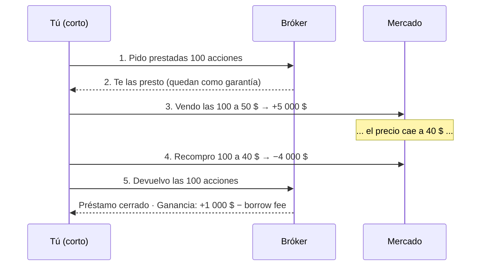

# Lección 4.4 · Largos y cortos

| Campo | Detalle |
|---|---|
| ⏱️ Duración estimada | 40–50 min de estudio |
| 🧱 Módulo | [M4 · Plataforma y Primera Ejecución](README.md) |
| ⬅️ Anterior | [Lección 4.3 · El costo real de operar](leccion-4-3.md) |
| ➡️ Siguiente | [Lección 4.5 · Cuenta demo](leccion-4-5.md) |

---

## Por qué importa

El retail opera casi siempre en largo porque "vender algo que no tienes" suena a truco. Pero si tu análisis dice "caída confirmada en 3 pasos" ([Lección 3.4](../mod-03-anatomia-del-grafico/leccion-3-4.md)) y solo sabes comprar, pierdes la mitad de las oportunidades de tu propio sistema. Y hay una segunda razón, más profunda: la mecánica del corto explica fenómenos que te van a golpear incluso sin operar cortos — los *short squeeze* que revientan gráficos, los *borrow fees* que erosionan posiciones, y la asimetría estructural de los mercados: **suben en escalera y caen en ascensor**. Entender el corto es entender por qué las caídas son más violentas que las subidas, y por qué tu SL deja de ser recomendación y se convierte en estructura portante el día que vendes.

## Concepto

**Long (largo):** comprar barato → vender caro. Dos pasos en orden natural: compras 100 unidades a 50, vendes a 60: +1 000 (menos costos). Tu pérdida máxima teórica es el precio llegando a cero: acotada.

**Short (corto):** ganar con la caída invirtiendo el orden. En acciones/CFDs de acciones la mecánica literal es: (1) **pedir prestadas** las acciones al bróker (las presta otro cliente o el inventario del propio bróker); (2) **venderlas** al precio actual; (3) esperar la caída; (4) **recomprarlas** más baratas; (5) **devolverlas** al prestamista. La ganancia = precio de venta − precio de recompra − costos. En forex y CFDs de índices/oro no hay préstamo visible: el botón "vender" abre la posición directamente — pero el mecanismo económico es el mismo, y en forex además siempre estás vendiendo una divisa **comprando otra**: tu short de EUR/USD es un long de USD ([Lección 2.6](../mod-02-motor-del-precio/leccion-2-6.md): el DXY te afecta).

**Costos propios del corto:**

- **Borrow fee** (acciones/CFDs acciones): interés anual por el préstamo, típico 0,5–3 % *(ilustrativo)*; en acciones *hard-to-borrow* puede ser brutal. Se prorratea por día de posición.
- **Swap en corto forex:** puede ser **positivo** si vendes la divisa de tasa alta contra la de tasa baja — el único "alquiler" que a veces te paga a ti.

**Short squeeze:** cuando el precio sube en lugar de caer, los cortos pierden y muchos cierran (compran para recomprar). Su recompra **es la compra que sube más el precio**, que liquida más cortos, que recompra más… una cascada sin techo. Caso público: GameStop, enero 2021 — con más de la flotante vendida en corto, el precio multiplicó en días y fondos que vendían corto cerraron pérdidas multimillonarias al recomprar.

**La asimetría estructural:** las subidas se construyen con acumulación paciente (fragmentos, [Lección 3.2](../mod-03-anatomia-del-grafico/leccion-3-2.md)) — escalera. Las caídas se aceleran con miedo, que es urgencia pura (takers en masa, [Lección 2.1](../mod-02-motor-del-precio/leccion-2-1.md)) — ascensor. Implicación práctica: las piernas bajistas suelen ser más rápidas y profundas que las alcistas; el corto tiene ventaja de velocidad y desventaja de costos + riesgo de squeeze.

**Visual — la mecánica del short, paso a paso** (100 acciones a 50 $):

## Analogía

Tu primo y las entradas del concierto. Él no tiene entradas, pero le prometes 10 al precio de hoy (70 $) para el fin de semana — te las consigue de un amigo del trabajo (le "pides prestadas" con su permiso). Ya vendiste lo que no tenías: cobraste 700 $. El viernes las consigues a 50 $, las entregas, y ganaste 200 $ sin haber tenido nunca entradas propias. Ahora el mal escenario: el grupo anuncia que será su último concierto, el precio se dispara a 150 $, y TU promesa sigue en pie. Cada comprador ansioso que empuja el precio arriba es alguien cerrando su propia promesa corta — y tú debes recomprar a 150 y perder 800. No hay techo para cuánto puede subir: la promesa corta pierde mientras el precio suba. Eso es un squeeze: primos por todo el estadio comprando desesperados.

## Cómo se hace: el mismo trade en los dos sentidos, con números cerrados

Misma idea técnica (retesteo confirmado en zona, protocolo M3.4), ejecutada en los dos sentidos sobre EUR/USD, lote 0,06, riesgo 18 $ *(cifras ilustrativas)*:

- **Long:** buy limit 1,0824 → SL 1,0794 (30 pips) → TP 1,0884 (60 pips). Cobro si sube: +60 pips = +36 $ bruto (60 × 0,6 $/pip).
- **Short:** sell limit 1,0860 (borde inferior de la resistencia) → SL 1,0890 (30 pips sobre la entrada, tras el máximo del swing) → TP 1,0800 (60 pips bajo). Cobro si baja: +60 pips = +36 $ bruto.
- **Costos diferenciales:** si cada lado se sostiene 2 noches: long paga swap −0,84 $ (2 × −0,42); short **cobra** +0,36 $ (2 × +0,18) *(ilustrativo, según diferencial de tasas)*. El corto parte con 1,20 $ de ventaja de costos en este par — hasta que llega un squeeze.
- **El riesgo que NO es simétrico:** tu long pierde como máximo 30 pips planeados y, sin SL, como mucho hasta el precio 0 (≈ −6 500 $: el nominal completo de 0,06 lotes). Tu short sin SL no tiene techo de pérdida: el precio puede subir 200 pips o 2 000. **Por eso en cortos el SL no es negociable ni un pip** — y en acciones cortadas con gaps, el plan usa tamaño reducido: mismo R monetario, no mismo tamaño nominal (el gap de apertura puede saltarse cualquier stop — [Lección 2.4](../mod-02-motor-del-precio/leccion-2-4.md): los gaps del fin de semana).

**El borrow fee con números:** cortas 100 acciones a 50 $ (posición de 5 000 $), borrow 2 % anual *(ilustrativo)* → 100 $/año ≈ 0,28 $/día. 10 días de posición: 2,78 $ — pequeño, pero se suma y en *hard-to-borrow* (10–50 % anual) convierte un trade de 3 semanas en un empate.

## Error común

**(1) Cortar sin SL "porque el techo es lo que ponga"** — es exactamente al revés: el corto es el único escenario donde tu pérdida es ilimitada por diseño; la ley del stop ([Lección 4.6](leccion-4-6.md)) se escribe primero para los cortos. **(2) Pelear contra un squeeze** — "ya tiene que caer, está sobreextendido": la presión de los cortos atrapados no lee tu análisis; cada pip de subida es órdenes de recompra obligada. El protocolo: SL puesto desde el inicio y respetado; reentrar más tarde, si el régimen lo vuelve a permitir, es otra decisión sin bagaje. **(3) Olvidar que en forex el corto es un long cruzado** — vendes EUR/USD y el USD se debilita por un dato macro: pierdes aunque "el EUR no hizo nada". La cadena DXY de la Lección 2.6 es tu contexto obligado antes de cualquier corto de major. **(4) Ignorar que el 95 % del material del retail está pensado para largos** *(heurística)* — tus ejemplos mentales de "comprar bajo" te empujan a anticipar fondos en caídas rápidas: el ascensor no se agarra con las manos.

## Conexión cuantitativa

Operar ambos lados duplica el universo de setups que tu sistema puede estadísticamente medir — mismo E, más muestras, menos dependencia del régimen alcista de tu instrumento favorito. Pero los dos lados no cuestan lo mismo: $E_{neto}^{short} = E_{bruto} - c - f_{borrow}$ (en acciones) o $+ f_{swap}$ (si el diferencial juega a tu favor en forex). Concretado: un short de acciones con E bruto +0,15R, borrow equivalente a 0,02R por las noches sostenidas y slippage de gap ocasional (+0,01R esperado) queda en +0,12R neto — aún válido; el mismo short en un *hard-to-borrow* con 0,25R de borrow mensual queda en −0,10R: **el costo del préstamo puede por sí solo invalidar un setup técnicamente perfecto**. La regla del programa: antes de un short de acciones, el borrow fee anual se convierte a R y entra en el cálculo; antes de un short de forex, el swap del par entra; y en ambos, el SL es estructural porque la cola derecha no tiene suelo.

---

## 🎯 Puntos clave

1. Short = vender prestado → recomprar barato → devolver. La ganancia vive en la diferencia de recompra.
2. En forex/CFDs el préstamo es invisible (botón "vender"), pero el costo existe: borrow fee en acciones; swap (a veces positivo) en forex.
3. Todo short de forex es a la vez un long de la otra divisa: la cadena DXY es contexto obligado.
4. Short squeeze: las recompras obligadas de los cortos perdedores son la gasolina de la subida — cascada sin techo.
5. Asimetría estructural: suben en escalera (acumulación paciente), caen en ascensor (miedo = urgencia).
6. En largos tu peor caso sin SL es el precio 0; en cortos no hay techo — el SL en cortos es ley de las leyes.

## 🔄 Autoevaluación rápida

1. Enumera los 5 pasos de la mecánica del short en acciones y di de dónde sale exactamente la ganancia.
2. ¿Por qué el riesgo de un short sin SL es ilimitado y el de un long sin SL no lo es (aun siendo desastroso)?
3. Describa el mecanismo del squeeze en 3 pasos y di qué conducta del programa lo neutraliza.

Ver respuestas

1. (1) Pedir prestadas las acciones al bróker. (2) Venderlas al precio de mercado (cobras el nominal). (3) Esperar la caída. (4) Recomprarlas más baratas. (5) Devolverlas al prestamista. La ganancia = venta − recompra − costos (borrow fee prorrateado + spread/comisión). El bróker cierra el préstamo al devolver: tú nunca fuiste propietario.
2. El long comprado a 50 $ pierde como máximo hasta el precio 0: −50 $/acción de techo de desastre (durísimo, pero acotado). El corto vendido a 50 $ debe recomprar para devolver las acciones, y el precio de recompra no tiene techo: a 150 $ pierdes 100 $/acción, a 500 $ pierdes 450 $/acción. La pérdida del corto está abierta por arriba — por eso el SL del corto se coloca, se verifica y no se toca jamás.
3. (1) El precio sube → cortos en pérdida. (2) Parte de los cortos cierra = recompra obligada, que es demanda compradora adicional → sube más. (3) La subida liquida más cortos, que recompran más: bucle de realimentación sin techo hasta que no quedan cortos que liquidar. Lo neutraliza: SL puesto antes de entrar y respetado (sales en tu −1R sin participar en la cascada) + no reentrar en corto "porque ya está caro" durante el squeeze.

