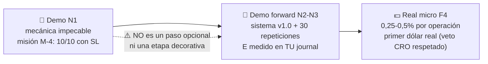

# Lección 4.5 · Cuenta demo

| Campo | Detalle |
|---|---|
| ⏱️ Duración estimada | 40–50 min de estudio + sesión de configuración |
| 🧱 Módulo | [M4 · Plataforma y Primera Ejecución](README.md) |
| ⬅️ Anterior | [Lección 4.4 · Largos y cortos](leccion-4-4.md) |
| ➡️ Siguiente | [Lección 4.6 · El Stop Loss como ley](leccion-4-6.md) |

---

## Por qué importa

La demo es tu gimnasio: cuesta 0 $, no expone capital y permite cometer los cientos de errores mecánicos que todo operador necesita cometer — con el único requisito de que los registres. Pero la demo mal configurada enseña vicios caros: quien practica con 100 000 $ virtuales y lotes de 1.00 entrena un tamaño que jamás usará, y quien opera 30 veces al día sin journal entrena reflejos contrarios a su futuro plan. El programa no usa la demo "para ver si funciona el trading" — la usa como **laboratorio de mecánica** con protocolo ordenado: mismo capital que tu plan real, mismo riesgo por operación, mismas órdenes que ejecutarías en vivo, y un criterio de salida claro. La honestidad sobre lo que la demo puede y no puede darte es parte de la lección: te da procedimiento, no nervios — y fingir lo contrario es autoengaño.

## Concepto

**Qué es:** una cuenta con dinero virtual conectada a cotizaciones reales (o casi). Montas órdenes, el panel computa P/L, swap y margen igual que una real — pero la factura es ficticia.

**Qué simula bien (por eso la usamos):**

- La **mecánica completa**: tipos de órdenes, OCO, ejecución, pips, lotes, margen, swap.
- La **lectura del panel** y el flujo de trabajo diario (journal, capturas, checklist).
- El **comportamiento del precio** — si el bróker es serio, la demo usa el mismo feed que la real.

**Qué NO simula (por eso no nos engañamos):**

- **Slippage real** en noticias y gaps: muchas demos ejecutan al precio exacto siempre ([Lección 4.3](leccion-4-3.md)).
- **Tu psicología con dinero real:** la pérdida de 18 $ reales duele distinto que la virtual — y fingir que no es así es negar la variable 85/15 del programa ([Lección 1.4](../mod-01-negocio-trading/leccion-1-4.md)).
- **La fricción de retiros, requotes y stops-out reales** bajo volatilidad extrema.

**La configuración realista del programa (no negociable):**

| Parámetro | Valor | Por qué |
|---|---|---|
| Capital virtual | **El de tu plan real** (p. ej. 2 000 $) — no 100 000 $ | entrenar el tamaño que usarás |
| Riesgo por operación | **1 % = 20 $** (igual que el plan) | la mecánica del riesgo se automática aquí |
| Apalancamiento | El que usarás de verdad (p. ej. 1:30) | el margen debe doler proporcionalmente |
| Tipo de cuenta | El mismo que abrirías (standard o raw) | los costos de la [Lección 4.3](leccion-4-3.md) deben verse |
| Lote típico resultante | 0,05–0,06 en EUR/USD (fórmula de la receta) | micro real, no fantasía |

**Lectura del panel de posiciones** (los campos que debes saber leer antes de operar):

- **P/L flotante:** la ganancia/pérdida *si cerraras ahora* — todavía es tuya solo en papel.
- **P/L realizado:** el resultado definitivo cuando cierras — el único que entra en tu journal.
- **Margen usado:** la garantía retenida por tu posición. Con 0,06 lotes EUR/USD a 1,0852 y apalancamiento 1:30: (0,06 × 100 000 × 1,0852) ÷ 30 ≈ **217 $**.
- **Margen libre:** capital − margen usado − pérdidas flotantes. Si tiende a 0, tu tamaño es demasiado grande — el programa te quiere lejos de esa línea.
- **Swap acumulado:** el almacén de la [Lección 4.3](leccion-4-3.md) cobrando en tiempo real.

**Visual — el circuito de progresión del programa** (la demo es la primera etapa, no el destino):

## Analogía

Simulador de vuelo. Ninguna aerolínea sienta a un novato al mando de un 747 con pasajeros: primero cientos de horas de simulador, donde estrellarse es gratis y cada procedimiento se repite hasta el músculo. Pero nadie finge que el simulador vuela: no hay turbulencia emocional, no hay pasajeros detrás, no hay consecuencia. La industria del trading hace lo contrario que la aeronáutica: le dice al novato "súbete, el dinero te enseña" — y por eso estudios de reguladores estiman que entre el 70 % y el 90 % pierde. El programa aeronáutico es el del programa: demo primero, protocolo completo, y honestidad sobre lo que el simulador no puede enseñarte — el sudor del pasajero real lo conocerás en F4, con riesgo micro, no antes.

## Cómo se hace: tu sesión de configuración (una vez, 30 minutos)

1. **Abre la demo** con el bróker que hayas preseleccionado en el paso 0 de la [Receta](../../03-recursos/laboratorio/receta-primera-operacion.md) (due diligence sin marcas, regulación verificada).
2. **Fija capital 2 000 $ y apalancamiento 1:30** *(o tu plan real; más apalancamiento no es "mejor": es más margen para cometer errores más grandes)*.
3. **Carga el layout `FIT12-trabajo`** de la [Lección 4.1](leccion-4-1.md) y la watchlist de 5 instrumentos.
4. **Verifica el tamaño:** abre la calculadora de lote (o la fórmula: lote = riesgo $ ÷ (SL pips × valor pip)): 20 $ ÷ (30 × 10) = 0,066 → **0,06** en EUR/USD.
5. **Ejecuta tu primera OCO completa** siguiendo la receta: buy limit 1,0824 + SL 1,0794 + TP 1,0884 *(precios ilustrativos del caso maestro)*.
6. **Lee el panel:** margen usado ≈ 217 $, margen libre ≈ 1 783 $, P/L flotante en 0.
7. **Deja la posición trabajar** con SL/TP montados y cierra la plataforma — la OCO vigila por ti.
8. **Al día siguiente:** revisa el resultado, regístralo en `journal/plantilla_journal_v0.csv` y completa el checklist de 6 puntos de la misión M-4.
9. **Repite en XAU/USD:** ficha de variación de la receta: riesgo 20 $, SL 4 $ de recorrido → 5 oz = 0,05 lotes (0,05 × 100 oz × 4 $ = 20 $ ✓).
10. **Confirma el circuito completo:** orden montada → ejecutada → gestionada (o no gestionada: la OCO gestiona) → cerrada → registrada. Ese bucle ES la mecánica que N1 certifica.

## Error común

**(1) La demo casino:** 100 000 $ virtuales, lotes de 1.00, 30 operaciones al día, cero journal. Entrena exactamente lo contrario del plan: tamaño fantasma, frecuencia patológica y memoria sin datos. La primera semana real de esa persona será una descongelación dolorosa — mejor no crear los vicios. **(2) El perfeccionismo demo infinito:** "aún no estoy listo" en el mes 8 de demo sin criterio de salida. El programa fija umbrales: misión M-4 (10/10 mecánica impecable) cierra N1, y N2 avanza en demo-forward con sistema — la demo no es un refugio del miedo, es un laboratorio con entregables. **(3) Tomar el P/L flotante como resultado:** el trade "que ganaba 40 pips y cerró en −30" no perdió 70 pips porque "el mercado se lo robó": sin TP parcial ni gestión planificada (eso llega en M8), el flotante es papel. Lo único real es el precio de cierre. **(4) Cambiar el capital virtual a mitad** "para probar con más margen": rompe la comparabilidad de tu estadística — la demo es un experimento con variable única: tu mecánica.

## Conexión cuantitativa

La demo es donde tu mecánica se vuelve **medible sin costo**: el objetivo de la misión M-4 es 10/10 con SL puesto antes de entrar (100 %, sin excepciones) — un KPI binario que la demo mide perfectamente porque no requiere dinero. El resto de métricas de la demo son provisionales por diseño: WR, E y rachas medidos en demo **no cuentan** como estadística del sistema (N pequeña, sin slippage real, sin psicología) — el programa los invalida explícitamente para que nadie construya confianza sobre arena. La progresión honesta: demo = mecánica (N1) → demo-forward = sistema con muestra (N2-N3, N ≥ 30 repeticiones documentadas) → real micro = psicología con riesgo acotado (F4: 0,25–0,5 %). Cada etapa responde una pregunta distinta; mezclarlas es contestar mal las tres.

---

## 🎯 Puntos clave

1. La demo simula mecánica y flujo de trabajo; NO simula slippage real, fricción ni tu psicología con dinero real.
2. Configuración realista no negociable: capital del plan real, riesgo 1 %, apalancamiento real, tipo de cuenta real, lotes micro (0,05–0,06).
3. Panel: P/L flotante es papel; realizado es journal. Margen usado ≈ 217 $ en tu posición tipo 1:30; si el margen libre se encoge, el tamaño sobra.
4. El circuito del programa: demo (mecánica) → demo-forward (sistema) → real micro (psicología) — cada etapa responde una pregunta distinta.
5. La demo no da estadística de sistema: WR y E demo se invalidan por N pequeño y costos irreales.
6. Criterio de salida de la demo: misión M-4 completa — la demo sin entregable es refugio, no laboratorio.

## 🔄 Autoevaluación rápida

1. ¿Qué dos cosas simula bien la demo y qué tres no simula? ¿Por qué esa diferencia define el KPI de la misión M-4?
2. Calcula el margen usado de 0,10 lotes EUR/USD a 1,0900 con apalancamiento 1:30. ¿Y con 1:100?
3. Tu amigo lleva 8 meses en demo "preparándose" sin misiones ni entregables. ¿Qué le objeta el programa?

Ver respuestas

1. Simula bien: mecánica completa (órdenes, OCO, margen, swap) y el flujo de trabajo (journal, checklist). No simula: slippage real en noticias/gaps, tu psicología con dinero real, y fricciones de cuenta real (requotes, stops-out). Por eso el KPI de M-4 es binario de mecánica (10/10 con SL puesto antes de entrar): es lo único que la demo puede medir con validez — WR/E demo quedan invalidados como estadística.
2. Nominal = 0,10 × 100 000 × 1,0900 = 10 900 $. A 1:30: 10 900 ÷ 30 ≈ **363 $** de margen usado. A 1:100: **109 $**. El margen menor de 1:100 no te hace más rico: solo permite posiciones más grandes — el riesgo real lo define el SL y el lote, no el apalancamiento (la cuenta 1:100 solo facilita el error de tamaño).
3. La demo sin entregables es refugio, no laboratorio: 8 meses sin misiones no producen mecánica certificada ni datos comparables. El programa fija umbrales de salida (M-4: 10/10; luego N2 con 30 repeticiones documentadas). La objeción correcta: ¿qué pregunta concreta responde hoy tu demo? Si no hay pregunta, hay miedo con excusa técnica — y la progresión del programa existe precisamente para no quedarse atrapado ahí.

