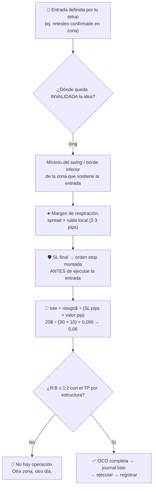

# Lección 4.6 · El Stop Loss como ley

| Campo | Detalle |
|---|---|
| ⏱️ Duración estimada | 45–60 min de estudio |
| 🧱 Módulo | [M4 · Plataforma y Primera Ejecución](README.md) |
| ⬅️ Anterior | [Lección 4.5 · Cuenta demo](leccion-4-5.md) |
| ➡️ Siguiente | — (última lección del módulo; sigue el [Examen N1](../../03-recursos/evaluaciones/examen-n1.md)) |

---

## Por qué importa

Esta lección cierra el Nivel 1 con la única regla del programa que no admite contextos, excepciones ni "solo esta vez": **toda posición lleva Stop Loss puesto antes de entrar**. El SL es el mecanismo que acota tu peor caso a 1R conocido antes de arriesgar un centavo — y sin él, la esperanza matemática de la [Lección 1.4](../mod-01-negocio-trading/leccion-1-4.md) no existe: no puedes calcular E cuando la cola de pérdidas no tiene suelo. El SL es también lo que convierte la estadística de la industria (70–90 % de cuentas perdedoras) en algo que no te aplica mecánicamente: la mayoría de esas cuentas muere por posiciones sin salida planificada que se convirtieron en "inversiones a la baja". Aquí no vamos a "intentar ponerlo casi siempre": el checklist de ejecución del programa exige SL montado en el 100 % de las operaciones, y la misión M-4 certifica exactamente eso.

## Concepto

**Definición:** el Stop Loss es una orden stop de cierre a un precio donde tu idea queda **invalidada** — no donde el dolor se vuelve insoportable. La diferencia es estructural: el mercado decide el primer precio (donde el análisis muere), tú solo calculas el lote que cabe.

**Las tres propiedades de la ley:**

1. **Se define ANTES de entrar.** El SL es la entrada de tu cálculo, no su corrección: primero SL, después lote — invirtiendo el orden, "eliges" el stop para que quepa la apuesta que ya querías, y eso es deformar el análisis en favor del deseo.
2. **Va por estructura.** Long: bajo el **mínimo del swing/zona** que sostiene tu entrada; short: sobre el **máximo del swing/zona**. Con margen de respiración: spread + ruido local del marco (2–3 pips en EUR/USD H1 *(ilustrativo)*; escala con el ADR del instrumento, [Lección 2.4](../mod-02-motor-del-precio/leccion-2-4.md)). Un SL dentro del ruido no es protección: es una barrida de stops esperando ocurrir ([Lección 2.3](../mod-02-motor-del-precio/leccion-2-3.md)).
3. **Nunca se aleja del precio.** El SL se queda, se acerca (breakeven/arrastre, opcional y posterior — M8) o se ejecuta. Moverlo en contra para "darle aire" convierte tu −1R planeado en −2R, −3R… y anula el cálculo de ruina de todo el programa.

**SL mental no es SL.** "Lo llevo en la cabeza" significa que en el momento crítico — adrenalina, noticia, tick que roza — tu disciplina compita contra la plataforma. La historia de cada cuenta rota tiene esa frase en algún lugar. La ley: la orden está montada en el bróker, verificada en el panel, antes de que la entrada exista.

**La fórmula que amarra todo** (la de la receta): $\text{lote} = \dfrac{\text{riesgo \$}}{\text{SL pips} \times \text{valor pip}}$. El SL sale de la estructura; el riesgo sale de tu plan (1 %); el lote es el **resultado**, nunca la entrada.

**Visual — protocolo de colocación por estructura (long):**



## Analogía

El cinturón de seguridad. No lo abrochas porque calculaste que hoy chocabas: lo abrochas porque el choque **no está bajo tu control**, y lo abrochas antes de arrancar — nadie se lo pone en plena curva. El SL es tu cinturón: no implica que tu idea sea mala, implica que el mercado puede invalidarla sin avisar. Y quitarlo en la pérdida es la locura exacta de soltarte el cinturón porque "el golpe ya viene y el cinturón me aprieta": el cinturón no causa el golpe — te separa a ti del parabrisas. Por eso SL mental no vale: el cinturón en el maletero ("lo llevo por si acaso") no abrocha a nadie.

## Cómo se hace: el caso maestro completo, con números cerrados

La operación tipo de la receta, ahora vista desde el SL:

1. **Setup:** retesteo confirmado de la zona 1,0820–1,0824 en EUR/USD H4, régimen y protocolo de 3 pasos completos ([Lección 3.4](../mod-03-anatomia-del-grafico/leccion-3-4.md)).
2. **¿Dónde muere la idea?** Bajo el mínimo del swing local: **1,0798** (el precio perdiendo ese mínimo ya no es "retesteo que se sostiene": es rotura fallida).
3. **Margen de respiración:** mínimo del swing local **1,0798** − 4 pips (spread 2 + ruido local 2) → **SL = 1,0794** = 30 pips bajo la entrada limit de 1,0824. El SL quedó tras la estructura con aire, no en el depósito obvio de stops ([Lección 2.3](../mod-02-motor-del-precio/leccion-2-3.md)).
4. **Lote desde el SL:** riesgo 1 % de 2 000 $ = 20 $; lote = 20 ÷ (30 × 10) = 0,066 → **0,06** (redondeo SIEMPRE a la baja): riesgo real 18 $ = **0,9 %** ✓.
5. **TP por estructura:** resistencia opuesta 1,0884 = 60 pips → R:B nominal **2,0** ✓ (mínimo del programa).
6. **OCO montada y verificada** (mecánica de la [Lección 4.2](leccion-4-2.md)): buy limit 1,0824 + SL 1,0794 + TP 1,0884 — verificada en el panel ANTES de la sesión.
7. **Journal listo** con la fila de la plantilla esperando datos.

**El checklist de ejecución — 6 de 6 o no hay operación** (la moneda del criterio de graduación):

```text
□ 1. Setup definido por escrito (qué lo activa y qué lo invalida)
□ 2. SL colocado por estructura (tras el swing/zona, con respiración)
□ 3. SL montado en la plataforma ANTES de la entrada
□ 4. Lote calculado DESDE el SL (riesgo ≤ 1 %, redondeo a la baja)
□ 5. TP por estructura con R:B ≥ 1:2
□ 6. OCO completa verificada + fila del journal abierta
```

## Error común

**(1) El SL en el borde exacto** — el depósito de stops de todo el mundo está 1-2 pips tras el nivel obvio ([Lección 2.3](../mod-02-motor-del-precio/leccion-2-3.md)): tu SL correcto está tras el swing real con respiración, no en la fila. **(2) El SL por tolerancia al dolor** — "máximo 40 pips porque son 40 $": el mercado no sabe cuánto toleras; si la estructura pide 28 pips y tu dolor pide 40, el problema es el tamaño (baja el lote), no la estructura. **(3) Quitar el SL cuando "está a punto de tocar"** — el instante en que más lo necesitas es el instante en que la adrenalina pide quitarlo; la ley existe para esos 30 segundos. **(4) Moverlo en contra** — "le doy aire y vuelve": cada pip de aire extra es deuda de riesgo que tu plan no presupuestó; si toca el SL nuevo, la pérdida ya no es 1R y tu serie de ruina cambió sin que lo autorizaras. **(5) Primero el lote, luego el stop** — invertir la fórmula para "aprovechar" un tamaño mayor es poner la apuesta antes que el análisis: es la definición operativa de apostar.

## Conexión cuantitativa

Con SL, tu peor caso por operación es exactamente −1R (más slippage): 10 operaciones fallidas seguidas = −10R = −18 % de una cuenta de 2 000 $ con R = 18 $… desagradable, **sobrevivible y medible**. Sin SL, una sola operación puede costar 5R, 10R o la cuenta: un gap de fin de semana, un FOMC con ventana roja ignorada ([Lección 2.6](../mod-02-motor-del-precio/leccion-2-6.md)), un squeeze en corto ([Lección 4.4](leccion-4-4.md)) — la distribución de pérdidas deja de tener cola acotada y la ruina deja de ser improbabilidad para ser **cuestión de exposición temporal**. Y hay una segunda consecuencia, menos obvia: con SL fiable, tu E es $E = (P_w \times W) - (P_l \times 1R)$ con pérdidas exactas — cada estadística del programa (breakeven WR = 1/(1+R:B), tablas de rachas) solo funciona si el lado perdedor vale exactamente 1R. **El SL no es una protección añadida al sistema: es la condición matemática para que exista sistema.**

---

## 🎯 Puntos clave

1. El SL marca el precio donde la idea queda INVALIDADA — no donde el dolor se vuelve insoportable.
2. Las 3 propiedades de la ley: definido antes de entrar, colocado por estructura (con respiración), nunca se aleja.
3. SL mental no es SL: la orden está montada y verificada en el bróker, o no hay operación.
4. El orden sagrado: estructura → SL → lote. El lote es el resultado del cálculo, jamás su entrada.
5. Checklist 6/6: setup, SL estructural, SL montado antes, lote desde el SL, TP con R:B ≥ 1:2, OCO verificada + journal.
6. El SL es la condición matemática del sistema: sin pérdidas acotadas a 1R, ni E ni breakeven WR ni gestión de rachas existen.

## 🔄 Autoevaluación rápida

1. ¿Por qué el SL va "tras el swing con respiración" y no en el borde exacto de la zona? Conecta con la Lección 2.3.
2. Tu estructura pide SL de 28 pips; tu presupuesto emocional pide 40. ¿Qué dice la ley del programa y qué ajustas?
3. Un trade avanza +1R y tu SL sigue en el punto original. Luego retrocede y lo toca: pierdes 1R tras haber estado +1R. ¿Qué violación NO cometiste, qué es opcional hacer en ese estado y en qué módulo se enseña?

<details>
<summary>Ver respuestas</summary>

1. El borde exacto es el depósito de stops de todo el mercado (nivel obvio): las barridas de liquidez de la Lección 2.3 atraviesan esos 1-2 pips, detonan la fila y revierten. Tras el swing real + respiración, tu stop solo salta si la estructura misma cedió — que es exactamente tu definición de idea invalidada. En el borde, sales sin que tu idea haya muerto: pagas el peaje de estar en la fila equivocada.
2. La ley: el SL lo define la estructura, nunca el dolor. Si la estructura pide 28 pips, el SL va a 28 pips y se ajusta el **tamaño**: lote = 20 $ ÷ (28 × 10) = 0,071 → 0,07 (riesgo real 19,6 $ ≈ 0,98 %). El presupuesto emocional se respeta bajando el lote, jamás deformando el stop — deformar el stop para caber es poner la apuesta antes que el análisis.
3. NO violaste nada: el SL estaba montado desde antes, no se movió en contra, y ejecutó −1R exacto — eso es la ley funcionando, no un error. Lo opcional en ese estado era **mover el SL a breakeven** (o arrastrarlo) una vez el trade avanzó a favor — gestión de posición activa, que el programa enseña en M8 (Gestión del Riesgo). Antes de M8, dejar el SL original intacto es la conducta correcta por defecto.

</details>
