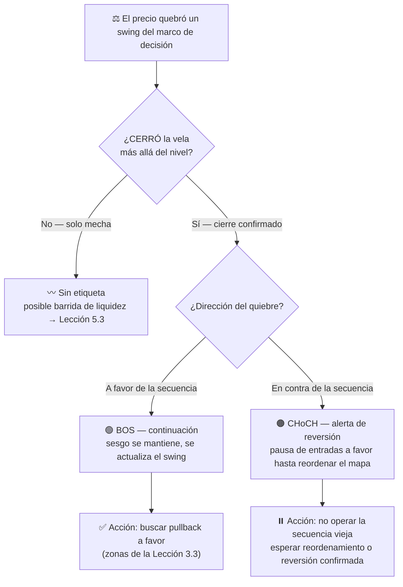

# Lección 5.2 · BOS y CHoCH — los dos quiebres que lo etiquetan todo

| Campo | Detalle |
|---|---|
| ⏱️ Duración estimada | 45–60 min de estudio |
| 🧱 Módulo | [M5 · Estructura de Mercado y Liquidez](README.md) |
| ⬅️ Anterior | [Lección 5.1 · Tendencia y estructura](leccion-5-1.md) |
| ➡️ Siguiente | [Lección 5.3 · Liquidez operable](leccion-5-3.md) |

---

## Por qué importa

La Lección 5.1 te dio el esqueleto; esta te da las **dos etiquetas que actualizan el mapa en vivo**. Cuando el precio quiebra un swing, el mercado te está diciendo una de dos cosas: *la tendencia sigue* o *la tendencia está en peligro* — y tu negocio depende de no confundirlas: comprar una continuación que era reversión (o huir de una reversión que era continuación) son los dos errores de mapa más caros que existen. Hay además una razón editorial que viene de la auditoría: los cursos fuente usaban **dialectos distintos para el mismo fenómeno** — uno llamaba "ruptura de nivel" a lo que el otro vendía como "Break of Structure" — y el vacío D1 del [análisis](../../00-analisis/analisis_cursos.md) documentó la desorientación resultante. Aquí aprenderás **un solo fenómeno con dos vocabularios**: quien domine ambos puede leer cualquier libro, curso o sala de trading sin quedar cautivo de ninguno.

## Concepto

**Definición — BOS** (*Break of Structure*, quiebre de estructura): el precio **cierra** más allá de un swing en la **misma dirección** de la secuencia vigente. En tendencia alcista: cierre sobre el último HH → la secuencia continúa. Es la etiqueta de **continuación**.

**Definición — CHoCH** (*Change of Character*, cambio de carácter): el precio **cierra** más allá de un swing en **contra** de la secuencia vigente. En tendencia alcista: cierre bajo el último HL → la secuencia está rota por primera vez. Es la etiqueta de **alerta de reversión** (no certifica la reversión: anuncia que ya no puedes asumir la continuación).

**La regla de confirmación: el cierre manda.** Una mecha que perfora el nivel y una vela que **cierra** tras él son eventos distintos: la mecha puede ser la barrida de liquidez de la próxima lección; el cierre es compromiso. El programa exige **cierre del marco de decisión** (H4 pide cierre H4, no vela M5 asomándose). Esto es el mismo principio de "confirmación en 3 pasos" de la [Lección 3.4](../mod-03-anatomia-del-grafico/leccion-3-4.md) aplicado a la estructura: nivel tocado → vela reacciona → **cierre confirma**. Solo el paso 3 etiqueta.

**Mapa unificado de nomenclatura (aporte propio del programa — el fenómeno es uno, los dialectos son dos):**

| Fenómeno | PA clásico | SMC/ICT | Qué significa |
|---|---|---|---|
| Cierre más allá del swing a favor | "Ruptura de resistencia/soporte" | **BOS** | Continuación confirmada |
| Primer cierre en contra de la secuencia | "Pérdida del soporte clave / techo descendente" | **CHoCH** | Carácter cambiado: alerta |
| Vuelta al nivel roto desde el otro lado | "Retesteo" | "Retest del BOS" / "retesteo del order block" | Segunda oportunidad de entrada |
| Expansión violenta que deja huecos | "Impulso con gap" | **Displacement** | Urgencia institucional (5.4) |
| Barrida breve del nivel y reversión | "Falsa ruptura / bull-trap" | **Liquidity grab / stop hunt** | Consumo de liquidez (5.3) |

Regla del programa: usa el vocabulario que quieras en tu journal, pero **sé bilingüe** — y desconfía por principio de quien venda el segundo dialecto como "secreto" del primero.

## Analogía

El partido de tenis. Mientras el favorito mantiene su saque y le quita el saque al rival, el marcador confirma el dominio: eso es la secuencia HH/HL y cada **BOS** es un game más ganado. El **CHoCH** es el primer break de saque en contra: el favorito no ha perdido el partido — puede que recupere el break enseguida — pero el analista ya no puede decir "domina con tranquilidad": el carácter del partido cambió. Nadie declara campeón al rival tras un break (eso sería operar el CHoCH como reversión confirmada), pero ningún analista serio lo ignora. BOS = el dominador confirma; CHoCH = el dominador pierde su saque por primera vez. Con eso lees cualquier set… y cualquier gráfico.

## Cómo se hace: etiquetar el caso maestro + árbol de decisión

Continuamos el caso *(ilustrativo)*: low 1,0745 → high 1,0860 → HL 1,0798 → high **1,0884**.

1. **BOS #1:** el impulso que pasó de ~1,0812 a 1,0884 **cerró** (H4) sobre el high previo 1,0860 → **BOS alcista**: la continuación quedó confirmada y nació el nuevo HH (1,0884).
2. **La frase de sesgo se actualiza:** "alcista mientras respete 1,0798" — el nivel de invalidación sigue siendo el HL; el BOS no lo cambia.
3. **El pullback:** el precio corrige hacia 1,0820–1,0824. Mientras no haya **cierre** bajo 1,0798, la secuencia sigue intacta — el retroceso es el "andén" de M3, no un cambio de carácter.
4. **CHoCH hipotético:** si una vela H4 **cierra** en 1,0790 → primer cierre bajo el HL → **CHoCH bajista**: la etiqueta de tendencia pasa a "en alerta"; ya no se compra pullback hasta que el mapa se reordene (o vuelva a demostrar HH+HL).
5. **Lo que NO fue CHoCH:** la mecha que durante el pullback rozó 1,0792 y la vela cerró en 1,0810 → sin cierre tras el nivel, **no hay etiqueta**: solo ruido + (spoiler de 5.3) una barrida de liquidez de manual.

**Árbol de decisión del quiebre:**

## Error común

**(1) Etiquetar CHoCH con mechas.** El quiebre sin cierre no etiqueta nada — es la puerta de entrada al whipsaw de la [Lección 3.6](../mod-03-anatomia-del-grafico/leccion-3-6.md): mecha abajo, compra de pánico, cierre arriba, y tú fuera con −1R sin que la estructura haya cambiado. **(2) Confundir "cualquier nivel roto" con BOS.** El BOS es del **swing estructural** de 5.1 (el que pasa el test de consecuencia), no de cualquier resistencia dibujada: romper una línea horizontal menor en rango no es BOS, es tránsito normal de rango. **(3) Operar el BOS "en caliente".** El quiebre confirmado invita a perseguir el precio — la entrada por extensión paga el peor precio del ciclo; el programa opera el BOS vía **retesteo** (arquetipo de M7), nunca por persecución. **(4) Cazar la reversión con el primer CHoCH.** Un CHoCH es una alerta, no un gatillo de reversión: las reversiones se confirman con reordenamiento (nueva secuencia LH/LL), no con una vela. **(5) Dialéctica de tribu.** "Yo soy de SMC" / "yo solo PA puro" es fidelidad de marca, no análisis: el mapa de esta lección demuestra que describen el mismo precio.

## Conexión cuantitativa

Las dos etiquetas son los interruptores de tu filtro de tendencia (5.1): con BOS vigente, el arquetipo *pullback en tendencia* opera con la corriente — el escenario para el que tu E fue estimado. Con CHoCH activo, ese mismo arquetipo queda **suspendido por regla**, y sus estadísticas futuras (M9) se registrarán aparte: un setup operado 50 % dentro y 50 % fuera de su condición de validez produce un WR mezclado que no describe nada — es el error de contabilidad estadística más común del trader minorista. Haz el número con el caso *(ilustrativo)*: comprar el retesteo tras BOS con SL 1,0794 (30 pips) y TP en el pool de 1,0884 (60 pips) da R:B 2,0 → breakeven WR = 1/(1+2) = 33,4 %; la misma entrada tomada tras un CHoCH no tiene ese mapa: el TP estructural dejó de existir (la secuencia está rota) y el trade se convierte en esperanza sin geometría. **La etiqueta correcta no añade pips: protege la geometría que hace calculable tu E.**

---

## 🎯 Puntos clave

1. BOS = cierre a favor de la secuencia (continuación); CHoCH = primer cierre en contra (alerta de reversión).
2. Solo el **cierre** del marco de decisión etiqueta: la mecha es ruido o barrida (5.3), jamás quiebre.
3. El mapa unificado: ruptura = BOS, falsa ruptura = liquidity grab, impulso con gap = displacement — dos dialectos, un fenómeno.
4. BOS actualiza el swing; no cambia el nivel de invalidación del sesgo (sigue siendo el HL/LL estructural).
5. CHoCH suspende el arquetipo de pullback: alerta ≠ gatillo de reversión.
6. La etiqueta correcta protege la geometría del trade (SL y TP estructurales) — sin ella, E deja de ser calculable.

## 🔄 Autoevaluación rápida

1. Vela H4 perfora 1,0798 con la mecha, cierra en 1,0810. ¿Qué etiqueta pones y qué haces con tus órdenes pendientes en la zona 1,0820–1,0824?
2. ¿Por qué el programa opera el BOS por retesteo y no "en caliente"? Conéctalo con un arquetipo del M7 y con el costo de la Lección 4.3.
3. Traduce al dialecto SMC y al PA clásico: (a) cierre H4 bajo el HL en tendencia alcista; (b) mecha que barre el mínimo obvio y vela que cierra de nuevo arriba.

Ver respuestas

1. **Sin etiqueta** (no hubo cierre bajo el nivel): es ruido o barrida de liquidez. Las órdenes pendientes **se mantienen** — el sesgo "alcista mientras respete 1,0798" exigía cierre para invalidarse, y no lo hubo. Lo único vigilado: que el siguiente cierre H4 no esté bajo el HL (ahí sí: CHoCH → retirar pendientes y pausar).
2. El BOS "en caliente" compra la extensión: peor precio (spread + slippage del impulso, [4.3](../mod-04-plataforma-y-primera-ejecucion/leccion-4-3.md)), SL más lejos o invalidado, y expone al whipsaw del retesteo fallido. El arquetipo *ruptura + retesteo* (M7) espera el regreso al nivel roto: mismo movimiento capturado, con SL cercano y geometría conocida → R:B superior a igual WR.
3. (a) SMC: **CHoCH** bajista · PA clásico: "pérdida del soporte estructural / techo descendente confirmado" — en ambos: alerta de reversión, pausa de compras. (b) SMC: **liquidity grab / stop hunt** · PA clásico: **falsa ruptura (bear trap)** — en ambos: no es quiebre, es consumo de liquidez; tema completo de la siguiente lección.

