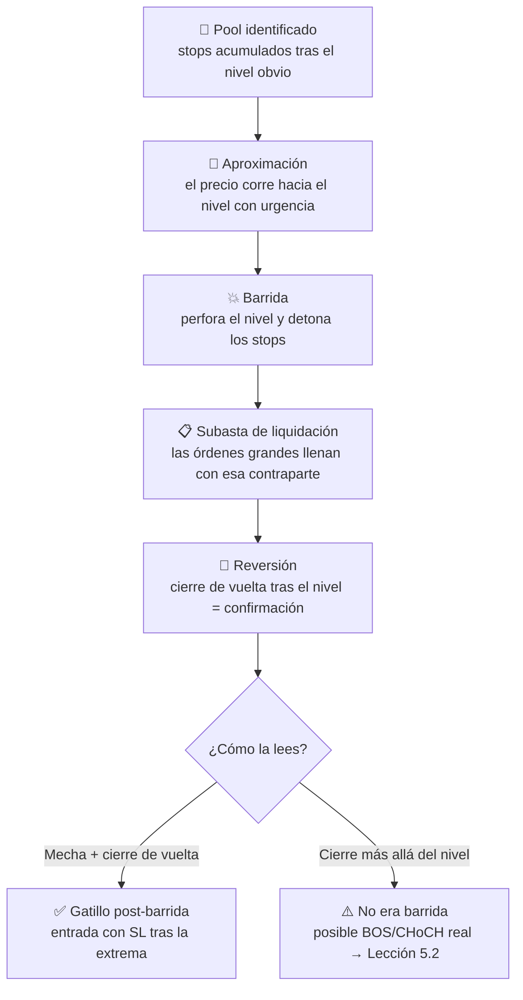

# Lección 5.3 · Liquidez operable — por qué el precio "va a buscar" los niveles obvios

| Campo | Detalle |
|---|---|
| ⏱️ Duración estimada | 45–60 min de estudio |
| 🧱 Módulo | [M5 · Estructura de Mercado y Liquidez](README.md) |
| ⬅️ Anterior | [Lección 5.2 · BOS y CHoCH](leccion-5-2.md) |
| ➡️ Siguiente | [Lección 5.4 · Imbalances y FVG](leccion-5-4.md) |

---

## Por qué importa

La [Lección 2.3](../mod-02-motor-del-precio/leccion-2-3.md) te mostró el síntoma (las barridas de stops que salvan tu SL del depósito obvio); esta lección te da la **arquitectura completa**: dónde vive la liquidez, por qué el precio parece magnetizado hacia los niveles que "todo el mundo" ve, y cómo convertir ese conocimiento en dos ventanas operativas — donde **no** poner tu stop y donde **sí** buscar tu entrada. Es la lección que explica la pregunta que todo principiante se hace tarde o temprano: *"¿por qué el precio toca mi SL y luego gira exactamente a mi favor?"*. Respuesta incómoda: no fue mala suerte ni conspiración contra ti — tu stop estaba, por diseño, en el sitio donde el mercado va a recoger órdenes. Entender esto cambia dónde nace cada operación que montarás por el resto del programa.

## Concepto

**Definición — pool de liquidez** (*liquidity pool*): acumulación de **órdenes stop** agrupadas tras un nivel visible. Cada stop de venta (longs protegiéndose) es una orden market dormida que dispara venta al tocar el nivel; cada stop de compra (cortos protegiéndose) dispara compra. Son las únicas zonas donde el mercado **sabe** que hay órdenes de tamaño disponibles sin buscarlas.

**El motor: las órdenes grandes necesitan contraparte.** Una orden institucional de cientos de millones no entra "a mercado" de golpe — empujaría el precio contra sí misma (la [Lección 2.1](../mod-02-motor-del-precio/leccion-2-1.md) ya te mostró el book en miniatura). La solución del libro de órdenes: ejecutar donde haya **órdenes opuestas concentradas**. ¿Y dónde se concentran? Tras los niveles obvios: los mínimos y máximos que cualquier principiante marca son, literalmente, **el depósito de stops de todo el mercado**. Por eso el precio "va a buscar" los niveles obvios: no es magnetismo técnico — es logística de ejecución.

**Los depósitos más gordos — equal highs/lows:** dos o más máximos/mínimos casi idénticos (el "doble techo/suelo" del M3, visto ahora desde el lado de la oferta). Cada toque añadió compradores con SL bajo el nivel y vendedores con stop encima: el segundo toque casi igual **duplica el depósito**. El nivel que "aguantó dos veces" no es más fuerte — está más cargado.

**Definición — barrida** (*liquidity grab / stop hunt*, ya definida en M2): la rotura breve del nivel que detona el pool y revierte. Traducción operatoria: la barrida **no es un quiebre** — es una **subasta de liquidación** donde el precio encuentra toda la contraparte que buscaba; terminada la subasta, el movimiento verdadero (que muchas veces era el contrario de la rotura) continúa sin freno.

**Regla asimétrica del programa — tu stop nunca vive en el pool:** la ley del SL de la [Lección 4.6](../mod-04-plataforma-y-primera-ejecucion/leccion-4-6.md) ("tras el swing con respiración") existe exactamente por esto. Tu SL va **detrás** de la estructura que importa, fuera del depósito; el depósito lo usa el análisis — como objetivo de barrida y como zona de gatillo posterior.

## Analogía

La manada y el depredador. Los stops agrupados tras el nivel obvio son un rebaño pastando siempre en la misma valla: visible, predecible, concentrado. El dinero grande no persigue ovejas sueltas por la llanura (órdenes dispersas: caro de cazar); espera en la valla, donde la manada entera está en un solo lugar. La barrida es el ataque: un instante de pánico que reúne todas las órdenes de venta (los stops de los longs) en el mismo segundo — y ese es exactamente el volumen de contraparte que la orden grande necesitaba para llenarse. Cuando el ataque termina, la manada ya no está ahí y el precio, con su nueva carga compradora, se mueve con fluidez. Tu defensa: no pastar junto a la valla (SL en el nivel obvio) — y tu negocio: aprender a estar del lado del que llega *después* del ataque, con la zona cargada ya consumida.

## Cómo se hace: la barrida del caso maestro, con números cerrados

Volviendo al caso *(ilustrativo)*: pullback alcista hacia la zona 1,0820–1,0824 tras el BOS sobre 1,0860 (5.2).

1. **Dónde está el pool:** el HL estructural en **1,0798** ya fue respetado una vez; los que compraron el rebote tienen SL debajo, y los cortos del rechazo anterior tienen stops encima del high local. Bajo 1,0798: depósito de stops de venta.
2. **La barrida:** el precio perfora 1,0798 con una vela H1 que llega a **1,0792** y **cierra de nuevo en 1,0810** — mecha larga abajo, cuerpo arriba. Detonó el pool, llenó las órdenes grandes, y el cierre demuestra que la urgencia compradora absorbió todo.
3. **El gatillo post-barrida:** vela siguiente confirma con cierre alcista ([protocolo 3.4](../mod-03-anatomia-del-grafico/leccion-3-4.md)) → entrada **1,0820** en el retorno a la zona.
4. **La geometría (el regalo de la barrida):** SL bajo la **extrema de la barrida**, no bajo el nivel obvio: 1,0792 − respiración 4 pips → **SL 1,0788** = 32 pips de distancia. TP en el pool superior sobre el HH 1,0884 (stops de cortos + breaks de compradores del máximo previo) → **1,0886** = 66 pips → **R:B ≈ 2,1** ✓.
5. **El lote desde el SL** (ley de [4.6](../mod-04-plataforma-y-primera-ejecucion/leccion-4-6.md)): 20 $ ÷ (32 × 10) = 0,062 → **0,06** → riesgo real 19,2 $ ≈ 0,96 % ✓.

**Ciclo de vida completo de una barrida:**

## Error común

**(1) Poner TU stop en el depósito ajeno.** SL en el borde exacto del nivel obvio = pastar en la valla: la barrida más pequeña te ejecuta y luego gira — el reclamo clásico del principiante ("el mercado me ve"). **(2) Llamar "manipulación" a la barrida.** La palabra sugiere ilegalidad y te convierte en víctima; es **microestructura**: la necesidad mecánica de encontrar contraparte. Víctima no aprende; operador sí. **(3) Comprar la caída sin cierre.** "Va a barrer y revertir" es una hipótesis, no una confirmación: sin el cierre de vuelta (3.4) estás atrapando un cuchillo; la barrida contra tendencia fuerte acaba siendo BOS real. **(4) Igualar "equal highs" con soporte fuerte.** El doble techo que "aguantó dos veces" acumula stops, no fuerza: cuanto más obvio y más tocado, más gordo el depósito y más probable la barrida. **(5) Olvidar el marco.** Los pools del marco de gatillo (M5) son ruido para el mapa H4; operar cada barridita M5 contra el mapa mayor es el error de jerarquía de 5.1.

## Conexión cuantitativa

La barrida es la máquina de R:B del programa, y aquí está el porqué aritmético: el SL post-barrida va **tras la extrema** (la mentira máxima del movimiento), no tras el nivel — eso **acorta el denominador** de tu geometría sin acercar la invalidación real: en el caso, SL de 32 pips que protegen la hipótesis correcta ("si vuelve a 1,0788, la reversión muere") vs 50+ pips que se necesitarían entrando "de seguridad" desde arriba. Con TP en el pool opuesto (66 pips), R:B 2,1 → breakeven WR = 1/(1+2,1) ≈ 32 % — cada punto de WR por encima es margen para costos (0,09R de [4.3](../mod-04-plataforma-y-primera-ejecucion/leccion-4-3.md): E neto ≈ 2,1 × WR − 1,09 × (1−WR)). Compara: la misma dirección operada "en el nivel" antes de la barrida habría pagado SL de nivel (ejecutado en la barrida) o SL de 50 pips con el mismo TP: peor R:B para la misma hipótesis. **La liquidez no es un tema místico: es geometría — el mercado te regala el SL corto exactamente en el punto donde la multitud acabó de ser liquidada.**

---

## 🎯 Puntos clave

1. Pool de liquidez = depósito de stops tras el nivel obvio; las órdenes grandes lo consumen para encontrar contraparte.
2. Equal highs/lows = el depósito duplicado; "aguantó dos veces" significa "está más cargado", no "es más fuerte".
3. La barrida es una subasta de liquidación, no un quiebre: solo el **cierre de vuelta** la confirma como gatillo.
4. Tu SL vive tras la estructura/extrema de la barrida, jamás en el depósito ajeno (ley 4.6 aplicada).
5. El TP también se ancla en liquidez: el pool del lado opuesto es el objetivo estructural natural.
6. Barrida + cierre de vuelta = gatillo con el mejor R:B del ciclo; barrida sin cierre = cuchillo o BOS real.

## 🔄 Autoevaluación rápida

1. ¿Por qué el precio "siempre" toca tu SL antes de girar a tu favor? Responde con el mecanismo, no con la anécdota.
2. En el caso: ¿por qué el SL va en 1,0788 y no en 1,0796 (bajo el nivel obvio)? ¿Qué hipótesis protege cada uno?
3. Una vela perfora el nivel y cierra 20 pips más allá. ¿Qué etiqueta aplicas y por qué la barrida ya no es tu lectura principal?

Ver respuestas

1. Porque tu SL estaba en el **pool**: tras el nivel obvio donde se acumulan los stops de todos. Las órdenes grandes necesitan esa contraparte para llenarse, así que el precio visita el depósito con frecuencia estadística — no fue contra ti: fue la logística de ejecución del mercado. La ley 4.6 (SL tras el swing con respiración) te saca del depósito.
2. SL en 1,0796 protege "el nivel no se perfora" — hipótesis falsa por construcción: el pool exactamente ahí garantiza la visita. SL en 1,0788 (bajo la extrema de la barrida con respiración) protege la hipótesis real: "la reversión post-barrida está viva" — si el precio vuelve a 1,0788, la subasta fracasó y la idea murió de verdad. Primer SL = ejecución estadística garantizada; segundo = invalidación genuina.
3. **Cierre tras el nivel** → ya no es barrida: aplicas el árbol de 5.2. Si el cierre fue a favor de la secuencia → **BOS** (continuación); en contra → **CHoCH** (alerta). La barrida se define por el rechazo (mecha + cierre de vuelta); el cierre más allá cambia el fenómeno — perseguir la reversión ahí es operar contra el quiebre confirmado.

