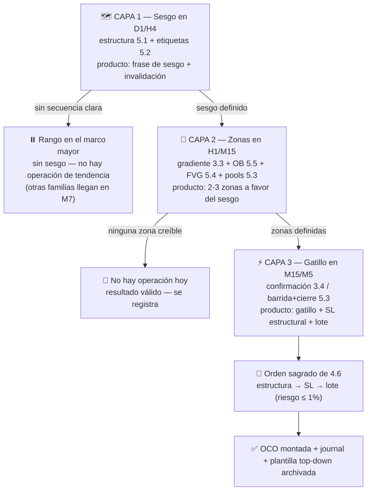

# Lección 5.6 · Top-Down Analysis — el protocolo de 3 capas

| Campo | Detalle |
|---|---|
| ⏱️ Duración estimada | 45–60 min de estudio |
| 🧱 Módulo | [M5 · Estructura de Mercado y Liquidez](README.md) |
| ⬅️ Anterior | [Lección 5.5 · Order blocks y zonas institucionales](leccion-5-5.md) |
| ➡️ Siguiente | [Laboratorio y Misión M-5 (hub del módulo)](README.md) |

---

## Por qué importa

Tienes las piezas: estructura (5.1), etiquetas (5.2), liquidez (5.3), huecos (5.4), zonas de origen (5.5). Esta lección las ensambla en **el proceso operativo que usarás cada sesión por el resto del programa**: el análisis top-down. El orden importa más que cualquier pieza suelta — el error de mapa más común del principiante no es ignorar un concepto, es usarlos **al revés**: caer enamorado de una vela de M5 (gatillo) sin haber decidido la dirección del H4 (sesgo), o dibujar zonas en H1 que contradicen el mapa del D1. El top-down es un embudo con jerarquía estricta: primero se elige el estadio, luego la puerta, luego el asiento. Y cierra el módulo con el estándar del programa: **un análisis que no queda por escrito en la plantilla no existe** — la misión M-5 auditada en M9 se alimenta exactamente de estos formularios.

## Concepto

**Definición — top-down analysis:** protocolo de lectura jerárquica en 3 capas, cada una con un marco temporal, una pregunta y un producto. Se baja de capa **solo cuando la superior está respondida por escrito**.

| Capa | Marcos | Pregunta | Producto (por escrito) |
|---|---|---|---|
| 1 · Sesgo | D1 / H4 | ¿Quién controla la estructura y hasta cuándo? | La frase de sesgo: dirección + nivel de invalidación ("alcista mientras respete 1,0798") |
| 2 · Zonas | H1 / M15 | ¿Dónde actuaría a favor de ese sesgo? | 2–3 zonas con tipo y porqué (gradiente 3.3 / OB 5.5 / FVG 5.4 / pool 5.3) |
| 3 · Gatillo | M15 / M5 | ¿Qué evento concreto me hace entrar y qué me invalida? | El gatillo definido ANTES (confirmación 3.4, barrida+cierre 5.3) + SL estructural ya ubicado |

**La regla de la confluencia como filtro de calidad:** cada coincidencia independiente entre capas suma calidad al setup. La jerarquía es asimétrica: **la capa 1 no se negocia jamás con la capa 3** — un gatillo perfecto contra el sesgo no es "otra oportunidad", es un trade de otra familia (reversión) que este programa todavía no opera (llega con el arquetipo de M7 y su propio presupuesto). Lo mínimo exigible para que un análisis produzca operación: sesgo definido + zona con al menos **una** confluencia estructural + gatillo con invalidación clara. Si la capa 2 no produce ninguna zona creíble a favor del sesgo, la respuesta del análisis es **"no hay operación"** — un resultado válido y frecuente que el programa premia, no castiga.

**La frase de sesgo vive en el tiempo:** se re-escribe cuando el mapa cambia (BOS actualiza swings, CHoCH la suspende) — el análisis es un documento vivo con fecha, no una piedra tallada.

**El flujo completo del módulo:**



## Analogía

El aterrizaje de un avión. Nadie aterriza un avión empezando por la pista: primero la **torre de control** asigna el aeropuerto y el corredor aéreo (capa 1: dirección y condiciones — tu sesgo); después la **aproximación** define el descenso por el corredor autorizado hacia la zona del aeropuerto (capa 2: las zonas donde actuar); y solo al final el **piloto** ejecuta el toque exacto con velocidad, flaps y decisión (capa 3: tu gatillo con invalidación). Un piloto que "siente" la pista y salta directo a la maniobra final se llama accidente; un trader que compra una vela de M5 sin corredor asignado se llama, en el journal, **impulso**. Y cuando la torre dice "pista cerrada por niebla" (sin sesgo, rango en H4), el avión desvía a otro aeropuerto — el piloto no aterriza "porque ya venía volando": tampoco tú operas "porque ya abriste el gráfico".

## Cómo se hace: la plantilla del programa, aplicada al caso maestro

**Plantilla oficial (se copia tal cual en `journal/analisis-topdown-N.md`):**

```text
TOP-DOWN #N — fecha/hora (Bolivia) — mercado — sesión (Lección 2.4)
CAPA 1 (D1/H4): secuencia: [HH+HL / LH+LL / rango] · frase de sesgo: "…"
                nivel de invalidación: [precio] · etiquetas activas: [BOS/CHoCH]
CAPA 2 (H1/M15): zona 1: [rango — tipo (gradiente/OB/FVG/pool) — porqué]
                 zona 2: [rango — tipo — porqué] (máx. 3 zonas)
                 confluencias: [zona+pool / zona+FVG / OB+gradiente…]
CAPA 3 (M15/M5): gatillo: [evento concreto — confirmación 3.4 / barrida+cierre]
                 invalidación (SL por estructura): [precio — tras qué] 
                 lote previsto: [riesgo 1% → lote] · R:B previsto: [x:y]
VEREDICTO: [operación planificada / no hay operación — porqué]
```

**El caso maestro, rellenado (resumen — *(ilustrativo)*):**

```text
TOP-DOWN #7 — lunes 08:30 Bolivia — EUR/USD — solapamiento Londres-NY
CAPA 1 (H4): secuencia: HH+HL · sesgo: "alcista mientras respete 1,0798"
             invalidación: cierre H4 bajo 1,0798 · etiquetas: BOS sobre 1,0860 activo
CAPA 2 (H1): zona 1: 1,0820–1,0824 — OB (5.5) + gradiente + FVG mitigado — porqué: origen del desplazamiento con BOS
             zona 2: pool bajo 1,0798 — porqué: depósito de stops; vigilada como barrida-candidata
             confluencias: zona 1 = OB + gradiente + FVG (triple)
CAPA 3 (M15): gatillo: barrida del pool + cierre de vuelta + cierre alcista siguiente (3.4)
              invalidación: SL 1,0788 (tras extrema de barrida, 4 pips de aire)
              lote previsto: 20$ ÷ (32×10) = 0,062 → 0,06 · R:B previsto ≈ 2,1 hacia pool 1,0886
VEREDICTO: operación planificada (arquetipo: pullback a zona con confluencia múltiple)
```

El mismo formulario, sin VEREDICTO operable, vale como "no hay operación": el análisis no se tira — se archiva; en M9 ese registro es la evidencia de tu disciplina de no-operación *(y la disciplina de no operar también se audita)*.

## Error común

**(1) Empezar por abajo.** Abrir M5, ver una vela que "parece rechazo" y comprar: gatillo sin mapa = la familia de errores con peor estadística de la industria *(el 70–90 % de cuentas perdedoras vive ahí)*. **(2) Capas contradictorias sin jerarquía.** "H4 es bajista pero M15 es alcista así que compro": el M15 alcista contra sesgo bajista no es confluencia — es otra familia de trade (contra-tendencia) que el programa no opera sin su propio presupuesto y arquetipo (M7). **(3) Análisis mental.** Todo lo que no está en la plantilla no existió: sin registro no hay auditoría en M9, no hay WR por arquetipo, no hay negocio. **(4) El embudo sin fecha de caducidad.** Un top-down del lunes no autoriza el trade del jueves: la frase de sesgo expira cuando el mapa cambia (BOS/CHoCH) o cuando la sesión (2.4) cambia de régimen. **(5) Zonas infinitas.** La capa 2 admite máximo 3 zonas: más zonas = análisis sin criterio, y cada zona extra diluye la atención exactamente cuando necesitas foco para el gatillo.

## Conexión cuantitativa

El top-down es la primera **máquina de producción de muestras homogéneas** del programa. Cada formulario archivado produce una fila con etiquetas (mercado, sesión, secuencia, tipo de zona, confluencias, arquetipo) — exactamente las columnas con las que M9 separará tu estadística por condición. La aritmética de fondo: tu E global $E = (P_w \times W) - (P_l \times L)$ es un promedio de los E por arquetipo; si las operaciones se mezclan sin etiquetas, ese promedio describe una poción inidentificable; si se separan (y el top-down etiqueta por diseño), descubrirás que probablemente **uno o dos arquetipos generan la totalidad de tu ventaja** y los demás la erosionan — y el negocio de M7-M12 se construye sobre esa separación, no sobre el promedio. Además el veredicto "no hay operación" entra en la muestra como acto de gestión: cada no-operación ante mapa degradado es una −1R evitada — el único trade con E garantizado es el que no se toma mal.

---

## 🎯 Puntos clave

1. 3 capas con jerarquía estricta: sesgo (D1/H4) → zonas (H1/M15) → gatillo (M15/M5) — se baja solo con la capa superior respondida por escrito.
2. Producto de la capa 1: la frase de sesgo + nivel de invalidación. De la 2: máximo 3 zonas a favor con su porqué. De la 3: gatillo + SL estructural + lote.
3. El gatillo de la capa 3 jamás anula el sesgo de la capa 1: contra-sesgo = otra familia (M7), no otra oportunidad.
4. "No hay operación" es un veredicto válido y frecuente — se registra con su porqué.
5. La plantilla archivada es la unidad de datos del negocio: sin formulario, el trade no es auditable en M9.
6. El análisis expira: BOS/CHoCH o cambio de régimen de sesión obligan a re-escribir la frase de sesgo.

## 🔄 Autoevaluación rápida

1. ¿Por qué la capa 1 se responde en D1/H4 y no directamente en M15? ¿Qué rompe el "sesgo en M15"?
2. Un gatillo de compra perfecto (barrida + cierre alcista) aparece mientras tu frase de sesgo es bajista. ¿Qué dice el protocolo y por qué no es "confluencia en contra"?
3. Enumera los 5 campos del VEREDICTO de la plantilla. ¿Cuál falta si tu plan dice "compro en la zona" sin más?

<details>
<summary>Ver respuestas</summary>

1. Porque el sesgo es una decisión de régimen, no de ruido: la secuencia estructural (5.1) solo es legible donde el ruido del marco menor desaparece. Un "sesgo en M15" confunde la pierna de hace tres horas con la tendencia: cambia tres veces al día, hace que cada gatillo parezca confirmación de algo, y destruye la homogeneidad de muestra — no podrás separar en M9 qué operaste con qué mapa.
2. El protocolo dice: **no hay operación** — ese gatillo pertenece a la familia contra-tendencia (reversión), que este programa solo opera con arquetipo y presupuesto propios en M7. No es "confluencia en contra" porque la confluencia se define como coincidencia **a favor del sesgo**: un gatillo contra la capa 1 es una señal de otra familia disfrazada — seguirla con el presupuesto del pullback es mezclar muestras y cobrarle a la estadística equivocada.
3. (1) gatillo concreto (evento, no sensación); (2) invalidación/SL por estructura con su porqué; (3) lote previsto desde el SL (riesgo ≤ 1 %, redondeo a la baja); (4) R:B previsto ≥ 1:2; (5) veredicto binario: operación planificada o "no hay operación" con porqué. Si solo dice "compro en la zona" falta casi todo: sin gatillo definido, sin SL, sin lote y sin R:B, lo que hay es una intención — y el examen N1 ya te enseñó que las intenciones no se auditan.

</details>
