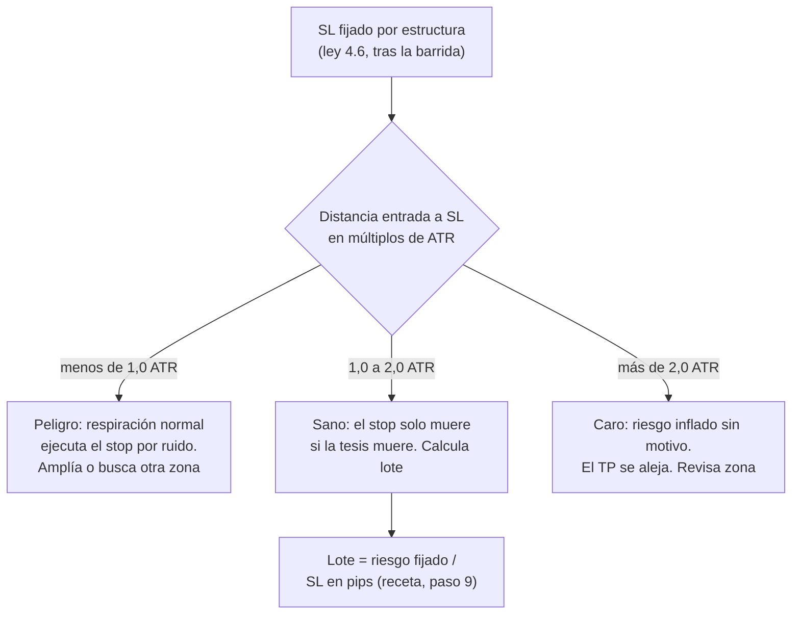

# Lección 6.3 · Volatilidad y canales — ATR audita tu stop

| Campo | Detalle |
|---|---|
| ⏱️ Duración estimada | 45–60 min de estudio |
| 🧱 Módulo | [M6 · Indicadores y Confluencias](README.md) |
| ⬅️ Anterior | [Lección 6.2 · Medias móviles](leccion-6-2.md) |
| ➡️ Siguiente | [Lección 6.4 · Momentum y osciladores](leccion-6-4.md) |

---

## Por qué importa

La volatilidad es la propiedad más ignorada por el principiante y la más estudiada por el profesional. El principiante fija su stop "donde se ve" y su objetivo "donde sueña"; el profesional primero pregunta *cuánto se mueve este instrumento en promedio* — porque un SL de 15 pips en un mercado que respira 40 es un donativo, y un TP a 100 pips en un mercado que avanza 20 es una promesa que nadie firmó. El ATR convierte esa pregunta en un número. Y tiene un aporte directo a tu caso: el SL de 32 pips de tu [Receta](../../03-recursos/laboratorio/receta-primera-operacion.md) no se eligió por ATR — se eligió por estructura (tras la barrida) — pero el ATR es la herramienta que *audita* si ese SL está en una zona estadísticamente sana o si el azar de esa operación te acunó. Esta lección también presenta los canales clásicos (Bollinger, Donchian) y la lección estadística más famosa del trading sistemático: las Tortugas.

## Concepto

**Rango verdadero (TR) y ATR.** El rango simple (high − low) miente cuando hay huecos entre velas. El rango verdadero (*true range*) los incorpora:

$$TR = \max\left(H - L,\; |H - C_{prev}|,\; |L - C_{prev}|\right)$$

El **ATR** (*average true range*) es la media móvil de los TR de N periodos (clásico: 14): la amplitud típica de las velas del marco. Es el medidor de volatilidad más usado del mundo porque es simple, robusto y sin opinión: no dice dirección, dice *tamaño*.

**Tres usos del ATR en el programa:**

1. **Auditar el SL:** tu stop debe estar más allá de la respiración normal del mercado. Regla de trabajo: SL sanos entre **1,0 y 2,0 ATR** del nivel estructural. Menos de 1 ATR: la mera respiración te caza por ruido; más de 2 ATR: pagas un riesgo que el motivo no justifica y tu TP se aleja en pips sin contrapartida de probabilidad.
2. **Dimensionar el movimiento esperado:** "¿es realista mi TP?" — un TP a 4 ATR del precio actual pide un movimiento excepcional; un TP a 1,5 ATR es una jornada ordinaria.
3. **Comparar instrumentos y marcos:** 30 pips en XAU/USD con ATR de 250 es ruido; 30 pips en EUR/USD con ATR de 21 es un día entero. El ATR traduce todos los mercados al mismo idioma.

**Bandas de Bollinger.** Canal estadístico construido sobre una SMA 20 con dos bandas a ±2 desviaciones estándar:

$$Bandas = SMA_{20} \pm 2\sigma$$

Bajo normalidad, ~95 % de los cierres caen dentro (advertencia: los rendimientos financieros tienen colas gordas — la cifra real es algo menor). Dos fenómenos que el programa usa: **squeeze** = ambas bandas se contraen (σ mínima): la volatilidad está comprimida y el mercado se prepara para una expansión — anticipa *fase*, no dirección (encaja con el ciclo de M3); y **walking the bands** = en tendencia fuerte, el precio viaja pegado a una banda: tocarla es medición de fuerza, no señal de giro.

**Canal de Donchian y las Tortugas.** El canal de Donchian es el máximo/mínimo de los últimos N periodos (clásico: 20): la caja de los extremos. Richard Dennis y William Eckhardt usaron su ruptura como base del experimento de las **Tortugas** (años 80): sistema de ruptura de 20 días, riesgo de ~2 % por posición, dimensionado con el propio ATR (su "N"), salidas en canal inverso de 10. La lección que sobrevive al mito: un sistema de reglas completamente mecánicas, con riesgo controlado y esperanza positiva, puede enseñarse — el comercio no es adivinar, es ejecutar estadística.

## Analogía

La puerta de tu casa y la altura de la gente. Si la puerta mide 1,90 m y tus invitados miden 1,75 de promedio, casi nadie se golpea: el margen sobra. Ahora te mudas a un país donde la media es 1,85: la misma puerta empieza a producir golpes diarios. El SL es la puerta y la ATR es la altura media de los movimientos: no existe "el stop correcto en pips" en abstracto — existe el stop correcto *para la respiración de este mercado en este marco*. Y el squeeze es el pasillo estrecho antes del salón: la gente se amontona antes de abrirse; el amontonamiento no dice hacia qué puerta saldrán.

## Cómo se hace: auditoría ATR del SL de la receta

El instante previo a la operación de la [Receta](../../03-recursos/laboratorio/receta-primera-operacion.md) *(ilustrativo)* — EUR/USD H4:

1. **Mides el ATR(14) H4:** ≈ 21 pips. Anotas el número en tu pre-trade — ocupa 10 segundos.
2. **Recuperas el SL estructural:** 1,0788, fijado 4 pips por debajo del low de la barrida (1,0792) según la ley 4.6 (SL tras la estructura con respiración).
3. **Distancia entrada→SL:** 1,0820 − 1,0788 = 32 pips. Auditoría: $32 / 21 \approx 1{,}52$ ATR → dentro del rango sano 1,0–2,0. El stop NO lo dictó el ATR: lo dictó la estructura; el ATR confirma que la estructura no es una puerta de 1,60 m para invitados de 1,85.
4. **Auditorías contrafácticas (para calibrar tu ojo):** un SL a 1,0805 (15 pips, "porque apretado arriesga menos") = 0,7 ATR → la respiración normal de 21 pips lo ejecuta sin que tu tesis haya fallado; un SL a 1,0760 (60 pips, "más margen") = 2,9 ATR → riesgo inflado 1,9×, lote reducido a la mitad por la misma tesis: overpaying por miedo.
5. **Donchian 20 H4 sobre el caso:** el canal va de 1,0745 (low del swing) a 1,0884 (el HH). Un cierre H4 por encima de 1,0884 sería el gatillo Tortuga de continuación — nota cómo el lenguaje de "ruptura de extremos de N periodos" y el "BOS por cierre" del M5 describen el mismo fenómeno con dos dialectos.
6. **Bollinger sobre el caso:** antes del impulso del BOS (1,0860), las bandas se contrajeron (squeeze) — la contracción precedió a la expansión. Y durante el tramo alcista, los cierres caminaron cerca de la banda superior: walking the bands, la firma estadística de una tendencia sana.

## Error común

**(1) SL = 1 ATR fijo sin estructura.** El ATR audita, no diseña: el SL se fija tras la estructura y el ATR verifica. Un SL "1 ATR sobre el precio" colocado en medio de la nada es auditoría sin motivo. **(2) Tocó la banda inferior → compro.** En rango, la reversión a la media funciona a veces; en tendencia fuerte el precio camina sobre la banda y ese "compro barato" es vender fuerza comprada. Primero el régimen (6.2, 6.7), después la banda. **(3) Usar el ATR del marco equivocado.** El ATR H4 no sirve para auditar un SL de M15: cada marco tiene su respiración. **(4) Creer que el squeeze predice el lado.** Anticipa expansión, no dirección; el lado lo da la estructura alrededor del squeeze.

## Conexión cuantitativa

La auditoría ATR cierra el círculo con la aritmética de la receta: riesgo fijado 1 % de 1 920 $ = 19,2 $; SL 32 pips → lote $= 19{,}2 / (32 \times 10) \times 1 = 0{,}06$ lotes (receta, paso 9). Con ATR 21: cada pip de tu SL equivale a $32/21 \approx 1{,}52$ respiraciones H4 — tu riesgo está expresado en unidades de clima del mercado, no en pips heroicos. Y la regla de las Tortugas da el estándar histórico del dimensionado: riesgo ~2 % por posición con N (su ATR) normalizando el tamaño entre mercados — el antepasado directo de lo que este programa formaliza en M8 (riesgo fijo por operación) y M9 (validación con muestra). Si algún día tu journal muestra que tus stops "por estructura" caen sistemáticamente bajo 1 ATR, esa es una señal estadística de que eliges zonas apretadas: el medidor detectó un sesgo que tus ojos no veían.

---

## 🎯 Puntos clave

1. $TR = \max(H-L, |H-C_{prev}|, |L-C_{prev}|)$; ATR = media móvil del TR: la amplitud típica, sin opinión de dirección.
2. Auditoría del SL: sano entre 1,0 y 2,0 ATR del nivel; < 1 ATR lo caza el ruido, > 2 ATR pagas demasía.
3. ATR también dimensiona TP realista y traduce todos los mercados al mismo idioma.
4. Bollinger = SMA 20 ± 2σ: squeeze anticipa fase (no dirección); walking the bands = fuerza, no giro.
5. Donchian de 20 + riesgo controlado + dimensionado por ATR: la lección real de las Tortugas.
6. El SL lo diseña la estructura, lo audita el ATR y lo dimensiona el lote — tres pasos, un solo responsable: tu checklist.

## 🔄 Autoevaluación rápida

1. Calcula el TR de una vela con H = 1,0830, L = 1,0812, cierre previo = 1,0826.
2. Tu SL estructural queda a 0,8 ATR. ¿Qué dice el programa y qué dos opciones correctas tienes?
3. Sobre el caso: ¿por qué el squeeze previo al BOS no "decidió" comprar? ¿Quién decidió y quién midió?

Ver respuestas

1. $H - L = 18$; $|H - C_{prev}| = |1{,}0830 - 1{,}0826| = 4$; $|L - C_{prev}| = |1{,}0812 - 1,0826| = 14$. TR = máx(18, 4, 14) = **18 pips**. El rango simple ya bastaba aquí (no hubo hueco), pero el TR protege contra velas con gap donde el high/low quedan lejos del cierre previo.
2. Dice: stop dentro de la respiración — la mera variación normal ejecuta el SL antes de que tu tesis falle. Opciones: (a) buscar una zona estructural más profunda/lejana que dé 1,0–2,0 ATR con el lote recalculado; (b) rechazar la operación ("no hay operación" es veredicto válido, 5.6). Lo que no se hace: dejar el SL en 0,8 ATR "porque la zona era tan bonita".
3. El squeeze solo midió compresión de volatilidad (fase pre-expansión) — no contiene dirección. Quien decidió el lado fue la estructura: secuencia HH/HL con sesgo por escrito (5.1). Quien midió el tamaño del riesgo fue el ATR (1,52 en el SL). Estructura decide, ATR audita — el squeeze fue contexto, no veredicto.

