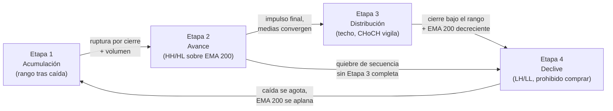

# Lección 6.7 · Etapas de Weinstein — el filtro macro de 4 etapas

| Campo | Detalle |
|---|---|
| ⏱️ Duración estimada | 40–55 min de estudio |
| 🧱 Módulo | [M6 · Indicadores y Confluencias](README.md) |
| ⬅️ Anterior | [Lección 6.6 · Fibonacci, Elliott y armónicos](leccion-6-6.md) |
| ➡️ Siguiente | [Lección 6.8 · Radar de fiabilidad y dashboard](leccion-6-8.md) |

---

## Por qué importa

Toda la técnica que has aprendido — zonas, gatillos, indicadores — opera mejor o peor según una pregunta que el principiante nunca hace: **¿en qué etapa de su ciclo está este instrumento?** La misma figura de pullback comprado en Etapa 2 (tendencia viva) y en Etapa 4 (declive) tiene resultados estadísticos opuestos, aunque la vela sea idéntica. Stanley Weinstein sistematizó el ciclo de los activos en 4 etapas reconocibles con medias móviles y volumen — el "mapa de pájaro" que el M3 ya te dio como ciclo de 4 fases y que ahora formalizas como filtro macro: la primera consulta del análisis, ANTES de buscar zonas. Su regla más famosa es también la más violada de la industria: **prohibido comprar en Etapa 4 por "está barato"**. Esta lección te da el checklist de etapa que tu sesión abrirá de aquí en adelante.

## Concepto

**Las 4 etapas del ciclo** (marco de decisión: D1; para intradía, H4 como espejo):

| Etapa | Nombre | Qué se ve en el gráfico | Qué se prohíbe | Qué se opera |
|---|---|---|---|---|
| 1 | **Acumulación** | Rango tras una caída (la EMA 200 se aplana); volumen sin dirección | Anticipar el giro (no hay estructura que lo confirme) | Nada, o el arquetipo de rango con presupuesto propio (M7) |
| 2 | **Avance / markup** | Tendencia alcista: HH/HL, medias escalonadas al alza, precio sobre la EMA 200 | Vender "sobrecompra" (6.4) | Pullbacks, rupturas + retesteo — el pan de cada día del programa |
| 3 | **Distribución / techo** | La tendencia se aplana tras el impulso final; medias convergen; volumen alto sin avance de precio | Abrir nuevos largos "por inercia" | Recoger objetivos; achicar exposición; vigilar CHoCH (5.2) |
| 4 | **Declive / markdown** | LH/LL, precio bajo la EMA 200 decreciente | **Comprar "porque está barato"** | Nada para el sistema v1 de este programa (cortos solo con arquetipo propio en M7) |

**Cómo se verifica la etapa** — el checklist del programa (en orden, con los instrumentos que ya tienes):

1. **Posición y pendiente de la EMA 200** (6.2): el filtro macro de una línea — precio por encima y creciente apunta a Etapa 2; por debajo y decreciente apunta a Etapa 4; aplana y el precio cruza una y otra vez → 1 o 3.
2. **La estructura del M5:** secuencia HH/HL (2) vs LH/LL (4) vs solape (1/3) — el mapa y el medidor deben decir lo mismo; si discrepan, gana el marco mayor y anotas la discrepancia.
3. **El volumen/interés (6.5):** expansión en la dirección de la etapa (confirmación) o clímax agotado (aviso de transición).
4. **La frase de etapa por escrito:** "EUR/USD D1 en Etapa 2 desde [fecha], invalidación: cierre D1 bajo [nivel]" — igual que el sesgo de 5.1, porque ES el sesgo con vestido de ciclo.

**Integración con el M3:** el ciclo de 4 fases del [Lección 3.2](../mod-03-anatomia-del-grafico/leccion-3-2.md) (acumulación → expansión → distribución → contracción) y las etapas de Weinstein son el mismo animal en dos dialectos: fases = fenomenología de la subasta (quién acumula); etapas = fenomenología del gráfico (cómo se ve). El programa usa las etapas como checklist operativo porque son verificables con medias y estructura; usa las fases para explicar el PORQUÉ (la subasta de M2).

**La transición silenciosa:** la Etapa 3 no siempre es un techo dramático — a veces la Etapa 2 muere sin fiesta (el quiebre de secuencia llega directo del avance al declive; por eso el diagrama tiene el atajo B → D). El filtro de etapa se consulta cada sesión precisamente porque las etapas no avisan con etiquetas: la estructura es el único semáforo.

## Analogía

Las estaciones para un agricultor. La misma semilla (tu técnica) da cosecha en primavera (Etapa 2) y se pudre sembrada en otoño (Etapa 3 tardía). El agricultor no discute con el invierno ni "apuesta al verano temprano": consulta el calendario, y su calendario es el gráfico — EMA 200 como termómetro, estructura como almanaque. Comprar en Etapa 4 "porque está barato" es sembrar trigo en la helada porque la semilla salió rebajada: el precio de entrada no cambia la estación.

## Cómo se hace: la etapa del caso maestro

El mismo EUR/USD H4 de la [Receta](../../03-recursos/laboratorio/receta-primera-operacion.md) *(ilustrativo)*, el día del pullback:

1. **Checklist 1 — EMA 200:** ≈ 1,0712, creciente, precio 1,0820 un 1 % por encima: firma de Etapa 2 (o 2 tardía).
2. **Checklist 2 — estructura M5:** secuencia HH/HL viva (low 1,0745 → HL 1,0798 → BOS 1,0860 → HH 1,0884): el mapa confirma el medidor.
3. **Checklist 3 — volumen:** el BOS con 1,8× (6.5): expansión en la dirección de la etapa, sin clímax agotado visible.
4. **Checklist 4 — frase de etapa:** *"EUR/USD H4 en Etapa 2, invalidación de etapa: cierre H4 bajo 1,0745"* — nota que el nivel de invalidación de etapa (el swing low mayor) es más exigente que el del sesgo (1,0798): la etapa muere cuando muere la secuencia completa, no con el primer CHoCH.
5. **Vigilancia honesta (Etapa 3 no confirmada):** tras el HH 1,0884, un CHoCH H4 sería el PRIMER aviso de transición — pero sin cierre bajo estructura mayor no se reetiqueta la etapa. El programa opera Etapa 2 mientras la evidencia la sostenga y vigila en cada sesión; ni entusiasmo (ya estamos en la 3) ni denegación (la 2 es eterna).

## Error común

**(1) Comprar Etapa 4 "porque está barato".** El error más caro del catálogo: el precio rebajado es la RECOMPENSA de vender, no la invitación a comprar — la estadística del régimen (3.6) muestra que contracorriente se paga con peor materia prima al mismo riesgo. "Barato" en markdown suele ponerse más barato. **(2) Confundir Etapa 1 con Etapa 2.** El primer quiebre del rango de acumulación sin volumen ni confirmación es el terreno de las falsas rupturas (5.2): la etapa 2 se declara por cierre + estructura, no por esperanza. **(3) Declarar la Etapa 3 por ansiedad.** Un pullback profundo no es un techo: la transición la escribe la estructura (CHoCH del marco mayor + quiebre de secuencia), no el susto de la mecha roja. **(4) Saltarse el checklist por entusiasmo del setup.** "El gatillo era tan bonito que no miré la etapa" — el checklist de 60 segundos existe para los días entusiastas; los días aburridos no hacen falta recordatorios.

## Conexión cuantitativa

La etapa es una etiqueta auditable: añade `etapa-2` / `etapa-4` / etc. a cada registro del journal y en M9 obtendrás TU tabla de WR y R:B realizado por etapa — la validación personal del filtro de Weinstein. Hipótesis de trabajo *(heurística, se auditará)*: la diferencia entre operar Etapa 2 vs Etapa 4 será la más grande de todas tus segmentaciones — mayor que por sesión (M2), mayor que por horario (M4). Números de trabajo para calibrar expectativa: con R:B 1:2, pasar de WR 45 % (Etapa 2, a favor de régimen) a WR 35 % (contracorriente) ya vimos en 6.2 que destruye la esperanza ($0{,}35R \to 0{,}05R$); en la práctica documentada por estudios de rendimiento minorista, la mayor parte de la destrucción ocurre operando contra régimen marcado — el ciclo es el multiplicador de fondo que el régimen de 3.6 ya te anticipó. El filtro no cuesta dinero (una consulta por sesión): es la auditoría más barata del negocio.

---

## 🎯 Puntos clave

1. Cuatro etapas: acumulación, avance, distribución, declive — el ciclo completo es el mapa de pájaro de cada instrumento.
2. El checklist de etapa: EMA 200 (posición + pendiente) → estructura M5 → volumen → frase por escrito con invalidación.
3. Etapa 2 se opera a favor; Etapa 4 se prohíbe comprar; 1 y 3 se vigilan (rango solo con arquetipo propio, M7).
4. La transición silenciosa existe: de la 2 puede saltarse a la 4 sin techo dramático — el semáforo es la estructura.
5. Weinstein y las fases del M3 son el mismo ciclo en dos dialectos: etapas para operar, fases para entender.
6. La etapa es la primera consulta de la sesión: 60 segundos que el journal auditará por separado.

## 🔄 Autoevaluación rápida

1. Enumera las 4 etapas con su firma gráfica y su prohibición. ¿Qué dialecto del M3 corresponde a cada una?
2. En el caso maestro, ¿cuál fue la frase de etapa y por qué su nivel de invalidación (1,0745) es más exigente que el del sesgo (1,0798)?
3. Un accionista promedia a la baja en un valor en Etapa 4: "ha caído 40 %, no puede caer más". Refuta con dos argumentos del programa.

Ver respuestas

1. **Etapa 1 acumulación** (rango tras caída, EMA 200 plana; prohibido anticipar el giro) ≈ fase de acumulación del M3. **Etapa 2 avance** (HH/HL sobre EMA 200 creciente; prohibido vender sobrecompra) ≈ fase de expansión. **Etapa 3 distribución** (techo, medias convergen, volumen sin avance; prohibido abrir largos nuevos) ≈ fase de distribución. **Etapa 4 declive** (LH/LL bajo EMA 200 decreciente; prohibido comprar) ≈ fase de contracción. Mismo ciclo: fases explican la subasta, etapas se verifican en el gráfico.
2. Frase: *"EUR/USD H4 en Etapa 2, invalidación: cierre H4 bajo 1,0745"*. El nivel es más exigente porque cada etiqueta protege una cosa distinta: el sesgo (1,0798) protege el trade de pullback — un CHoCH lo pausa; la etapa protege el RÉGIMEN completo — muere solo cuando la secuencia HH/HL entera queda destruida (cierre bajo el swing low mayor). Una es el permiso de la operación; la otra, el permiso del negocio entero sobre ese instrumento.
3. (a) El régimen manda sobre el precio de entrada: en markdown, la estadística de contracorriente paga peor materia prima con el mismo riesgo — la esperanza se degrada aunque "la vela sea igual" (3.6, 6.2). (b) "No puede caer más" no es un dato: es un deseo — la Etapa 4 no tiene suelo definido por estructura hasta que la Etapa 1 lo construya con cierres, volumen y secuencia; mientras tanto, cada rebaja es la recompensa de los vendedores, no la invitación del comprador (y su SL, si lo tiene, vive en un mapa sin niveles estructurales que lo respalden).

