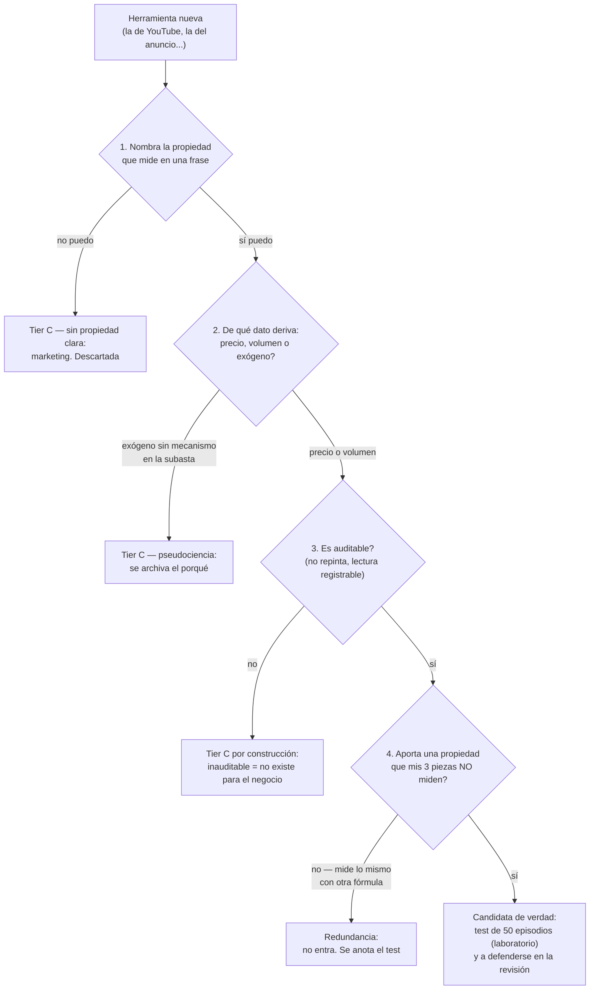

# Lección 6.8 · Radar de fiabilidad y dashboard — máximo 3 herramientas

| Campo | Detalle |
|---|---|
| ⏱️ Duración estimada | 45–60 min de estudio |
| 🧱 Módulo | [M6 · Indicadores y Confluencias](README.md) |
| ⬅️ Anterior | [Lección 6.7 · Etapas de Weinstein](leccion-6-7.md) |
| ➡️ Siguiente | [M7 · Construcción del Sistema](../mod-07-construccion-del-sistema/README.md) |

---

## Por qué importa

Este módulo visitó todo el catálogo — y ahora viene la pregunta de negocio: **¿cuáles entran a tu panel y por qué?** Sin un criterio de selección, el gráfico del principiante se convierte en el avión de los doce anemómetros (6.1): lleno, caro y ciego. Este es el aporte propio del programa: un **radar de fiabilidad** que clasifica cualquier herramienta por evidencia — no por popularidad, ni por nostalgia, ni por precio del curso que la vende — y la **regla del máximo 3** que convierte esa clasificación en un panel concreto: 1 filtro de régimen + 1 medidor de volatilidad + 1 gatillo/contexto. Con esta lección cierras el N2 técnico con tu primera decisión de arquitectura de instrumentos, defendida por escrito: el dashboard que el M7 montará dentro de tu Sistema v1.0.

## Concepto

**El radar de fiabilidad — tres tiers por evidencia:**

| Tier | Criterio de entrada | Herramientas del catálogo | Condición del programa |
|---|---|---|---|
| **A · Medidores defendibles** | Miden una propiedad observable con mecanismo claro (precio, actividad) y uso auditable en journal | **ATR** (amplitud), **volumen/VWAP** (interés, con salvedad FX), **medias móviles como filtro de régimen** (definición operativa de tendencia), **etapas de Weinstein** (checklist del ciclo) | Entrada por defecto al dashboard; cada una con regla de lectura escrita |
| **B · Contextuales** | Derivadas del precio con historial estadístico débil y dependiente de régimen; útiles como contexto, peligrosas como veredicto | **RSI/MACD** (momentum; divergencias como uso honesto), **Bollinger** (squeeze como fase; walking = fuerza), **Donchian** (arquetipo de ruptura), **Fibonacci** (contexto de descuento) | Máximo UNA en el dashboard, con su condición de uso explícita ("RSI solo para divergencias en zona, nunca contra sesgo") |
| **C · Marketing / pseudociencia** | Sin mecanismo verificable, sin muestra auditable, o mecanismo imposible de auditar | **Ciclos lunares y astrotrading** (sin mecanismo), **"indicadores secretos" que repintan** (inauditables), señales vendidas con certeza sin muestra | Prohibidas; se clasifican en el radar y se archiva la evidencia de por qué |

**El repintado (*repainting*) — descalificación automática:** un indicador repinta cuando reescribe sus valores PASADOS después de que ocurrieron (la flecha de "compra" que se movió a otra vela retroactivamente). Consecuencia fatal: **no se puede backtestear honestamente** — el histórico muestra la versión corregida, no la que viste en vivo. Cualquier herramienta que repinta queda en Tier C por construcción, sea cual sea su popularidad.

**Los test del radar (preguntas en orden):**
1. **¿Qué propiedad mide?** Si no puedes nombrarla en una frase (amplitud, velocidad, interés, dirección), la herramienta no entra.
2. **¿De qué dato deriva?** Precio, volumen o algo exógeno. Si es exógeno sin mecanismo causal en la subasta (fases lunares, numerología), Tier C.
3. **¿Es auditable?** ¿Puedes registrar su lectura en el journal y comprobarla después? Si repinta o si su lectura depende del "ojo del artista", no es auditable → no entra.
4. **¿Aporta algo que tus 3 piezas no miden?** Si mide lo mismo con otra fórmula, es redundancia (6.1), no confluencia.

**La regla del máximo 3 — el dashboard de confluencias:**

| Asiento | Familia | Candidato por defecto | Qué aporta que los otros no |
|---|---|---|---|
| 1. Filtro de régimen | Tendencia / ciclo | **EMA 200 (+50)** o Weinstein | Dirección permitida: el "solo largos / solo cortos" del día |
| 2. Medidor de volatilidad | Amplitud | **ATR(14)** | Tamaño: audita SL, dimensiona TP, normaliza mercados |
| 3. Gatillo/contexto | Momentum o volumen | **RSI (divergencias)** o volumen (multiplicadores) | Velocidad o interés: la tercera lectura ortogonal |

Por qué 3 y no 5: (1) **independencia real es escasa** — dentro del precio casi todo se correlaciona; con régimen + amplitud + velocidad/interés tienes las propiedades operables cubiertas; (2) **cada herramienta extra tiene costo** — una regla más que recordar bajo presión, un conflicto más que arbitrar en la vela crítica, un sesgo de confirmación más que auditar; (3) **la confluencia de verdad vive en la estructura** (M5): el panel auxilia, no dirige. El dashboard es el* staff *del mapa, no el mapa.

## Analogía

El botiquín de expedición. Un médico de montaña no carga la farmacia entera: lleva analgésico, antinflamatorio y antibiótico — las tres familias con mecanismo probado — y sabe la dosis de cada uno de memoria. El turista lleva 40 frascos "por si acaso" y en la emergencia no recuerda qué era cuál. Tu dashboard es el botiquín: 3 piezas, cada una con su indicación escrita ("el ATR es para tamaño, no para dirección"), dosis fija (parámetros clásicos, sin afinar) y fecha de caducidad auditable (si el journal demuestra que no aporta, sale).

## Cómo se hace: el dashboard aplicado al caso maestro

El instante del pullback de la [Receta](../../03-recursos/laboratorio/receta-primera-operacion.md) *(ilustrativo)*, con el panel de 3 asientos del programa:

1. **Asiento 1 — régimen:** EMA 200 ≈ 1,0712 creciente, precio encima; etapa 2 por escrito (6.7). Lectura: *"solo largos"*. Coste de la consulta: 10 segundos.
2. **Asiento 2 — volatilidad:** ATR(14) H4 ≈ 21 pips. Lectura: SL estructural de 32 pips ≈ 1,52 ATR (6.3): sano; TP 66 pips ≈ 3,1 ATR: exigente pero respaldado por el impulso medido. Coste: 15 segundos.
3. **Asiento 3 — contexto:** volumen del pullback 0,6× (6.5): caída sin convicción; RSI reseteado al neutro sin divergencia (6.4): impulso sano. Lectura: *"continuación probable; TP con margen"*. Coste: 30 segundos.
4. **La confluencia total:** sesgo estructural HH/HL (M5) + régimen a favor + stop dentro del rango estadístico + contexto de continuación — cuatro lecturas ortogonales, ninguna repetida, todas por escrito. La operación de la receta sale con **calidad máxima declarada** — no porque "todo diga comprar" (nadie dijo comprar: son medidores), sino porque ningún medidor contradice el plan de la estructura.
5. **El anti-ejemplo documentado:** el día que probaste el "indicador de la moda" en 10 episodios del laboratorio, el radar lo clasificó: mide velocidad (como tu RSI), deriva del precio (no aporta propiedad nueva), lectura no registrable (repinta suavizándose): **redundancia + inauditable** — no entra. Ese veredicto por escrito vale más que cualquier discusión.

## Error común

**(1) El dashboard de 8 indicadores.** No es un panel: es un tribunal de apelaciones permanente donde cada sentencia tiene apelación. Máximo 3, uno por familia — y sobra espacio en el gráfico para lo único que dirige: el precio y la estructura. **(2) Cambiar la regla a mitad de camino.** "Máximo 3" significa 3 la semana 12 también — el estudiante que rota su panel cada mes no tiene dashboard: tiene colección. Las adiciones pasan por el radar + los 50 episodios + la defensa con el agente. **(3) Clasificar por popularidad.** Que 2 millones de personas usen un indicador es su modelo de negocio, no su evidencia. El radar pregunta qué mide y si es auditable — la fila de usuarios no responde ninguna de las dos. **(4) Olvidar que el panel es staff.** Si tu dashboard "decide" operaciones sin estructura, invertiste la jerarquía: el medidor volvió a ser oráculo y volviste a la casilla del M1.

## Conexión cuantitativa

El dashboard convierte la "opinión sobre indicadores" en una **hipótesis testable**: las 3 piezas, sus reglas de lectura y su métrica se declaran ANTES de probar (anti data-mining, D6) y el laboratorio de este módulo genera los 50 episodios que la auditan. El diseño experimental del programa: para cada episodio, registrar coincidencia medidor-estructura (Sí/No) y desenlace; el resultado esperado NO es que el medidor "acierte" (no predice nada): es que **discrepe poco y discrepe con contenido** — cuando el ATR dice "SL sano" y el régimen dice "a favor", el porcentaje de desenlaces coherentes debería superar claramente el azar; y cuando discrepan, la discrepancia debería ser informativa (zona apretada, régimen dudoso). Si tu pieza de momentum discrepa del 40 % de las veces sin aportar nada, salió del panel por números — y ese es el único despido honorable en un negocio científico: con evidencia propia, no con nostalgia.

---

## 🎯 Puntos clave

1. Tres tiers: medidores defendibles (A), contextuales (B), marketing/pseudociencia (C) — la clasificación se defiende con el radar, no con la popularidad.
2. Repintar = descalificación automática: lo inauditable no existe para un negocio científico.
3. Los 4 test del radar: ¿qué propiedad mide? ¿de qué deriva? ¿es auditable? ¿aporta lo que tus 3 no miden?
4. Dashboard máximo 3: régimen (EMA 200/Weinstein) + volatilidad (ATR) + gatillo/contexto (RSI-divergencias o volumen) — una pieza por familia.
5. La confluencia de verdad vive en la estructura (M5); el panel la audita y la acompaña — jamás la dirige.
6. Toda adición o despido del panel se decide con el test de los 50 episodios y la revisión del agente: evidencia propia o silencio.

## 🔄 Autoevaluación rápida

1. Clasifica en el radar: (a) un indicador de fases lunares con backtest "93 %"; (b) el MACD; (c) el VWAP; (d) un indicador de flechas que ajusta sus señales pasadas al recalcular.
2. Enumera los 3 asientos del dashboard con su familia y su lectura sobre el caso maestro. ¿Qué propiedad única aporta cada uno?
3. Tu pieza de momentum discrepa del 40 % de los episodios del laboratorio sin mejorar ninguna decisión. ¿Qué hace el programa y qué NO hace?

Ver respuestas

1. (a) **Tier C**: propiedad exógena sin mecanismo en la subasta; el "93 %" sin muestra ni regla declarada es marketing con número. (b) **Tier B**: mide velocidad (derivado del precio); útil como contexto/divergencia con condición escrita — y redundante si ya hay RSI: solo uno de los dos entra. (c) **Tier A** (con salvedad FX): mide interés real de ejecución con mecanismo claro (benchmark institucional); en spot se usa como tendencia relativa del tick volume. (d) **Tier C por construcción**: repinta = inauditable = imposible de validar honestamente, sea cual sea su estética.
2. Asiento 1 régimen: EMA 200 creciente + Etapa 2 → *"solo largos"* (propiedad: dirección permitida). Asiento 2 volatilidad: ATR 21 pips → SL 32 pips ≈ 1,52 ATR sano, TP 66 ≈ 3,1 ATR exigente pero respaldado (propiedad: tamaño del riesgo). Asiento 3 contexto: volumen 0,6× en el pullback + RSI al neutro sin divergencia → *"continuación probable"* (propiedad: interés/velocidad — lo que el precio y el régimen no miden).
3. El programa lo despide del panel con evidencia: la métrica se declaró antes (anti data-mining), los 50 episodios existen, y el resultado es que la pieza no añade coincidencia informativa — sale del dashboard y se archiva el test. Lo que NO hace: amortiguar sus parámetros "a ver si mejora" (data-mining puro), agregar una cuarta pieza "para compensar", o quedárselo por apego. El panel se administra con la misma frialdad que el presupuesto.

