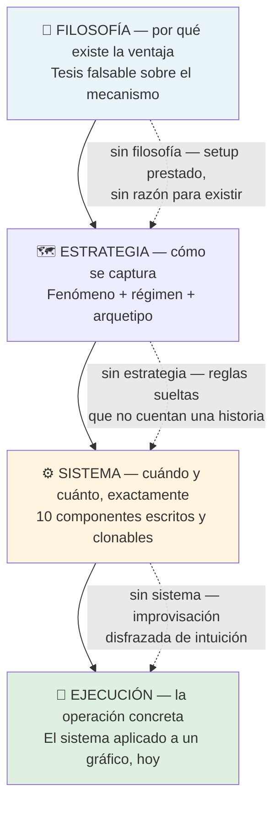

# Lección 7.1 · Filosofía, Estrategia y Sistema — el test del clon

| Campo | Detalle |
|---|---|
| ⏱️ Duración estimada | 40–55 min de estudio |
| 🧱 Módulo | [M7 · Construcción del Sistema](README.md) |
| ⬅️ Anterior | [M6 · Indicadores y Confluencias](../mod-06-indicadores-y-confluencias/README.md) |
| ➡️ Siguiente | [Lección 7.2 · Los 10 componentes](leccion-7-2.md) |

---

## Por qué importa

Has acumulado doce lecciones de herramientas: estructura, liquidez, zonas, medidores, ciclos. Pero herramientas apiladas no son un negocio — son un taller lleno de máquinas sin plano. La diferencia entre un trader y un operador de opiniones no está en cuánto sabe: está en si su conocimiento está **formalizado en reglas que otro podría ejecutar**. Esta lección instala la jerarquía de vocabulario que el resto del módulo usa con precisión quirúrgica: filosofía, estrategia y sistema no son sinónimos — son tres capas de abstracción distintas, y confundirlas es la razón número uno por la que los traders "saben mucho" y siguen perdiendo. Al terminar, podrás leer cualquier plan —el tuyo o el de un gurú— y decir en 30 segundos en qué capa vive, qué capa le falta y si pasa la única prueba que importa: la de que dos desconocidos, leyendo el mismo documento ante el mismo gráfico, ejecuten la misma operación.

## Concepto

**Definición — filosofía de mercado:** tu tesis falsable sobre *por qué* el mercado deja dinero en la mesa para quien esté donde tú estás. No es una opinión sobre el precio del euro; es una hipótesis sobre el **mecanismo** de la ventaja. Ejemplos de filosofías honestas: *"los stops del retail se agrupan tras los niveles obvios, y las instituciones necesitan barrerlos para llenar posición — por eso el precio visita los extremos antes de moverse"* (la filosofía de liquidez del M5). *"El precio se aleja y regresa a su media porque la información llega en oleadas, no de golpe"* (reversión a la media). *"Las tendencias persisten porque la información se difunde lentamente entre participantes"* (seguimiento). Una filosofía es falsable: puedes imaginar la evidencia que la refutaría. Si no puedes, no es filosofía — es fe.

**Definición — estrategia:** la narrativa coherente que convierte esa filosofía en una *forma de capturarla*: qué fenómeno buscas, en qué régimen, en qué marcos temporales y con qué arquetipo de operación. La estrategia no dice "compra a las 1,0820" — dice *"operaré pullbacks hacia zonas de barrida de liquidez en tendencia H4, porque ahí es donde la filosofía dice que las instituciones completan su llenado"*. La estrategia es el mapa del territorio donde operarás; todavía no es ejecutable.

**Definición — sistema de trading:** la formalización ejecutable y completa de la estrategia: un documento donde cada decisión operativa está cerrada — mercado, marcos, régimen, setup, gatillo, stop, salidas, gestión, riesgo, horario — con reglas **explícitas**, es decir, verificables por un tercero sin interpretación. El sistema es el único de los tres niveles que puede backtestearse, auditarse y mejorarse, porque solo él tiene respuestas cerradas.

**La jerarquía completa:**

| Capa | Pregunta que responde | Naturaleza | Si falta |
|---|---|---|---|
| 🧭 Filosofía | ¿Por qué existe la ventaja? | Hipótesis falsable sobre el mecanismo | Setup prestado sin razón para funcionar — no sabes cuándo la ventaja deja de existir |
| 🗺️ Estrategia | ¿Cómo se captura esa ventaja? | Narrativa coherente — fenómeno, régimen, arquetipo | Reglas sueltas que no cuentan historia — imposible saber cuándo aplicar qué |
| ⚙️ Sistema | ¿Cuándo, exactamente, y cuánto? | Documento ejecutable con reglas cerradas | Improvisación disfrazada de intuición — nada es medible ni auditable |
| 🎯 Ejecución | ¿Qué hago en este gráfico, ahora? | La regla aplicada al caso concreto | (La ejecución sin sistema ya la viviste en M4-M5 — ansiedad, dudas, doble opinión) |

**El test del clon.** La prueba de que tu documento es un sistema y no una colección de vibraciones: entrega tu plan a dos personas que no te conozcan, ponlas ante el mismo gráfico del mismo día, y observa. Si ambas marcan la misma zona, la misma entrada, el mismo stop y el mismo objetivo — es un sistema. Si una opera y la otra no, o entran a precios distintos "porque la vela se veía diferente", no es un sistema: es tu subjetividad escrita con apariencia de regla. El test del clon es la versión operativa de la definición de regla explícita: **una regla es explícita cuando dos lectores razonables no pueden discrepar sobre si se cumplió.**

**Por qué "veo una vela en soporte" no es un sistema.** Descompon la frase: no dice mercado (¿cuál?), ni marco (¿semanal o de 5 minutos?), ni qué cuenta como soporte (¿el low de ayer o la zona de 40 pips del M3?), ni qué vela es "señal" (¿cualquier martillo? ¿con qué cierre?), ni riesgo (¿cuánto?), ni salida (¿dónde?), ni qué pasa si falla (¿doble posición? ¿abandono?). Cada hueco es un punto donde tu estado de ánimo del día rellenará el vacío — y por eso la frase produce resultados no replicables: no hay nada que replicar.

## Analogía

El restaurante. La **filosofía** es el concepto: "cocina de mercado, producto local, fuego lento" — la tesis de por qué la gente pagará por comer aquí. La **estrategia** es la carta: platos coherentes con ese concepto, temporada, precios. Y el **sistema** es la ficha de cocina: 180 gramos, 3 minutos, 62 grados — tan explícita que un cocinero nuevo en la partida produce el mismo plato. Un chef con concepto brillante y sin fichas sirve platos diferentes cada noche y no sabe cuál funcionó; uno con fichas puede medir, ajustar y crecer. Tu trading sin sistema es el restaurante sin fichas: cada día improvisas "algo rico", y al final del mes no puedes auditar por qué la caja no cierra. El sistema es la ficha de cocina de tu negocio: aburrida, precisa, y la única razón por la que el negocio escala.

## Cómo se hace: las tres capas sobre el caso maestro

Tu [Receta](../../03-recursos/laboratorio/receta-primera-operacion.md) *(ilustrativo)* ya ejecutó las tres capas sin nombrarlas — era el sistema v0 del programa. Vamos a leerla con esta óptica:

1. **Filosofía de la receta:** los stops del retail se acumulan bajo los mínimos obvios; las instituciones los barren para llenarse; después del barrido viene el desplazamiento. Por eso la operación compró la barrida a 1,0792 dentro de la zona 1,0820–1,0824 — no "porque se veía soporte", sino porque el mecanismo de llenado institucional dejaba huella medible ahí.
2. **Estrategia de la receta:** operar pullbacks en tendencia H4 (secuencia HH/HL activa) hacia zonas de interés con barrida de liquidez, entrando en el marco de ejecución cuando la estructura confirma. Fenómeno: barrida + continuación de régimen. Arquetipo: el que catalogaremos en [7.3](leccion-7-3.md).
3. **Sistema de la receta:** las doce reglas del documento — riesgo 1 % (19,20 $), entrada 1,0820 limit, SL 1,0788 (32 pips), TP 1,0886 (66 pips, R:B ≈ 2,1), horario de sesión, registro con captura. Cerradas, verificables, clonables: si hoy le dieras la receta a otro estudiante con el mismo gráfico, ejecutaría la misma operación.

El trabajo de este módulo es generalizar eso: la receta era *una* operación escrita a mano; el Sistema v1.0 es la máquina que produce operaciones de ese tipo **sin que tú estés ahí decidiendo cada una**. El laboratorio del [hub](README.md) te da la plantilla de 10 componentes para hacerlo.

## Error común

**(1) Estrategia sin filosofía.** Copiar el setup de un video ("EMA 20 + RSI 50 funciona") sin saber por qué funcionaría: cuando deje de hacerlo —y lo hará— no sabrás si la herramienta murió o si el régimen cambió, porque nunca supiste el mecanismo. **(2) Filosofía sin sistema.** El eterno lector que explica la liquidez mejor que nadie y lleva dos años sin un documento escrito: su filosofía es decorativa porque no produce operaciones auditablemente idénticas. **(3) El "sistema" mental.** "Lo llevo todo en la cabeza" — la versión mental no puede clonarse, no puede backtestearse, y cambia sutilmente cada semana sin que lo notes; escribirlo es el único modo de que deje de mutar. **(4) Confundir sistema con robot.** Un sistema no exige automatización: exige explicitud. Puedes ejecutarlo a mano — lo que no puedes es improvisar dentro de él. **(5) Tres sistemas a la vez.** Filosofía de liquidez, estrategia de ruptura y sistema de reversión: las capas deben contar la misma historia; si no la cuentan, tienes tres proyectos a medio terminar, y cada uno contamina la estadística de los otros.

## Conexión cuantitativa

El test del clon no es solo estética: es la condición previa de toda la estadística que viene. Tu esperanza $E = (P_w \times W) - (P_l \times L)$ se **estima** con muestras (la misión de 30 repeticiones, los 100 backtests de M9). Pero si las reglas no son explícitas, la muestra no mide tu sistema: mide tu sistema *más tu improvisación del día*, y esa mezcla no es estacionaria — el $P_w$ de tu documento no existe, porque el "documento" cambia con tu estado de ánimo. Formalmente: cada componente no escrito es un parámetro libre que tu humor ajusta en tiempo real, y una estimación sobre parámetros que mutan no converge a nada. La escritura explícita congela los parámetros y convierte tus operaciones en una muestra limpia de UN proceso — la única clase de proceso a la que la estadística puede decirle algo. Por eso el programa exige el Sistema v1.0 por escrito ANTES del backtesting de M9: primero el objeto medible, después la medición.

---

## 🎯 Puntos clave

1. Filosofía = por qué existe la ventaja (tesis falsable); estrategia = cómo se captura; sistema = cuándo exactamente y cuánto (reglas cerradas).
2. El test del clon es la prueba de explicitud: dos desconocidos ante el mismo gráfico deben ejecutar la misma operación.
3. Regla explícita = verificable por un tercero sin interpretación; si dos lectores razonables pueden discrepar, no es regla.
4. "Veo una vela en soporte" falla las tres capas: sin mercado, sin marco, sin definición, sin riesgo, sin salida.
5. La receta de tu primera operación ya era un sistema en miniatura: el M7 la generaliza en una máquina de operaciones.
6. Sin explicitud no hay estadística posible: la muestra mediría tu humor, no tu sistema — por eso el v1.0 se escribe antes del backtesting.

## 🔄 Autoevaluación rápida

1. Clasifica en su capa y di qué le falta: (a) "operaré rupturas del rango asiático con volumen"; (b) "las instituciones dejan FVG porque completan órdenes por tramos"; (c) "compro EUR/USD cuando RSI < 30 y hay una vela verde, con el riesgo que se sienta bien".
2. Pasa el test del clon a la regla "entrar en el pullback a la zona": ¿por qué falla y cómo la reescribirías para que pase?
3. Sobre la receta: identifica las tres capas (filosofía, estrategia, sistema) citando el número concreto de la operación que pertenece a cada una.

Ver respuestas

1. (a) **Estrategia** (fenómeno + arquetipo) — le falta la filosofía (¿por qué habría de funcionar la ruptura de ese rango?) y el sistema (qué cuenta como ruptura, dónde el stop, cuánto riesgo). (b) **Filosofía** — tesis mecanística y falsable sobre el llenado institucional; le falta la estrategia que la convierta en operaciones y el sistema que las cierre. (c) Mezcla incoherente: la parte condicional intenta ser **sistema** pero falla el test del clon ("vela verde" no está definido — ¿cierre verde de cuánto?), y "riesgo lo que se sienta bien" es la negación misma del componente de riesgo: improvisación con vocabulario técnico.
2. Falla porque "pullback", "la zona" y "entrar" admiten miles de interpretaciones: qué marco, qué profundidad cuenta como retroceso, qué es la zona (¿el FVG? ¿el OB? ¿ambos?), entrada a mercado o limit, a qué precio. Reescritura que pasa: *"En H4 con régimen alcista (HH/HL activo y precio sobre EMA 200 creciente), cuando el precio retroceda a la zona definida por el OB H1 con FVG de 3 velas y ejecute barrida del mínimo del pool más cercano, entrar limit en el 50 % del FVG con SL 0,25 × ATR(14) H4 bajo el extremo de la barrida"*. Cada cláusula es verificable por un tercero.
3. **Filosofía:** la barrida del pool bajo 1,0798 antes de la entrada — el mecanismo de llenado institucional (M5.3) que da razón de ser a comprar la barrida. **Estrategia:** comprar pullback en tendencia HH/HL hacia zona de interés con barrida — el arquetipo del que la operación es una instancia. **Sistema:** los números cerrados — entrada limit 1,0820, SL 1,0788 (32 pips), TP 1,0886 (R:B ≈ 2,1), riesgo 1 % (19,20 $), horario, registro: reglas que otro habría ejecutado idénticas.

