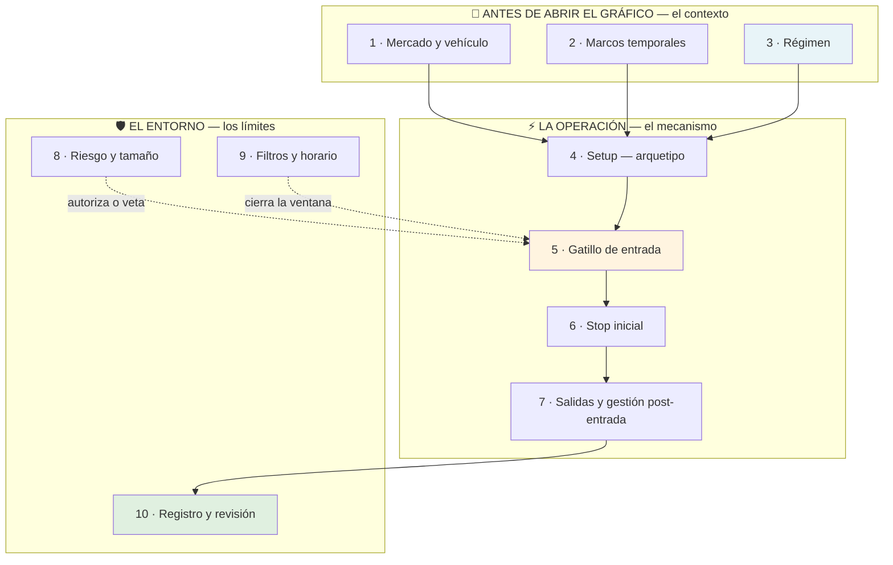

# Lección 7.2 · Los 10 componentes del sistema

| Campo | Detalle |
|---|---|
| ⏱️ Duración estimada | 45–60 min de estudio |
| 🧱 Módulo | [M7 · Construcción del Sistema](README.md) |
| ⬅️ Anterior | [Lección 7.1 · Filosofía, Estrategia y Sistema](leccion-7-1.md) |
| ➡️ Siguiente | [Lección 7.3 · Arquetipos de setup](leccion-7-3.md) |

---

## Por qué importa

Un sistema no es "un conjunto de reglas" en abstracto: es una lista cerrada de **preguntas que ya tienen respuesta**. Cada componente de esta lección es una pregunta que tu negocio debe responder ANTES de abrir el gráfico, y cada hueco que dejas abierto es una puerta para la improvisación — que siempre entra disfrazada de "lectura del momento". Cuando revises los journals de traders que fracasan, casi siempre encontrarás el mismo patrón: 3 componentes definidos (entrada, mercado, tamaño a ojo) y 7 huecos. Cuando revises los de los que sobreviven, encontrarás lo contrario: las 10 preguntas respondidas por escrito, aunque algunas respuestas sean deliberadamente simples. Esta lección te da el esqueleto completo para que tu Sistema v1.0 del laboratorio no tenga ni un solo hueco.

## Concepto

Los 10 componentes, agrupados por el momento en que actúan, con la pregunta que cierra cada uno y el ancla de la teoría que ya estudiaste:

| # | Componente | Pregunta que cierra | Ancla teórica |
|---|---|---|---|
| 1 | **Mercado y vehículo** | ¿Dónde opero y con qué instrumento — y por qué ese y no otro? | M1.3 (coordenada), M2.6 (personalidad) |
| 2 | **Marcos temporales** | ¿Dónde decido, dónde marco zonas, dónde ejecuto? | M5.6 (top-down de 3 capas) |
| 3 | **Régimen** | ¿En qué estado del mercado está permitido operar y en cuál no? | M3.6 (regímenes), M6.7 (Weinstein) |
| 4 | **Setup (arquetipo)** | ¿Qué fenómeno concreto busco repetido? | 7.3 (los 4 arquetipos) |
| 5 | **Gatillo de entrada** | ¿Qué evento exacto autoriza pulsar el botón — tipo de orden y precio? | M5.6 (gatillo), M4.2 (órdenes) |
| 6 | **Stop inicial** | ¿Dónde la idea está muerta — con qué margen para el ruido? | M4.6 (SL como ley), M6.3 (ATR) |
| 7 | **Salidas** | ¿Dónde me voy con ganancia — TP único, parciales, trailing? | M5.3 (liquidez opuesta) |
| 8 | **Gestión post-entrada** | ¿Qué hago (o me abstengo de hacer) con la posición abierta? | Regla de simplicidad (7.6) |
| 9 | **Riesgo y tamaño** | ¿Cuánto pierdo si el SL salta — y cómo lo calculo cada vez? | M1.4 (esperanza), M8 (formalización) |
| 10 | **Filtros, horario y registro** | ¿Cuándo NO opero (horario, noticias) y cómo documento cada operación? | M2.5-2.6 (sesiones, macro), M9 (journal) |

Tres observaciones de diseño que distinguen un sistema profesional de una lista de deseos:

1. **El régimen (3) filtra al setup (4), no al revés.** Primero preguntas "¿estamos en un estado donde mi arquetipo tiene sentido?" y solo después buscas el setup. El principiante hace lo contrario: encuentra el patrón y luego busca excusas para el régimen.
2. **El gatillo (5) es un evento, no una sensación.** "Cuando se ve fuerte" no es un gatillo; "cierre M15 por encima del 50 % de la vela de barrida" sí. La diferencia es la misma del test del clon: un evento se verifica, una sensación no.
3. **La gestión post-entrada (8) incluye la decisión de no hacer nada.** El sistema v1.0 del programa deliberadamente no mueve stops ni toma parciales: cada movimiento adicional es una decisión más donde tu psicología puede colarse. La abstención escrita también es una regla.

## Analogía

La lista de verificación previa al vuelo (checklist) de la aviación. Existe porque en 1935 el prototipo del B-17 se estrelló por un olvido trivial — los frenos del timón puestos — y la respuesta de la industria no fue "pilotos más atentos": fue una lista escrita donde cada ítem existe porque alguien lo olvidó una vez, con un coste. Tu sistema es tu checklist: el componente "horario" existe porque algún trader arruinó su semana operando a las 3 de la madrugada; el "riesgo y tamaño" existe porque alguien puso el 20 % "porque esta sí era clara"; la "gestión post-entrada" con abstención existe porque alguien movió su stop tres veces hasta convertir una pérdida de 1R en una de 5R. No es burocracia: es la memoria empaquetada de errores que tú todavía no has cometido — y que la lista te evita cometer.

## Cómo se hace: los 10 componentes rellenados con el caso maestro

Así se ve el esqueleto con las respuestas del programa (la plantilla vacía está en el [laboratorio del hub](README.md) para que la copies):

1. **Mercado y vehículo:** EUR/USD spot en demo; por qué: la personalidad del M2.6 (líquido, spreads bajos, sesiones claras) y es donde ya tienes mecánica entrenada.
2. **Marcos temporales:** H4 para sesgo y zonas (capa 1 del top-down), M15 para gatillo (capa 3). Nada por debajo de M15 — el ruido del M1 no paga.
3. **Régimen:** solo largos si H4 muestra secuencia HH/HL activa con precio sobre EMA 200 creciente *(el caso: low 1,0745 → HL 1,0798 → BOS sobre 1,0860)*; solo cortos con el espejo; sin dirección → sin operación.
4. **Setup:** pullback en tendencia con barrida de liquidez hacia zona de interés (OB/FVG) — el arquetipo del que la receta es una instancia (zona 1,0820–1,0824, barrida a 1,0792).
5. **Gatillo:** cierre M15 que recupera el nivel barrido; entrada limit en el 50 % del FVG activo (1,0820 en el caso).
6. **Stop inicial:** bajo el extremo de la barrida con margen de 0,25 × ATR(14) H4; auditoría de sanidad: el SL total debe medir entre 1,0 y 2,0 ATR *(32 pips ≈ 1,52 ATR — pasa)*.
7. **Salida:** TP único en la liquidez opuesta (el último HH: 1,0886 en el caso, 66 pips, R:B ≈ 2,1) o 2R fijos, lo que llegue antes. Sin parciales en v1.0.
8. **Gestión post-entrada:** ninguna — la posición vive sola hasta SL o TP. La abstención está escrita para que no puedas "ayudar".
9. **Riesgo y tamaño:** 1 % fijo del capital inicial por operación (19,20 $ sobre 2 000 $ en el caso; el lote sale del SL: 32 pips → 0,06 lotes). La formalización completa llega en M8.
10. **Filtros, horario y registro:** solo solapamiento Londres–NY en hora Bolivia; fuera de la ventana roja de noticias (15/15 y FOMC 30/30, M2.6); dashboard M6 con máximo 3 piezas y reglas escritas; toda operación al journal con captura antes de avanzar el replay.

Observa que ninguna regla menciona un indicador como veredicto: el dashboard audita (ATR para el stop, régimen con EMA/estructura), la estructura decide. Es exactamente la constitución del M6.1 aplicada.

## Error común

**(1) Los componentes incompletos.** Definir 4 y dejar 6 huecos: sin horario operarás a las 3 de la madrugada "porque había señal"; sin gestión escrita moverás el stop; sin régimen comprarás pullbacks en Etapa 4. **(2) Los componentes decorativos.** Escribir "gestión: trailing stop dinámico según estructura" cuando llevas 30 operaciones en tu vida: componentes que no sabes ejecutar hoy son humo — mejor una regla simple que una sofisticada que no cumples. **(3) El componente-que-es-tres.** Meter régimen + setup + gatillo en una sola frase ("compro cuando está alcista y hace pullback y confirma"): son tres preguntas distintas y cada una necesita su propia respuesta auditable. **(4) Tamaño "a ojo" dentro de un sistema escrito.** Si los otros 9 componentes son exactos y el 9 es "según me sienta", el sistema entero queda contaminado: el tamaño es el multiplicador de todo lo demás. **(5) Sobredefinir.** 27 reglas con subcondiciones: cada regla extra es un punto de contradicción potencial entre reglas y una regla extra que romperás. La plantilla cierra con 10 componentes — cada uno con 1-3 frases. Si necesitas más, probablemente estés ajustando al pasado (lección 7.6).

## Conexión cuantitativa

Cada componente no escrito es un grado de libertad que tu ejecución aleatoriza, y la aleatorización tiene coste medible: si tu stop "depende del gráfico" y tu gestión "depende del ánimo", entonces $W$ y $P_w$ de tu esperanza $E = (P_w \times W) - (P_l \times L)$ no son parámetros del sistema sino de la mezcla sistema+humor — y la varianza de la mezcla es mayor que la del sistema. Concreto: con riesgo fijo de 1R y 30 operaciones, un sistema cerrado produce una distribución de resultados con dispersión atribuible al mercado; el mismo sistema con 3 componentes abiertos produce dispersión de mercado **más** dispersión de ejecución, y tú no puedes separarlas. Cuando en M9 midas el sistema, la conclusión honesta será "no sé si el sistema es malo o mi ejecución lo fue". La escritura completa es lo que vuelve interpretable el número final: por eso el criterio de graduación del módulo exige **completitud de componentes** antes que cualquier resultado.

---

## 🎯 Puntos clave

1. Un sistema es una lista cerrada de 10 preguntas respondidas; cada hueco es una puerta de la improvisación.
2. El orden importa: el régimen filtra al setup — primero "¿puedo operar?" y solo después "¿veo mi patrón?".
3. Gatillo = evento verificable, nunca una sensación; la misma lógica del test del clon aplicada al botón.
4. La gestión post-entrada incluye la abstención escrita: menos decisiones en vivo = menos puertas para la psicología.
5. El caso maestro rellena los 10 con números cerrados — la receta era el sistema v0 del programa.
6. Componentes decorativos (que no puedes ejecutar hoy) son humo: simple y cumplible antes que sofisticado y roto.

## 🔄 Autoevaluación rápida

1. Tu plan dice: *"Compro pullbacks en EUR/USD"*. Enumera los componentes que faltan y el error concreto que cada hueco produciría en las próximas 2 semanas.
2. ¿Por qué el v1.0 del programa no usa parciales ni trailing? Argumenta con la regla de decisiones y con el criterio de audibilidad de M9.
3. Reordena esta operación del caso maestro en los componentes correctos: *"entrada limit 1,0820"* · *"HH/HL activo en H4"* · *"TP 1,0886"* · *"solo Londres–NY"* · *"lote 0,06 por SL de 32 pips"*.

Ver respuestas

1. Faltan: (2) marcos — ¿pullback visto en qué marco? sin esto mezclarás señales D1 con ejecución M1; (3) régimen — comprarás pullbacks en tendencia bajista o Etapa 4; (4) setup exacto — ¿qué cuenta como pullback, hacia qué zona?; (5) gatillo — entrarás "cuando se sienta listo"; (6) stop — o no pones, o lo pides "un poco más lejos" cada vez; (7) salidas — cerrarás por miedo a mitad del recorrido; (8) gestión — moverás el stop; (9) riesgo — tamaño a ojo: 5 % un día, 0,5 % otro; (10) horario y registro — operaciones nocturnas sin journal. En dos semanas: resultados no replicables y un journal inauditable.
2. Regla de decisiones: cada gestión en vivo es una nueva decisión y cada decisión expone a la psicología (M10) — la abstención escrita elimina la clase entera de errores de gestión. Audibilidad: con gestión activa, el resultado final mezcla la calidad del sistema con la calidad de tus maniobras (¿cuándo moviste?, ¿por qué ahí?) — el número final deja de medir al sistema. Con "nada" escrito, el resultado es 100 % atribuible al sistema y comparable operación a operación.
3. Entrada limit 1,0820 → componente 5 (gatillo, con tipo de orden y precio). HH/HL activo H4 → componente 3 (régimen). TP 1,0886 → componente 7 (salidas). Solo Londres–NY → componente 10 (horario). Lote 0,06 por SL de 32 pips → componente 9 (riesgo y tamaño — el lote deriva del stop, no de la intuición).

