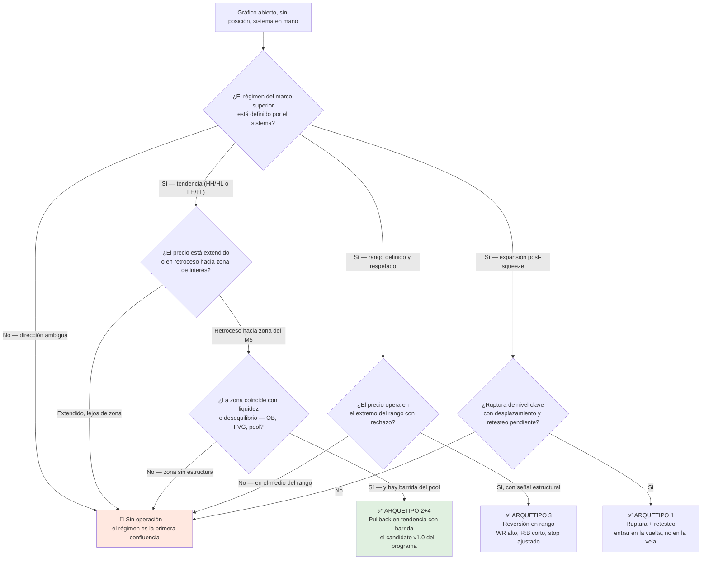

# Lección 7.3 · Arquetipos de setup — los 4 caminos hacia la ventaja

| Campo | Detalle |
|---|---|
| ⏱️ Duración estimada | 50–65 min de estudio |
| 🧱 Módulo | [M7 · Construcción del Sistema](README.md) |
| ⬅️ Anterior | [Lección 7.2 · Los 10 componentes](leccion-7-2.md) |
| ➡️ Siguiente | [Lección 7.4 · Esperanza aplicada](leccion-7-4.md) |

---

## Por qué importa

Los setups no se inventan: se eligen. Detrás de los miles de patrones con nombres exóticos que vende la industria hay exactamente **cuatro lógicas de captura** — cuatro arquetipos — y todo lo demás es variación de vocabulario. Conocer el catálogo completo te hace dos cosas: te impide saltar de sistema en sistema (porque entiendes que el setup nuevo de YouTube es el mismo arquetipo que ya tienes, con otro nombre), y te obliga a elegir el tuyo con criterios de compatibilidad — con tu filosofía, con tu mercado y con tu régimen — en vez de por popularidad. La decisión es irreversible a efectos estadísticos: en la misión de este módulo operarás UN arquetipo 30 veces, y si lo eliges mal, los 100 backtests de M9 medirán el arquetipo equivocado. Esta es la lección donde eliges el caballo con el que correrás el resto del programa.

## Concepto

**Definición — arquetipo de setup:** familia de operaciones que comparten la misma lógica de captura de la ventaja: dónde entra (relación con el movimiento previo), contra qué apuesta (qué desequilibrio explota) y cómo muere (qué invalida la idea). El setup concreto de tu sistema es una instancia parametrizada del arquetipo: el arquetipo dice "pullback en tendencia"; tu sistema dice exactamente qué pullback, hacia qué zona, con qué gatillo.

**El catálogo completo:**

| Arquetipo | Lógica de captura | Régimen óptimo | Firma típica (WR × R:B) | Cómo muere |
|---|---|---|---|---|
| 1 · **Ruptura + retesteo** *break and retest* | La ruptura de un nivel confirma que las órdenes del lado contrario se agotaron; el retesteo ofrece la entrada donde la ruptura se valida | Expansión post-squeeze (M6.3), inicio de Etapa 2 (M6.7) | WR bajo-medio (~35-45 %) × R:B alto (≥ 1:2,5) | Falsa ruptura: el retesteo no aguanta y el precio vuelve al rango |
| 2 · **Pullback en tendencia** *trend pullback* | La tendencia sigue viva; el retroceso a zona de interés es el punto donde las instituciones añaden a favor del régimen al precio menos caro | Tendencia establecida (HH/HL o LH/LL activos) | WR medio (~40-55 %) × R:B medio-alto (1:2) | La reversión real: el HL/LH estructural se rompe (CHoCH, M5.2) |
| 3 · **Reversión en rango** *range fade / mean reversion* | En rango, los extremos son zonas donde el precio "está caro o barato" respecto a la media; se opera el rechazo hacia el centro | Rango definido (M3.6), Etapas 1 y 3 | WR alto (~55-70 %) × R:B corto (~1:0,8-1) | La ruptura del rango: el rechazo se convierte en breakout y el "fijo" se convierte en víctima |
| 4 · **Barrida + giro** *sweep and reversal* | El precio barrer un pool de liquidez (M5.3) completa el llenado institucional; la entrada se pone tras el barrido, a favor del sesgo, cuando la estructura confirma el giro | Cualquiera con sesgo claro en el marco superior; zona de interés alcanzada | WR medio (~35-50 %) × R:B alto (≥ 1:2,5) | La barrida en contra del régimen fuerte: el "barrido" era el primer tramo de la aceleración |

Dos advertencias sobre la tabla: (a) las firmas WR × R:B son **formas ilustrativas** de la estructura de cada arquetipo, no estadísticas universales — el WR real de TU instancia se mide en tu muestra (misión de este módulo, M9); y (b) la firma es coherente con la esperanza: el arquetipo 3 necesita WR alto porque gana poco por acierto; el 1 necesita R:B alto porque falla mucho. Un sistema que opera el arquetipo 3 esperando R:B 1:3 está rompiendo la naturaleza de su propia bestia.

**El híbrido 2+4 del programa.** Mira el caso maestro de nuevo con esta lente: tendencia HH/HL en H4 (arquetipo 2: la tendencia es el contexto), pullback a la zona 1,0820–1,0824, y DENTRO del pullback, barrida del pool bajo 1,0798 hasta 1,0792 (arquetipo 4: la entrada se da tras el barrido). La [Receta](../../03-recursos/laboratorio/receta-primera-operacion.md) no eligió el híbrido por estética: es el arquetipo que integra TODAS las herramientas del N2 — régimen (M3/M6.7), estructura (M5.1), CHoCH como invalidación (M5.2), liquidez (M5.3), zona (M5.4-5.5), top-down (M5.6) y dashboard como auditor (M6). Por eso es el candidato natural del Sistema v1.0: cada componente del sistema tiene una definición estructural no ambigua.

## Analogía

La pesca. Cuatro arquetipos = cuatro técnicas: el arrastre (ruptura: cubrir agua nueva donde el banco se mueve), la mosca en la corriente (pullback: presentar la mosca donde el pez ya espera alimento, en su línea de espera), el fondo en el hoyo (reversión en rango: esperar al pez estacionario en su esquina) y el señuelo en la superficie tras el splash (barrida+giro: pescar el pánico del banco). Ninguna es "la mejor": depende del lago (el régimen), de la especie (el mercado) y de tu destreza. El pescador que cambia de técnica cada hora no pesca nada — no porque las técnicas fallen, sino porque ninguna la practicó hasta que sus manos la conocen. Y la lección más incómoda del catálogo: el arquetipo que más se ajusta a tu psicología inicial no es el que más gana por operación, sino el que puedes ejecutar 30 veces sin desviarte una sola vez.

## Cómo se hace: elegir tu arquetipo con 4 filtros

Para el Sistema v1.0, el arquetipo se elige respondiendo por escrito:

1. **Compatibilidad filosófica (7.1):** ¿tu tesis sobre el mecanismo predice que este arquetipo capture dinero? Si tu filosofía es la de la huella institucional (M5), el híbrido 2+4 es su traducción directa; si tu tesis fuera "la información se difunde lento" (seguimiento puro), el arquetipo 1 o 2 sin barrida.
2. **Compatibilidad de mercado (M2.6):** ¿tu mercado presenta el fenómeno con frecuencia operable? Las barridas son ubicuas en FX mayor; las rupturas con retesteo limpio son más frecuentes en índices; la reversión en rango exige rango — y EUR/USD H4 pasa semanas sin uno claro.
3. **Compatibilidad de invalidación (M5.2):** ¿la idea muere con un evento estructural objetivo? El 2+4 muere con CHoCH por debajo del HL — verificable. Un arquetipo que "muere cuando se ve mal" no tiene invalidación, y sin invalidación no hay stop defendible.
4. **Coste de ejecución (M4.3):** ¿el spread y el slippage se comen tu R:B? El arquetipo 3 con R:B 1:0,8 es el más frágil ante costes: si el coste es 0,1R, tu ganancia neta por acierto cae de 0,8R a 0,7R — un 12,5 % de tu beneficio evaporado; el arquetipo 1 con R:B 1:3 pierde solo un 3 %.

Aplicados al programa: los 4 filtros convergen en el **híbrido 2+4** — filosofía integrada, fenómeno frecuente en EUR/USD, invalidación estructural (cierre bajo el HL), y R:B ≥ 1:2 con margen para costes. La misión del módulo pondrá a ese candidato 30 veces a prueba, y su WR real —no el ilustrativo de la tabla— decidirá si llega a los 100 backtests de M9 como está o con ajustes.

## Error común

**(1) Mezclar arquetipos en la misma muestra.** 30 operaciones donde 12 son pullbacks, 10 rupturas y 8 reversiones no son una muestra de nada: su WR combinado es la media de tres poblaciones distintas y no describe a ninguna. La misión exige UN arquetipo. **(2) Herramientas del arquetipo equivocado.** RSI 30 (herramienta de reversión en rango, M6.4) para comprar pullbacks en tendencia fuerte: en régimen alcista el RSI no llega a 30 — y si llega, es porque la tendencia se rompió, justo cuando no querías comprar. Cada arquetipo usa el panel a su manera. **(3) Clasificación retrospectiva.** "Al final resultó ser un pullback" — el arquetipo se declara ANTES de la operación; si solo lo puedes nombrar después, es narrativa, no sistema. **(4) Perseguir el arquetipo de moda.** El que gana esta semana en Twitter: sin preguntarse en qué régimen funciona, acabas operando reversión en rango en una expansión — la configuración exacta que la tabla marca como la muerte del arquetipo 3. **(5) Cambiar de arquetipo tras la primera racha.** 4 pérdidas seguidas en el arquetipo elegido (probabilidad que la lección 7.5 calcula: esperable) no es evidencia de arquetipo equivocado; es evidencia de que la muestra está en su minuto 4.

## Conexión cuantitativa

La razón estadística para no mezclar arquetipos es que cada uno tiene su propia pareja de parámetros $(P_w, \frac{W}{L})$, y la esperanza solo es aditiva dentro de una población homogénea: si operas la mitad en un arquetipo con $E_1 = +0{,}2R$ y la mitad en otro con $E_2 = -0{,}1R$, tu media es $+0{,}05R$ — un número que no pertenece a ninguna de las dos máquinas y que empeora al reponderar sin saberlo. Peor: el PF combinado es una mezcla de distribuciones y sus rachas no son independientes entre arquetipos (todos sufren juntos en el cambio de régimen). Por eso la tabla de la lección 7.4 —la matriz WR × R:B— se aplica al arquetipo elegido, no a tu cuenta: la misión de 30 repeticiones estima **la pareja de parámetros de UN arquetipo**, y con ella entras a 7.4 a leer tu propia fila de la matriz. La homogeneidad de la muestra es lo que hace interpretable todo lo que viene después: backtesting (M9), tamaño de posición (M8) y hasta la psicología (M10) dependen de que las 30 operaciones sean instancias de la misma máquina.

---

## 🎯 Puntos clave

1. Cuatro lógicas de captura existen: ruptura+retesteo, pullback en tendencia, reversión en rango, barrida+giro — todo lo demás es vocabulario.
2. Cada arquetipo tiene firma típica WR × R:B coherente con su naturaleza: quien gana poco necesita acertar mucho, y viceversa.
3. Las firmas son formas ilustrativas — el WR real de tu instancia se mide en tu muestra, nunca se hereda de la tabla.
4. El híbrido 2+4 (pullback en tendencia con barrida) integra todas las herramientas del N2 y es el candidato v1.0 del programa.
5. La elección del arquetipo pasa 4 filtros: filosofía, mercado, invalidación estructural y costes — todos por escrito.
6. La muestra de la misión es de UN arquetipo: mezclar poblaciones produce un E que no describe ninguna máquina.

## 🔄 Autoevaluación rápida

1. Un influencer publicó esta semana: "el patrón triple-top invertido con volumen está imparable". ¿Qué arquetipo es (con vocabulario traducido), en qué régimen funciona y qué le pasa fuera de él?
2. Calcula el coste relativo de un spread de 0,1R sobre el beneficio bruto por acierto del arquetipo 3 (R:B 1:0,8) frente al arquetipo 1 (R:B 1:3). ¿Qué conclusión operativa extraes?
3. El caso maestro: identifica en qué momento la operación dejó de ser arquetipo 2 puro y se convirtió en 2+4. ¿Qué nivel exacto fue barrido y qué confirma el M5.3 sobre ese movimiento?

Ver respuestas

1. Traducido: es una **reversión** (giro de un techo triple fallido = rechazo de extremo con confirmación), un dialecto del arquetipo 3 (o 4 si el techo acumulaba stops). Funciona en rango o en agotamiento de tendencia (final de Etapa 3) — fuera de él (en expansión de Etapa 2) el "techo" se rompe al alza y el arquetipo muere exactamente como dice la tabla: el rechazo se convierte en breakout. La pregunta que el influencer no responde: ¿en qué régimen se testeó? Sin régimen declarado, es marketing con velas.
2. Arquetipo 3: beneficio bruto 0,8R, coste 0,1R → beneficio neto 0,7R = **12,5 % del bruto evaporado** (0,1/0,8). Arquetipo 1: bruto 3R, coste 0,1R → neto 2,9R = **3,3 % evaporado**. Conclusión: los sistemas de R:B corto son los más sensibles a la calidad de ejecución (spread, slippage, comisiones) — si tu broker/ejecución es mediocre, el arquetipo 3 puede pasar de E+ a E− solo por costes, mientras el arquetipo 1 apenas lo siente. El coste no es una línea del journal: es una variable del diseño del sistema.
3. La operación era arquetipo 2 (pullback en tendencia HH/HL hacia la zona 1,0820–1,0824) hasta que el precio perforó el mínimo del pool bajo 1,0798 y cerró la barrida en 1,0792 — ese quiebre del mínimo obvio es el momento 2→2+4. El M5.3 confirma la lectura: el nivel obvio acumulaba stops de los compradores del primer impulso; la barrida los ejecutó (materia prima institucional) y la recuperación inmediata del nivel con desplazamiento posterior es la firma del llenado completado — la ventana que el gatillo M15 aprovechó en 1,0820.

