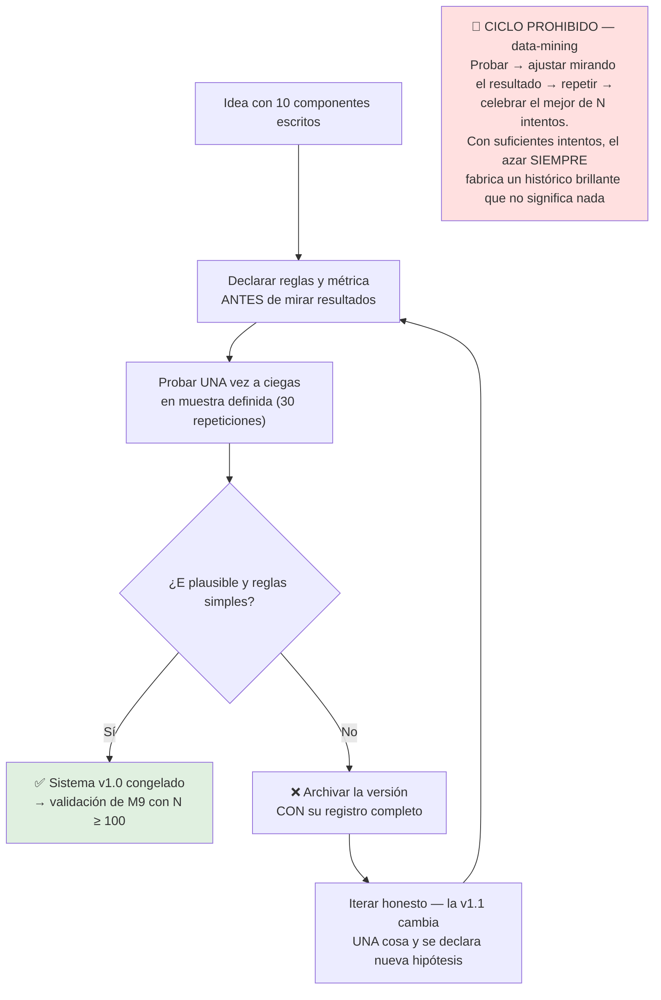

# Lección 7.6 · Criterios de robustez — cuando el sistema sobrevive al espejo

| Campo | Detalle |
|---|---|
| ⏱️ Duración estimada | 45–60 min de estudio |
| 🧱 Módulo | [M7 · Construcción del Sistema](README.md) |
| ⬅️ Anterior | [Lección 7.5 · Métricas y rachas](leccion-7-5.md) |
| ➡️ Siguiente | [🏆 Evaluación Nivel 2 · examen-n2](../../03-recursos/evaluaciones/examen-n2.md) |

---

## Por qué importa

Tienes un sistema escrito, con arquetipo elegido, matriz leída y métricas definidas. Falta la pregunta final de N2 — y es la pregunta que separa los sistemas que financian una carrera de los que financian una ilusión: **¿cómo sé que mi v1.0 no es un traje cosido a medida del pasado?** Cada regla que escribiste se apoyó, consciente o no, en operaciones que ya viste; la tentación permanente del trader es retocar las reglas hasta que el histórico luce perfecto — y ese retoque tiene nombre técnico (sobreoptimización) y un mecanismo estadístico preciso. Esta lección te da los cuatro criterios con los que el agente auditor aprobará o devolverá tu Sistema v1.0, y la regla de comportamiento más valiosa del programa: las reglas se declaran antes de probar, se prueban una vez, y los ajustes se archivan para una v1.1 que cambia UNA cosa — nunca el ciclo infinito de "probar-ajustar-celebrar" que fabrica sistemas brillantes en el replay y suicidas en vivo.

## Concepto

**Los 4 criterios de robustez del programa** — el checklist con el que se aprueba el v1.0:

| # | Criterio | Qué exige | Cómo se verifica |
|---|---|---|---|
| 1 | **Escrito y clonable** | El test del clon de 7.1: dos desconocidos ejecutan igual | Lectura del documento por un tercero (el agente auditor) |
| 2 | **Componentes completos** | Las 10 preguntas de 7.2 cerradas, sin huecos | Recorrido por la plantilla, componente a componente |
| 3 | **E plausible con margen para costes** | La celda esperada en la matriz (7.4) sobrevive a la fricción de 0,06-0,1R y al deterioro de ejecución en vivo | La fila declarada de tu arquetipo, restado el coste |
| 4 | **Simple y probado fuera de muestra** | Reglas mínimas y una prueba en datos que el sistema no vio al construirse | Conteo de reglas + diseño del test (abajo) |

**Criterio 4a — la simplicidad es cuantitativa.** No es minimalismo estético: cada regla es un parámetro que tu documento ajusta al pasado. Un sistema con 27 reglas tiene 27 lugares donde el azar del histórico pudo "explicarse" a sí mismo; con 10, los tiene diez. La heurística del programa: el v1.0 debe sobrevivir con **≤ 10 reglas explícitas totales** (los componentes, cada uno con 1-3 frases). Si tu sistema necesita más, no es más preciso: está aprendiendo de memoria las particularidades de los movimientos que viste — exactamente como un estudiante que memoriza las respuestas del examen anterior y suspende el siguiente.

**Criterio 4b — fuera de muestra (out-of-sample).** La única prueba que importa: ¿funciona en datos que no existían cuando escribiste las reglas? Formalmente, divide tu evidencia en muestra de construcción (donde surgieron las ideas) y muestra de prueba (datos posteriores o desconocidos donde se verifica). La misión de este módulo ya está diseñada para eso: el Bar Replay arranca en **fechas que no recuerdas**, con avance a ciegas — tus 30 repeticiones son, por construcción, una prueba fuera de muestra de un sistema escrito de antemano. Es la diferencia entre predecir y explicar: el que ajusta reglas tras ver el resultado **explica** el pasado; el que declara reglas antes **predice** — y solo la predicción vale dinero.

**El enemigo formal — el sesgo de data-mining.** El ciclo prohibido:

Por qué el ciclo prohibido garantiza autoengaño: si pruebas 20 variantes de un sistema incluso INÚTIL y te quedas con la mejor, esa mejor tendrá casi seguro un histórico espectacular — no porque funcione, sino porque entre 20 loterías eliges el billete que ya ganó. Es la falacia del francotirador texano dibujada al revés: primero disparas 20 veces a la pared, después pintas la diana alrededor del mejor agujero. El programa bloquea el ciclo con dos candados: la métrica se **declara antes** (regla que ya viviste en el laboratorio del M6) y cada iteración se **archiva con su registro** — la historia completa de tus intentos es auditable, incluidos los feos.

**La humildad del intervalo de confianza.** Con N=30 y WR medido de 40 %, el intervalo de confianza al 95 % del WR verdadero es:

$$WR \pm 1{,}96\sqrt{\frac{WR(1-WR)}{N}} = 40\% \pm 1{,}96\sqrt{\frac{0{,}4 \times 0{,}6}{30}} \approx 40\% \pm 17{,}5\%$$

Es decir: tu medición "40 %" es compatible con un sistema verdadero entre ~22 % y ~58 %. Esa horquilla —enorme— es la razón por la que (a) la misión de 30 repeticiones produce un **candidato**, no una sentencia, (b) M9 exige N ≥ 100 para validación, y (c) el programa prohíbe decisiones estructurales (cambiar de arquetipo, abandonar) con muestras de este tamaño. La estadística no es pesimista: es honesta sobre lo que una muestra puede decir.

## Analogía

El traje a medida contra el prêt-à-porter. Un sastre que confecciona un traje ajustado a un único cuerpo —medido en un solo instante, con esa postura exacta— obtiene un traje perfecto para ese cuerpo y ese momento, y inservible para cualquier otro. Un sistema ajustado hasta que el histórico luce perfecto es ese traje: cosido sobre las arrugas exactas de 30 movimientos concretos que nunca se repetirán. La robustez es la propiedad contraria: encajar en un rango de cuerpos (regímenes, periodos, mercados vecinos) sin deshacerse. El sastre honesto deja margen de costura; el constructor de sistemas honesto deja reglas simples y las prueba en un cuerpo nuevo que no midió. Y cuando el traje "perfecto" del replay no abotona en vivo, el ajuste no fue maestría: fue la costura escondida que solo sujetaba en la pose del maniquí.

## Cómo se hace: la checklist final del Sistema v1.0

Antes de entregar el v1.0 al agente auditor (laboratorio del hub), tu documento pasa esta lista — cada "no" devuelve el sistema a la mesa:

1. ¿Cada componente (7.2) responde con una regla verificable, no con intención?
2. ¿El documento pasa el test del clon leído por otra persona (o por tu yo de dentro de 6 meses)?
3. ¿El arquetipo fue elegido con los 4 filtros de 7.3, por escrito?
4. ¿La fila esperada de la matriz (7.4) está declarada ANTES de la misión — WR esperado y R:B mínimo?
5. ¿Las reglas totales caben en ≤ 10? Si no, ¿qué regla se añadió y qué evidencia la justifica (y no "para que funcione mejor")?
6. ¿Ninguna regla fue modificada después de ver resultados de la muestra? (si sí: versión nueva, muestra nueva, desde cero)
7. ¿La métrica de éxito se declaró antes de probar? (qué cuenta como acierto, qué como fallo, qué como "no hay setup")
8. ¿La prueba se corrió fuera de muestra (replay en fechas no recordadas, a ciegas)?
9. ¿El registro completo está archivado — incluidos los intentos anteriores descartados?
10. ¿El veredicto salió de la matriz y las métricas (7.5), no del ánimo del día?

Diez ítems, dos horas de honestidad, y el resultado es un sistema que M9 puede validar sin ambigüedad. El criterio de robustez es, al final, una promesa contigo: *"no volveré a tocar esto hasta tener la evidencia que dije que iba a contar como evidencia"*.

## Error común

**(1) Ajustar el stop hasta que el backtest brilla.** El clásico: "con SL de 30 pips hay 12 falsos salidos; con 35 solo 5" — cada ensanchamiento es ajuste al pasado de ESA muestra; el stop honesto sale de la estructura y el ATR (M6.3), no del recorrido óptimo retrospectivo. **(2) Añadir confluencias hasta maquillar el WR.** Cada filtro añadido tras ver fallos es data-mining con estética de rigor: si el filtro era bueno, se declara como hipótesis de la v1.1 y se prueba en muestra nueva — no se cose en la v1.0 ya probada. **(3) Cambiar de arquetipo tras la primera racha.** La tabla de 7.5 ya te dijo que la racha de 6-7 es esperable: cambiar de máquina en ese punto es reiniciar el contador de evidencia a cero manteniendo el sesgo intacto. **(4) Celebrar la v1.0 como validada.** La misión produce un candidato con intervalo ±17,5 %: la validación llega con los 100 backtests de M9 y el forward de demo. Confundir candidato con validado es sembrar la sobreconfianza que M10 tratará como sesgo. **(5) Descartar sin archivar.** Borrar los intentos fallidos: además de perder el aprendizaje, rompes la audibilidad de tu propio proceso — el journal del sistema (qué versiones existieron, qué cambiaron, por qué) es la primera pieza del journal profesional de M9.

## Conexión cuantitativa

La sobreoptimización tiene lectura matemática directa en la esperanza: cada parámetro libre que ajustas a la muestra consume información — con $k$ reglas ajustadas sobre $N$ operaciones, el rendimiento en muestra tiende a inflarse aproximadamente como $\sqrt{k/N}$ respecto al rendimiento real que verás fuera de ella. Con N=30 y 10 reglas libres, ese inflado es del orden del 58 %: un sistema que "mide" +0,3R ajustado puede deber +0,19R o menos fuera de muestra — y con 27 reglas sobre la misma muestra, el inflado supera el 90 %: el número del replay es, funcionalmente, ficción. Las contramedidas son exactamente los criterios de esta lección en forma de fracciones: **menos k** (simplicidad), **más N** (100 backtests de M9, con su intervalo que se estrecha a ±9,8 %), y **muestra nueva para cada hipótesis nueva** (out-of-sample por diseño). La robustez no es una virtud moral: es la gestión explícita de la razón $\frac{k}{N}$ que determina cuánto de tu resultado es máquina y cuánto es espejismo.

---

## 🎯 Puntos clave

1. Los 4 criterios de robustez: escrito y clonable, componentes completos, E plausible con margen para costes, simple y probado fuera de muestra.
2. La simplicidad es cuantitativa: cada regla es un ajuste al pasado — el v1.0 sobrevive con ≤ 10 reglas.
3. Out-of-sample = la prueba en datos que el sistema no vio; el replay a ciegas en fechas no recordadas la garantiza por construcción.
4. El ciclo prohibido (probar-ajustar-celebrar) fabrica históricos brillantes sin significado: métrica declarada antes y versiones archivadas son los dos candados.
5. La humildad estadística: con N=30 y WR 40 %, el verdadero está entre ~22 % y ~58 % — la misión produce candidato, M9 produce validación.
6. La robustez es la gestión de k/N: menos reglas, más muestra, hipótesis nueva en muestra nueva — eso decide cuánto de tu resultado es real.

## 🔄 Autoevaluación rápida

1. Tu v1.0 tiene 14 reglas y en el replay de 30 operaciones dio WR 58 % con PF 2,4. Un amigo propone "añadir el filtro de RSI para subir el WR a 65 %". Diagnostica los tres problemas de esta propuesta con las herramientas de la lección.
2. Calcula el intervalo de confianza del WR para una muestra de N=100 con WR medido 42 %. Compáralo con el de N=30 y extrae la conclusión que justifica el diseño de M9.
3. ¿Por qué la misión del módulo exige Bar Replay desde "fechas que no recuerdas"? ¿Qué criterio de robustez satisface exactamente y qué pasaría si repitieras la misión sobre el mes que acabas de estudiar en vivo?

Ver respuestas

1. (a) **Sobreoptimización por k:** 14 reglas ya superan el presupuesto (≤ 10) y añadir una más agranda el inflado $\sqrt{k/N}$ (con k=15, N=30: ≈ 71 % de inflación esperable) — el WR 58 % con PF 2,4 en N=30 es sospechoso de contener ajuste, no de ser bueno. (b) **Ciclo prohibido:** "añadir el filtro para subir el WR" es ajustar DESPUÉS de ver resultados — exactamente la secuencia probar-ajustar que fabrica históricos falsos; el filtro sería una hipótesis nueva (v1.1) con muestra nueva. (c) **Métrica mal planteada:** perseguir "WR 65 %" es perseguir una variable de la matriz (7.4) ignorando su pareja (R:B) — si el filtro de RSI sube el WR recortando los recorridos, puede moverte a la columna 1:1 y destruir la esperanza neta. El diagnóstico correcto: congelar la v1.0 tal cual, llevarla a M9, y probar el RSI como hipótesis separada.
2. N=100, WR 42 %: $\pm 1{,}96\sqrt{0{,}42 \times 0{,}58/100} = \pm 1{,}96 \times 0{,}0494 ≈ \pm 9{,}7$ % → intervalo [32,3 %, 51,7 %]. Contra el ±17,5 % de N=30: cuadruplicar la muestra **reduce el error a la mitad** (ley de la raíz cuadrada: el error cae como $1/\sqrt{N}$). Conclusión de diseño: con N=100 el intervalo todavía no es fino (≈ ±10 %) pero ya permite distinguir "el sistema está por encima del breakeven con margen" de "estamos en el filo" — esa distinción es exactamente lo que la validación de M9 necesita y lo que N=30 no puede dar.
3. Satisface el criterio **out-of-sample** (4b): si las reglas del v1.0 se escribieron antes y las fechas del replay no estaban en tu memoria al escribirlas, ninguna información de esos movimientos pudo colarse en las reglas — la prueba mide predicción, no explicación. Si repitieras la misión sobre el mes recién estudiado en vivo, la muestra estaría contaminada: ya sabes dónde están los HH, dónde barraron los pools y qué mercados corrieron — tus "predicciones" serían recuerdos disfrazados, el WR saldría inflado (estudios típicos muestran saltos de deciles de puntos por contaminación de memoria) y la matriz te diría una celda que no le pertenece al sistema. Es la razón pedagógica profunda del replay: es el único instrumento del M4 que fabrica futuro desconocido a voluntad.

