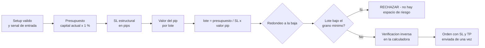

# Lección 8.3 · La regla del 1 % y position sizing — el presupuesto que nunca se rompe

| Campo | Detalle |
|---|---|
| ⏱️ Duración estimada | 50–65 min de estudio |
| 🧱 Módulo | [M8 · Gestión del Riesgo](README.md) |
| ⬅️ Anterior | [Lección 8.2 · Asimetría del drawdown](leccion-8-2.md) |
| ➡️ Siguiente | [Lección 8.4 · Apalancamiento real](leccion-8-4.md) |

---

## Por qué importa

Ya sabes por qué (8.1: inventario) y contra qué te proteges (8.2: asimetría). Esta lección instala el instrumento operativo que convierte esas dos lecciones en un número que cabe en una orden: el **position sizing**. Es la lección cuantitativa más importante del programa entero — más que la matriz de 7.4 — porque responde la pregunta que TODO lo demás presupone: *¿cuántos lotes pongo?* La respuesta profesional tiene una propiedad que la industria rara vez enseña: el tamaño es un **resultado**, no una decisión libre. Se calcula a partir de tres entradas (capital, presupuesto de riesgo, distancia al stop) y no admite ajuste emocional. Si tu Sistema v1.0 (componente 9) decía "riesgo y tamaño: 1 % fijo con cálculo del lote", esta lección es la máquina que ejecuta esa regla — y el laboratorio del módulo te la entrega como calculadora verificada.

## Concepto

**La fórmula universal, en dos pasos.** Paso 1 — el presupuesto:

$$\text{riesgo en \$} = \text{capital} \times \text{riesgo \%}$$

Paso 2 — el tamaño que lo respeta exactamente:

$$\text{lote} = \frac{\text{riesgo en \$}}{\text{SL en pips} \times \text{valor del pip por lote}}$$

Las tres entradas del paso 2: la distancia al stop (que sale de la estructura — componente 6 del sistema, auditada con ATR en M6), el valor del pip por lote estándar (propiedad del instrumento — 8.4 la desarrolla) y el presupuesto del paso 1 (que sale de la cuenta y de la regla del 1 %). **Ninguna de las tres entradas es una opinión.** Por eso el sizing profesional es aburrido por diseño: dos traders con los mismos datos calculan el mismo lote — es tu primer "test del clon" cuantitativo (7.1).

**El caso maestro desglosado.** La Receta ya ejecutó esto en el paso 9; ahora lo ves máquina por máquina:

| Paso | Dato | Cálculo | Resultado |
|---|---|---|---|
| 1. Capital | $C_0$ | — | 1.920 $ |
| 2. Presupuesto | 1 % | $1.920 \times 0{,}01$ | **19,20 $** |
| 3. SL estructural | bajo el low barrido | — | 32 pips |
| 4. Valor del pip | EUR/USD, cuenta USD | — | 10 $/pip/lote |
| 5. Lote bruto | fórmula | $19{,}20 / (32 \times 10) = 19{,}20/320$ | **0,06 lotes** |
| 6. Verificación inversa | control | $0{,}06 \times 32 \times 10$ | 19,20 $ ✓ exacto |

Cinco micro-reglas que la fórmula no te dice y que separan la calculadora profesional de la de tutorial:

1. **Redondeo SIEMPRE a la baja, al grano disponible.** Si el cálculo da 0,064 y tu broker cotiza en micro-lotes (0,01), operas 0,06 — nunca 0,07. El redondeo hacia arriba rompe el presupuesto por definición: es el primer acto de oversizing, cometido "por pragmatismo". Con la baja, el riesgo real queda SIEMPRE ≤ presupuesto: $0{,}06 \times 32 \times 10 = 19{,}20$ ✓ (aquí exacto; en el escenario 4 de la misión será 0,8 % — también correcto).
2. **Si el lote sale por debajo del grano mínimo, la operación se rechaza.** Presupuesto 4 $ con SL 80 pips → 0,005 lotes: no existe. No se "redondea a 0,01" (eso doblaría el riesgo a 2 %): se rechaza. El sizing tiene veto — igual que el setup ("no hay setup", M7) hay "**no hay espacio de riesgo**".
3. **Solo la distancia al stop está en riesgo.** El caso maestro abre 0,06 lotes = 6.000 $ de nominal — y NO está en riesgo 6.000 $: está en riesgo 19,20 $, porque el SL (4.5) convierte el movimiento adverso en una pérdida cerrada y acotada. El resto del nominal es madera de escenografía: se mueve, pero tu pérdida máxima es la del presupuesto. Esta distinción es la que la 8.4 explota para demoler el mito del apalancamiento.
4. **El SL manda, el lote obedece — nunca al revés.** El SL se coloca donde muere la idea (estructura + margen + ATR, M5-M6). Si el lote que sale es "muy pequeño", la solución NO es acortar el stop para que quepa más lote — es aceptar el tamaño o rechazar. Acortar el stop para agrandar el lote es fabricar stops que el ruido normal del mercado toca (M3: whipsaw) con el agravante de que ahora son grandes.
5. **El % se recalcula sobre el capital ACTUAL, no sobre el inicial.** Tras una racha de −6 %, tu presupuesto es el 1 % del saldo actual (menos). Tras una racha ganadora, apenas sube. El riesgo compuesto en la cuenta descendente y el riesgo casi plano en la ascendente: esa asimetría deliberada es la vacuna contra el martingale invertido.

**El flujo completo de una decisión de sizing** *(todo esto cabe en una fila de checklist pre-operación)*:



**Por qué exactamente el 1 %** *(la derivación completa, con las lecciones ya construidas)*: la 7.5 te dio la frecuencia (rachas de 6-7 esperables con WR 40 %); la 8.2 te dio el precio de cada drawdown (superlineal). El 1 % es el cruce de ambas curvas: produce un drawdown esperable de −6 % (herida, ~8 meses de curación) y un drawdown de emergencia estadística (20 pérdidas, casi 3× la racha esperable) de solo −18,2 % (aún recuperable). Sube a 3 %: la racha esperable ya te deja en −17 % (zona de revisión obligatoria) y 20 pérdidas en −46 %. Sube a 5 %: la racha esperable → −26,5 % (no retorno práctico). **El 1 % no es prudencia moral: es el punto donde la curva de daño de 8.2 sigue debajo de la línea de emergencia incluso con la estadística más fea de 7.5.** ¿Cuándo 0,25-0,5 %? Si tu WR medido es bajo (rachas de 10-12 esperables, como la autoevaluación 3 de 8.2), si operas instrumentos con gaps/fin de semana, o si estás en tu primer año (la ejecución imperfecta añade su propia "racha" — M10). ¿Cuándo más de 1 %? Ningún argumento del programa lo justifica antes de M9: la evidencia (100 backtests + forward) no existe todavía para subir la apuesta.

## Analogía

El repartidor de pizzas y el depósito de gasolina. El repartidor no llena el tanque "según las ganas del día": su empresa le asigna una ruta (el setup), el mapa le dice cuántos kilómetros tiene (la distancia al stop) y el camión consume X litros por kilómetro (el valor del pip). El presupuesto de gasolina sale de la caja de la empresa, no de la emoción del chofer — y si la ruta de hoy requiere más gasolina de la que el presupuesto cubre, la ruta se rechaza: no se sale con el tanque a medias "a ver si llega". Tu cuenta es la caja; el 1 %, la política de gastos; el SL, los kilómetros; el lote, los litros. Un repartidor que llena el tanque "porque hoy se siente afortunado" no es valiente: es un pasivo operativo. Y el que dice "esta ruta es tan buena que vale llenar el tanque doble" ha olvidado cómo se paga la gasolina cuando la ruta falla — que es la ÚNICA parte del plan que la caja sí siente.

## Cómo se hace: la calculadora del programa (laboratorio)

El laboratorio del módulo construye la calculadora completa (hoja de cálculo + la versión Python del repo). Las fórmulas exactas de la hoja, celda por celda:

```text
B1 capital actual          = [tu saldo]
B2 riesgo %                = 1 %
B3 presupuesto             = B1 * B2 / 100
B4 entrada                 = [precio de tu señal]
B5 stop                    = [precio estructural + margen]
B6 SL en pips              = ABS(B4 - B5) / 0.0001      ← EUR/USD y pares XXX/USD de 4-5 decimales
B7 valor del pip por lote  = 10                          ← EUR/USD, GBP/USD, AUD/USD con cuenta USD
B8 lote bruto              = B3 / (B6 * B7)
B9 lote final              = FLOOR(B8, 0.01)             ← redondeo a la baja al micro-lote
B10 verificación inversa   = B9 * B6 * B7                ← debe ser ≤ B3 (si B10 > B3, hay error)
B11 riesgo real %          = B10 / B1 * 100              ← el número que va al journal
```

Reglas de la hoja: si B8 < 0,01 → la celda muestra **RECHAZADA** (no calcula); el journal registra B9 y B11 de cada operación; la pestaña 2 (correlación, 8.5) audita la cartera simultánea. El caso de control: con los datos de la Receta la hoja debe devolver **0,06 / 19,20 $ / 1,0 %** — si no, la hoja está mal, no el caso.

## Error común

**(1) Sizing al revés: "quiero operar 0,2 lotes, ¿cuánto riesgo es?"** — 0,2 lotes con SL 32 = 64 $ = 3,3 %: el tamaño mandó sobre el presupuesto. La única pregunta válida empieza en el presupuesto. **(2) El stop "para que quepa el lote".** Colocar el SL a 15 pips porque "el 1 % con mi capital solo me permite 0,12 lotes a 15 pips y yo quiero más lote": acabas de fabricar un stop dentro del ruido (M3) — y encima grande. El SL es estructural; el lote es esclavo. **(3) Redondear hacia arriba "para que sea justo el 1 %".** 0,064 → 0,07 = 22,40 $ = 1,17 %: el primer oversizing es siempre un redondeo amable. **(4) Recalcular el % sobre el capital inicial para siempre.** Tras 6 pérdidas sigues arriesgando 19,20 $ sobre 1.804 $ = 1,06 % — pequeño error acumulativo; pero tras GANAR, arriesgar 19,20 $ "para no variar" te deja en 0,9 % — inofensivo. El error grave es el otro: subir el % manualmente tras rachas ganadoras ("voy en racha") — el resultado no es evidencia de sistema mejorado (M9: N ≥ 100 o nada). **(5) Usar la fórmula con el valor del pip equivocado.** Aplicar 10 $/pip a USD/JPY (≈ 6,67 $ a 150) o al oro (convención distinta): error de un 50 % en el tamaño. La 8.4 es la lección del valor del pip — y la misión del módulo tiene escenarios específicos para quemarlo.

## Conexión cuantitativa

El sizing es la bisagra entre la estadística (N2) y el dinero real (N3). Con riesgo fijo en %, todas las métricas del sistema se expresan en R (7.4-7.5) y se convierten a dinero con una sola multiplicación: 100 operaciones a +0,2R con riesgo 1 % = +20 % del capital — la misma máquina al 5 % sería +100 %... con un drawdown esperable de −26,5 % que la 8.2 etiqueta como no retorno práctico. El sizing es exactamente el dial que reparte esa conversión, y la regla del 1 % es la posición del dial que mantiene el negocio por debajo de la línea de emergencia en TODOS los escenarios de rachas medidos. Conecta hacia atrás con el componente 9 del Sistema v1.0 (que hoy se convierte de declaración a procedimiento) y hacia delante con 8.4 (el valor del pip y el mito del apalancamiento), 8.5 (el presupuesto por CARTERA, no solo por operación) y 8.6 (los frenos que asumen el 1 % como base de su cascada). Después de esta lección, tu checklist pre-operación tiene un paso nuevo y no negociable: **la calculadora corre antes de cada orden** — y su fila de verificación inversa es la última línea defensiva antes de enviar.

---

## 🎯 Puntos clave

1. $\text{riesgo en \$} = \text{capital} \times \text{riesgo \%}$ y $\text{lote} = \frac{\text{riesgo en \$}}{\text{SL pips} \times \text{valor pip}}$: el tamaño es una salida, no una decisión libre.
2. Caso maestro: $19{,}20 / (32 \times 10) = 0{,}06$ lotes — verificación inversa $0{,}06 \times 32 \times 10 = 19{,}20$ ✓.
3. Redondeo SIEMPRE a la baja; si el lote no llega al grano mínimo (0,01), la operación se rechaza: "no hay espacio de riesgo".
4. Solo la distancia al stop está en riesgo: 6.000 $ de nominal, 19,20 $ de riesgo — el SL convierte lo grande en lo acotado.
5. El 1 % es la derivación cuantitativa de 7.5 (rachas) + 8.2 (asimetría): mantiene la peor herida esperable en −6 %, muy debajo de la línea de emergencia (−15 %).
6. El % se aplica al capital ACTUAL: compuesto en caída, casi plano en subida — vacuna contra el martingale.

## 🔄 Autoevaluación rápida

1. Capital 3.000 $, riesgo 1 %, SL 50 pips, EUR/USD. Calcula presupuesto, lote bruto, lote final y verificación inversa.
2. Capital 350 $, riesgo 1 %, SL 80 pips, EUR/USD. Calcula el lote bruto, decide qué haces y demuestra numéricamente por qué NO redondeas a 0,01.
3. Tu cuenta está en 1.700 $ tras una racha. ¿Cuál es tu nuevo presupuesto por operación al 1 %? ¿Y por qué el sistema lo hace automático en vez de "mantener 19,20 $ por comodidad"?
4. Un trader operar 1,0 lote fijo "para simplificar". Con SL 32 y SL 96 en dos operaciones distintas, ¿cuánto arriesga en cada una y qué regla del sizing rompe?

<details>
<summary>Ver respuestas</summary>

1. Presupuesto: $3.000 \times 0{,}01 = 30$ $. Lote bruto: $30/(50 \times 10) = 0{,}06$. Lote final: 0,06 (grano exacto). Verificación: $0{,}06 \times 50 \times 10 = 30$ $ ✓ — riesgo real 1,0 %.
2. Presupuesto: $350 \times 0{,}01 = 3{,}50$ $. Lote bruto: $3{,}50/(80 \times 10) = 0{,}0044$ → **por debajo del grano mínimo (0,01): se rechaza** — "no hay espacio de riesgo". Demostración del por qué: redondear a 0,01 da $0{,}01 \times 80 \times 10 = 8$ $ = 2{,}29$ % del capital — más del doble del presupuesto. El principio: el riesgo real debe quedar ≤ presupuesto, y el sizing tiene veto igual que el setup. La causa (capital pequeño o SL ancho) se anota en el journal y se espera una operación que quepa.
3. Presupuesto nuevo: $1.700 \times 0{,}01 = 17$ $. Automático porque la voluntad no es un procedimiento: mantener 19,20 $ "por comodidad" es un 1,13 % silencioso que crece con cada racha (compuesto hacia arriba del daño), mientras recalcular hace el riesgo compuesto hacia abajo — la misma asimetría de 8.2 trabajando a tu favor. En la calculadora es solo actualizar B1 cada semana (o por operación).
4. SL 32: $1 \times 32 \times 10 = 320$ $; SL 96: $960$ $. Sobre una cuenta típica, la segunda operación arriesga 3× la primera con la MISMA "estrategia" — rompe las reglas 1 (el presupuesto manda) y 3 (el lote es una salida de la fórmula): su riesgo por operación es una lotería, y su curva de capital (M9) será inauditable porque el R deja de ser una unidad constante.

</details>
