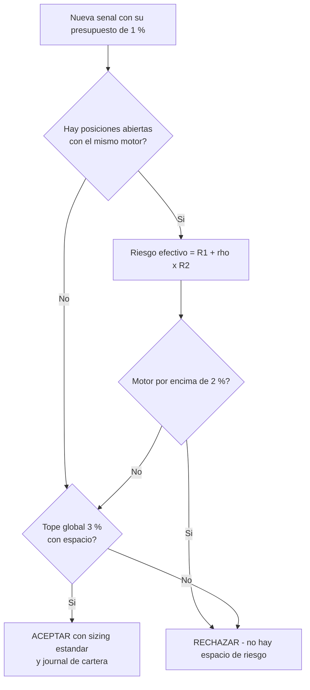

# Lección 8.5 · Riesgo de cartera y correlación — dos operaciones pueden ser una sola apuesta

| Campo | Detalle |
|---|---|
| ⏱️ Duración estimada | 50–65 min de estudio |
| 🧱 Módulo | [M8 · Gestión del Riesgo](README.md) |
| ⬅️ Anterior | [Lección 8.4 · Apalancamiento real](leccion-8-4.md) |
| ➡️ Siguiente | [Lección 8.6 · Frenos de emergencia](leccion-8-6.md) |

---

## Por qué importa

Todo lo que construiste hasta aquí es el presupuesto de UNA operación. Pero tu plataforma permite abrir varias a la vez, y ahí aparece el agujero que el SYLLABUS marca como aporte propio del programa (vacío 1): **el riesgo de cartera**. El error clásico es aritmético y fatal: creer que tres operaciones de 1 % son "tres apuestas independientes" cuando las tres dependen del mismo motor — el dólar. Si vendes EUR/USD, GBP/USD y AUD/USD a la vez, no tienes tres ideas: tienes UNA apuesta de 3 % contra el dólar con tres envoltorios. El día del dato de la Fed, no serán tres pérdidas de 1 % repartidas en tres días: será una pérdida de ~3 % en una hora, con las tres posiciones moviéndose como un solo cuerpo. Esta lección te da el instrumento que el presupuesto individual no puede dar: el mapa de motores (correlación), la fórmula de riesgo efectivo y los topes de cartera escritos — la capa de protección que actúa entre tu operación (8.3) y tus frenos (8.6).

## Concepto

**El mapa de motores.** Detrás de cada gráfico hay un motor: la divisa o el activo cuyo "humor" mueve el precio. EUR/USD depende del euro Y del dólar — son dos motores acoplados. GBP/USD, AUD/USD, USD/JPY, USD/CHF: todos tienen al dólar como uno de sus motores. El oro (XAU/USD) cotiza en dólares y a menudo reacciona a los mismos vientos refugio. Cuando abres dos posiciones que comparten motor, sus resultados dejan de ser independientes: la correlación ($\rho$, número entre −1 y +1) mide exactamente cuánto se mueven juntas.

**Tabla de correlaciones típicas FX** *(ventana móvil, D1/H4 — VALORES ILUSTRATIVOS: se miden en tu plataforma, cambian en el tiempo y se rompen en crisis)*:

| Par de instrumentos | $\rho$ típico | Lectura operativa |
|---|---|---|
| EUR/USD ↔ GBP/USD | ≈ +0,85 | Casi gemelos: Europa vs dólar |
| EUR/USD ↔ AUD/USD | ≈ +0,70 | El dólar manda en ambos |
| EUR/USD ↔ USD/JPY | ≈ +0,10 a +0,30 | Motores parcialmente distintos |
| EUR/USD ↔ USD/CHF | ≈ −0,95 | Espejo casi perfecto (franco ligado al euro) |
| XAU/USD ↔ EUR/USD | ≈ +0,20 a +0,40 | Refugio vs divisa: relación inestable |

**La fórmula conservadora del programa.** Para dos posiciones de riesgo $R_1$ y $R_2$ con correlación $\rho$:

$$R_{\text{efectiva}} = R_1 + \rho \times R_2$$

Con EUR/USD long 1 % y GBP/USD long 1 %: $R_{\text{efectiva}} = 1 + 0{,}85 \times 1 = 1{,}85$ %. Tus "dos operaciones de 1 %" son, para el inventario, casi una de 2 %. Y el peor caso operativo no es una probabilidad remota: **con $\rho = 0{,}85$ es el resultado ESPERADO** — los dos SL tocarán el mismo día casi cada vez que el dólar se mueva contra ti. Peor aún: esa pérdida conjunta NO tiene la estadística de dos pérdidas independientes (que aparecerían en días distintos, con la racha bien troceada); llega concentrada, en la misma hora, con el mismo gap.

**Reglas operativas por bandas** *(la traducción de la fórmula a decisión — por escrito, no a ojo)*:

| $\rho$ medido | Tratamiento del riesgo | Justificación |
|---|---|---|
| $\rho \geq +0{,}70$ | **Suma completa** ($R_1 + R_2$): son la misma apuesta | Los gemelos fallan juntos por diseño |
| $+0{,}30 \leq \rho < +0{,}70$ | Suma de la mitad ($R_1 + R_2/2$) | Motor compartido parcial |
| $-0{,}30 < \rho < +0{,}30$ | Independientes (cada una su 1 %) | Motores distintos — todavía cuentan para el tope global |
| $\rho \leq -0{,}70$ | **Sin crédito de cobertura**: no suman ni "se anulan" | Las coberturas rompen en pánico — advertencia abajo |

**La advertencia de la correlación negativa.** "Vendo EUR/USD y compro USD/CHF con $\rho = -0{,}95$, así que si una pierde la otra gana" — la lectura es correcta EN CALMA y falsa EN CRISIS: los días de pánico (dato de la Fed, guerra, quiebra) todas las correlaciones se disparan hacia +1 y las "coberturas" caen juntas. Por eso la banda negativa no da crédito: no se suma su riesgo (no es una apuesta doble) pero tampoco se usa como excusa para agrandar tamaños.

**Los topes de cartera del programa** *(escritos en el componente 10 del Sistema v1.0)*:

1. **Tope por motor: máx 2 % de riesgo efectivo sobre un mismo motor.** EUR/USD long (1 %) + GBP/USD long (1 %): $\rho \geq 0{,}7$ → suma completa → 2 % sobre el motor "dólar": JUSTO en el tope — permitido, sin espacio para un tercero.
2. **Tope global: máx 3 % de riesgo nominal simultáneo en la cartera.** Tres operaciones de 1 % en motores independientes agotan el presupuesto global: la cuarta señal espera. Este tope es la última línea antes del freno general (8.6).
3. **Nueva señal que rompería un tope → se rechaza** ("no hay espacio de riesgo", 8.3). No se reduce el tamaño a medias "para que quepa" salvo que tu sistema lo declare por escrito — la simplicidad manda y la granularidad rota ensucia la estadística (7.4: el R debe seguir siendo unidad constante).

**El árbol de decisión completo** *(pégalo junto a tu checklist pre-operación — es el paso previo a la calculadora de sizing cuando YA hay posiciones abiertas)*:

**Ejemplo resuelto completo.** Cartera actual: EUR/USD long abierta (1 %). Llegan, en la misma sesión, tres señales: (a) GBP/USD long 1 % — $\rho$ con tu EUR/USD ≈ 0,85 ≥ 0,7 → suma completa → motor dólar en 2 %: tope alcanzado, se acepta sin margen; (b) AUD/USD long 1 % — mismo motor, ya en tope → **RECHAZAR**; (c) USD/JPY short 1 % — short USD/JPY = también corto el dólar: mismo motor otra vez → **RECHAZAR**. Resultado del día: dos operaciones (la original + GBP/USD), exposición efectiva 2 % sobre el dólar, y tres señales procesadas con veredicto escrito. Compara con el aficionado: cuatro posiciones, 4 % nominales, ~3,7 % efectivos sobre el mismo motor, y la certeza de que el dato de las 14h30 decidirá su semana entera.

## Analogía

El barco y los compartimentos estancos. El Titanic no se hundió por un solo agujero: se hundió porque sus cinco compartimentos delanteros se llenaron JUNTOS — el agua de uno pasaba al siguiente. Los diseñadores asumieron compartimentos independientes; el iceberg los trató como uno solo. Tus posiciones son compartimentos y el "motor compartido" es el iceberg: EUR/USD, GBP/USD y AUD/USD largos parecen tres bóvedas separadas hasta que el dólar se mueve y el agua pasa de una a otra en minutos. La correlación es el mapa de mamparos que conectan; el tope por motor (2 %) es la regla de diseño que limita cuántos compartimentos pueden compartir la misma pared; y el tope global (3 %) es la flotabilidad total del barco. El trader sin esta lección navega convencido de tener cinco bóvedas independientes; el que la aplicó sabe exactamente cuánta agua total puede entrar — y diseñó el barco para que esa cantidad nunca sea la que se hunda.

## Cómo se hace: medir y aplicar en tu plataforma

1. **Mide la correlación real** (la tabla de arriba es ilustrativa y envejece): en tu plataforma, correlación de retornos diarios con ventana de 30-90 días entre los pares que operas. Anota los valores en la pestaña 2 de tu calculadora (lab) y refresca mensualmente — la correlación es un dato del journal de cartera, no una constante.
2. **Clasifica tus señales por motor antes de calcular el lote:** para cada nueva señal, lista los motores (divisas base y cotizada + activo). Con EUR/USD, USD/JPY y oro en cartera, una señal de GBP/USD toca el motor dólar YA saturado — no necesitas precisión decimal para verlo.
3. **Aplica las bandas y los topes en orden:** primero el tope por motor con la fórmula $R_{\text{efectiva}} = R_1 + \rho R_2$; después el global. Solo si ambas casillas dan verde, corres la calculadora de sizing (8.3). El orden importa: la cartera manda sobre la operación.
4. **Registra en el journal:** cada operación lleva su etiqueta de motor y el riesgo efectivo de la cartera tras abrirla. Es la única forma de auditar después (M9) si tus pérdidas "independientes" fueron realmente independientes — la distribución de tus días rojos te lo dirá: si los peores días concentran 2-3 pérdidas, tus topes no se estaban aplicando.

## Error común

**(1) Sumar nominales y llamarlo diversificación.** "Tengo 4 pares, es más diversificado que 1" — con el dólar en los cuatro, es 4 % sobre UN motor: el iceberg compartido del Titanic. La diversificación real exige motores distintos, y en FX retail todos los mayores comparten el dólar — la diversificación honesta que existe es LIMITAR la exposición simultánea, no multiplicar los pares. **(2) Usar la correlación "de memoria".** "EUR/USD y GBP/USD siempre van juntas" — ¿hace 90 días también? La correlación se mide con ventana y fecha, o no existe: lo que era 0,85 puede ser 0,40 tras un trimestre de política monetaria divergente. **(3) La cobertura que no es.** Abrir USD/CHF "para cubrir" EUR/USD y operar después ambos "sin riesgo total": con $\rho = -0{,}95$ en calma, el par gasta dos spreads y dos swaps para anularse casi perfectamente — y el día de crisis se mueven juntas a favor del pánico. La cobertura honesta es NO ABRIR la segunda posición. **(4) Ignorar el oro y los índices.** "Solo opero FX": si tu oro cotiza en dólares y tu índice reacciona a la Fed, tu cartera tiene motor USD también ahí. El mapa de motores incluye TODO lo que puedes abrir, no solo los pares con USD en el nombre. **(5) Tratar los topes como sugerencias cuando la señal es "muy buena".** El tope no evalúa la calidad de la señal — evalúa la supervivencia del inventario (8.1). La señal mejor del mes que rompe el tope se rechaza igual: el día que el tope te salve, no sabrás que te salvó, y ese es exactamente el punto.

## Conexión cuantitativa

La cartera cierra la aritmética del módulo: 8.3 fijó el presupuesto por operación (1 %); esta lección fija el presupuesto por CONJUNTO (2 % por motor, 3 % global); la 8.6 pondrá el techo temporal (−2 % día, −4 % semana, −6 % mes). Los tres niveles multiplican la misma idea a escalas distintas: el presupuesto existe para que ninguna secuencia de decisiones individuales razonables —cada una con su 1 % calculado— fabrique colectivamente una ruina. Cuantitativamente: sin topes, una cartera de 4 pares con motor dólar tiene un "día de dato" con ~3,7 % de riesgo efectivo concentrado — un 40 % del presupuesto MENSUAL de freno (−6 %) jugándose en una hora; con los topes, ese mismo día queda acotado a ~2 %. Hacia atrás, la fórmula $R_{\text{efectiva}}$ es la primera vez que el programa usa la correlación como INPUT de riesgo y no como curiosidad de indicador (M6 la clasificó como contexto). Hacia adelante: M9 auditará en tus 100 backtests si los días de pérdidas múltiples respetan los topes (etiqueta de error "sizing en cartera"), y M12 convertirá los topes de cartera en la sección de límites del Plan de Trading — la regla que sobrevive a tu entusiasmo porque nunca dependió de él.

---

## 🎯 Puntos clave

1. Operaciones que comparten motor NO son independientes: 3 pares contra el dólar = una apuesta de ~3 %.
2. $R_{\text{efectiva}} = R_1 + \rho \times R_2$: con $\rho = 0{,}85$, dos operaciones de 1 % son ~1,85 % — y fallarán juntas como resultado ESPERADO, no como mala suerte.
3. Bandas: $\rho \geq 0{,}7$ suma completa; $0{,}3$–$0{,}7$ suma de la mitad; $< 0{,}3$ independientes; $\rho \leq -0{,}7$ sin crédito de cobertura (las coberturas rompen en pánico).
4. Topes escritos: **2 % por motor, 3 % global**; señal que rompe tope → rechazo ("no hay espacio de riesgo").
5. La correlación se mide (ventana 30-90 días, refresco mensual) o no existe; el mapa de motores incluye oro e índices.
6. Orden de decisión: primero cartera (topes), después sizing (calculadora) — la cartera manda sobre la operación.

## 🔄 Autoevaluación rápida

1. Cartera: EUR/USD long abierta (1 %). Llegan GBP/USD long (1 %, ρ de precios ≈ 0,85 con tu EUR/USD) y USD/JPY short (1 %). Decide cada señal con las bandas y topes, con números y lados del motor.
2. ¿Por qué $\rho = -0{,}95$ NO te permite "duplicar tamaño porque estoy cubierto"? Explica el mecanismo del día de crisis.
3. Tu pestaña de correlación mide EUR/USD↔AUD/USD en +0,68. Aplica la banda correcta a una segunda operación de 1 %: ¿riesgo efectivo del motor dólar si ya tenías 1 % en EUR/USD?
4. El día del NFP pierdes EUR/USD y GBP/USD el mismo día (−2 %). ¿Qué te dice sobre tus etiquetas de journal y qué revisa M9 con ese dato?

Ver respuestas

1. **GBP/USD long:** tus dos posiciones comparten lado (ambas cortan el dólar, ambas largas moneda europea) y ρ de precios ≈ 0,85 ≥ 0,7 → suma completa: $R_{\text{efectiva}} = 1 + 0{,}85 ≈ 1{,}85$ % → con la banda conservadora, 2 % sobre el motor dólar → **tope alcanzado JUSTO: ACEPTAR** (sin margen para nadie más en ese motor). **USD/JPY short:** vender USD/JPY = VENDER dólares — mismo lado del motor (corto USD) que tus dos europeas; el motor ya está en 2 % → $2 + 1 = 3$ % > tope → **RECHAZAR** ("no hay espacio de riesgo"). Cartera final: 2 posiciones, ~2 % efectivo sobre el dólar, 2 % de 3 % del global — la tercera señal esperó, y el día del dato de la Fed tu daño máximo acotado es ~2 %, no 3 %.
2. Porque la correlación de calma no sobrevive al estrés: en pánico las correlaciones convergen a +1 (todo se vende, todo se mueve con el mismo viento). Tu "cobertura" de −0,95 exige que el FRANCO se aprecie exactamente cuando el pánico golpea — pero el pánico también castiga monedas periféricas y liquidez. El día que necesitas la cobertura, la compra de ella no llega: tienes las dos pérdidas Y los dos spreads Y los dos swaps. Por eso la banda negativa no da crédito de tamaño.
3. Banda $+0{,}3 \leq \rho < +0{,}7$ → suma de la mitad: $R_{\text{efectiva}} = 1 + 0{,}68 \times 1 ≈ 1{,}7$ %... con la regla de banda conservadora: $1 + 1/2 = 1{,}5$ % del motor dólar — por debajo del tope de 2 %: **ACEPTAR** (y el global pasa a 2 % de 3 %).
4. Que tus "dos operaciones independientes" fallaron juntas: o la correlación subió desde tu última medición, o los topes no se aplicaron. M9 audita exactamente esto: etiqueta "sizing en cartera", conteo de días con pérdidas múltiples y su correlación con eventos — si tu distribución muestra días de −2 % frecuentes, el tope por motor estaba en el papel, no en la ejecución.

