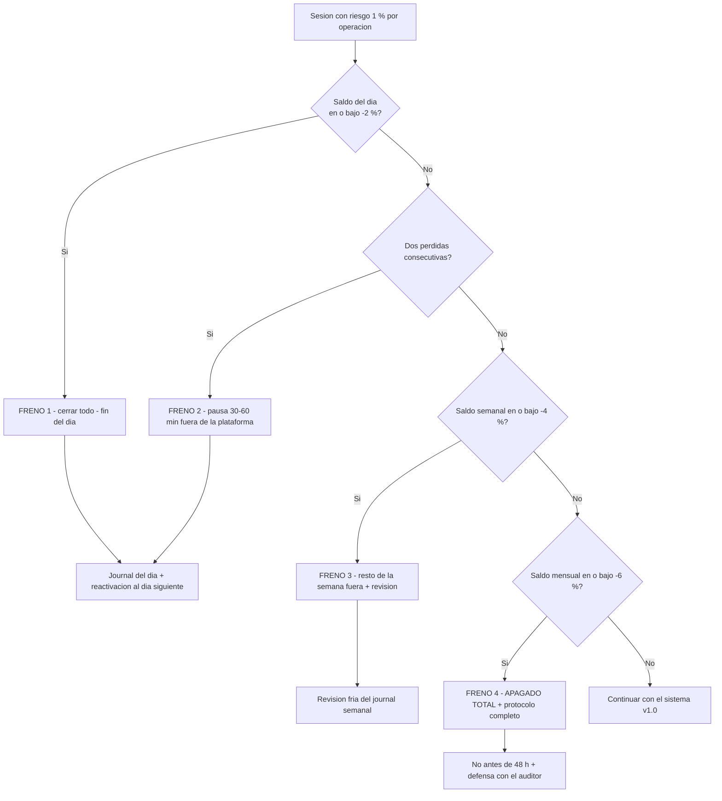

# Lección 8.6 · Frenos de emergencia — la cascada que hace imposible la ruina de un día

| Campo | Detalle |
|---|---|
| ⏱️ Duración estimada | 45–60 min de estudio |
| 🧱 Módulo | [M8 · Gestión del Riesgo](README.md) |
| ⬅️ Anterior | [Lección 8.5 · Riesgo de cartera y correlación](leccion-8-5.md) |
| ➡️ Siguiente | [🧪 Laboratorio · Calculadora de position sizing](README.md#-laboratorio--construir-la-calculadora-de-position-sizing) |

---

## Por qué importa

Tienes presupuesto por operación (8.3), topes por cartera (8.5) y la tabla de asimetría que dice cuánto cuesta cada herida (8.2). Falta la última capa — la que protege contra el único enemigo que las fórmulas anteriores no cubren: **TÚ, en el peor día de tu carrera**. El día que la racha llega, el dato sale en contra, el Spread se abre y tu cerebro (M10 lo demostrará con neurobiología) empieza a proponer decisiones que tu Sistema v1.0 jamás escribiría. Los frenos de emergencia son la infraestructura que hace esa propuesta irrelevante: reglas automáticas, escritas en frío, que recortan tu capacidad de daño por día, por semana y por mes — antes de que la emergencia exista. El SYLLABUS marca este protocolo como aporte propio del programa (vacío del currículo fuente), y su principio es industrial: **la fuerza de voluntad no es un sistema de seguridad; un disyuntor sí.**

## Concepto

**La cascada completa** *(cada nivel asume el 1 % de 8.3 como base — los porcentajes son del saldo de referencia del periodo)*:

| Nivel | Disparador | Acción obligatoria | Lógica matemática / psicológica |
|---|---|---|---|
| 0 | Riesgo por operación = 1 % | Sizing de la calculadora (8.3) | La peor racha esperable (6-7) produce herida, no amputación |
| 1 | Saldo del día ≤ −2 % | Cerrar TODAS las posiciones; fin del día | Dos pérdidas al 1 % ya consumieron el día: la estadística del día está rota y el tilt intradía es el más caro que existe |
| 2 | 2 pérdidas consecutivas | Pausa obligatoria: 30-60 min fuera de la plataforma (o resto de la sesión) | Con WR 40 %, 2 pérdidas seguidas ocurren el 36 % de las veces (7.5): NO es el sistema roto — es que HOY tú no estás alineado; la distancia es el antídoto del tilt |
| 3 | Saldo semanal ≤ −4 % | Resto de la semana sin operar; revisión del journal | Cuatro pérdidas: la semana ya barrió el escenario normal; lo que siga ya no es señal, es revancha con horario |
| 4 | Saldo mensual ≤ −6 % | **APAGADO TOTAL + protocolo de apagado completo (abajo)** | El mes consumió el peor escenario estructural completo: operar más es jugar el inventario del negocio contra una racha que la 8.2 ya etiquetó de no retorno |

**La matemática del techo.** Los tres topes (−2 % día, −4 % semana, −6 % mes) convierten la cola abierta de la distribución en un **techo conocido**: el peor mes posible de tu negocio v1.0 es ≈ −6 % (el freno 4 dispara antes de que los días malos se acumulen más). Compara con la ausencia de frenos: la MISMA racha esperable (7.5) al 5 % de riesgo produce −26,5 % (8.2: no retorno práctico); al 10 %, −47 %. La cascada no reduce la frecuencia de las pérdidas — reduce la CAPACIDAD de daño cuando la cabeza ya no está en la silla. Y hay una sutileza cuantitativa que conviene ver: el freno 1 trocea las rachas — una racha de 6 con el freno diario NUNCA ocurre completa en un día (máximo 2 pérdidas y fuera): el daño se dispersa en ≥ 3 días, cada uno con su pausa obligatoria — es exactamente la fricción temporal que el tilt necesita para no arrancar.

**El protocolo de apagado** *(el paso a paso del freno 4 — se ejecuta en orden, sin excepciones, y vive firmado en tu journal)*:

1. **Cierra TODAS las posiciones abiertas al precio de mercado.** Sin "esta ya está casi en el SL", sin "se recupera sola": el freno no negocia con posiciones. El objetivo del apagado es quitarte TODAS las fuentes de resultado en vivo — una posición abierta es una dosis que se administra sola cada minuto.
2. **Cierra la plataforma — la cierras, no la minimizas.** La diferencia es la diferencia entre salir del casino y mirarlo desde la ventana. La sesión siguiente se abre CON PROTOCOLO, no por impulso.
3. **Escribe en el journal:** fecha y hora, nivel de freno disparado, saldo exacto, drawdown desde el máximo, y tu temperatura emocional del 1 al 10 (el termómetro que M10 formalizará). Tres frases bastan; el dato importa más que la literatura.
4. **Regla de reactivación: no antes de 48 horas** + revisión completa del journal del mes + defensa con el agente auditor: ¿qué se rompió — sistema, ejecución o cabeza? Las tres respuestas tienen protocolos distintos, y ninguna es "volver rápido".
5. **Firma y fecha.** El documento se escribe HOY, en el laboratorio del módulo, en frío — y se firma. Un freno no escrito no existe; un freno escrito a mitad del día rojo es una negociación, no una regla.

**Por qué cada disparo es "algo ocurrido", no "cómo me siento".** Los cinco niveles miden SALDOS y CONTEOS — números que la plataforma calcula y tu journal audita. Ninguno dice "si te sientes mal", "si el mercado se ve raro" o "si crees que algo anda mal": esas evaluaciones son exactamente las que el cerebro estresado falsifica. La regla del programa: **un freno se dispara por un número o no se dispara** — y por eso el laboratorio lo instala en la calculadora (la pestaña de frenos compara saldos y devuelve el nivel activo, sin opinión).

**La cascada completa en un mapa** *(el diagrama que acompaña a tu checklist pre-sesión)*:

**La trampa que la cascada mata por construcción: "una más para recuperar".** La revancha es el mecanismo de ruina más documentado del trading minorista (M10 la desmonta a fondo): tras una pérdida, subir tamaño o frecuencia "para salir rápido del pozo". Su matemática es demoledora — con la cuenta en −4 % y riesgo duplicado al 2 %, una racha de 6 (esperable, 7.5) añade −11,4 %: el pozo se excava con la pala del pozo. La cascada la hace IMPOSIBLE por diseño: el día rojo no tiene más operaciones disponibles; la semana roja no tiene más días; el mes rojo no tiene más mes. La decisión de seguir no está en tus manos emocionales — está en una regla escrita cuando estabas frío. Eso es exactamente lo que hace que funcione: **no te pide fuerza de voluntad, te la ahorra.**

## Analogía

Los disyuntores de las bolsas reales. Cuando un índice cae un porcentaje brusco en minutos, los mercados del mundo (NYSE, CME, las bolsas asiáticas) activan "circuit breakers": pausas obligatorias de minutos a horas según la profundidad de la caída. ¿La lógica de los reguladores? En el pánico, la velocidad mata: los precios sin pausa se desploman en cascada porque cada vendedor asusta al siguiente; la pausa NO arregla el mercado — le compra tiempo a la cabeza colectiva para respirar. Nadie considera "intervención socialista" a esos frenos: son arquitectura de mercado desde 1988. Tu cascada es el mismo diseño a escala personal: el freno 1 (−2 % día) es tu pausa de 15 minutos; el 3 (−4 % semana) es tu cierre anticipado; el 4 (−6 % mes) es tu cierre total. El regulador que escribiste en frío protege al operador que se descompone en caliente — y como en los mercados, la regla funciona porque no pide opinión: dispara por nivel.

## Cómo se hace: instalar la cascada hoy (30 minutos)

1. **Escribe los 5 niveles en tu journal** con los disparadores EXACTOS de la tabla (saldos y conteos, cero sentimientos). Si tu % base no es 1 % (por ejemplo 0,5 % en tu primer año), escala la cascada proporcionalmente y decláralo — lo que no se puede es dejar niveles "a ojo".
2. **Instala las alertas de plataforma:** alerta de saldo flotante y de equity en los niveles −2 %/día, y recordatorio semanal del −4 %. La plataforma vigila gratis y sin emociones — la mayoría de brokers/MT5/TradingView lo permiten en dos clics.
3. **Añade la pestaña de frenos a tu calculadora** (lab del módulo): entradas de saldo de referencia día/semana/mes + equity actual → salida del nivel activo y la acción. La calculadora no opina: compara números.
4. **Firma el protocolo de apagado** (los 5 pasos de arriba, con tu nombre y fecha) y pégalo donde operas. Es el contrato contigo — el equivalente exacto del contrato anti-ludopatía de M1, ahora con matemática detrás.
5. **Ensayo en seco:** una vez al mes, simula el disparo del freno 1 en demo (o repítelo mentalmente con la checklist): qué cierras, qué escribes, qué haces después. La emergencia no es el momento de leer el manual por primera vez.

## Error común

**(1) El freno "negociable".** "Hoy fue un día raro, el −2 % fue mala suerte, sigo" — el freno que se desactiva en caliente no existe; su único uso posible es el día que más ganas tienes de ignorarlo. Si un disparo te parece injusto, se revisa EN FRÍO (¿fue el disparador correcto? ¿el nivel correcto?), nunca en vivo. **(2) Mover el nivel para no dispararlo.** Bajar el stop "para que no cuente como pérdida" o pasar a otra plataforma "donde no tengo la alerta": el mecanismo de evasión es la prueba de que el freno era necesario. **(3) Confundir el freno 2 con un castigo.** La pausa tras 2 pérdidas no dice "hiciste mal": dice "el 36 % de las veces tu sistema pierde dos seguidas — descansa y vuelve". Castigar la estadística normal es castigar al negocio por funcionar; el freno protege del caso anómalo (el día donde las 2 se convierten en 5 por puro tilt). **(4) La pausa que no es pausa.** "Pausa de 30 minutos" mirando el gráfico en el móvil es seguir operando sin poder ejecutar — la pausa te saca de la plataforma Y de la pantalla; si tu cabeza sigue en la vela de 5 minutos, no hubo pausa, hubo espera. **(5) Declarar la cascada y no instalarla.** Los niveles en un documento que nunca se conectó a alertas ni a la calculadora: la cascada funciona por arquitectura (alertas, pestañas, checklist), no por memoria — la que falla justo cuando hace falta.

## Conexión cuantitativa

La cascada es la síntesis aritmética de todo el módulo: el 1 % de 8.3 define el grano del daño; la estadística de 7.5 define su frecuencia (rachas de 6-7 esperables); la tabla de 8.2 define su precio superlineal; y los topes de 8.5 evitan que varias señales sumen el daño de un día de golpe. Con esas cuatro piezas, el peor mes del negocio v1.0 deja de ser una distribución con cola de ruina y pasa a ser un número: **≈ −6 %, con protocolo de retorno escrito**. Recuperarlo con $E = +0{,}2R$ y 1 % toma ~31 operaciones perfectas (≈ 8 meses a 4 ops/mes *(ilustrativo, compuesto — la misma cifra de la tabla 8.2)*): un susto administrado en frío, no una tragedia — esa es la definición operativa de un sistema de riesgo que funciona. Hacia M10: los frenos son la arquitectura que compra tiempo a la mente (la pausa del nivel 2 es literalmente el antídoto del secuestro emocional que estudiaremos); hacia M9: el journal auditará cuántos disparos hubo y si cada uno se ejecutó sin negociación — la métrica "disparos ejecutados / disparos debidos = 100 %" es, en los primeros dos años, más importante que cualquier WR. Y hacia M12: la cascada completa entra como sección obligatoria del Plan de Trading — el documento que hace que este módulo sobreviva a tu entusiasmo de enero y a tu cansancio de marzo.

---

## 🎯 Puntos clave

1. La cascada: 1 % por operación → −2 % día (cerrar todo) → 2 pérdidas seguidas (pausa 30-60 min) → −4 % semana (fuera hasta el lunes) → −6 % mes (apagado total + protocolo).
2. Todos los disparadores son NÚMEROS (saldos, conteos) — nunca sentimientos; un freno se dispara por un dato o no se dispara.
3. El techo matemático: con la cascada, el peor mes posible ≈ −6 % — vs −26,5 % (al 5 % sin frenos) en la zona de no retorno de 8.2.
4. El freno diario trocea las rachas: nunca 3 pérdidas seguidas el mismo día — la fricción temporal es el antídoto del tilt.
5. Protocolo de apagado en 5 pasos: cerrar TODO → cerrar plataforma → journal + temperatura → no antes de 48 h + defensa → firma en frío.
6. "Una más para recuperar" muere por construcción: la decisión de seguir no está en tus manos emocionales — está en la regla escrita.

## 🔄 Autoevaluación rápida

1. Tu día: 2 pérdidas de 1 % y una tercera señal "mejor que nunca". ¿Qué nivel de la cascada ya está activo, qué haces con la tercera señal y qué hace el freno por tu estadística mensual?
2. Calcula: racha de 5 pérdidas en la semana, todas al 1 %. ¿Saldo semanal, qué freno dispara y cuánto faltaba para el siguiente nivel?
3. Cuenta en −5 % mensual a mitad de mes, con una posición abierta +0,8 %. ¿Qué dice la cascada exactamente — y por qué la posición en ganancia NO cambia la respuesta?
4. Un amigo te dice: "yo soy disciplinado, no necesito frenos escritos". Réplica con los tres argumentos del módulo (neurobiología del peor día, matemática del techo, disyuntores de mercado).

Ver respuestas

1. Tras 2 pérdidas consecutivas el **freno 2** ya está activo (pausa 30-60 min); el **freno 1** dispara con la SEGUNDA pérdida si el día marca −2 % — en este caso exactamente eso: día cerrado, la tercera señal NO se evalúa (no es que "decidas no tomarla": no existe decisión que tomar, la sesión terminó). Para tu mes: el freno evita que el día rojo se convierta en el origen de la revancha — la causa nº 1 de los meses de −15 %+ no es la racha inicial, es lo que se opera DESPUÉS de ella.
2. Saldo semanal: $0{,}99^5 = 0{,}951$ → **−4,9 %** → supera el −4 %: **freno 3 dispara** (resto de la semana fuera, revisión del journal). Faltaban ~1 % para el freno 4 (mensual −6 %): si el mes ya traía otra pérdida de 1 % en semanas previas, el apagado total dispara también. Nota la asimetría de la cascada: la semana roja NO se "corrige" operando — se audita.
3. El saldo mensual ≤ −6 % compara tu EQUITY total (saldo + flotante) con la referencia del mes: $-5$ % + $0{,}8$ % flotante = $-4{,}2$ % efectivo → **todavía no dispara el freno 4** — pero está a una pérdida de 1 % (o de que el flotante se evapore) del apagado. La respuesta correcta: posición se gestiona SOLO por su plan (SL/TP del sistema, sin tocar nada "para no disparar el freno"), y ninguna operación NUEVA se abre (la cartera está a 1,8 % del apagado — el espacio de riesgo ya no existe). La posición en ganancia no cambia nada porque el freno mide el MES, no la operación: la esperanza de "que suba más" es exactamente la voz que el protocolo existe para silenciar.
4. (a) **Neurobiología:** el peor día secuestra la decisión (M10: amígdala vs corteza prefrontal) — tu "disciplina" en caliente es un órgano con el riego alterado; el freno escrito en frío no depende de ese órgano. (b) **Matemática:** el techo de −6 % mensual con frenos vs la cola abierta sin ellos — tu disciplina promedio no es un número; el tope sí, y es auditable. (c) **Precedente industrial:** los mercados más grandes del mundo se PAUSAN solos por regla — no porque sus participantes "no sean disciplinados", sino porque la arquitectura de seguridad no confía en el juicio en pánico ni en el mejor de los humanos. Si lo hace el NYSE, lo hace tu cuenta de 1.920 $.

