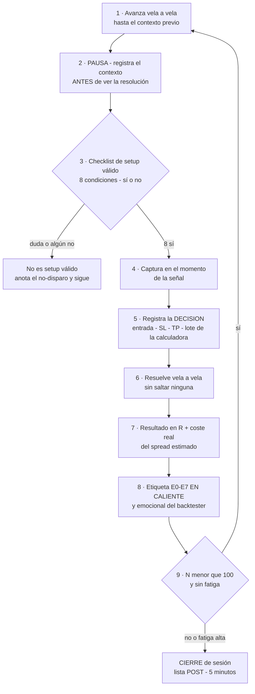

# Lección 9.2 · Protocolo de backtesting manual — la rutina que hace los 100 datos comparables

| Campo | Detalle |
|---|---|
| ⏱️ Duración estimada | 50–65 min de estudio |
| 🧱 Módulo | [M9 · Backtesting, Journal y Validación](README.md) |
| ⬅️ Anterior | [Lección 9.1 · Epistemología del backtesting](leccion-9-1.md) |
| ➡️ Siguiente | [Lección 9.3 · Métricas del reporte](leccion-9-3.md) |

---

## Por qué importa

La estadística de 9.1 solo vale si tus 100 datos son **mediciones comparables entre sí** — cien filas producidas por el mismo procedimiento, no cien anécdotas con formatos distintos. Un backtest sin protocolo produce datos que no se pueden sumar: la operación 12 se registró "a ojo", la 47 decidió con la vela sin cerrar, la 68 no anotó el coste — y el WR resultante no mide tu sistema, mide tu inconsistencia. El protocolo es lo que separa el laboratorio del aficionado mirando gráficos antiguos, y su prueba de fuego es el **test del clon** (7.1): otro desconocido, con tu sistema y tu protocolo, debería producir el mismo registro fila por fila. Si tu procedimiento no es replicable por un clon, tus métricas no describen el sistema — describen tu estado de ánimo durante 8 sesiones. Esta lección define la única pieza que el SYLLABUS deja implícita y el programa explicita: la definición operativa de setup válido, la rutina fija por operación y las reglas de parada. Al terminar, tu laboratorio deja de ser una exploración y se convierte en lo que la 9.3 necesita: una campaña de medición.

## Concepto

**La definición operativa de setup válido.** Es la decisión más importante del protocolo y la que el aficionado deja sin escribir. Definición del programa: **una señal es un setup válido cuando TODAS las condiciones de los componentes 1–8 de tu Sistema v1.1 son verificables sí/no en la vela de decisión** — contexto (régimen y tendencia del TF mayor), zona (el nivel/área definida por tu estrategia), la barrida o desencadenante que exige tu arquetipo, la vela de reacción cerrada, el SL estructural identificable, y las reglas de sesión que tu sistema fija. Si tu v1.1 está bien escrito (M7 lo garantizó), la verificación es un checklist binario: ocho filas, sí o no. Y la regla que cierra la definición: **la duda es un no.** Si no puedes verificar una condición con las velas cerradas, la señal no es un setup válido — no "probablemente lo sea". La razón es el test del clon: un criterio que se resuelve "por sensación" en caliente no es una regla, y cada duda resuelta a favor de operar convierte tu WR medido en una medición de tu optimismo.

**Las tres listas del protocolo.** El backtest se administra como una campaña con estructura fija:

1. **Lista PRE (una vez, antes de la operación 1)** — la declaración de 9.1: hipótesis (WR, R:B, E), N=100, coste estimado, mercados/TF, métricas con umbrales. Además: la definición de setup válido escrita como checklist imprimible (8 filas sí/no), y el formato exacto de fila del journal v1 (9.5).
2. **Rutina POR OPERACIÓN (la que se repite 100 veces)** — la secuencia de 9 pasos del diagrama inferior. Su función es que la única variable entre filas sea el mercado, nunca tu procedimiento.
3. **Lista POST (al final de cada sesión, 5 minutos)** — temperatura del backtester (fatiga 1-10, apego al resultado 1-10: sí, también en backtest — la fatiga contamina la disciplina del registro), filas completadas vs operaciones hechas (deben coincidir: cero memoria pendiente), y las dudas del día anotadas en el diario del backtester.

**La rutina por operación, paso a paso:**

Los pasos 2 y 5 merecen subrayado porque son los que el aficionado salta. **El paso 2 (pausa y registro ANTES de la resolución)** es tu ceguera operativa: decides y anotas la decisión antes de que el mercado te diga si fue "buena" — si primero miras y luego anotas, tu registro recogerá la decisión ajustada por el resultado (anclas psicológicas en acción). **El paso 5 (registrar la DECISION, no la intención)** significa precios exactos, lote de la calculadora (M8) y la captura — no "entré cerca de la zona": cerca no es un precio, y una fila sin precios no se puede auditar.

**Qué cuenta como operación de la muestra — y qué no.** Entra: toda ejecución de setup válido (8 sí), resuelta por las reglas del sistema. Entra también — con su etiqueta — toda ejecución que TÚ considersaste setup válido y lo era: los errores se registran, no se borran (9.1). No entra: las señales que la definición rechaza (se anotan como **no-disparos** en el acta semanal: son la métrica de disparos debidos de M8, pero no filas de operación), y las operaciones de "prueba de la plataforma" o experimentos fuera de sistema (ni siquiera deberían existir en una sesión de backtest; si ocurrieron, van al diario, no al dataset).

**Cuándo parar — las dos únicas salidas legítimas.** *(1) N=100 alcanzado.* La muestra se cierra donde se declaró: llegar a 97 y "sentir" que faltan 3 buenos resultados es exactamente el data-mining que 9.1 prohíbe. *(2) Condición de ruina simulada:* si durante el backtest el drawdown acumulado de la muestra supera la línea de emergencia de M8 (−15 %) con el tamaño planificado, el laboratorio se detiene y el veredicto se adelanta — un sistema que en 100 operaciones simuladas revienta el presupuesto no merece las 100: se rechaza a ese tamaño (o se re-testea a 0,25–0,5 %, con la decisión documentada). Lo que NUNCA es salida legítima: parar a mitad "porque va mal" (eso es entregar el informe antes de terminar el experimento) ni extender "porque va bien" (cada extensión post-hoc es una apuesta a favor de tu ego, no del sistema).

**El manejo de las dudas: el diario del backtester.** Durante la campaña aparecerán casos borde: "¿esta barrida agarró el pool o solo la rozó?", "¿este pullback es de calidad suficiente?". El protocolo manda: **anota la duda con fecha y fila, aplica la definición literal, y sigue**. Al cerrar las 100, el diario tiene tres destinos posibles: (a) la definición ya cubría el caso (la duda era tuya, no del sistema) — se archiva; (b) el caso borde apareció ≤ 3 veces — estadísticamente irrelevante, se archiva; (c) el caso borde es recurrente y material — se convierte en la candidata a modificación de la ventana mensual (9.6), con re-test. Lo prohibido — resolver la duda a mitad de muestra cambiando la regla — destruiría la comparabilidad de todo lo anterior.

## Analogía

El control de calidad farmacéutico (GMP — buenas prácticas de manufactura). Cada lote de un medicamento se prueba con el MISMO protocolo: mismas muestras, mismos aparatos calibrados, mismos criterios de aprobación — y el técnico que ejecuta no puede "adaptar" el procedimiento porque le parezca razonable: el protocolo es el que manda sobre la opinión, precisamente porque la medición debe ser independiente de quién mide. Un lote rechazado se registra con la misma formalidad que uno aprobado (¡exactamente tu E0 y tu "todo entra"!), y las dudas del técnico se elevan al comité de calidad — no se resuelven en el banco de trabajo. La industria aprendió que cuando el procedimiento depende del criterio del operador, el resultado depende del operador: el mismo principio de tu test del clon. Tu laboratorio de 100 operaciones es una línea de producción de datos: el protocolo de esta lección es tu GMP, y las filas del journal son tus lotes.

## Cómo se hace: montar y ejecutar una sesión de backtest

1. **Prepara la sesión (5 min).** Bar Replay con rango de fechas vírgenes; gráfico limpio (solo los elementos de tu sistema: estructura, zona, y los medidores de tu dashboard si tu v1.1 los usa); checklist de setup válido impreso o en pantalla dividida; el CSV del journal v1 abierto en la segunda pantalla; la calculadora de sizing a mano. Una sesión estándar: **10–15 operaciones máximo** — la fatiga del paso 6 (resolver vela a vela, sin saltar) degrada la disciplina del registro, y una fila contaminada contamina el promedio.
2. **Ejecuta la rutina de 9 pasos sin excepciones.** Con un cronómetro mental: la pausa del paso 2 y el registro del paso 5 son sagrados. Si en algún momento te descubres avanzando rápido "para llegar a la acción" (paso 6 saltando velas), detén la operación actual y reiníciala — el contexto que no viste es información que tu decisión ya no tiene.
3. **Registra los no-disparos por sesión.** Al final de cada sesión, anota en el acta: cuántas veces la definición rechazó una señal que tu instante de entusiasmo habría tomado. No es burocracia: es la diferencia entre tu sistema y tu instinto, medida en datos — y en la revisión semanal (9.6) es la pregunta 1.
4. **Aplica la condición de ruina simulada si aparece.** Si el drawdown acumulado cruza −15 % con el tamaño planificado: detén, documenta la fila y la fecha, y decide entre rechazar el sistema o re-testear a 0,25–0,5 % — la decisión va al acta, no al pánico.
5. **Cierra la sesión con la lista POST.** Temperatura (fatiga/apego), verificación de filas completas (cero memoria pendiente: la operación resuelta y no registrada NO existe — si la olvidaste, se anota como tal en el diario), y dudas del día. Después, la plataforma se cierra: la sesión siguiente se abre con protocolo, no por inercia.

## Error común

**(1) Avanzar el replay "para llegar a la acción".** Saltar velas de consolidación destruye el paso 2: sin contexto visto vela a vela, tu "señal" se decide con información incompleta — y el look-ahead entra por la puerta de la impaciencia. La consolidación ES parte del sistema: el contexto se vive, no se salta. **(2) Decidir con la vela en formación.** "Está cerrando fuerte, entro ya" — el close final no existe todavía (9.1): la regla de la vela cerrada no admite excepciones "obvias"; las veces que la vela "obvia" se deshace al cierre son exactamente las que tu WR real absorbe y tu backtest inflado esconde. **(3) "Esta operación no cuenta porque me equivoqué de zona."** Sí cuenta: entra con su etiqueta (E2 si fue entrada fuera de regla) y engorda la métrica de errores — borrarla es supervivencia (9.1) y falsea el WR de ejecución que la revisión semanal necesita. **(4) Mirar el resultado antes de registrar la decisión.** El paso 5 precede al paso 6 por diseño: si ves la resolución primero, tu "registro" documenta la decisión ajustada por el conocimiento del resultado — una fila que parece honesta y no lo es. **(5) Cambiar el coste estimado a mitad de campaña** porque "el spread de la tarde es menor": el coste se declara en la lista PRE y se audita al final (9.3 compara el estimado con el real del forward); ajustarlo en vuelo vuelve incomparables las filas de antes y después.

## Conexión cuantitativa

La comparabilidad es lo que permite que la 9.3 sume las 100 filas en métricas con sentido: WR, R:B medio y E solo se calculan sobre filas homogéneas — misma definición de setup, mismos precios registrados, mismo criterio de coste. El coste estimado (0,08R en el caso maestro) se aplica fila por fila en el paso 7 y se audita al final: la 9.3 mostrará que ese "detalle" decide un tercio de la esperanza bruta. La métrica de **disparos debidos vs ejecutados** (M8) nace aquí: cada no-disparo del paso 3 y cada setup válido ejecutado alimentan el ratio que la misión M-9 reporta — un 98/100 no es un 98 %: es la prueba de que tu ejecución tiene 2 fugas que la revisión semanal va a nombrar. Y hacia la 9.6: el diario del backtester y las listas POST son la materia prima de las actas semanales — el protocolo de esta lección produce, sin esfuerzo extra, la evidencia que la auditoría propia consumirá.

---

## 🎯 Puntos clave

1. Setup válido = **las 8 condiciones del v1.1 verificables sí/no con velas cerradas; la duda es un no** — sin la definición, tu WR mide tu optimismo.
2. El protocolo vive en 3 listas: PRE (declaración única), POR OPERACIÓN (rutina de 9 pasos) y POST (temperatura y cierre) — la única variable entre filas es el mercado.
3. Los pasos críticos son el 2 (decidir ANTES de ver la resolución) y el 5 (registrar la decisión con precios exactos y captura) — son tu ceguera operativa.
4. Los no-disparos se cuentan (métrica de M8); las operaciones error se etiquetan y entran (9.1); nada se borra del dataset, nunca.
5. Solo hay dos paradas legítimas: **N=100 declarado** o **ruina simulada (DD > −15 %)** — parar o extender por resultados parciales es data-mining en vivo.

## 🔄 Autoevaluación rápida

1. Formula la definición operativa de setup válido con tus palabras (sin mirar el sistema) y explica qué hace el protocolo ante la duda. ¿Por qué "la duda es un no" protege la estadística y no solo la disciplina?
2. Durante la sesión 5 descubres que las últimas 3 operaciones las resolviste avanzando el replay a velocidad alta, saltando velas de consolidación. ¿Qué hace el protocolo? (3 acciones concretas.)
3. Explica por qué las 30 repeticiones de la misión M-7 NO entran en la muestra oficial de 100 — y por qué eso NO las invalida como práctica.

Ver respuestas

1. Definición: señal donde las 8 condiciones del v1.1 son verificables sí/no en la vela de decisión con velas cerradas (contexto del TF mayor, zona definida, desencadenante del arquetipo, vela de reacción cerrada, SL estructural, reglas de sesión). Ante la duda: la señal se rechaza y se anota como no-disparo con la razón. Protege la estadística porque un criterio resuelto "por sensación" no es replicable (test del clon): si cada duda se resuelve a favor de operar, la muestra mezcla dos poblaciones — las señales del sistema y las señales de tu confianza — y el WR medido ya no pertenece a ninguna de las dos; es un promedio de categorías distintas que la 9.3 no puede leer.
2. (a) Detener la campaña y marcar las 3 filas afectadas: se quedan en el dataset (nada se borra) pero se documentan en el diario del backtester con fecha y sesión; (b) reiniciar la operación en curso desde el paso 1 (el contexto saltado es información que la decisión no tiene); (c) revisar la lista POST de la sesión 5 y ajustar el ritmo de las sesiones siguientes (10-12 ops o pausa a mitad de sesión) — la fatiga que produce el salto de velas es exactamente lo que la lista POST mide.
3. Las 30 de M-7 se ejecutaron con el observador en entrenamiento: la definición de setup válido se estaba aprendiendo, el protocolo de registro aún no existía en su forma final, y tu criterio evolucionó DURANTE la muestra — sus filas no son comparables entre sí ni con las de ahora (el problema de comparabilidad de esta lección, en su forma más pura). Eso no las invalida como práctica: su valor fue epistémico — aprender el oficio del backtest y DECLARAR las métricas ANTES (el candado anti data-mining que hace válidas las 100 siguientes). En términos de esta lección: fueron tu calibración de instrumento; la campaña oficial empieza con el instrumento ya calibrado.

