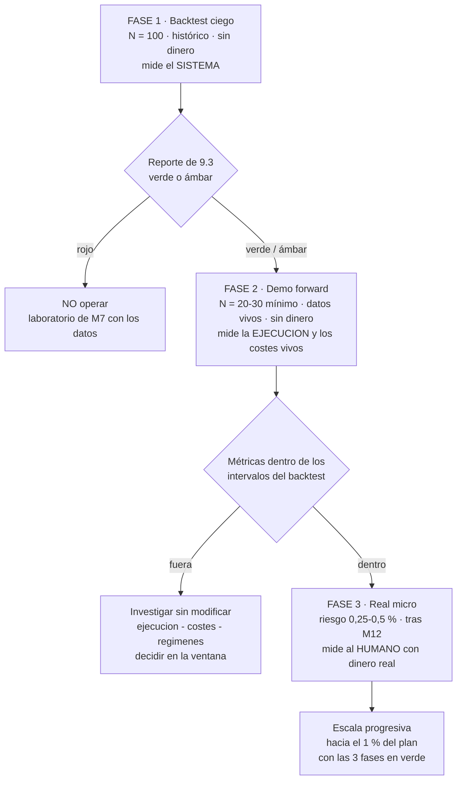

# Lección 9.4 · Forward testing en demo — la transición honesta del laboratorio al mundo

| Campo | Detalle |
|---|---|
| ⏱️ Duración estimada | 40–55 min de estudio |
| 🧱 Módulo | [M9 · Backtesting, Journal y Validación](README.md) |
| ⬅️ Anterior | [Lección 9.3 · Métricas del reporte](leccion-9-3.md) |
| ➡️ Siguiente | [Lección 9.5 · El Journal profesional](leccion-9-5.md) |

---

## Por qué importa

El backtest mide el **sistema**; no puede medir tu **ejecución** ni los costes del vivo. Hay huecos estructurales que ningún replay rellena: el spread que tu señal encuentra en vivo a las 09:31 no es el estimado; el SL que en backtest se ejecuta "al precio exacto" en vivo sufre slippage; y el disparo que en replay no cuesta nada dudar, en vivo se negocia con el pulso. El forward testing es el puente: **el mismo sistema, las mismas reglas, los mismos umbrales — pero datos vivos, en tiempo real, sin dinero todavía**. Es la fase que el aficionado salta (del backtest bonito al real "porque ya está aprobado") y que el profesional recorre con la misma disciplina que el laboratorio: N declarado, journal completo, métricas comparadas contra los intervalos del backtest. Esta lección define el embudo completo de la evidencia — backtest → demo forward → real micro → escala —, los 4 huecos que el forward mide y los criterios de paso de fase. Y una honestidad de programa: el peldaño de dinero real se recorre **después de M12** (Fase 4), porque antes faltan el broker (M11) y el plan (M12) — el embudo no se salta ninguna estación.

## Concepto

**El embudo de la evidencia.** Cada fase filtra y añade lo que la anterior no puede dar:

*(en este programa la Fase 3 abre tras M12 — Fase 4 de la [Receta](../../03-recursos/laboratorio/receta-primera-operacion.md): antes faltan el broker serio (M11) y el plan escrito (M12); el embudo no da saltos).*

**Los 4 huecos que el backtest no puede ver** — y que el forward existe para medir:

| Hueco | Qué es | Cómo lo mide el forward |
|---|---|---|
| **Spread vivo en la señal** | El spread NO es constante: se ensancha en aperturas, noticias y baja liquidez; tu estimación de 0,08R era un promedio de replay | Cada fila registra el spread REAL del momento de la señal → al cerrar N=20-30, el coste medio real se compara contra el 0,08R estimado |
| **Slippage del SL** | En backtest el SL se ejecuta al precio exacto; en vivo, gaps y noticias ejecutan PEOR que tu precio | Cada SL ejecutado registra la diferencia (precio SL vs precio de ejecución) → la fila del journal crea tu estadística personal de slippage |
| **Tu ejecución** | Dudar, llegar tarde, no disparar la señal válida, sobregestionar — en replay no hay pulso y no hay costo de dudar | La métrica de disparos debidos vs ejecutados (M8) se mide en vivo por primera vez + la deriva entre R planificado y R real (9.5) |
| **La infraestructura** | Plataforma que se cuelga, conexión que cae, orden que no se llena — raros, reales, y solo aparecen en vivo | Los incidentes se cuentan en el acta semanal: frecuencia y duración; si el broker/entorno falla en demo, imagínalo en real (M11 elegirá con esto) |

La lectura conjunta: el backtest responde "¿tiene esperanza el sistema?"; el forward responde "¿sobrevive esa esperanza al mundo real y a ti?". Son preguntas distintas con instrumentos distintos — y el embudo las hace en orden porque cada una filtra a la siguiente.

**Criterio de paso de fase: "dentro de los intervalos".** El forward no tiene que salir MEJOR que el backtest — tiene que salir **dentro de lo que el backtest declaró**: el WR forward cae dentro del IC del backtest (ej. [30,4 %, 49,6 %]), el PF neto cerca del medido (1,25 ± su propio error, amplio con N=20-30), los costes reales contra el 0,08R, y los disparos en 100 %. Dos asimetrías que el programa fija: **(a) si el forward sale MEJOR** (WR 55 % con N=20): no se celebra ni se escala — con N=20 el IC es ±22 pp y el exceso suele ser varianza o filtro involuntario (¿tomaste solo las señales "bonitas"?); se sigue midiendo. **(b) si sale PEOR de forma persistente** (WR forward bajo el peor caso del backtest con N ya maduro): se investiga SIN modificar — primero ejecución (etiquetas E1-E4 del journal), luego costes (slippage/spread), luego régimen (¿cambió el mercado?): el hallazgo se documenta y se decide en la ventana mensual (9.6). El N forward se declara antes también (20-30 mínimo): el forward hereda TODOS los candados del backtest.

**Por qué demo y no real directo.** El demo forward mide ejecución mecánica con tiempo real pero sin el ruido psicológico del dinero — y ese es exactamente su límite: M10 estudiará lo que el demo no puede medir. La secuencia honesta es acumular evidencia por capas: el backtest limpió la hipótesis, el demo limpia la ejecución y los costes, el real micro (Fase 4) limpia la psicología con riesgo acotado (0,25–0,5 %), y solo con las tres fases en verde se escala hacia el 1 % del plan. Cada capa añade una variable nueva y solo una: así, cuando algo falla, sabes QUÉ se rompió.

## Analogía

La licencia de piloto. Nadie pasa del simulador al Boeing con 300 pasajeros: simulador (tu backtest — el avión es real, el viento no), luego **vuelo en zona con instructor** (tu demo forward — el avión real, el viento real, el riesgo contenido), luego el primer solo en circuito pequeño (real micro), y solo con horas acumuladas, la licencia que habilita la escala. El salto simulador→avión no cambia el avión: cambia el viento, el ruido y tu pulso — exactamente los 4 huecos. Y la industria no considera el instructor una pérdida de tiempo: considera la gente que se lo salta un peligro público. Tu demo forward es tu vuelo en zona: las mismas maniobras del manual (tu sistema), registradas con la misma actitud de instrucción (el journal), con un instructor que no te regatea preguntas incómodas — tu acta semanal.

## Cómo se hace: ejecutar la fase forward con protocolo

1. **Declara el experimento forward (misma forma que el PRE del backtest).** N declarado (20-30 mínimo; el programa recomienda 30 para que el IC baje a ±18 pp), hipótesis (las métricas caen dentro de los intervalos del backtest), métricas y umbrales (los MISMOS de la tabla de 9.3 — no se inventan unos nuevos más "amables"), y las reglas del sistema congeladas (v1.1, el changelog sigue sin modificaciones).
2. **Ejecuta en tu ventana del sistema.** Las señales llegan en vivo cuando el mercado lo decida — no se fuerzan ("hoy no hay setup" es una sesión válida y se anota como tal). Cada señal válida: checklist de 8 condiciones con velas cerradas, captura en el momento, orden con el lote de la calculadora (el DEMO se opera con el tamaño REAL que usarías — un demo con 1 lote mide otra cosa), y journal v1 completo en caliente.
3. **Registra los 4 huecos fila por fila.** Spread real al momento (columna del journal), slippage del SL cuando se ejecuta, disparos debidos vs ejecutados en el acta, incidentes de infraestructura con duración. Estas 4 columnas son las que el backtest no tiene — son el valor añadido de la fase.
4. **Compara semanalmente contra los intervalos.** En cada acta semanal (9.6): el WR parcial forward contra el IC del backtest, los costes contra 0,08R, los disparos contra 100 %. No para reaccionar — para que la comparación final de la fase no sea una sorpresa.
5. **Cierra la fase con el mini-reporte.** A N declarado cumplido: el mismo reporte de una página de 9.3 con la fila extra de los 4 huecos, y la decisión: dentro de intervalos → fase siguiente cuando el programa la abra (Fase 4, tras M12); fuera → investigación documentada + ventana mensual; y en ambos casos el acta de cierre con fecha.

## Error común

**(1) Saltar al real "porque el backtest ya aprobó".** El backtest aprobó el SISTEMA; tu ejecución y los costes vivos no tienen ni una sola medición. El salto es exactamente el error que el embudo existe para impedir — y el costo del atajo se paga con la primera racha en real, sin estadística de ejecución que explique si el problema fue el sistema o tú. **(2) Operar el demo con tamaño fantasma.** "En demo pongo 1 lote porque no pasa nada" — entonces tu demo mide un negocio que no vas a operar: el sizing afecta la gestión (8.3-8.5), la frecuencia de señales que aceptas y tu atención. El demo se opera con el lote que la calculadora daría con tu capital real: si es 0,06, el demo lleva 0,06. **(3) Modificar reglas durante el forward.** El mismo candado del backtest: el N se declaró, las reglas se congelaron; "ajustar el TP en vivo porque el mercado está rápido" destruye la comparabilidad de la fase entera. Las dudas van al diario del backtester — que ahora se llama diario del forward. **(4) Contar solo las operaciones "bonitas".** La señal a las 03:00 fuera de tu ventana no cuenta (tu sistema lo dice), pero la que perdiste por llegar tarde SÍ: se etiqueta (E2) y entra. Un forward sin errores es un forward sin honestidad — tu ejecución real incluye lo incómodo, o el reporte mide un humano que no existes. **(5) Leer un forward mejor que el backtest como "el sistema es mejor de lo que creía".** Con N=20 el IC es ±22 pp: un 55 % forward es estadísticamente indistinguible de un 40 % backtest. La asimetría honesta: el exceso suele descontarse (varianza + filtro involuntario) y el déficit persistente sí se investiga — la cautela siempre del lado de la prudencia.

## Conexión cuantitativa

**Hacia 9.3:** los umbrales del forward son los del backtest — la tabla de 3 vías se reutiliza tal cual con los intervalos como referencia; el WR* neto (34,8 %) sigue siendo la línea que ningún intervalo debe cruzar hacia abajo. **Hacia 8.5-8.6:** el forward es la primera vez que los topes de cartera y la cascada de frenos operan en vivo — las señales simultáneas llegan de verdad, y el árbol de decisión de la cartera (8.5) se ejecuta con reloj corriente; cada freno disparado en demo es un ensayo gratis del protocolo de apagado. **Hacia 9.5:** las 4 columnas nuevas del forward (spread real, slippage, deriva, incidentes) se suman al journal v1 — la infraestructura de registro se construye en la siguiente lección y este módulo la usa de principio a fin. **Hacia M10-M12:** el demo forward es el laboratorio donde M10 probará la temperatura pre-sesión y el diario emocional (el demo mide la mecánica; la psicología se entrena aquí para que en real micro ya sea rutina); M11 añadirá la elección de broker con tus datos reales de slippage como criterio; y M12 escribirá el plan que declara en qué fase del embudo está tu negocio — el mapa de esta lección es una sección obligatoria de ese plan.

---

## 🎯 Puntos clave

1. El embudo de la evidencia: **backtest (sistema) → demo forward (ejecución y costes vivos) → real micro (el humano, 0,25–0,5 %, tras M12) → escala** — sin saltos de estación.
2. Los 4 huecos que solo el forward mide: **spread vivo, slippage del SL, tu ejecución (disparos y deriva), infraestructura** — cada uno con su columna en el journal.
3. El criterio de paso es "dentro de los intervalos" del backtest — no "mejor": un forward que sale muy bien se desconfía igual que uno que sale mal.
4. El forward hereda TODOS los candados: N declarado antes, reglas congeladas, todo entra al dataset, nada se modifica en vuelo.
5. El demo se opera con el tamaño real de la calculadora — un demo con tamaño fantasma mide un negocio que no vas a operar.

## 🔄 Autoevaluación rápida

1. Enumera los 4 huecos del backtest y explica en una línea cómo mide cada uno el demo forward. ¿Cuál de los 4 NO podría cerrarse ni con 1.000 operaciones de backtest — y por qué?
2. Tu forward de 20 operaciones cierra con WR 55 % (backtest: 40 % ± 9,6). Calcula el IC del forward, interpreta el resultado con la asimetría del programa, y decide: ¿qué NO se hace y qué sí?
3. ¿Por qué el programa espera a M12 para el real micro aunque el forward esté en verde? Nombra las 2 piezas que faltan y qué fase del embudo declara cada una.

Ver respuestas

1. (1) Spread vivo: cada fila registra el spread real del momento de la señal → coste medio real vs 0,08R. (2) Slippage del SL: diferencia entre precio SL y precio de ejecución, op por op. (3) Ejecución: disparos debidos vs ejecutados + deriva R planificado vs real — el pulso no existe en replay. (4) Infraestructura: incidentes contados con duración en el acta. El que no se cierra con ningún backtest es (3): la ejecución bajo presión es del humano, y en replay no hay ni dinero ni reloj ni consecuencias — no es una limitación de datos, es una limitación de naturaleza.
2. IC con N=20: $1{,}96\sqrt{0{,}55 \times 0{,}45/20} = 1{,}96 \times 0{,}111 = ±21{,}8$ pp → [33,2 %, 76,8 %]. El 55 % forward es estadísticamente indistinguible del 40 % del backtest (los intervalos se solapan ampliamente). NO se hace: celebrar, escalar tamaño, "soltar" el sistema ("ya confío"), ni modificar el TP para "aprovechar que estoy en racha". SÍ se hace: seguir midiendo hasta el N declarado (o más), revisar si hubo filtro involuntario (¿tomé solo las señales bonitas? — el acta de no-disparos lo delata), y mantener el sizing provisional. La asimetría del programa: el exceso se desconfía, el déficit persistente se investiga — la prudencia siempre del lado conservador.
3. Porque al embudo aún le faltan dos piezas de infraestructura que este módulo no da: (a) **M11 · La Industria** — elegir broker serio (regulación, costes, ejecución): tu estadística real de slippage y spread depende de con quién operas, y ese criterio necesita el módulo entero; (b) **M12 · Plan de Trading y de Negocio** — el documento donde el real micro se declara como fase con presupuesto, límites y criterios de salida (sin plan, el real micro es solo un backtest con los nervios de tu dinero). La Fase 4 de la Receta declara ambos: el primer dólar real llega con broker elegido, plan firmado y riesgo micro — nunca antes.

