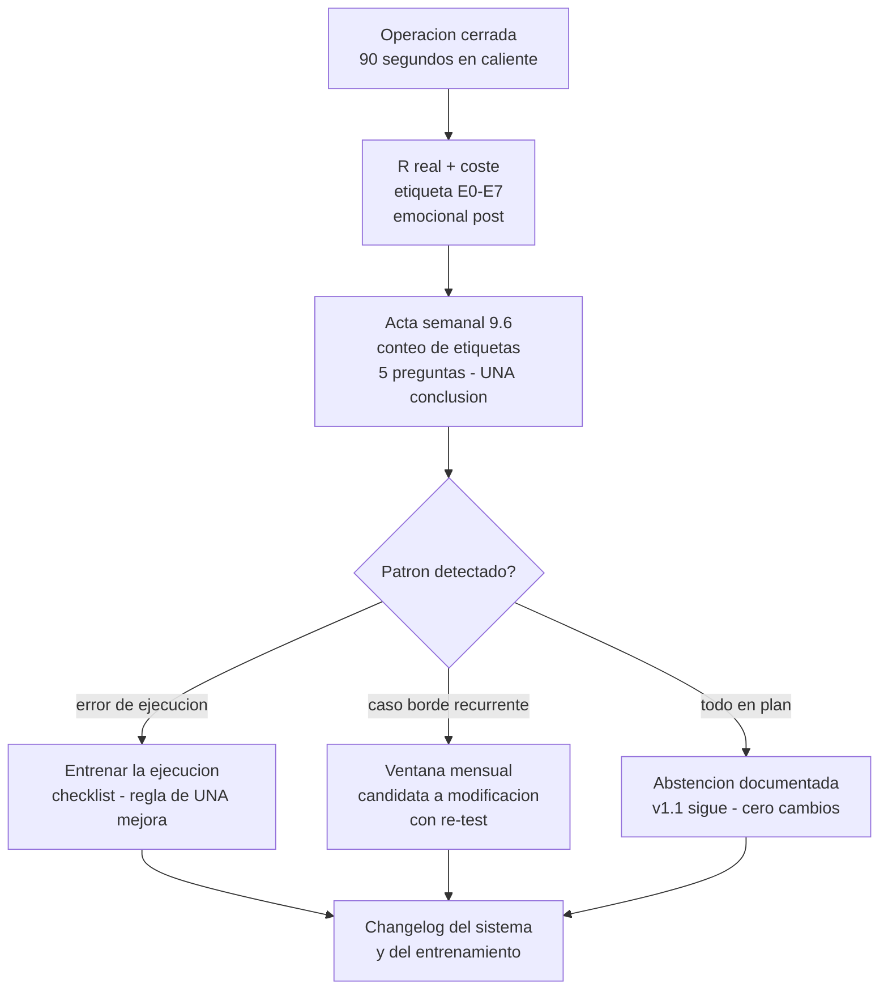

# Lección 9.5 · El Journal profesional — tu caja negra con taxonomía de errores

| Campo | Detalle |
|---|---|
| ⏱️ Duración estimada | 50–65 min de estudio |
| 🧱 Módulo | [M9 · Backtesting, Journal y Validación](README.md) |
| ⬅️ Anterior | [Lección 9.4 · Forward testing en demo](leccion-9-4.md) |
| ➡️ Siguiente | [Lección 9.6 · Revisión semanal y mensual](leccion-9-6.md) |

---

## Por qué importa

Todo lo que este módulo ha construido — la muestra de 100, las métricas, los umbrales, el embudo — depende de un registro que no mienta. Y aquí está el problema estructural: **la memoria del trader es el testigo menos fiable de su propio negocio**. Reescribe el pasado para proteger el ego ("esa pérdida fue mala suerte, no mi error"), confunde lo que pasó con lo que quiso que pasara, y a los tres meses no distingue entre la operación planificada y la improvisada. El journal profesional es la solución de ingeniería a esa falla humana: una **caja negra** que registra en caliente, con campos fijos, la captura del gráfico en el momento de la señal y una etiqueta de error de una taxonomía cerrada. Este módulo aporta al programa dos piezas que el SYLLABUS marcó como vacío (nº 3) de los cursos de referencia: la **taxonomía de errores E0–E7** — con la distinción central de la carrera, **pérdida ≠ error** — y el protocolo de revisión que la siguiente lección monta. La inversión de tiempo es de 90 segundos por operación; el retorno es que cada fila de tu negocio se vuelve auditable, y tú dejas de adivinar por qué pierdes: lo lees.

## Concepto

**Del v0 al v1: qué cambia y por qué.** El journal v0 (Sprint 2) registraba la **mecánica** de la operación: instrumento, órdenes, resultado, una nota libre. Servía para aprender a registrar. El journal v1 registra el **negocio**: añade el R planificado (la decisión ANTES), la etiqueta de error de una taxonomía cerrada (el diagnóstico EN caliente), el estado emocional pre/post (la semilla de M10) y la captura obligatoria de señal (la evidencia). La diferencia no es de columnas sino de propósito: el v0 describía operaciones; el v1 **alimenta una auditoría** — cada campo existe porque una métrica del reporte (9.3) o una pregunta del acta semanal (9.6) lo consume. Un campo que nadie lee no entra a la plantilla: el journal es infraestructura de análisis, no un diario íntimo.

**Los campos mínimos del v1** *(el CSV completo, con las 24 columnas y ejemplos migrados, está en [`journal/plantilla_journal_v1.md`](../../../journal/plantilla_journal_v1.md)):

| Campo | Para qué existe (quién lo consume) |
|---|---|
| fecha, horas inicio/fin, mercado, dirección, tipo de orden | Contexto operativo: ventanas, mercados y mecánica (acta semanal) |
| fase (backtest / forward_demo / real_micro) | El embudo de 9.4: cada fila sabe en qué estación nació |
| setup_valido (sí/no) + disparo_debido | La métrica de disparos ejecutados/debidos de M8 |
| lote, entrada, SL, TP | La decisión exacta: precios que se pueden auditar (paso 5 de la rutina 9.2) |
| **R planificado** | La esperanza de la operación al momento de decidir: $R_{plan} = \frac{TP - \text{entrada}}{\text{entrada} - SL}$ |
| **R real + resultado $** | El dato que suma las métricas (9.3) |
| coste_r | El ladrón silencioso: audita el 0,08R estimado |
| SL antes de entrada (sí/no) | La ley de M4, verificada fila por fila |
| **captura** | La evidencia del gráfico EN el momento de la señal: la memoria no puede reescribir lo que está en la imagen |
| **emocional pre / post (1–10)** | La semilla del diario de M10; el acta lee sus desvíos sistemáticos |
| **etiqueta_error (E0–E7)** | El diagnóstico del proceso: la columna que convierte 100 filas en un mapa de tu ejecución |
| regla_violada + lección (1 línea) | El puente directo al changelog de 9.6 |

**La taxonomía de errores E0–E7** — el aporte central del módulo. Una etiqueta por operación, asignada **en caliente** (al cerrar la operación, no el domingo):

| Etiqueta | Nombre | Definición operativa | Ejemplo típico |
|---|---|---|---|
| **E0** | En plan (sin error) | Setup válido + ejecución conforme + gestión conforme — **incluye TODA pérdida con SL respetado y sizing correcto** | La pérdida −1R de la racha esperada: coste estadístico, no error |
| **E1** | Operar sin setup | Se ejecutó una señal que la definición de setup válido rechaza | Entrar por FOMO "porque se estaba yendo"; la operación del aburrimiento |
| **E2** | Entrada fuera de regla | Setup válido, pero la ejecución violó la regla de entrada | Entrar antes de la vela de reacción cerrada; precio fuera de la zona |
| **E3** | SL manipulado | El SL se movió, amplió o eliminó — o se cerró manualmente antes del SL sin regla de gestión que lo autorice | "Le doy espacio"; el cierre por miedo a los −19 $ |
| **E4** | Sizing fuera de presupuesto | El lote no es la salida de la calculadora (M8) | El 0,10 "para aprovecharla" cuando la calculadora daba 0,06 |
| **E5** | Gestión improvisada | Se movió el TP, se hizo parcial o breakeven sin que una regla del componente 10 lo autorice | "Aseguro" a +0,5R y el TP golpea dos velas después |
| **E6** | Freno ignorado | Se operó con la cascada de M8 activa o se violó un tope de cartera | La tercera operación del día con el freno nivel 1 ya disparado |
| **E7** | Error de ejecución técnica | Orden mal puesta, fat finger, OCO olvidado, dirección invertida | El long que salió short; el SL que nunca se puso |

Tres reglas de uso que le dan valor estadístico: **(1) UNA etiqueta por operación** — si hay varias, se asigna la PRIMERA de la cadena causal (sin setup no habría sizing fuera: es E1, y el resto se anota en regla_violada); una operación con dos etiquetas es una operación sin diagnóstico. **(2) En caliente** — la etiqueta se asigna al cerrar la operación, con el emocional post fresco; el etiquetado del domingo es reconstrucción, y la reconstrucción defiende al ego (las estadísticas de los que etiquetan tarde tienen sospechosamente más E0). **(3) La taxonomía es cerrada** — si un error no encaja, se describe en regla_violada y la revisión decide si merece una etiqueta nueva (con evidencia); inventar etiquetas ad hoc destruye la comparabilidad del conteo.

**La distinción central: pérdida ≠ error.** La E0 existe exactamente para esto. Una pérdida con SL respetado, sizing correcto y setup válido es el **coste estadístico del negocio** — el 60 % de las operaciones del caso maestro pierde y el sistema GANA +0,16R neto por operación; castigar la pérdida en plan es no entender la matemática de 7.4. Un error, en cambio, es la **desviación del proceso** — y ahí está la asimetría que define la carrera: una ganancia fuera de plan (E1, E2, E4...) **es un error**, y es el más peligroso de todos: el +2R "a ojo" que salió bien refuerza y PREMIA el circuito equivocado — el cerebro aprende "así se gana", y la próxima vez que el circuito se active, el tamaño será mayor. La pérdida errónea duele y enseña; la ganancia errónea divierte y desarma. (La lección 10.4 construirá todo un módulo sobre esta línea; aquí queda instalada en la columna de tu journal.)

**La deriva de ejecución: R planificado vs R real.** Las columnas de R permiten una medición que casi nadie hace: si el R real se desvía **sistemáticamente** del planificado (ej. TP movido → ganadoras de +1,4R cuando el plan decía +2,1R), el diagnóstico es de **ejecución**, no de sistema — el sistema que diseñaste rendía +0,16R neto; el que ejecutas rendirá distinto, y tu reporte de 9.3 medirá al segundo disfrazado del primero. La regla del programa: la deriva se mide, se reporta en el acta y se corrige entrenando la ejecución (checklist, disciplina de TP) — **jamás** recalculando las expectativas para que "cuadren" con la ejecución desviada. La deriva de disparos (debidos vs ejecutados) es la hermana de esta métrica: 100 % es la única nota aprobada (M8).

**El emocional pre/post (1–10): la semilla de M10.** Dos números por operación, 5 segundos de honestidad: ¿cómo llegaste (sueño, estrés, apego) y cómo quedaste? El acta semanal leerá sus patrones: pre > 8 con "me toca recuperar" → riesgo de revancha (el freno de 8.6 existe para eso); post < 4 tras pérdida → la pausa obligatoria antes de la siguiente decisión. No es psicología decorativa: son las columnas que M10 usará para tu diagnóstico, registradas desde HOY — cuando llegues a M10 tendrás semanas de datos propios, no la teoría de otro.

## Analogía

La caja negra del avión. El registrador de vuelo no opina, no aconseja y no juzga: **graba** — altitud, rumbo, cada accionar de los mandos, los últimos 25 horas sin interrupción. Cuando hay un incidente, la investigación no entrevista la memoria del piloto (el estrés falsifica el recuerdo: los testigos de accidentes confunden sistemáticamente lo que hicieron con lo que creyeron hacer): **lee la caja**. Y la línea de fondo de toda la aviación moderna: los accidentes casi nunca son UNA causa — son cadenas de desviaciones pequeñas que el registro hace visibles antes de que se encadenen. Tu journal es tu caja negra: la etiqueta E0–E7 es el registro del accionar de los mandos (tu ejecución), el emocional pre/post es el registro de la cabina, y la captura de señal es la foto del panel en el momento exacto. El acta semanal es tu investigación de incidentes — con la ventaja de que en trading el "accidente" cuesta un 1 % y no un avión: por eso el profesional registra TODO, incluidos los vuelos rutinarios.

## Cómo se hace: montar el journal v1 y la rutina de los 90 segundos

1. **Monta la infraestructura (30-45 min).** Copia el CSV v1 del programa ([`journal/plantilla_journal_v1.md`](../../../journal/plantilla_journal_v1.md)) a tu hoja de cálculo (o usa el CSV directo); añade las columnas del forward (spread real, slippage) si ya estás en esa fase; imprime la taxonomía E0–E7 y pégala junto al monitor — la etiqueta correcta es la que está a la vista en caliente, no la que recuerdas el domingo. Entra los 2 ejemplos migrados del v0 para calibrar.
2. **Rutina post-operación: los 90 segundos.** Al cerrar CADA operación, antes de cerrar la plataforma: R real y resultado (10 s) → etiqueta E0–E7 con la taxonomía a la vista (20 s) → emocional post 1–10 (5 s) → captura ya tomada en la señal, verificada en la fila (5 s) → lección de UNA línea si la hay (50 s). No es burocracia: es el paso 8 de la rutina de 9.2, en vivo. La regla: **la plataforma no se cierra con filas pendientes** — la memoria pendiente es memoria que se falsifica.
3. **Registra también lo que NO operaste.** Las señales válidas no ejecutadas van al acta (disparos debidos), y las rechazadas con razón van al registro de señales rechazadas (1 línea: fecha, mercado, razón). El 60 % de la información de ejecución vive en lo que NO hiciste — y es la mitad que el aficionado no registra jamás.
4. **Calibra la honestidad con tu primera semana.** Si tu primera semana cierra con 100 % E0, sospecha de ti mismo: la muestra de cualquier humano que aprende tiene errores E2/E7 al menos; el E0 perfecto de novato suele significar "no sé etiquetarme" o "no me atrevo". El journal no califica: mide — un 40 % de errores bien etiquetados vale más que un 0 % sospechoso, porque lo primero es reparable y lo segundo es ciego.
5. **Conecta el journal con el resto del sistema.** La calculadora de sizing (M8) produce el lote que va a la fila; la cascada (M8) decide si la fila puede existir; el reporte de 9.3 consume las filas; el acta de 9.6 lee las etiquetas. El journal v1 es el nodo central de todo el negocio — por qué esta lección es el corazón del módulo.

## Error común

**(1) El journal del domingo.** Reconstruir 12 operaciones el fin de semana con la memoria como única fuente: cada fila será "verosímil" y ninguna será cierta — la memoria protege el ego en proporción directa al tiempo pasado. La etiqueta en caliente no es perfeccionismo: es la diferencia entre medir y novelar. **(2) La etiqueta múltiple.** "Fue E1 y E2 y un poco de E4" — no: la primera de la cadena causal, el resto a regla_violada. El conteo semanal solo puede leer frecuencias si cada operación tiene exactamente un diagnóstico principal; el "todo lo anterior" es la forma en que el ego diluye la responsabilidad. **(3) El journal que solo registra operaciones.** Sin no-disparos y señales rechazadas, la métrica de disparos (M8) no existe y la mitad de tu ejecución queda fuera del mapa. **(4) La lección que se convierte en ensayo.** La lección es UNA línea ("esperar la vela cerrada en zona H4"); si necesitas un párrafo, el diagnóstico no está maduro — va al acta de la semana, donde el espacio obliga a precisión. **(5) Usar el journal para autoflagelarse.** El journal es un instrumento de medición, no un tribunal: la E0 existe para que la pérdida en plan quede PRESUPUESTADA y sin culpa, y la taxonomía existe para convertir el remordimiento difuso ("soy un desastre") en un objetivo concreto ("E2 × 4 esta semana: disparo prematuro — se entrena con la regla de la vela cerrada"). El trader que castiga el error deja de etiquetarlo; el que lo mide, lo corrige.

## Conexión cuantitativa

**Hacia 9.3:** cada métrica del reporte se calcula DE las filas — WR y PF de los resultados, coste medio de la columna coste_r, rachas de la serie temporal, disparos del par setup_valido/disparo_debido; sin journal v1 no hay reporte, solo impresiones. **Hacia 8.3-8.6:** la fila verifica el presupuesto (lote vs calculadora → E4), los topes de cartera y la cascada (E6) — la columna de etiquetas es la auditoría del módulo de riesgo en cada operación. **Hacia 9.6:** el conteo de etiquetas y los patrones del emocional pre/post son la materia prima de las actas — la revisión semanal dura 30 minutos precisamente porque los 90 segundos post-operación ya hicieron el trabajo. **Hacia M10:** tus columnas emocionales y tus etiquetas E1/E6 (FOMO y freno ignorado) son el dataset personal sobre el que la psicología científica diagnosticará; M10 te pedirá MÍRATI en el journal — el que llega sin journal llega sin espejo. Y hacia M12: el changelog del sistema (que el acta produce) y las lecciones de una línea son la materia prima del plan de trading — tu documento rector se escribirá con años de filas, no con opiniones de enero.

---

## 🎯 Puntos clave

1. El journal v1 registra el **negocio**: R planificado, etiqueta de error, emocional pre/post y captura — cada campo existe porque una métrica o un acta lo consume.
2. La taxonomía cerrada E0–E7, **una etiqueta por operación en caliente**, la primera de la cadena causal — la comparabilidad del conteo es su valor.
3. **Pérdida ≠ error**: la E0 presupuesta el coste estadístico; la ganancia fuera de plan ES un error — y es el más peligroso porque premia el circuito equivocado.
4. La deriva (R planificado vs real; disparos debidos vs ejecutados) diagnostica la EJECUCIÓN — se entrena, jamás se "recalcula" para que cuadre.
5. Los 90 segundos post-operación son la inversión más rentable del negocio: 100 filas audibles valen más que cualquier intuición sobre tu propio desempeño.

## 🔄 Autoevaluación rápida

1. Clasifica con etiqueta y justifica: (a) pérdida −1R, SL respetado, lote de la calculadora, setup 8/8; (b) ganancia +2R tomada fuera de zona sin setup; (c) pérdida −1R tras mover el SL "para darle aire"; (d) pérdida −1R con la cascada en nivel 2 activa; (e) ganancia +1R con lote 0,10 cuando la calculadora daba 0,06.
2. Tu acta semanal muestra E2 × 4 (todas entradas antes de la vela cerrada) y E0 × 6. Formula la conclusión única de la semana y explica por qué NO corresponde modificar el sistema en la ventana mensual.
3. Explica por qué una ganancia de +3R fuera de plan es MÁS peligrosa que una pérdida de −1R en plan. Usa la matemática de la esperanza y el mecanismo del refuerzo en tu respuesta.

Ver respuestas

1. (a) **E0** — el coste estadístico presupuestado: la racha esperable del sistema en acción, sin culpa y sin corrección. (b) **E1** — operar sin setup; que haya salido +2R no cambia la etiqueta: la columna mide el PROCESO, no la suerte — y es la más peligrosa de la lista por el refuerzo. (c) **E3** — SL manipulado (el movimiento del SL sin regla de gestión; la pérdida −1R no es el error — el movimiento sí). (d) **E6** — freno ignorado: con la cascada en nivel 2 el protocolo mandaba pausa 30-60 min; operar violó el apagado parcial (y la cadena causal empieza ahí: el freno es el "porqué" de toda la operación). (e) **E4** — sizing fuera de presupuesto: +1R con 0,10 lotes son +32 $ donde el plan decía +19,20 $ — la desviación del presupuesto ES el error, ganes o pierdas.
2. Conclusión única: "4 de 10 operaciones dispararon antes de la vela cerrada (E2) — esta semana se entrena la regla de la vela cerrada con el checklist en pantalla: ninguna orden antes del cierre de la vela de reacción". NO corresponde modificar el sistema porque el patrón diagnosticado es de EJECUCIÓN, no de diseño: las reglas eran correctas y no se siguieron — cambiarlas ahora sería tratar una falla de disparo reescribiendo el manual (la confusión que la ventana mensual existe para evitar). El entrenamiento (regla de UNA mejora) ataca el E2; el sistema v1.1 sigue congelado; y si las E2 persisten 4 semanas tras el entrenamiento, entonces sí: el caso entra a la ventana con EVIDENCIA de que el problema puede estar en la regla (¿demasiado estricta?, ¿la vela cerrada llega tarde?) — y se re-testea.
3. Matemática: la esperanza del sistema (+0,16R neto) solo existe si las reglas se ejecutan — una operación fuera de plan es una extracción de una DISTRIBUCIÓN DISTINTA (sin WR 40 % ni R:B 2,1 garantizados): su +3R no "compensa" nada, es ruido de otra máquina. Refuerzo: la pérdida en plan duele y no enseña circuito nuevo (era el coste esperado); la ganancia fuera de plan activa el sistema de recompensa EXACTAMENTE cuando el comportamiento fue erróneo — el cerebro marca "fuera de zona = +3R" como patrón ganador, y su próxima activación será con más tamaño y más convicción. El Trader que repite el circuito construye un negocio cuya esperanza no conoce — porque su journal (si etiqueta bien) muestra E1 que él celebra. Por eso la columna mide el proceso: la única ganancia que cuenta es la que el sistema puede repetir.

