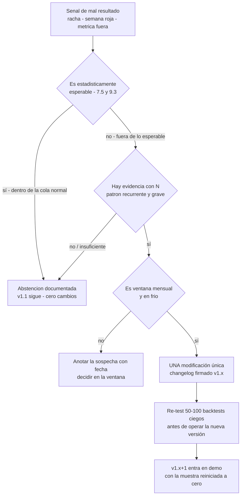

# Lección 9.6 · Revisión semanal y mensual — el protocolo que decide cuándo tocar el sistema (y cuándo NO)

| Campo | Detalle |
|---|---|
| ⏱️ Duración estimada | 45–60 min de estudio |
| 🧱 Módulo | [M9 · Backtesting, Journal y Validación](README.md) |
| ⬅️ Anterior | [Lección 9.5 · El Journal profesional](leccion-9-5.md) |
| ➡️ Siguiente | [🧪 Laboratorio del módulo](README.md#-laboratorio--backtesting-ciego-de-100-operaciones) |

---

## Por qué importa

Un sistema sin auditoría programada se degrada por deriva en una de dos direcciones — y ambas son fatales. **Hiperactividad:** el trader que "mejora" su sistema cada tres días está haciendo data-mining en vivo (9.1) — cada cambio resetea su muestra a cero, y una década entera puede pasar sin acumular jamás 100 operaciones de NINGÚN sistema. **Parálisis:** el trader que no revisa cronifica sus errores — las E2 de esta semana son las E2 de hace dos meses, y el negocio acumula la misma fuga de ejecución durante años sin nombrarla. La revisión programada es el termostato entre ambos extremos: un momento fijo, con un protocolo fijo, donde el sistema PUEDE cambiar — y fuera del cual está congelado. Este protocolo es el segundo aporte propio del módulo al SYLLABUS (vacío nº 3): las actas semanales y mensuales que convierten tu journal en decisiones documentadas. Al terminar tienes la pieza que faltaba para que el negocio se mantenga solo: el calendario de mantenimiento que decide cuándo tocar el sistema — y, más importante todavía, cuándo NO.

## Concepto

**La revisión semanal — el protocolo de 6 pasos (30–45 min, día fijo, fuera de mercado).** Se agenda como cita inamovible (viernes tarde o domingo; nunca "cuando el mercado esté lento": la revisión es estructura, no oportunidad). Los pasos:

1. **Leer la semana completa del journal** — las operaciones Y los no-disparos: la semana se lee entera antes de opinar sobre ella. El conteo básico: N de operaciones, resultado en R, etiquetas E0–E7.
2. **Contar las etiquetas** — el mapa de la semana: E0 × 7, E2 × 3, E7 × 1. Sin conteo no hay patrón; sin patrón, la "sensación de la semana" (que la memoria ya está distorsionando) dictará conclusiones falsas.
3. **Responder las 5 preguntas de auditoría** (la tabla inferior) — con datos de las filas, no con recuerdos: cada pregunta cita su columna del journal v1.
4. **Medir los disparos** — ejecutados / debidos: la métrica de M8 de la semana. Un 8/9 no es un número: es una pregunta ("¿qué bloqueó el disparo que faltó?") con respuesta obligatoria en la conclusión.
5. **Escribir UNA conclusión** — la regla de UNA mejora: qué UNA cosa de ejecución se entrena la próxima semana (del tipo checklist, horario, filtro de fatiga). UNA, no cinco: la semana humana no absorbe más, y el entrenamiento disperso no entrena nada.
6. **Documentar la decisión o la abstención** — el acta cierra con: conclusión escrita, cambio de entrenamiento (si lo hay) y la línea explícita *"sistema v1.1: sin cambios"*. La abstención también se documenta: una revisión que no produce nada escrito no ocurrió.

**Las 5 preguntas de auditoría semanal:**

| # | Pregunta | Qué dato la responde |
|---|---|---|
| 1 | ¿Operé solo setups válidos (8/8)? | Conteo de filas con setup_valido = no o etiquetas E1 |
| 2 | ¿Mi sizing respetó el presupuesto en todas? | Columna lote vs calculadora; etiquetas E4 (debe ser cero) |
| 3 | ¿Todos mis SL se respetaron — puestos antes y sin manipulación? | Columna SL antes de entrada; etiquetas E3 |
| 4 | ¿Mi estado emocional contaminó decisiones? | Patrones del pre/post: pre > 8 con pérdidas (revancha), post < 4 con reentrada (tilt); etiquetas E6 |
| 5 | ¿Qué UNA cosa corrijo la próxima semana? | La etiqueta más frecuente NO-E0 + su corrección de ejecución más concreta |

**La revisión mensual — las métricas contra el reporte (1–2 h, última semana del mes).** La pregunta del mes es una sola: **¿el mes que viví se parece al sistema que medí?** Concretamente: el WR del mes contra el IC del backtest ([30,4 %, 49,6 %] en el caso maestro), el PF neto contra el medido, la racha del mes contra la distribución (una racha de 9-10 en un mes de 20 ops es estadística normal, no crisis), el Max DD acumulado contra la línea −15 % de M8, el coste real contra el 0,08R, y los disparos del mes contra 100 %. De esa comparación sale la **ventana de modificación**: el único momento del calendario donde el sistema puede cambiar.

**La ventana de modificación — las 4 condiciones acumulativas.** El sistema v1.x solo cambia cuando TODAS se cumplen:

1. **Es ventana mensual** (fin de mes, en frío, con el acta mensual delante) — nunca intradía, nunca tras una racha, nunca "ahora que lo veo claro".
2. **Hay evidencia con N suficiente** — un caso borde visto 2 veces no es evidencia; el umbral del programa: el patrón debe aparecer en ≥ 10 % de las operaciones del mes (o ser estructuralmente grave: una sola E3/E6 es grave por definición, porque ataca el presupuesto).
3. **UNA sola modificación por vez** — la atribuibilidad: si cambias el TP y el filtro a la vez y la E mejora, no sabrás a qué se debió. La modificación única es lo que hace legible el siguiente ciclo.
4. **Re-test antes de operar** — el sistema modificado (v1.2) corre 50–100 backtests ciegos NUEVOS antes de tocar demo o real: cada modificación resetea la muestra, y operar un sistema sin muestra es empezar de cero sin haberlo declarado.

**La lista negra — cuándo NO se modifica (cada ítem con su razón cuantitativa):**

| Señal (la excusa) | Por qué NO (la razón) |
|---|---|
| "Vine de una racha de 5, algo hay que cambiar" | La racha de 5 con WR 40 % tiene P = 0,6⁵ ≈ 7,8 % por ventana — en 20 ops por mes es estadística NORMAL (7.5); cambiar tras ella es operar la distribución de cola |
| "El WR de mis últimas 20 ops bajó a 30 %" | Con N=20 el IC es ±22 pp: un 30 % medido es indistinguible de un 40 % real; la muestra no autoriza nada |
| "Acabo de ganar 3 seguidas, el sistema puede aflojarse" | El exceso también es varianza; relajar tras ganancias es la puerta del oversizing progresivo (8.4) |
| "Vi un video que dice que el R:B 1:3 es mejor" | Una hipótesis nueva entra por la puerta del laboratorio (M7): declaración + backtest propio + ventana — no por YouTube |
| "Este mercado ya no funciona como antes" | Puede ser verdad (el régimen cambia) — y por eso se documenta como sospecha y se decide CON datos del acta mensual, no con la sensación del martes |

La lista negra comparte mecanismo con el protocolo de apagado de 8.6: **las decisiones estructurales se toman en frío, por escrito, contra números** — el cerebro estresado o eufórico falsifica evaluaciones cualitativas, y el calendario existe para que la decisión importante no coincida jamás con el momento emocional.

**El changelog del sistema.** Cada modificación que supera las 4 condiciones queda registrada como una entrada firmada: fecha, versión (v1.1 → v1.2), evidencia que la motivó (filas del journal, actas), la modificación única (qué componente cambia, de qué a qué) y el plan de re-test (N, fechas). El changelog es al sistema lo que el historial clínico al paciente: sin él, cada "mMMM, mejor lo cambio" parece razonable en soledad; con él, la cadena de decisiones se puede auditar — y el patrón más revelador del changelog amateur es su frecuencia (cada 2 semanas = data-mining en vivo; cada 6-12 meses CON evidencia = mantenimiento profesional).

## Analogía

El mantenimiento aeronáutico por horas de vuelo. Los aviones no se revisan "cuando suenan raro" ni se les cambian piezas por inspiración: se revisan **por calendario programado** — cada X horas de vuelo, una inspección definida; cada Y horas, una mayor. Y cada intervención queda en el log técnico: qué se cambió, con qué evidencia, quién la aprobó, y el vuelo de prueba que valida el cambio antes del servicio comercial. La razón es la misma del changelog: en un sistema complejo, la "mejora" no auditada es indistinguible del sabotaje — el mecánico que "ajusta de oído" es el que crea los incidentes que investigará la caja negra. Tu sistema v1.x es una aeronave: las actas semanales son las inspecciones de línea, la ventana mensual es el hangar programado, y el changelog es tu log técnico. La lista negra es la regla que toda la aviación aprendió con sangre: el piloto que "siente" que el motor suena raro aterriza — pero el mecánico no desmonta el motor en el aire: se espera al hangar, con el manual y los datos.

## Cómo se hace: agendar y ejecutar tu primera revisión

1. **Agenda las dos citas permanentes.** Semanal: día y hora fijos (45 min), fuera de mercado, con el journal delante. Mensual: última semana del mes (90 min), con el acta mensual y el reporte del backtest en paralelo. Ambas van al calendario como citas de negocio — porque lo son: son la única hora semanal en que el negocio decide conscientemente.
2. **Usa las plantillas del programa.** El [`journal/plantilla_journal_v1.md`](../../../journal/plantilla_journal_v1.md) incluye las plantillas de acta semanal (6 campos) y de acta mensual (métricas del mes vs intervalos + decisión de versión). Cópialas, úsalas, archívalas: la serie de actas es el historial clínico de tu negocio.
3. **Ejecuta la semana 1 del backtest como primer material.** Tu primera acta semanal se practica CON el backtest (la misión M-9 incluye la revisión simulada con el agente): el material es el mismo (filas, etiquetas, no-disparos) y el error cero dinero — practica el protocolo en el laboratorio para que llegue entrenado a la fase forward.
4. **Aplica la regla de UNA mejora en el entrenamiento, NO en las reglas.** La conclusión semanal solo produce cambios de EJECUCIÓN (checklist, horario, filtro de fatiga); los cambios de REGLAS viven en la ventana mensual con las 4 condiciones. La distinción: entrenar "esperar la vela cerrada" no cambia el sistema — lo ejecuta.
5. **Si toca modificación: recorre el árbol completo.** La candidata entra con sus filas, pasa la prueba de N, se espera a la ventana, se formula como UN cambio de UN componente, se firma en el changelog y se re-testea. Si cualquier eslabón falla, la sospecha queda documentada con fecha — y el sistema sigue. Ambos desenlaces son éxitos del protocolo: la modificación bien hecha y la abstención bien documentada protegen la muestra igual.

## Error común

**(1) Revisar "cuando el mercado está lento".** La revisión que se agenda por oportunidad no es un protocolo: es una visita ocasional — y el mes que el mercado no se aquietó, no hubo revisión (exactamente el mes en que hacía falta). Cita fija, calendario, sin excusas: la auditoría interna que depende del humor es la que no ocurre. **(2) Cambiar dos cosas a la vez.** "Ya que estoy, ajusto el TP y el filtro" — con dos cambios y una mejora, no sabes cuál la produjo (y si empeora, tampoco): la atribuibilidad es lo que hace legible el ciclo siguiente; la ventana mensual acepta UNA modificación y te obliga a priorizar — la priorización forzada es parte del diseño. **(3) Confundir ajuste de ejecución con cambio de sistema.** Las E2 cronificadas no piden un sistema nuevo: piden entrenar el disparo (checklist, vela cerrada). Reescribir reglas para resolver lo que es un problema de ejecución es el error más común del mes 3-6 — y produce sistemas que "cambian cada semana" sin que ninguno llegue nunca a tener muestra. **(4) La revisión sin acta.** "Lo revisé mentalmente y va todo bien" — no hay evidencia de que ocurriera; la memoria del revisor es la misma que falsifica el journal (9.5). Sin acta escrita, la revisión no ocurrió — y la serie de actas es lo que M12 convertirá en plan. **(5) El "progresito" semanal.** "Mejoro una regla cada semana, ¿no es eso ser diligente?" — no: cada cambio resetea la muestra a cero; el que mejora cada semana jamás acumula 100 operaciones del mismo sistema, y por tanto jamás sabe si NINGUNO funcionó. La diligencia mal dirigida es data-mining con calendario: la mejor versión de tu sistema en diciembre será la que acumuló meses de muestra, no la que acumuló cambios.

## Conexión cuantitativa

**Hacia 9.3:** los umbrales de la tabla de 3 vías son los que la acta mensual compara contra el mes real — el IC del WR, el PF neto, la racha esperada: la revisión no inventa criterios, aplica los declarados. **Hacia 7.5:** la distribución de rachas es lo que separa "estadísticamente esperable" de "fuera de lo esperable" en el primer nudo del árbol — sin esa estadística, toda racha parecería motivo de cambio y el sistema se desarmaría en la primera cola normal. **Hacia 8.2:** el Max DD del mes contra la línea −15 % es la comparación de cada acta: la emergencia de M8 y la auditoría de M9 comparten el mismo número — el negocio tiene un solo tablero. **Hacia M10:** las actas leen tus patrones emocionales (pre > 8, post < 4, E6) y M10 los tratará — la revisión es donde la psicología entra como DATO, no como discurso. **Hacia M12:** la serie de actas y el changelog son la materia prima del plan de trading (el documento rector que M12 escribirá): el plan declara tus reglas de modificación — que habrás practicado durante meses en estas actas. Y hacia la Evaluación N3: la revisión semanal simulada con el agente (misión M-9) es el ensayo general de la entrevista socrática de graduación.

---

## 🎯 Puntos clave

1. La revisión semanal: **6 pasos, día fijo, fuera de mercado** — leer, contar, 5 preguntas, disparos, UNA conclusión, decisión documentada o abstención.
2. La regla de UNA mejora ataca solo la **ejecución** (checklist, horario, fatiga); las reglas del sistema solo cambian en la **ventana mensual**.
3. La ventana exige 4 condiciones acumulativas: **fin de mes en frío + evidencia con N + UNA modificación única + re-test de 50–100 backtests** antes de operar.
4. La lista negra (rachas, N=20, "lo vi en un video") tiene razón cuantitativa en cada ítem: la cola normal de la distribución no es un diagnóstico.
5. Cada modificación resetea la muestra a cero — por eso el changelog profesional se firma cada 6-12 meses con evidencia, y el amateur "mejora" cada dos semanas hasta no tener ninguna muestra.

## 🔄 Autoevaluación rápida

1. Tu acta semanal cierra con E0 × 6, E2 × 3 (entradas antes de vela cerrada), E7 × 1 (OCO olvidado, detectado a tiempo). Formula la conclusión única, el entrenamiento de la semana y la línea de abstención sobre el sistema. ¿Por qué el E7 no produce conclusión separada?
2. El mes cierra: 20 operaciones, WR 38 %, PF neto 1,28, racha máxima 10 (−9,6 %), disparos 19/20, coste real 0,09R. Aplica la comparación mensual contra el backtest (WR esperado 40 % ± 9,6; PF neto 1,25; racha esperada ~9 en 100; c 0,08R) y escribe la decisión de la ventana.
3. Tu compañero de estudio cambia su SL a 1,5× tras perder 3 seguidas un martes. Nombra las violaciones del protocolo (3) y qué habría hecho con la misma inquietud el protocolo del programa.

Ver respuestas

1. Conclusión única: "4 de 10 entradas dispararon antes de la vela cerrada (E2): esta semana se entrena el bloqueo del envío — el checklist impreso con el paso 'vela cerrada sí/no' antes de cada orden, y ninguna ventana de orden abierta mientras la vela de decisión está en formación". El E7 no produce conclusión separada porque la regla de UNA mejora prioriza por frecuencia e impacto: 4 E2 sistemáticas > 1 E7 puntual ya detectada y corregida (se anota en el acta con su corrección inmediata — dobles chequeos de OCO — pero el entrenamiento de la semana es uno). Línea de abstención: "Sistema v1.1: sin cambios". La E0 dominante (6/10) confirma que el sistema se está ejecutando; el problema es de disparo, no de diseño.
2. Comparación: WR 38 % dentro del IC [30,4; 49,6] ✓ · PF neto 1,28 ≥ 1,25 ✓ · racha 10 en 20 ops: dentro de lo plausible (la racha esperada ~9 corresponde a 100 ops; en 20, la cola normal llega a 7-8 y una de 10 con P 0,6¹⁰ ≈ 0,6 % por ventana × ~11 ventanas ≈ 6-7 % es infrecuente pero no anómala — se documenta) · disparos 19/20 = 95 % → fuga del 5 %, la pregunta obligatoria de la conclusión ✓ · coste real 0,09R vs 0,08R estimado: dentro del margen, se actualiza la c para el próximo reporte ✓. Decisión de la ventana: **abstención documentada** — el mes se parece al sistema medido; v1.1 sigue; la conclusión mensual entrena el disparo faltante y el changelog registra "sin cambios, con sospecha de racha documentada". Ninguna métrica da para modificación: la evidencia con N es insuficiente y el primer nudo del árbol (¿esperable?) dice sí.
3. Violaciones: (1) decidió FUERA de ventana (un martes, en caliente, tras una racha — exactamente el momento que el calendario existe para proteger); (2) decidió SIN evidencia con N (3 pérdidas: P(racha 3) = 0,6³ ≈ 22 % por ventana — estadística normal, no diagnóstico); (3) decidió SIN protocolo de modificación (no hay changelog, no hay re-test: el sistema "nuevo" sin muestra es empezar de cero sin declararlo). El protocolo con la misma inquietud: la sospecha se anota con fecha en el diario, se verifica que 3 pérdidas sean cola normal (sí), y el tema entra al acta mensual — si tras el mes la evidencia con N existe (patrón recurrente ≥ 10 % o gravedad estructural), se formula UNA modificación en la ventana, se firma y se re-testea. La inquietud era legítima; el momento y el procedimiento, no.

