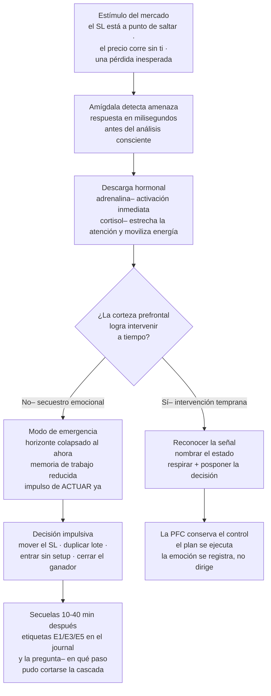

# Lección 10.1 · Neurobiología del riesgo — por qué tu cerebro no está diseñado para el trading

| Campo | Detalle |
|---|---|
| ⏱️ Duración estimada | 45–60 min de estudio |
| 🧱 Módulo | [M10 · Psicotrading Científico](README.md) |
| ⬅️ Anterior | [Lección 9.6 · Revisión semanal y mensual](../mod-09-backtesting-journal-y-validacion/leccion-9-6.md) |
| ➡️ Siguiente | [Lección 10.2 · Los 5 miedos](leccion-10-2.md) |

---

## Por qué importa

Durante nueve módulos construiste el negocio: la estructura (M1-M4), la técnica (M5-M7), el presupuesto y la evidencia (M8-M9). Ahora toca estudiar el último activo sin auditar: **el operador**. Y la primera verdad incómoda es estructural, no moral: tu cerebro evolucionó para mantenerte vivo en una sabana, no para sostener riesgo financiero en tiempo real. Los mecanismos que te salvaron de los depredadores — reacción rápida ante amenazas, aversión a la pérdida, búsqueda de patrones incluso donde no los hay — son exactamente los que sabotean una operación: te hacen cerrar el ganador temprano (alivio), sostener el perdedor (evitar la confirmación de la pérdida), y disparar en el quiebre que "parecía" señal (patrones falsos). La buena noticia es doble: estos mecanismos son **predecibles** (se activan ante los mismos estímulos) y por tanto **gestionables** — no se elimina la amígdala, se diseña el entorno para que no dirija. Esta lección te da el mapa hardware: qué ocurre en tu cerebro los segundos previos a un clic impulsivo, por qué el "ya sabía que no debía" llega siempre tarde, y por qué el sueño y la fatiga no son detalles de estilo de vida sino variables operativas del negocio. Si terminas con una sola idea incrustada, que sea esta: **la disciplina no es un rasgo de carácter — es una función biológica con recursos limitados, y el trading profesional se diseña para gastarlos bien.**

## Concepto

**El sistema de dos veloces.** Tu cerebro procesa el riesgo con dos arquitecturas de velocidades radicalmente distintas. El **sistema límbico** (centro: la **amígdala**, *amygdala*) es rápido, automático y antiguo: detecta amenazas y dispara respuestas en milisegundos, antes de que la conciencia participe. La **corteza prefrontal** (PFC, *prefrontal cortex*) es lenta, deliberada y reciente: planea, evalúa probabilidades, considera consecuencias — es la región que ejecuta tu checklist, calcula el lote y respeta el plan. En condiciones calmadas la PFC gobierna con la límbica como asesor. Bajo estrés agudo el flujo se invierte: la amígdala toma el control (el **secuestro emocional** o *amygdala hijack* que popularizó Daniel Goleman) y la PFC queda **funcionalmente degradada** — no "ignoras" tu plan: pierdes acceso parcial a las capacidades que lo ejecutan (memoria de trabajo reducida, evaluación de riesgo distorsionada, horizonte temporal colapsado al corto plazo). El trader que "se sale del plan" no es débil: es un ser humano cuyo hardware ejecutó el programa de emergencia que la evolución instaló. El problema: ese programa está calibrado para depredadores, no para spread.

**La cascada del secuestro, paso a paso** — los ~90 segundos críticos:

**Las dos moléculas que debes conocer** *(etiquetado como simplificación didáctica — la neuroquímica real es más rica y contextual)*. El **cortisol** (*cortisol*), hormona del estrés: en picos agudos estrecha tu atención (visión de túnel: solo ves la pérdida actual, no la estadística de 100 operaciones), potencia la memoria del miedo (la próxima vez esa zona "asusta" antes de analizarse) y degrada la función prefrontal sostenida — es la razón por la que la tercera operación mala del día es peor que la primera: no es que el mercado empeore, es que tu laboratorio químico se deteriora. La **dopamina** (*dopamine*), neurotransmisor de la anticipación de recompensa: no se libera al obtener la ganancia sino al **esperarla** — y responde más al tamaño de la recompensa posible que a su probabilidad (por eso el lote grande "se siente" mejor antes de existir, y por eso una cuenta demo con apalancamiento desmesurado produce las mismas pulsiones). Esta asimetría es la base neurológica del FOMO (10.3): la señal que se te escapa duele como una pérdida real aunque nunca fuera tuya.

**La aversión a la pérdida y su constante.** Los experimentos fundacionales de Kahneman y Tversky (teoría de la perspectiva, 1979) midieron un patrón estable: el dolor de una pérdida pesa aproximadamente **el doble** que el placer de una ganancia equivalente *(aproximación empírica con varianza individual, no constante universal)*. Traducción operativa brutal: tu cerebro necesita que un sistema con R:B 2,1 gane ~2 veces por cada pérdida para "sentir" el equilibrio en cero — justo donde la mayoría abandona sistemas con esperanza positiva **medida** (el WR 40 % del caso maestro produce 6 pérdidas por cada 4 ganancias: neurológicamente, seis golpes contra cuatro recompensas). Esto no es una debilidad a corregir: es la constante con la que se diseña. El programa ya la contempló — el journal v1 registra el emocional pre/post precisamente para que veas tu propia constante en datos, no en teoría.

**Sueño y fatiga decisional: variables operativas, no estilo de vida.** Dos hallazgos con implicación directa de horario: *(1)* la privación de sueño (noches de < 6 h) degrada de forma medible la función prefrontal — planificación, control de impulsos, evaluación de riesgo — mientras deja intacta la reactividad límbica: despierto pero **desgobernado**, el perfil exacto del operador que "sabía" las reglas y no las ejecutó. *(2)* La **fatiga decisional** (*decision fatigue*, Baumeister — la etiquetamos como heurística con evidencia mixta en la literatura, no como ley): cada decisión activa consume un recurso regulador que se agota con el uso sostenido; una sesión de 4 h con 20 micro-decisiones termina en decisiones autopiloto — que en trading adoptan la forma de entrar "porque sí" o de no revisar el checklist. Consecuencia de diseño: la **ventana de ejecución** del programa (10.7) acota la sesión activa a un máximo de ~3 h en los picos del mercado, y el protocolo de temperatura pre-sesión (laboratorio) pregunta por el sueño ANTES de abrir la plataforma — porque la variable más determinante de tu sesión se decidió la noche anterior.

**El contexto cambia el cerebro que decide.** El mismo estímulo (precio a 5 pips del SL) produce respuestas distintas según el estado previo: con 8 h de sueño y sin posiciones, es un dato; con 5 h y tras dos pérdidas, es una amenaza con cortisol circulante. Por eso el programa no te pide "ser fuerte": te pide **medir el estado antes de exponerlo**. La temperatura pre-sesión (laboratorio de este módulo) convierte esto en protocolo: tres dimensiones (sueño, estrés, apego al resultado) con umbral numérico — si tu estado no califica, la posición la toma el protocolo, no tu entusiasmo. Es la misma lógica del checklist de M8 aplicada al hardware: los frenos existían porque las caídas son inevitables; este protocolo existe porque los secuestros también.

## Analogía

El piloto de caza y el G-LOC. Cuando un caza acelera, la fuerza G empuja la sangre fuera del cerebro y el piloto puede perder la consciencia (G-LOC) en segundos — sin aviso subjetivo, precisamente cuando más necesita estar lúcido. La aviación no resolvió esto pidiendo pilotos "más fuertes de carácter": lo resolvió con **ingeniería del entorno** — el traje anti-G que comprime las piernas (hardware externo), la maniobra de tensión ensayada (protocolo entrenado), y sobre todo la regla de que el vuelo se ejecuta con **procedimientos previos**: descanso verificado, estado declarado, checklist. Nadie despega sin dormir "porque hoy me siento con ganas". El trading es el único deporte de alto estrés donde el amateur despega sin protocolo, sin descanso verificado y creyendo que su talento anula la fisiología. El profesional copia al aviador: asume que el hardware falla bajo G, ensaya el protocolo ANTES del estímulo (en plena cascada no se aprende nada — solo se ejecuta lo ya automatizado), y trata el sueño como pre-vuelo obligatorio. Tu traje anti-G es el journal abierto, la calculadora en pestaña fija, y el umbral de temperatura que prohíbe la sesión.

## Cómo se hace: instalar los 4 detectores tempranos

La cascada dura segundos, pero **siempre emite señales antes del clic** — el trabajo no es ser más fuerte, es detectar antes:

1. **Detector corporal (0-10 s):** el más rápido y el más fiable. Aprende TU firma física de activación — las más comunes: calor en cara/cuello, mandíbula tensa, respiración corta y alta en el pecho, pies que se posicionan "para saltar", mano que flota hacia el ratón. Protocolo: cuando lo detectes, **nombra el estado en voz baja** ("activación") — etiquetar verbalmente recluta PFC y frena la amígdala *(mecanismo de *affect labeling*, medido en neuroimagen)*.
2. **Detector cognitivo (5-30 s):** escucha los pensamientos-firma: *"esta vez es distinta"*, *"lo recupero con la siguiente"*, *"solo esta vez sin checklist"*, *"el mercado me está mirando"*. Ninguno es análisis; todos son publicidad interna del secuestro. Antídoto: la pregunta del programa — *"¿esta decisión está escrita en mi componente 1-8?"* Si no está escrita, no es decisión: es impulso con disfraz.
3. **Detector conductual (30 s-5 min):** los micro-comportamientos previos al desastre: acercar el cursor al botón sin haber hecho el cálculo, abrir la pestaña del instrumento "solo para ver", recalcular el lote por segunda vez con número mayor. Regla de hierro: **cada clic es una decisión y toda decisión pasa por el protocolo** — si la mano va más rápido que el checklist, el checklist se ejecuta en voz alta.
4. **Detector de sesión (contínuo):** cuenta las decisiones activas de la sesión (entradas, gestiones, cierres — no miradas). Más de ~10-12 o más de ~2-3 h activas: la sesión entra en zona de fatiga; el plan dice qué hacer (cerrar nuevas aperturas, dejar que las posiciones se gestionen solas). El journal v1 ya registra la hora — hazla visible: **la hora de la operación es un dato de riesgo**, la estadística de tus secuestros vivirá en ese campo.

## Error común

**(1) "Yo controlo mis emociones, no necesito protocolos."** El que lo dice aún no tuvo su primer secuestro con dinero en juego — o lo tuvo y lo reetiquetó como "mala suerte". El secuestro no se negocia en consciente: ocurre antes. La defensa es ambiental, no volitiva. **(2) Confundir registrar con rumiar.** El diario emocional no es terapia de silla: son campos con escala numérica y una línea de contexto. Si escribes dos párrafos de indignación, no estás midiendo — estás alimentando el circuito. Registro seco, luego el mercado de nuevo. **(3) Combatir el cortisol con más pantalla.** Tras una pérdida fuerte, "ver el gráfico para entender qué pasó" a los 2 minutos es cortisol pidiendo más cortisol. Regla del programa: pérdida → protocolo post-mercado (10.7) → la lectura técnica se hace en la revisión del día, no en caliente. **(4) Creer que el sueño es de los débiles.** Un operador con 5 h de sueño y 100 000 $ de inventario es el piloto que despega sin verificar combustible: desastre probable con causa conocida y evitable. **(5) Esperarse a "sentirse mal" para actuar.** El profesional actúa por la MEDIDA, no por la sensación: la temperatura pre-sesión da un número; el número decide. Los días en que "te sientes genial pero dormiste 4 h" son los más peligrosos — entusiasmo con PFC cansada es el cóctel del overtrading.

## Conexión cuantitativa

**Hacia 9.5:** el journal v1 ya pide emocional pre/post con escala — hasta hoy era campo decorativo; desde esta lección es el **sensor primario** del laboratorio de M10: tus próximos 10 registros son la línea base de tu temperatura. **Hacia 8.3:** la regla del 1 % protege el inventario contra la varianza del mercado; el protocolo de temperatura protege contra la varianza del operador — dos capas del mismo principio: acotar el daño máximo de un evento probable. **Hacia 10.2:** ahora sabes QUÉ hardware te secuestra; la siguiente lección ataca el contenido — los 5 miedos específicos que la amígdala usa como guion, y el marco probabilístico que los desarma. **Hacia 10.7:** la ventana de ejecución no es una sugerencia ergonómica: es el límite de horas donde tu PFC conserva la mayoría de edad legal para firmar decisiones. **El dato que auditará la Evaluación N3:** de tus 10 sesiones de la misión M-10, ¿cuántas secuelas (E1/E3/E5) quedaron tras un registro pre-sesión en rojo? Si tu journal está honesto, la correlación aparecerá sola — y será tu primera curva de aprendizaje personal en psicotrading.

---

## 🎯 Puntos clave

1. El trading confronta hardware evolutivo (amígdala rápida, corteza prefrontal lenta): bajo estrés agudo el control se invierte — **el secuestro emocional degrada exactamente las capacidades que ejecutan el plan**.
2. Cortisol y dopamina explican los dos vicios núcleo: visión de túnel tras la pérdida (cortisol) y pulsión por la recompensa improbable (dopamina) — no son debilidades, son farmacología; se gestiona con entorno, no con voluntad.
3. La aversión a la pérdida (~2:1, heurística empírica) hace que un sistema con WR 40 % y R:B 2,1 se **sienta** perdedor mientras matemáticamente no lo es — el journal con emocionales es el antídoto medible.
4. Sueño y fatiga decisional son variables operativas: < 6 h de sueño desgoberna (PFC degradada, límbica intacta); la sesión activa se acota (~3 h, ~10-12 decisiones activas).
5. La defensa es **ambiental y anticipada**: detectores tempranos (corporal, cognitivo, conductual, de sesión) + temperatura pre-sesión con umbral — el protocolo decide, no la sensación del día.

## 🔄 Autoevaluación rápida

1. Describe la cascada del secuestro en sus 4 pasos (estímulo → amígdala → hormonas → PFC degradada) y ubica en qué paso intervienen: (a) la etiquetación verbal, (b) la temperatura pre-sesión, (c) el checklist obligatorio. ¿Por qué (c) es el último recurso y no el primero?
2. Un trader lleva 3 h de sesión con 14 decisiones activas y planea "una última operación para terminar el día bien". Diagnostica con los conceptos de la lección (fatiga decisional, costo hormonal acumulado) y formula la respuesta del programa en 3 pasos.
3. Explica por qué la aversión a la pérdida (≈ 2:1) hace que el sistema del caso maestro (WR 40 %, R:B 2,1, E +0,16R neto) se experimente como perdedor durante semanas, y qué dato del journal v1 permite VER que la sensación miente.

Ver respuestas

1. (a) La etiquetación verbal interviene en el paso 2-3: nombrar "activación" recluta PFC antes de que la descarga hormonal domine — la intervención más temprana disponible en caliente. (b) La temperatura pre-sesión actúa ANTES del paso 1: no interviene en la cascada, la **impide** — si el estado previo no califica, no hay sesión que secuestrar. (c) El checklist es el último recurso porque se aplica en el punto de máxima presión (paso 4, ya con hormonas circulando): funciona, pero contra una PFC ya degradada es la defensa más cara; por eso el orden del programa es impedir (temperatura) → detectar temprano (etiquetar) → bloquear (checklist).
2. Diagnóstico: 14 decisiones activas en 3 h supera ambos límites (~10-12 decisiones, ~3 h) — la sesión está en zona de fatiga decisional; el recurso regulador está agotado y las próximas decisiones serán autopiloto con sesgo a la impulsividad; cada decisión reciente con estrés añade cortisol — la probabilidad de secuestro en la "última operación" es la máxima del día, y su motivación ("terminar bien") es apego al resultado, no señal del sistema. Respuesta del programa: (1) NO hay "última operación" — el plan no incluye recuperar el día, incluye cerrar nuevas aperturas (la inacción es posición legítima, 10.7); (2) las posiciones abiertas quedan en gestión de plan (SL en su lugar, sin improvisación) o se cierran por protocolo si la temperatura lo exige; (3) registro inmediato en el journal: hora, contador de decisiones, estado — y el post-mercado (10.7) hará la lectura técnica en frío.
3. Con WR 40 %, cada 10 operaciones traen ~6 pérdidas y ~4 ganancias; con la constante ≈ 2:1, el balance emocional ≈ 12 unidades de dolor contra 4 de placer — el sistema se siente tres veces más doloroso de lo que es aunque E = +0,16R neto por operación. El sesgo se corrige con datos: la curva de capital del journal (y el reporte de las 13 métricas) muestra la deriva agregada — tras 100 operaciones, +16R acumulados con PF neto 1,25. La sensación dice "pierdo siempre"; la curva dice "+16R en 100": la discrepancia entre ambas es literalmente la medida de tu aversión a la pérdida, y revisarla en frío (9.6) es el entrenamiento que recalibra la constante.

