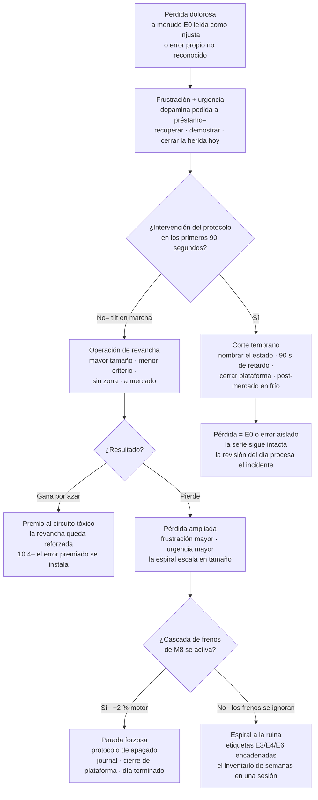

# Lección 10.5 · Sesgos cognitivos — los cuatro que operan tu cuenta (y sus antídotos)

| Campo | Detalle |
|---|---|
| ⏱️ Duración estimada | 50–65 min de estudio |
| 🧱 Módulo | [M10 · Psicotrading Científico](README.md) |
| ⬅️ Anterior | [Lección 10.4 · Pérdida ≠ Error](leccion-10-4.md) |
| ➡️ Siguiente | [Lección 10.6 · Estoicismo operativo](leccion-10-6.md) |

---

## Por qué importa

En 9.1 auditaron los tres sesgos que contaminan el **backtest** (supervivencia, data-mining, look-ahead) — sesgos de evidencia, que falsifican lo que crees saber. Esta lección ataca los cuatro que contaminan la **ejecución**: confirman lo que ya crees, inflan lo que confías, congelan lo que esperas y encienden lo que resientes. Son los sesgos del dato vivo — operan en los segundos y minutos de la decisión real, y por eso no se combaten con conocimiento general (saber que existen no impide sufrirlos: es el efecto de "sesgo ciega al sesgo" — la literatura muestra que conocer los sesgos apenas mejora el propio desempeño). Lo que sí funciona es lo que este programa ya construyó: **protocolos externos** que toman la decisión en el lugar donde el sesgo la tomaría. Esta lección no te "enseña" los cuatro sesgos para que los evites con voluntad — te los enseña para que reconozcas, en cada uno, qué pieza de tu infraestructura (journal v1, checklist, pre-compromiso, cascada de frenos) es su antídoto concreto, y para que el acta semanal los audite por nombre. Si terminas con una sola idea: **un sesgo no se vence mirándolo — se vence con una regla que lo hace irrelevante en el momento de la decisión.**

## Concepto

**Sesgo 1 — Confirmación (*confirmation bias*).** Buscas, notas y recuerdas la información que apoya tu posición activa (o tu tesis pendiente), y descuentas la que la contradice. En ejecución: con posición compradora, lees el quiebre de estructura alcista en un gráfico que un neutro leería como distribución; descartas el volumen divergente "porque H4 manda"; la noticia adversa "está descontada". Su forma más sutil: **preparar el argumento antes de mirar el dato** — abrir el gráfico "sabiendo" que la zona va a aguantar. Antídoto: (1) el **checklist con condiciones sí/no escritas ANTES** — la definición operativa de setup válido (9.2) elimina el espacio donde la confirmación decide: cada condición es verificable por un tercero; (2) el **caso contrario obligatorio**: antes de disparar, una línea por escrito del escenario que invalida la operación ("si pierde 1,0812 con cierre, la idea muere") — escribirlo activa el procesamiento que la confirmación evita; (3) el journal: el registro de no-disparos con razón "duda" repetida delata la confirmación crónica en el acta.

**Sesgo 2 — Exceso de confianza (*overconfidence bias*).** Tras una racha ganadora, tu cerebro atribuye el resultado a tu habilidad y el azar queda fuera de la contabilidad — el WR "real" que percibes sube aunque tu muestra no cambió. Consecuencias medibles: el tamaño sube (la avaricia #3), el techo de operaciones se ignora (#5), y la "certeza" transforma tu expectativa de la operación siguiente de "probable" a "debida" — exactamente el error del axioma 3 (10.2). La evidencia empírica del oficio es consistente: los periodos de mayor sobreconfianza siguen a las mayores rachas, y las mayores pérdidas siguen a la sobreconfianza. Antídoto: (1) la **serie como unidad** (10.2): tras 5 ganadoras, tu probabilidad de la siguiente sigue siendo 40 % — el journal lo recuerda con el WR histórico en la cabecera; (2) la **regla de tamaño fija**: el sizing sale de la calculadora (M8), nunca de la sensación del día — la calculadora no sabe que vas ganando; (3) en el acta semanal: la métrica "riesgo medio real vs 1 %" — la sobreconfianza se detecta ahí antes que en la cuenta.

**Sesgo 3 — Anclaje (*anchoring bias*).** El primer número que tu cerebro recibe se convierte en el centro de gravedad de todas tus estimaciones — aunque sea irrelevante. En ejecución: el precio de entrada de TU operación ancla tu lectura ("compré en 1,0820, por debajo de eso es 'barato'") cuando el mercado ya no sabe que compraste; el TP que imaginaste ancla la gestión aunque la estructura cambió; el máximo del día ancla "cuánto debería correr". El anclaje es el sesgo de los niveles "sentidos": "está caro" / "está barato" son siempre comparaciones contra un ancla, no contra estructura. Antídoto: (1) los **niveles del sistema, no los tuyos**: tu componente 3 define zonas por estructura verificable (M5), no por tu precio de entrada — si el BOS se rompe, tu ancla se rompe con él y la gestión sigue la regla, no el precio de compra; (2) **cero negociación con el SL**: el SL se define antes de entrar por la geometría de la zona (8.4) — el anclaje post-entrada ("está casi, le doy aire") es la etiqueta E3; (3) en la revisión: contrastar tus niveles del journal con los que un neutro habría dibujado (la revisión simulada con tu agente auditor existe para esto).

**Sesgo 4 — Revancha (*revenge trading* / tilt).** El único de los cuatro que es una secuencia temporal completa — por eso merece su mapa:

La mecánica del tilt es la unión de todo lo que ya sabes: la pérdida activa la amígdala (10.1), el "recuperar" es la avaricia #3 con marketing de miedo #2 (10.3), el premio ocasional de la revancha refuerza el circuito (10.4) — y la única barrera estructural es la **cascada de frenos de M8**: −2 % de cartera en el día → la plataforma se cierra POR REGLA, no por decisión. El tilt es la razón de que esa cascada exista: en su punto álgido, tu PFC no puede apagarte — necesita que la regla lo haga. Antídoto resumido: (1) el **protocolo post-pérdida de 90 segundos** (10.1: nombrar, respirar, posponer) aplicado SISTEMÁTICAMENTE tras toda pérdida > 1R o con carga emocional; (2) la **cascada activa** (M8: los topes configurados en la plataforma, no en tu cabeza); (3) en el journal: las etiquetas E3/E4/E6 encadenadas en una misma sesión son la firma del tilt — el acta las busca por patrón horario (las sesiones de tilt viven en los minutos posteriores a pérdidas).

**Los cuatro, en una tabla de auditoría** — para que el acta semanal los busque por nombre:

| Sesgo | Pregunta de auditoría del acta | Firma en el journal | Antídoto estructural |
|---|---|---|---|
| Confirmación | ¿Cuántas señales validé con "más miradas" en vez de con el checklist? | No-disparos con razón "duda" tras condiciones cumplidas | Checklist sí/no + caso contrario por escrito |
| Exceso de confianza | ¿Mi riesgo medio real esta semana fue el 1 % declarado? | Filas con E4 tras rachas ganadoras | Calculadora + tamaño fijo + WR histórico a la vista |
| Anclaje | ¿Gestioné contra el plan o contra mi precio de entrada? | E3 (SL movido) y E5 (gestión improvisada) post-entrada | Niveles por estructura + SL inmodificable |
| Revancha | ¿Hubo entradas en los 10 min posteriores a una pérdida > 1R? | E1/E4/E6 encadenadas con sello horario | Protocolo de 90 s + cascada de M8 |

## Analogía

El juez que ya decidió. Imagina un tribunal donde el juez, antes de oír el caso, le susurra a la fiscalía: "estoy casi seguro de que el acusado es culpable — tráiganme lo que lo confirme". Nadie aceptaría eso como justicia; todos lo practicamos como lectura de mercado. El sesgo de confirmación es exactamente ese juez: la tesis ("esto va a subir") contrata la evidencia en lugar de evaluarla. Los sistemas judiciales lo resolvieron con **procedimiento, no con virtud**: el juez no elige qué admite (reglas de evidencia), la defensa tiene palabra garantizada (el caso contrario obligatorio), y el veredicto se firma con MOTIVACIÓN escrita que un tercero puede auditar (tu journal). Cada pieza procedural existe porque en algún momento un juez real falló con su sesgo intacto y su conciencia limpia. Tu trading necesita el mismo escepticismo sobre sí mismo: el checklist es tu regla de admisión de evidencia, el caso contrario es tu defensa garantizada, y el journal con etiquetas en caliente es tu veredicto auditable. El trader que funciona "por intuición" es el tribunal sin procedimiento: a veces acierta, nunca sabe por qué, y no puede mejorar porque no tiene registros de sus errores.

## Cómo se hace: el circuito anti-sesgo en la sesión real

1. **Antes de la sesión (3 minutos):** escribe el **caso contrario del día** — "el escenario que invalidaría mi sesgo direccional hoy es…". Si no puedes escribirlo, no tienes una tesis: tienes un deseo con gráfico.
2. **En cada señal (checklist + 1):** el checklist de los componentes 1-8 (9.2) **más la pregunta ancla-cero**: *"¿esta decisión cambiaría si no tuviera posición abierta / si no hubiera visto el máximo de hoy?"* Si la respuesta es no, la decisión es del ancla, no del plan.
3. **Tras cada pérdida que duela (90 segundos, no negociables):** nombrar el estado en voz alta → cronómetro de 90 s sin tocar la plataforma → al terminar, la pregunta de la matriz: "¿hay señal válida con checklist completo?" — sí: se ejecuta normal; no: se cierra la plataforma o se pasa a observación. El timer es la pieza clave: corta la urgencia (la fase donde el tilt contrata).
4. **En el acta semanal (5 minutos):** las 4 preguntas de auditoría de la tabla de arriba, por nombre de sesgo — no "¿cómo me sentí?", sino "¿cuántas veces apareció la firma?". Los sesgos que no se cuentan no se gestionan; tu objetivo de la semana siguiente nace de la fila más caliente.

## Error común

**(1) "Yo conozco los sesgos, a mí no me atrapan."** Ese es el sesgo de punto ciego (*bias blind spot*) — el meta-sesgo medido que muestra que conocer sesgos no protege de sufrirlos; solo la estructura en el momento de la decisión protege. El conocimiento sin protocolo es la receta del "ya sabía que no debía". **(2) Combatir la revancha con promesas.** "Nunca más opero enojado" — la promesa es volitiva y el tilt ocurre cuando la voluntad ya perdió el volante; la solución es la cascada de M8 configurada EN la plataforma: el tope diario que cierra el acceso. Promesa = planes; cascada = ingeniería. **(3) Confundir convicción con confirmación.** Tu sistema SÍ tiene una tesis por operación (el BOS, la zona) — la diferencia es que la tesis del sistema viene con condiciones de invalidación escritas de antemano; el sesgo convence SIN condiciones de salida ("solo si cae más"). Prueba rápida: ¿sabes en qué precio exacto tu idea está muerta? Si no, es confirmación. **(4) Auditar los sesgos solo en las semanas malas.** El acta de la semana GANADORA es la más importante para exceso de confianza — la firma (riesgo medio subiendo, techo rozado) aparece ahí, camuflada por el P/L verde. Las semanas rojas auditan la revancha; las verdes auditan la confianza. **(5) Esperar que el antídoto se sienta bien.** El caso contrario obligatorio y el timer de 90 s son incómodos por diseño: interrumpen el circuito que quería seguir. La comodidad de la decisión sesgada es exactamente el costo del protocolo — y la razón de que los amateur lo salten.

## Conexión cuantitativa

**Hacia M8:** la revancha es el caso de uso de la cascada (−2 % motor / −4 % semana / −6 % mes): sin frenos mecánicos, el tilt escala en tamaño exactamente cuando tu criterio está en su mínimo — el diseño de la cascada asume tu peor versión. **Hacia 9.3:** los sesgos tienen métrica: confirmación → disparos debidos vs ejecutados; confianza → riesgo medio real; anclaje → deriva R planificado vs real; revancha → etiquetas encadenadas por sello horario. Tu reporte mensual puede incluir los cuatro números — la psicología entra al mismo tablero que la estadística. **Hacia 10.6:** los cuatro sesgos comparten raíz: el yo en el centro de la decisión (mi tesis, mi racha, mi entrada, mi recuperación) — la dicotomía del control de la siguiente lección es la desarmadura general que los deja sin combustible. **Hacia la Evaluación N3:** los casos socráticos de tilt y FOMO te pedirán identificar el sesgo, su antídoto y QUÉ HUBIERAS HECHO con tu journal delante — ensaya con tus 10 sesiones reales: cada E1/E3/E4/E6 es un caso de examen que ya viviste.

---

## 🎯 Puntos clave

1. Los sesgos de ejecución no se vencen con conocimiento (sesgo de punto ciego) sino con **estructura en el momento de la decisión**: checklist, calculadora, niveles de estructura, cascada.
2. Confirmación se corta con condiciones sí/no + **caso contrario escrito**; confianza se corta con **tamaño fijo** y la serie como unidad; anclaje se corta con **SL inmodificable** y gestión por estructura; revancha se corta con el **timer de 90 s + cascada de M8**.
3. El tilt es una secuencia temporal mapeable — su ventana crítica son los **90 segundos post-pérdida** y su barrera final son los frenos mecánicos, no tu carácter.
4. Las ganancias de la revancha (por azar) refuerzan el circuito tóxico: el tilt que "salió bien" es la 10.4 aplicada — se registra con la misma gravedad que una pérdida grande.
5. El acta semanal audita los cuatro **por nombre y con métrica**: semanas rojas buscan revancha, semanas verdes buscan confianza.

## 🔄 Autoevaluación rápida

1. Señala el sesgo dominante en cada caso y su antídoto estructural: (a) "el volumen bajo no importa, la estructura es clara"; (b) tras 6 ganadoras, subes el lote de 0,06 a 0,10 "porque el sistema está caliente"; (c) tu SL salta por 3 pips y re-entras "al mismo nivel, es obvio que aguanta"; (d) a los 4 minutos de perder 1R entras en el mismo par, dirección contraria, con el doble de lote.
2. Calcula el costo en R del caso (b) si la racha caliente termina: 4 operaciones con lote inflado (riesgo 1,67 % vs 1 %) y todas E0 (−1R cada una en su R). ¿Qué porcentaje de inventario adicional quemó la sobreconfianza vs el tamaño correcto? *(Cuenta 10 000 $, 1 % = 100 $, riesgo inflado = 167 $.)*
3. ¿Por qué el timer de 90 segundos es más eficaz que la promesa "no opero enojado"? Explica con el hardware de 10.1 y con la secuencia del mermaid: en qué paso exacto actúa cada uno.

Ver respuestas

1. (a) **Confirmación**: la "claridad" descuenta evidencia contraria → antídoto: checklist sí/no + volumen como condición escrita (o fuera del sistema, pero decidido antes). (b) **Exceso de confianza**: el azar de la racha reatribuido a habilidad → antídoto: calculadora (tamaño fijo 1 %) + WR histórico en cabecera. (c) **Anclaje**: tu entrada es el centro de gravedad y el nivel "obvio" es TU nivel → antídoto: SL inmodificable (E3 registrada) y re-entrada solo si el sistema redefine la zona. (d) **Revancha**: la secuencia completa en un clic → antídoto: timer de 90 s + cascada de M8 (si el día ya tocó −2 %, la regla ya decidió: no hay acceso).
2. Tamaño correcto: 4 × (−100 $) = −400 $ = −4,0 % de la cuenta… cuidado: en R del sistema son 4 E0 de −1R con 1 % → −4 % total. Con sobreconfianza: 4 × (−167 $) = −668 $ = −6,68 %. Costo adicional de la sobreconfianza: **268 $ = 2,68 % de inventario extra** (el 67 % más de daño). Traducción al registro: 4 filas E0 correctas vs 4 filas E4 — mismas señales, mismo mercado, mismas pérdidas de serie: la única diferencia es el sesgo, y costó dos tercios más. Es el argumento cuantitativo definitivo de por qué el sizing sale de la calculadora y no de la sensación.
3. La promesa opera en la PFC consciente — y el tilt ocurre justo cuando la amígdala ya secuestró el control (10.1): la promesa está disponible mientras la parte que la hizo sigue al mando, y desaparece de la mesa en la fase crítica. El timer es **procedimiento externo con física**: un cronómetro y la regla de no tocar la plataforma operan aunque la PFC esté degradada — funcionan como el freno mecánico que no negocia con el conductor. En el mermaid: la promesa intenta actuar en el nodo C ("¿interviene el protocolo?") pero con el hardware ya invertido; el timer corta la transición B→D (la urgencia antes de la operación de revancha); y si el tilt ya avanzó (D→G), la cascada de M8 actúa en H — por eso el programa apila las tres capas: impedir (temperatura), cortar (timer), cerrar (cascada).

