# Lección 10.7 · Rutina y hábitos — la arquitectura diaria del rendimiento sostenible

| Campo | Detalle |
|---|---|
| ⏱️ Duración estimada | 45–60 min de estudio |
| 🧱 Módulo | [M10 · Psicotrading Científico](README.md) |
| ⬅️ Anterior | [Lección 10.6 · Estoicismo operativo](leccion-10-6.md) |
| ➡️ Siguiente | [🧪 Laboratorio del módulo](README.md#-laboratorio--diario-emocional-y-temperatura-pre-sesión) |

---

## Por qué importa

Tienes el hardware (10.1), los miedos desarmados (10.2), las avaricias contenidas (10.3), el juicio de proceso (10.4), los sesgos con antídotos (10.5) y la filosofía (10.6). Falta la pieza que convierte todo eso en un día real, repetible, sostenible: la **arquitectura de la jornada**. La razón es fisiológica y ya la conoces: tus recursos de ejecución (PFC, atención, control de impulsos) son limitados y decaen con el uso — el profesional no gestiona "su carácter" a lo largo del día; gestiona su **energía prefrontal**: la protege con el sueño, la concentra en la ventana donde el mercado paga (los picos de volumen), la ahorra delegando decisiones en el sistema, y la recupera con un cierre ritual que impide que el mercado viva en tu cabeza hasta la madrugada. Esta lección une las piezas dispersas de todo el programa (la tabla de sesiones de 2.5, la ventana de ejecución que 10.1 introdujo, el post-mercado que 10.6 esbozó) en una rutina única — el esqueleto sobre el que la misión M-10 ejecutará tus 10 sesiones. Si terminas con una sola idea: **el rendimiento no es lo que haces en la pantalla — es lo que construyó tu cerebro esa mañana y lo que le dejas recuperar esa noche.**

## Concepto

**La rutina completa del día de trading, en un mapa:**

```mermaid
flowchart LR
    subgraph PRE["BLOQUE PRE-SESIÓN · 15 min<br/>construye el cerebro que decide"]
        P1["Verificación de sueño<br/>temperatura– dimensión 1"] --> P2["Estrés y apego al resultado<br/>dimensiones 2 y 3"]
        P2 --> P3{"¿Temperatura califica?"}
        P3 -- "Verde ≥ 7/9" --> P4["Plataforma abierta<br/>premeditatio · caso contrario<br/>metas de proceso del día"]
        P3 -- "Ámbar 4-6/9" --> P5["Sesión reducida<br/>riesgo a la mitad · máx 2 disparos"]
        P3 -- "Rojo ≤ 3/9" --> P6["NO SE OPERA<br/>observación o repaso<br/>registro en el diario"]
    end
    subgraph SESION["VENTANA DE EJECUCIÓN · máx 3 h en picos"]
        S1["Solo TF y sesiones del plan<br/>contador de decisiones visible"] --> S2{"Señal con checklist<br/>completo?"}
        S2 -- "Sí" --> S3["Ejecutar protocolo<br/>sizing de calculadora · SL intacto"]
        S2 -- "No" --> S4["Inacción estratégica<br/>la posición correcta es estar fuera"]
        S3 --> S5["Gestión de plan<br/>sin improvisación post-entrada"]
    end
    subgraph POST["BLOQUE POST-SESIÓN · 10-15 min<br/>recupera el cerebro para mañana"]
        A1["Cierre de aperturas nuevas<br/>las abiertas quedan en plan"] --> A2["Journal completo en caliente<br/>etiquetas · emocional post"]
        A2 --> A3["Juicio de proceso + recibo de varianza<br/>10.6– dos columnas separadas"]
        A3 --> A4["Plataforma cerrada físicamente<br/>frase de cierre– el día terminó"]
    end
    P4 --> S1
    P5 --> S1
    S5 --> A1
    S4 --> A1
```

**El sueño como inversión de PFC (la variable que decide antes de que entres).** La noche anterior fabrica al operador de hoy: la privación de sueño (< 6 h) degrada la función prefrontal — planificación, control de impulsos, lectura de riesgo — mientras la reactividad límbica permanece intacta (10.1: despierto pero desgobernado). La consecuencia operativa no es "duerme bien por salud" sino una regla de negocio con número: **el sueño es la dimensión 1 de tu temperatura pre-sesión, y una noche mala reduce el riesgo del día** — no por castigo, por aritmética: operas con el instrumento que tienes. La disciplina del sueño no es estilo de vida: es la mitad "fuera de horario" del plan de trading, y en el journal de la misión M-10 verás el patrón en tus propios datos (sesiones con sueño rojo → sesiones con etiquetas de error — la correlación que la Evaluación N3 examinará).

**La ventana de ejecución: concentrar la energía donde el mercado paga.** Tu plataforma de sesiones (2.5) ya identificó los picos de liquidez de TU mercado: solapamiento Londres-Nueva York para forex (aprox 14h-17h hora Bolivia, ajustado por el horario de verano), apertura NY para índices, los tramos de alta actividad para tu instrumento. La regla del programa: **la ejecución activa se concentra en esos picos con un máximo de ~3 h y ~10-12 decisiones activas** (entradas, gestiones, cierres — las miradas no cuentan). Dos razones que se suman: (1) la **calidad de la señal** — fuera de los picos tu sistema (diseñado en H1/H4 con estructura) no dispara mejor por más que mires: el ruido crece y la fatiga también, la peor proporción posible; (2) la **decaencia del recurso decisional** — cada decisión gasta; a partir del límite, las decisiones siguen saliendo pero bajan de calidad sin que lo percibas (el déficit no se siente: se mide — por eso el contador es visible, no mental). El trader que opera 8 h "por dedicación" ejecuta su peor trading en el tramo 5-8 y lo llama experiencia.

**La fatiga decisional y el arte de no gastar.** Las decisiones del día se reparten en dos clases: las que PAGAN (disparar un setup validado, gestionar según plan) y las que COBRAN (decidir mirando, recalcular por ansiedad, dudar post-entrada). La arquitectura anti-fatiga delega todo lo repetitivo en estructura: el sizing sale de la calculadora (cero decisiones), el SL y TP salen de la geometría del componente (cero decisiones), la gestión sale del plan (cero decisiones por vela). Lo que queda para tu PFC es lo único que la justifica: **verificar el checklist y ejecutar**. Regla práctica de ahorro: si una decisión se repite idéntica cada día, se convierte en regla escrita; si una decisión aparece más de dos veces por sesión SIN señal del sistema, es la fatiga cobrando por adelantado.

**La inacción estratégica como posición.** La lección que más cuesta interiorizar (y la que más esperanza protege): **no estar en el mercado ES una posición** — la que tu sistema recomienda el ~70-90 % del tiempo *(para sistemas de H1/H4 con 2-3 disparos por semana)*. No es esperar "sin hacer nada": es ejecutar activamente la decisión de no exponer inventario cuando no hay ventaja — la misma lógica del "cash es una posición" de los gestores. Sus tres formas legítimas: (1) el día sin señales (se ejecuta la observación, se registra en el diario, se termina); (2) la señal fuera de criterio (la duda es un no — 9.2); (3) el bloque de sesión que no califica (temperatura ámbar/roja). El amateur lee la inacción como pérdida de tiempo; el profesional la lee como **protección de la esperanza ya fabricada**: cada día sin operar fuera de sistema es un día que tu E +0,16R no se diluyó.

**El protocolo post-mercado: cerrar para abrir mañana.** Los 4 pasos del bloque POST del mapa: (1) **cierre de aperturas nuevas** — no se entra a nada después de la hora de corte (las posiciones abiertas quedan en gestión de plan, con su SL intacto); (2) **journal completo en caliente** — etiquetas, emocional post, notas de ejecución: la memoria del trader se corrompe en horas (la reconstrucción nocturna embellece: el registro en caliente es la única evidencia honesta); (3) **juicio de proceso + recibo de varianza** (10.6) — la única puntuación del día es tu columna izquierda; (4) **cierre físico y ritual** — plataforma cerrada, notificaciones fuera, frase de cierre. El paso 4 protege el activo más subestimado del oficio: **la recuperación** — el sueño de esa noche es el PFC del día siguiente, y el bucle de pantalla nocturna ("veo un minuto más") es exactamente el cortisol pidiendo más cortisol (10.1). El profesional cierra porque sabe qué comprará al despertar.

**Hábitos de la base (el pedestal, no la sesión).** Tres soportes con evidencia sostenida y implicación directa: **sueño regular** (horarios estables potencian la calidad — el regulador circadiano premia la consistencia), **ejercicio físico moderado regular** (mejora medible de la función ejecutiva y de la regulación emocional — el antídoto fisiológico más barato contra el cortisol crónico) y **bloques de pantalla fuera del mercado** (la recuperación atencional necesita desenganche real: el "descanso" con el gráfico en el móvil no es descanso). Nada de esto es asesoría médica ni se mide en R: es el pedestal sobre el que la sesión existe — el programa lo declara porque tu journal lo va a revelar igual.

## Analogía

El atleta y la semana de competición. El sprinter profesional no entrena intensivo el día de la final: su semana está diseñada al revés de lo que el amateur imagina — pico de carga días antes, descarga total antes, calentamiento protocolizado el día D, y después: descanso estructurado, nutrición, sueño — porque el rendimiento se produce en la **recuperación**, no en el esfuerzo. El amateur entrena duro el mismo día de la final, se agota en el calentamiento, compite cansado, y descansa "cuando pueda". Tu jornada de trading es la final de cada día: la ventana de ejecución (3 h) es la pista; el pre-sesión (temperatura + premeditatio) es el calentamiento protocolizado; el post-sesión (journal + cierre) es la recuperación estructurada; y el sueño es la noche anterior a la final. El trader que opera 8 h es el que "entrena" durante la final: confunde horas con rendimiento. El profesional desaparece de la pantalla después de su ventana — y es exactamente ahí, en la recuperación que el amateur desprecia, donde se fabrica el lobo de mañana.

## Cómo se hace: montar tu rutina v1.0 (una semana de calibración)

1. **Fija tus horarios con la tabla de sesiones (2.5):** escribe TU ventana de ejecución (los picos de tu instrumento, máx 3 h) y la hora de corte de aperturas nuevas (30-60 min antes de que cierre la ventana). Hazla visible: una hoja junto a la pantalla con los 3 tiempos (inicio, corte, cierre).
2. **Construye la hoja de temperatura del laboratorio** (este módulo) y úsala desde la primera sesión de la misión M-10: 3 dimensiones con número, umbral verde/ámbar/rojo, y la decisión del día registrada — la hoja es la prueba de que el protocolo decidió, no la sensación.
3. **Instala el contador de decisiones** (papel, pizarra o nota en pantalla): cada decisión activa suma; a 10-12, la sesión entra en modo cierre (nada nuevo, gestión de plan). La primera semana solo MIDE — la segunda ya aplica el corte.
4. **Define tu frase de cierre y tu ritual físico** (cerrar pestañas, apagar monitor, registrar el total en R del día): 60 segundos que enseñan al cerebro dónde termina el trabajo. El objetivo medible: dormir sin el gráfico en la cabeza — si a la tercera semana sigue el bucle, el ritual se ajusta en el acta semanal (es una mejora de ejecución, no un capricho).
5. **Calibra la semana completa en el acta:** ¿cuántos días operaste dentro de la ventana? ¿cuántas decisiones activas en promedio? ¿cuántos cierres rituales completos? Esas 3 métricas son las de rutina de la misión M-10 — y las que el agente auditor pedirá en la Evaluación N3.

## Error común

**(1) "Cuando haya más tiempo, operaré más."** La ventana no crece con el tiempo libre: crece con los picos de TU mercado — un día libre no convierte el rango asiático en Londres, solo multiplica tus decisiones sobre ruido. El tiempo extra se invierte en revisión, backtest o descanso: en la columna izquierda de 10.6, nunca en más pantalla de ejecución. **(2) Postergar el journal "para el final del día".** El registro en caliente existe porque la memoria se corrompe en horas y la reconstrucción embellece (10.4: la etiqueta se asigna en caliente); el journal "al final" es literatura, no registro — y es el campo que más se nota en la auditoría: las etiquetas reconstruidas son siempre más generosas. **(3) Creer que la rutina mata la flexibilidad.** El mapa fija el ESQUELETO (ventana, temperatura, registro, cierre); deja libre TODO lo que el mercado decida dentro (señales, gestión, inacción). La flexibilidad sin esqueleto es improvisación con buena imagen: lo que se ajusta cada día, se degrada cada día — lo que se ajusta en la ventana mensual (9.6), evoluciona. **(4) Operar la ventana de otro.** "Mi amigo opera NY y le va bien" — su ventana es su instrumento y su sistema; el tuyo salió de TU tabla de sesiones (2.5) y TU estructura (H1/H4). Cambiar de ventana es cambiar de sistema: se hace en la ventana de modificación con evidencia, no por imitación. **(5) Saltarse el cierre en los días buenos.** El post-mercado se ejecuta TODOS los días — especialmente los ganadores: es donde la sobreconfianza (10.5) se detecta antes (riesgo medio subiendo, techo rozado) y donde el premio correcto (proceso) se refuerza. El día bueno sin cierre es el día que entrena el circuito equivocado.

## Conexión cuantitativa

**Hacia 2.5:** tu ventana de ejecución son los picos de TU tabla de sesiones traducidos a tu hora local (Bolivia, UTC-4): en forex, el solapamiento Londres-NY (aprox 14h-17h hora Bolivia en horario de verano, ~13h-16h en invierno) — verifica el ajuste estacional en tu plataforma, no en memoria. **Hacia 8.8 / M8:** el corte de aperturas nuevas y la gestión de plan son la versión diaria de tus frenos: la cascada cierra por pérdida acumulada; la ventana cierra por reloj — dos relojes distintos, misma función: cortar el daño cuando el criterio ya no está a la venta. **Hacia 9.6:** las 3 métricas de rutina (días en ventana, decisiones promedio, cierres completos) entran al acta semanal junto a las etiquetas y los disparos — la rutina se audita con la misma seriedad que la estadística. **Hacia la Evaluación N3:** tus 10 sesiones de la misión M-10 serán la evidencia: temperaturas registradas, ventanas respetadas, cierres completos — la entrevista pedirá correlaciones, no intenciones ("¿qué pasó con tus etiquetas de error los días de temperatura roja?").

---

## 🎯 Puntos clave

1. El rendimiento diario se fabrica FUERA de la pantalla: **sueño → temperatura → ventana concentrada → registro → cierre ritual → recuperación** — el esqueleto fijo deja libre todo lo que el mercado decida dentro.
2. **Ventana de ejecución: máx ~3 h en los picos de tu mercado y ~10-12 decisiones activas** — la calidad de señal crece en los picos y la fatiga decisional crece fuera de ellos: la peor proporción es operar de más.
3. **La inacción estratégica es una posición**: para sistemas H1/H4 con 2-3 disparos/semana, estar fuera es la recomendación del sistema el 70-90 % del tiempo — protege la esperanza ya fabricada.
4. El journal en caliente y el cierre físico no son burocracia: son la evidencia honesta (la memoria corrompe) y la protección del activo que decide mañana (el sueño fabrica la PFC de hoy).
5. Toda decisión repetitiva se convierte en regla escrita — la PFC se reserva para lo único que la justifica: verificar el checklist y ejecutar.

## 🔄 Autoevaluación rápida

1. Tu ventana de pico es 14h-17h. A las 16h50 tienes una posición abierta en +0,4R y aparece una señal válida para entrar. ¿Qué dice la regla de corte y qué haces con cada pieza (señal, posición, registro)? ¿Y si la señal aparece a las 16h20?
2. Calcula el costo de decisional de una semana "activa": 5 días × 8 h con ~25 decisiones diarias, donde a partir de la decisión 12 la calidad decae (asume que las primeras 12 tienen el E del sistema y las restantes E = −0,08R). Compárala con la semana en ventana: 5 días × 3 h, ~8 decisiones dentro de sistema. ¿Qué semana protege mejor la esperanza de 20 operaciones/mes del caso maestro?
3. Un trader justifica operar fuera de ventana: "así descubro más señales". Refuta con las dos razones de la lección (calidad de señal y decaencia del recurso) y con el dato de dilución de 10.3 — ¿qué le estás protegiendo exactamente al decir "no"?

Ver respuestas

1. A las 16h50: la señal es INEXISTENTE operativamente — estás a 10 min del corte; ejecutarla ahora significaría abrir una posición cuyo inicio de gestión cae fuera de tu ventana (el corte existe para no gestionar cansado). Acción: registrar en el diario como señal fuera de ventana (no-disparo con razón "horario"), la posición abierta queda en gestión de plan (SL/TP intactos) y el journal se cierra en su hora. A las 16h20: la señal es válida y está DENTRO de la ventana — se ejecuta el protocolo completo (checklist, calculadora, registro en caliente); el corte de 16h30-17h (si lo definiste así) aplica a las SIGUIENTES: nada nuevo después de la hora de corte, pero la última señal dentro de la ventana es legítima. La diferencia entre ambas es de 30 minutos — y es exactamente la diferencia entre ejecutar el sistema y forzar la franja.
2. Semana activa: 25 decisiones/día × 5 = 125. Con las primeras 12 en sistema (E +0,16R neto) y las 13 restantes en ruido (−0,08R): E diaria = 12 × 0,16 + 13 × (−0,08) = 1,92 − 1,04 = +0,88R; semanal = +4,4R… pero ojo: esas 65 decisiones de ruido también CONSUMEN el techo y la fatiga, y diluyen la muestra. Semana en ventana: 8 × 0,16 = +1,28R diaria = +6,4R semanal CON 40 decisiones menos, cero dilución y la energía intacta para revisión. La ventana no solo protege la esperanza — la AMPLÍA (+45 % en este modelo ilustrativo) mientras reduce el trabajo y las etiquetas de error. Y en el límite real: el mes de 20 operaciones del sistema se ejecuta igual en ambas semanas — la diferencia es cuánto ruido añades al camino.
3. Las dos razones: (1) CALIDAD — tu sistema fue diseñado y validado sobre estructura de H1/H4 en picos de liquidez; fuera de ventana no "descubre" señales: descubre ruido con forma de señal, y la duda es un no; (2) RECURSO — cada decisión fuera de ventana gasta la fatiga que la ventana real necesita; llegas al pico con el instrumento a medio cargar. Y el dato de 10.3: cada operación de ruido tiene E ≈ −0,08R — "descubrir más señales" cuesta −0,08R por descubrimiento y diluye la muestra que M9 validará. Lo que proteges con el NO: la esperanza +0,16R por operación, la integridad de la muestra, y la energía prefrontal que el pico pagará — es decir, el negocio entero.

