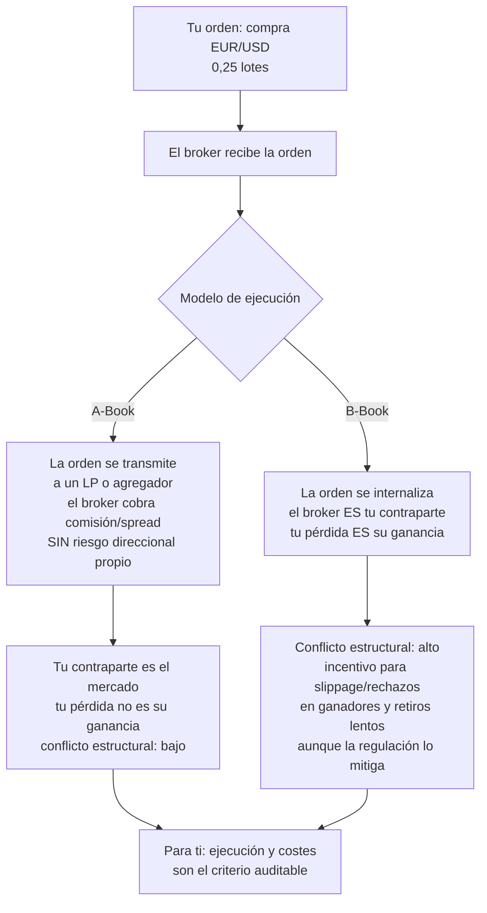

# Lección 11.1 · Brokers de verdad — la infraestructura no se elige con publicidad

| Campo | Detalle |
|---|---|
| ⏱️ Duración estimada | 45–60 min de estudio |
| 🧱 Módulo | [M11 · La Industria](README.md) |
| ⬅️ Anterior | [Lección 10.7 · Rutina y hábitos](../mod-10-psicotrading-cientifico/leccion-10-7.md) |
| ➡️ Siguiente | [Lección 11.2 · Radar de estafas](leccion-11-2.md) |

---

## Por qué importa

Con el N3 cerrado, tu negocio necesita el último proveedor que todavía elegiste por omisión: el broker. Es el concesionario de tu acceso al mercado, el custodio de tu capital y el cobrador de tus costes — y la mayoría de los principiantes lo elige por un anuncio, un bono o la recomendación de quien le vendió un curso. Esta lección te da los criterios **universales** de selección (sin marcas, sin afiliados): qué significa realmente la regulación, cómo se diferencia un broker que te pasa al mercado (A-Book) de uno que te toma el lado contrario (B-Book) — y por qué el segundo no es necesariamente una estafa pero sí un conflicto de intereses estructural — y los 5 pilares con los que evaluarás cualquier firma en el laboratorio de este módulo. La regla del programa: **la elección de infraestructura se hace con matriz de criterios y evidencia verificable, como cualquier decisión de negocio** — no con testimonios ni con la web más bonita. Si terminas con una sola idea: **tu broker es un proveedor crítico con conflicto de intereses potencial — se audita antes de depositar, no después de retirar.**

## Concepto

**A-Book vs B-Book: el flujo de tu orden.** Cuando presionas "comprar", tu orden no viaja mágicamente al mercado interbancario — el broker decide qué hacer con ella:

Lo importante es la honestidad del mapa: el **B-Book** (*market maker* interno) es legal, común y hasta funcional (ofrece spreads bajos y ejecución instantánea en tamaños pequeños) — no es una estafa por definición. Pero es un **conflicto de intereses estructural**: el modelo de negocio del broker gana cuando tú pierdes, y hay que compensarlo con regulación fuerte, historial de retiros y transparencia. Muchos brokers operan modelos híbridos (A-Book para cuentas grandes/ECN, B-Book para minoristas). Tu defensa no es "evitar B-Book a toda costa": es **saber qué modelo usas, verificar la regulación correspondiente y auditar tu ejecución real** (el coste medio por operación del journal v1 ya lo mide).

**Regulación: qué protege y qué NO.** Un regulador estricto (en el espectro clásico: FCA Reino Unido, BaFin Alemania, ASIC Australia, CFTC/NFA EE. UU., FINMA Suiza; CySEC como término medio europeo) exige: segregación de fondos del cliente en cuentas bancarias separadas del capital de la firma, pertenencia a fondo de compensación (indemnización si el broker quiebra), reportes financieros periódicos, prohibiciones de práctica (bonos con letra pequeña, incentivos agresivos) y un canal de disputa con teeth. Lo que la regulación NO garantiza: que no pierdas operando (eso es tu gestión), ni que el spread sea el mejor (eso es tu auditoría de costes). El otro extremo del espectro — jurisdicciones **offshore** con licencias "de registro" (St. Vincent, Marshall Islands, Vanuatu en su versión blanda) — ofrece al broker bajos costes y a ti casi nada: la "regulación" existe en papel pero sin segregación exigible, sin fondo de compensación y sin supervisión real de la ejecución. No es ilegal operar ahí; es **asumir el riesgo de custodia completo por tu cuenta**, frecuentemente a cambio de un spread ligeramente mejor: la aritmética exacta del risk creep (10.3) aplicada a la infraestructura.

**Los 5 pilares de selección** *(criterios universales — la rúbrica del laboratorio los convierte en puntuación)*:

| Pilar | Qué auditar | Evidencia verificable |
|---|---|---|
| 1. Regulación | Licencia REAL en el registro público del regulador (no el logo en la web); entidad legal exacta que te abrirá la cuenta; segregación y fondo de compensación | Búsqueda del número de licencia en el registro oficial; warn lists del regulador |
| 2. Ejecución | Modelo (A/B/híbrido), slippage típico, rechazos, requotes, velocidad de la orden | Cuenta demo + tu propio registro de ejecución; auditoría del journal |
| 3. Costos | Spread real de TU instrumento y TU sesión, comisión por lote, swap, costes ocultos de conversión | Comparativa de 2 semanas midiendo el coste medio por operación (M9) |
| 4. Retiros | Velocidad documentada, comisiones, condiciones de los bonos (letra pequeña), historial de problemas públicos | Reglas escritas del retiro + reseñas de incidencias (con sesgo: buscas patrones, no anécdotas) |
| 5. Soporte | Respuesta en TU idioma y TU horario, canales, resolución de disputas | Prueba real: pregunta 2 técnicas antes de abrir cuenta |

**El conflicto de los afiliados.** Casi todo el contenido "comparativo" de brokers en la industria paga comisión por referido (CPA o revenue share — el afiliado gana un % de TUS pérdidas en algunos esquemas). Esto no invalida toda la información: invalida su **independencia**. El protocolo del programa: los rankings de afiliados son una pista (quién existe, qué oferta), nunca la evidencia (la evidencia es el registro del regulador + tu auditoría de ejecución). La misma matriz de criterios del laboratorio aplica idéntica a todos los candidatos — sin favoritos.

## Analogía

El banco y el concesionario. Elegir broker eligiendo banco para tu negocio: no lo haces por el calendario de regalos del banco nuevo — haces que esté en el seguro de depósitos, que tenga años de balance público, que te cobre comisiones razonables y que hayas oído de retiros que funcionan. Y elegir tipo de broker eligiendo concesionario: hay vendedores que te venden el coche del fabricante (A-Book: cobran su comisión y punto) y hay vendedores que compran usados y te revenden con margen (B-Book: su ganancia depende del precio que te pongan). El segundo no es un delincuente — hay negocios legítimos de recompra-venta — pero exigirías: licencia de comercio, historial limpio, y que el precio que te ponen sea comparable al mercado. Lo que ningún adulto haría es dar sus ahorros al concesionario con la web más bonita "porque el vendedor parece buena gente".

## Cómo se hace: la pre-selección en 5 pasos (antes del laboratorio)

1. **Define TUS requisitos primero.** Instrumentos que operas (tu sistema), tamaño esperado de posición, horario de tu ventana de ejecución (10.7), moneda de depósito. La matriz se evalúa contra TUS necesidades, no contra "el mejor broker del mundo".
2. **Lista 5-8 candidatos de fuentes MÚLTIPLES** (tu análisis de cursos, rankings independientes, menciones regulatorias) — nunca los 5 primeros de un solo ranking de afiliados.
3. **Verifica la licencia en el registro público del regulador** — número exacto, entidad legal, estado activo, sin sanciones recientes. Si la web dice "regulado en X" y el registro no lo muestra: descartado. Este paso es binario.
4. **Puntúa los 5 pilares con la matriz del laboratorio** (misma rúbrica para todos, con fuente citada por celda).
5. **Prueba en demo 2 semanas** midiendo ejecución real (slippage, coste medio por operación) — el dato que ningún marketing publica es el que TÚ produces. Solo después de la matriz + la prueba se habla de depositar.

## Error común

**(1) "Mejor spread = mejor broker."** El spread es UNA celda de UN pilar: un broker offshore con spread 10 % menor y regulación nula te está cobrando el descuento en riesgo de custodia — la peor transacción de tu carrera si ocurre lo improbable que su probabilidad pagó por ser posible. **(2) Confundir el logo del regulador con la licencia.** "Regulado por FCA" en la web ≠ entidad regulada por FCA; la estafa clásica es clonar la identidad de un broker real. Verificación: el registro público con número de licencia y la entidad EXACTA que firmará tu contrato. **(3) Elegir por el bono de bienvenida.** Los bonos con restricciones de retiro son letra pequeña que amarra tu capital; el profesional compara costes recurrentes (spread × tu volumen), no regalos de entrada. **(4) Creer que "grande" significa "seguro" en cualquier jurisdicción.** El tamaño sin regulación estricta solo significa que tardarán más en caer — la segregación de fondos y el fondo de compensación son lo que protege tu capital, y esos son requisitos regulatorios, no de tamaño. **(5) Cambiar de broker por un mal mes.** El slippage de una sesión de noticias no es evidencia; tu coste medio por operación de 50+ operaciones sí. La infraestructura se cambia en la ventana de revisión (9.6), con datos — y el cambio de broker requiere re-validar la ejecución (el forward del 9.4 se repite parcialmente).

## Conexión cuantitativa

**Hacia M9:** tu coste medio por operación (0,06-0,1R típico) es la métrica que audita este pilar: un broker 0,02R más caro cuesta $0{,}02 \times 20 \times 12 = 4{,}8R$ al año — con tu E +0,16R y 20 operaciones/mes, casi la esperanza de un mes entero. **Hacia 10.3:** la elección offshore por spread es risk creep de infraestructura: ahorro visible, riesgo oculto — la misma firma de las 5 avaricias. **Hacia 11.2:** el broker B-Book sin regulación es el hábitat natural de las estafas de esta lección — la verificación regulatoria es el filtro compartido. **Hacia el laboratorio:** la matriz de due diligence puntuará estos 5 pilares con la misma rúbrica para 3 brokers — y la comparación honesta casi siempre cambia la pre-selección.

---

## 🎯 Puntos clave

1. El broker es un proveedor crítico con potencial conflicto de intereses: **A-Book transmite al mercado; B-Book es tu contraparte** — legal y funcional, pero exige regulación fuerte y auditoría de ejecución.
2. La regulación estricta aporta lo que el dinero no compra después: **segregación de fondos, fondo de compensación, supervisión** — offshore significa asumir el riesgo de custodia completo.
3. Los 5 pilares (regulación, ejecución, costos, retiros, soporte) se auditan con **evidencia verificable por celda** — registro público del regulador incluido, número de licencia y entidad exacta.
4. Los rankings de afiliados son pista, no evidencia: el afiliado a veces gana con TUS pérdidas — la matriz del laboratorio aplica la misma rúbrica a todos.
5. La métrica definitiva es TUYA: el coste medio por operación de tu journal y tu registro de ejecución en demo — 0,02R extra cuesta ~4,8R/año en el perfil del caso maestro.

## 🔄 Autoevaluación rápida

1. Un broker offshore te ofrece spread 20 % menor, apalancamiento 1:1000 y "licencia en el registro de su jurisdicción". Analiza la oferta con los 5 pilares y calcula el ahorro real anual si tu coste medio baja de 0,10R a 0,08R con 20 operaciones/mes — ¿qué riesgo estás aceptando por él y cómo se llama ese intercambio en el vocabulario del programa?
2. Explica por qué el B-Book no es una estafa pero sí un conflicto: qué gana el broker cuando ganas, cuando pierdes, y qué dos salvaguardas compensan el conflicto.
3. Formula la verificación binaria del pilar 1 en 4 pasos (qué buscarías exactamente antes de seguir evaluando un broker) y qué dos hallazgos lo descartan inmediatamente.

Ver respuestas

1. Ahorro: 0,02R × 20 ops × 12 meses = **4,8R/año** (~96 $ con riesgo de 20 $ por R del caso maestro). Lo que aceptas a cambio: sin segregación exigible, sin fondo de compensación, supervisión decorativa — el riesgo completo de custodia sobre tu capital. Nombre en el programa: **risk creep de infraestructura** (10.3): ahorro visible pequeño, exposición oculta grande — la peor proporción del catálogo. La decisión correcta con E +0,16R: 4,8R/año de ahorro no compensa la cola de riesgo de perder el depósito entero por quiebra del broker.
2. En B-Book el broker ES tu contraparte: cuando pierdes, él gana tu pérdida; cuando ganas, él la paga (por eso el conflicto: retiros lentos, slippage en ganadores, rechazos son incentivos estructurales, no paranoias). No es estafa porque el modelo es legal, común y regulable — las dos salvaguardas: **regulación estricta** (supervisión de la ejecución, segregación, canal de disputa con poder) y **tu auditoría de ejecución real** (coste medio, slippage, retiros documentados en TU cuenta). Con ambas, el conflicto queda gestionado; sin ellas, estás jugando devisitado contra la casa.
3. Los 4 pasos: (1) identificar la ENTIDAD legal exacta que abrirá la cuenta (del contrato, no de la web); (2) buscar esa entidad + número de licencia en el registro público del regulador correspondiente; (3) verificar estado activo, alcance de la licencia (instrumentos/servicios) y sanciones o acuerdos recientes; (4) revisar las warn lists del propio regulador y de otros reguladores serios. Descartes inmediatos: la licencia no aparece en el registro (o aparece con otra entidad/estado), y el broker aparece en una warn list — ambos son veredictos binarios, no puntos a ponderar.

