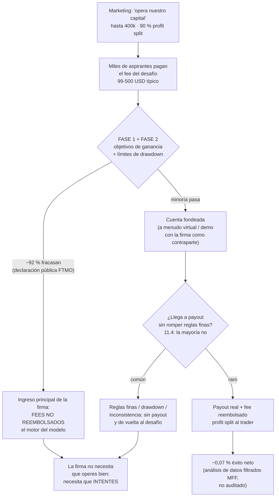

# Lección 11.3 · Prop firms: el negocio real — quien pone las reglas gana las reglas

| Campo | Detalle |
|---|---|
| ⏱️ Duración estimada | 50–65 min de estudio |
| 🧱 Módulo | [M11 · La Industria](README.md) |
| ⬅️ Anterior | [Lección 11.2 · Radar de estafas](leccion-11-2.md) |
| ➡️ Siguiente | [Lección 11.4 · Reglas finas de las prop firms](leccion-11-4.md) |

---

## Por qué importa

Las *proprietary trading firms* minoristas ("prop firms") son el fenómeno de crecimiento más rápido del ecosistema — y la zona con menos alfabetización del trader promedio: miles de participantes pueden explicar las reglas del desafío y casi ninguno puede explicar **el modelo de negocio de quien las pone**. Esta lección hace exactamente eso, con la honestidad que marca el programa: las prop firms no son una estafa por definición (hay firmas serias y reglas que se pagan), pero su economía funciona con un embudo donde **la mayoría del ingreso nace de los fees de quienes fracasan** — y las cifras disponibles son contundentes: la propia FTMO declaró públicamente que ~92 % de sus desafíos fracasan, y el análisis de los datos filtrados de MyForexFunds (no auditado, pero consistente con la estructura del modelo) sugirió que solo ~0,07 % de participantes terminaron con retiro neto positivo. Entender eso no es pesimismo: es el prerrequisito para usar la herramienta correctamente (11.5-11.6) — como **opción de capitalización al final del embudo de la evidencia, no como atajo al principio**. Si terminas con una sola idea: **en una prop firm, el producto que compras es una opción cara con esperanza negativa hasta que tu propia evidencia dice lo contrario — y la firma vende el desafío, no el fondeo.**

## Concepto

**El modelo de ingresos, dibujado completo:**

**Las tres verdades del modelo.** *(1) El cliente que paga es el desafiante, no el fondeado.* La firma vende desafíos; el trader fondeado es el producto de demostración que hace funcionar el marketing ("nuestro trader ganó X"). *(2) La mayoría del ingreso es fee de fracaso.* Con ~92 % de desafíos fallidos, la base económica es la venta de intentos — exactamente la economía de una lotería o de un casino con pasos intermedios. *(3) El "capital" a menudo no es capital real.* Muchas firmas operan cuentas demo con su propio sistema de imitación del mercado (con las reglas finas de 11.4 como mecanismo de control) y te pagan de sus ingresos por fees — legítimo si se paga, pero no estás "operando capital institucional": estás operando una simulación con premio. La honestidad del programa: ninguna de estas tres verdades es ilegal; todas son razones para hacer la aritmética ANTES de comprar.

**La aritmética del aspirante** (con los números públicos del sector). Supón una firma "típica": fee 150 $, objetivo +10 %, drawdown total 10 %, drawdown diario 5 %. Tu probabilidad de aprobar el desafío con un sistema HONESTO (WR 40 %, R:B 2,1, E +0,16R neto — el caso maestro) depende de la varianza, no de la esperanza: el objetivo de +10 % con riesgo 1 % por operación necesita ~10 netas positivas de R, y la racha esperada de ~9 pérdidas seguidas (0,99⁹ ≈ −8,6 % de drawdown) consume casi TODO el límite de 10 % **aun operando bien**. La conclusión estructural: el desafío mide resistencia a la varianza a un límite de inventario que tu propia evidencia (M8: −15 % era tu emergencia) apenas tolera — y por eso las reglas de riesgo dinámico del 11.5 existen: a 0,25-0,5 % por operación la racha completa cuesta 2,25-4,5 %, dentro del límite; al 1 %, la racha normal te descalifica.

$$P(\text{racha } 9) \text{ en el desafío: la varianza, no la esperanza, es la que desaprueba}$$

**El riesgo regulatorio y los colapsos.** El sector vive mayoritariamente en jurisdicciones sin supervisión financiera aplicable (no son brokers: no tocan tu capital de trading — toman fees). Las consecuencias cuando el modelo se estresa o se abusa, documentadas públicamente: **MyForexFunds (MFF)** — operación cerrada por la CFTC estadounidense en 2023 con alegaciones de fraude; **The Funded Trader (TFT)** — crisis de pagos y restructuración en 2024 con retiros congelados durante meses; **True Forex Funds** — cese de operaciones en 2024. *(Fechas y alcances según la cobertura pública del periodo; verifícalos al leer — el punto del programa no es el caso puntual sino la estructura: firmas sin supervisión + pagos dependientes de flujo de fees = riesgo de contraparte que tu due diligence debe cotizar.)* La lección operativa: la prop firm es un **riesgo de contraparte** (pueden no pagarte) que se gestiona con: firmeza regulatoria o historial de pagos verificable, diversificación (nunca toda tu esperanza de capitalización en UNA firma), y tamaño de expectativa acorde (el payout es una opción, no un sueldo).

**Cuándo el modelo ES útil para ti.** Si (y solo si) tu evidencia ya existe — 6-12 meses de consistencia documentada con journal y métricas (11.6) — el desafío se convierte en lo que el marketing dice que es: una evaluación de tus datos reales con premio de capital. En ese punto la aritmética cambia: tu probabilidad de aprobar ya no es la del 92 % (que mezcla principiantes comprando esperanza), sino la que TÚ midiste en tu forward testing — y el fee es el coste de un examen que tu evidencia dice que puedes pasar. La diferencia entre el comprador de esperanza y el profesional es literalmente el embudo completo de M9: **backtest → forward → consistencia → recién entonces, evaluación.**

## Analogía

La escuela de conducir que cobra por intento de examen. Imagina una autoescuela cuyo modelo de negocio es cobrar el examen de conducir por intento: 200 $ por presentarte, reembolsados solo si apruebas Y luego trabajas para su agencia de transportistas. ¿Es estafa? No — si el examen es real y pagan a quienes trabajan. ¿Es para ti? Depende de dónde estás: para el que nunca practicó, es una máquina de cobrar intentos (y el negocio SABE que el 92 % no pasa); para el que ya tiene 100 horas documentadas de práctica con instructor, es simplemente el paso formal para acceder al trabajo. El problema de la industria no es el modelo: es que el marketing del examen se vende como si el "capital grande" fuera el destino, cuando para la casa el destino es el fee del intento. Tu formación FIT-12 te convierte en el segundo tipo de cliente: el que presenta el examen cuando su bitácora dice que está listo.

## Cómo se hace: evaluar una prop firm con la lupa del negocio (antes del laboratorio)

1. **Identifica de dónde vive la firma:** ¿cuál es su INGRESO principal — fees de desafío o profit split de fondeados? Las publicaciones, el volumen de "payouts" y la publicidad te lo dicen. Si el 100 % del marketing es "compra desafío", el negocio es la venta de intentos: cotízalo como tal.
2. **Verifica la evidencia de pago:** no testimonios de pantallas — historial de pagos verificable (agregadores independientes, disputas públicas, antigüedad de la firma). El colapso MFF/TFT enseña la métrica: **antigüedad + transparencia de pagos + estructura legal identificable** (¿quién es la entidad? ¿dónde? ¿qué ley aplica a tu contrato?).
3. **Lee las reglas finas ANTES del fee** (la lección 11.4 las enumera): drawdown diario vs total, *consistency rules*, restricciones de noticias, límites de lotaje, políticas de copiado. Las reglas finas son el mecanismo real de aprobación — y donde son ambiguas, la interpretación siempre favorece a quien escribe el contrato.
4. **Haz la aritmética personal:** con TUS métricas (WR, R:B, racha esperada, coste medio), simula el desafío: ¿tu racha esperada de 9 pérdidas a 0,25-0,5 % cabe en el drawdown total con margen? ¿Tu objetivo de ganancia es alcanzable en N operaciones sin violar la regla diaria? Si la simulación no pasa con TU evidencia, el fee no se compra.
5. **Diversifica la contraparte:** si tu plan de capitalización incluye prop firms, ningún plan serio concentra toda la apuesta en una firma sin historial completo — el colapso de una firma no debe tocar tu negocio (tu capital propio y tu forward testing son el activo; el fondeo es el bonus).

## Error común

**(1) "El 92 % fracasa porque el 92 % son malos traders — yo no soy el promedio."** El Dunning-Kruger con estadística: el 92 % incluye gente CON sistemas honestos que fue descalificada por la varianza a riesgo inadecuado (la racha de 9 al 1 %). Tu ventaja no es creerte mejor: es operar a 0,25-0,5 % (11.5) Y tener la evidencia de 11.6 — y aun así, la probabilidad se respeta. **(2) Comprar el desafío "para motivarme".** El fee como incentivo psicológico es el fee como venta de esperanza: la motivación no se compra, se construye con el proceso (M10); el desafío se compra cuando los datos dicen que hay algo que evaluar. **(3) Confundir "cuenta fondeada" con "capital real".** Si la cuenta es demo con premio, tu riesgo de contraparte es el 100 % del payout — gestiona expectativas: el payout acumulado de una firma sin antigüedad no es un sueldo, es una promesa. **(4) Ignorar que el desafío cambia TU trading.** El objetivo de tiempo/ganancia de los desafíos induce sobreoperar y subir riesgo (las etiquetas E1/E4 de tu journal lo confirman si ya lo intentaste): el sistema v1.1 se opera igual en el desafío o no se compra el desafío — la regla del 11.5 (riesgo dinámico) existe para que la varianza no te obligue a romperte. **(5) Tratar la prop firm como plan A.** El orden del programa es estructural: primero el negocio propio (capital propio demostrado en demo/forward), luego el fondeo como palanca. El trader que hace del desafío su plan A compra intentos — exactamente lo que el modelo necesita que hagas.

## Conexión cuantitativa

**Hacia 8.2-8.3:** la racha de 9 al 1 % (−8,6 %) contra el límite de 10 % del desafío es la demostración exacta de por qué el riesgo dinámico de 11.5 existe — tu evidencia de M8 pre-calcula tu aprobación o tu fracaso. **Hacia 9.4:** el forward testing de 20-30 operaciones en demo es el que transforma tu probabilidad de desafío de "la del promedio" a "la tuya medida" — sin forward, el fee es una lotería comprada. **Hacia 11.4:** las reglas finas son donde se pierde la minoría que superó la varianza — la próxima lección las enumera completas. **Hacia 11.6:** el criterio honesto de cuándo intentar una evaluación (6-12 meses de consistencia documentada) cierra el puente entre este modelo de negocio y tu carrera real.

---

## 🎯 Puntos clave

1. El modelo de ingresos de una prop firm vive en los **fees de los desafíos fallidos** (~92 % según la propia FTMO): la firma vende intentos; el fondeado es el producto de marketing.
2. El análisis de datos filtrados de MFF (no auditado) sugiere ~0,07 % de éxito neto — la aritmética del aspirante debe asumir esperanza negativa **hasta que su propia evidencia diga lo contrario**.
3. La varianza, no la esperanza, es la que desaprueba: la racha esperada de ~9 pérdidas al 1 % (−8,6 %) casi agota el límite de 10 % **operando bien** — el riesgo dinámico de 0,25-0,5 % es la respuesta.
4. El riesgo regulatorio es estructural (sector sin supervisión financiera aplicable): MFF (CFTC 2023), TFT (crisis de pagos 2024) y True Forex Funds (cese 2024) son los casos que enseñan a cotizar la **contraparte**.
5. El modelo es útil SOLO al final del embudo: **backtest → forward → 6-12 meses de consistencia documentada → recién entonces el fee es un examen, no una lotería.**

## 🔄 Autoevaluación rápida

1. Dibuja el embudo de ingresos de una prop firm con sus 4 etapas y marca dónde se genera cada flujo de dinero. ¿Por qué la firma "no necesita que operes bien" en términos de modelo de negocio — y qué mantiene ese modelo honesto?
2. Tu caso maestro (WR 40 %, racha esperada 9) intenta un desafío con drawdown total 10 %. Calcula el drawdown de la racha esperada a 1 % y a 0,3 % por operación, y di cuál de las dos configuraciones sobrevive a SU PROPIA varianza. ¿Qué lección de M8 era esta?
3. Una firma nueva (8 meses) ofrece "el mejor profit split del mercado" con pagos por cripto y entidad legal en offshore sin supervisión. Evalúa con los 5 puntos del protocolo y el riesgo de contraparte: ¿qué decisión toma el programa y por qué la "mejor oferta" es precisamente la señal de alarma?

Ver respuestas

1. Embudo: (1) marketing ("opera nuestro capital") → (2) venta de desafíos (fee no reembolsado — el INGRESO principal) → (3) filtro de objetivos/drawdown (~92 % sale aquí: los fees ya ingresaron) → (4) minoría fondeada → payouts raros (fee reembolsado + split — el COSTE del modelo y el material del marketing). La firma no necesita que operes bien porque su ingreso está en la etapa 2: el fracaso del 92 % ES el negocio. Qué lo mantiene honesto: la reputación de pagos (sin fondeados pagando no hay marketing), la competencia entre firmas y — crecientemente — la atención regulatoria: es un modelo con incentivo perverso contenido solo por la transparencia de los payouts.
2. Al 1 %: 0,99⁹ = 0,9135 → **−8,65 %** de drawdown por la racha esperada — contra el límite de 10 % queda margen de 1,35 %: una sola operación adicional (o el coste de spread) te descalifica: TU PROPIA varianza normal aprueba tu fracaso. A 0,3 %: 0,997⁹ = 0,9733 → **−2,7 %** — la misma racha consume menos de un tercio del límite, con margen para dos rachas y el objetivo sigue alcanzable por el camino largo. Lección de M8: el drawdown esperado se calcula ANTES con la fórmula de rachas — la regla del 1 % es para tu capital propio con tu línea de −15 %; el desafío tiene línea propia y más corta: el tamaño se recalcula para el límite del examen, no para el de tu cuenta.
3. Decisión del programa: **descartada** — (1) antigüedad insuficiente para verificar historial de pagos (8 meses: no sobrevivió ni un ciclo completo de pagos estresados); (2) estructura offshore sin supervisión: el riesgo de contraparte es máximo (MFF/TFT enseñan qué pasa cuando el flujo de fees se corta); (3) pagos por cripto: sin canal de disputa, sin reversibilidad; (4) "el mejor profit split" es exactamente el marketing que compra aspirantes — la competitividad de las condiciones lo pagas en riesgo de contraparte; (5) la firma nueva con condiciones óptimas es el patrón del ciclo: crecer con fees → estresar pagos → colapsar o renegociar. La señal de alarma ES la oferta: en contrapartes sin supervisión, lo "demasiado bueno" es el producto.

