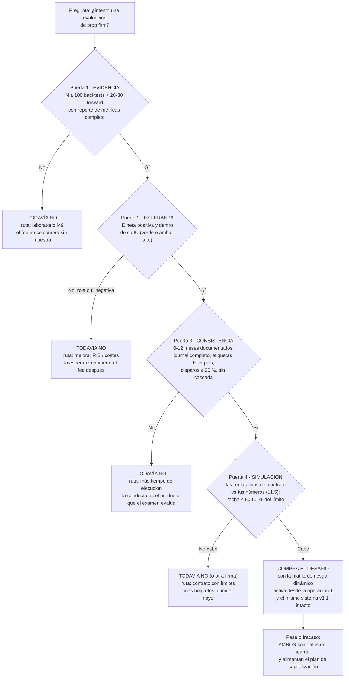

# Lección 11.6 · Cuándo intentar una evaluación — el criterio honesto de la puerta de capital

| Campo | Detalle |
|---|---|
| ⏱️ Duración estimada | 40–55 min de estudio |
| 🧱 Módulo | [M11 · La Industria](README.md) |
| ⬅️ Anterior | [Lección 11.5 · Matriz de riesgo para evaluaciones](leccion-11-5.md) |
| ➡️ Siguiente | [Lección 11.7 · Fiscalidad por principios](leccion-11-7.md) |

---

## Por qué importa

Las cuatro lecciones anteriores te dieron el mapa completo de la industria del fondeo: el modelo de ingresos (11.3), la letra fina (11.4) y el sizing que sobrevive (11.5). Falta la pregunta que organiza todo: **¿cuándo es CORRECTO comprar un desafío?** — no "cómo pasar", sino cuándo intentar. La industria no te lo pregunta (su respuesta comercial es "hoy, con descuento"); el programa te lo pregunta porque la respuesta define si eres un cliente que compra esperanza o un profesional que usa una herramienta. El criterio del programa es deliberadamente exigente: **6-12 meses de consistencia documentada** — journal completo, métricas del reporte, forward testing aprobado, conducta auditable — porque el fee comprado sin evidencia es exactamente el ingreso del embudo de 11.3: tú no quieres ser el 92 %; quieres ser el profesional que la estadística trata distinto porque SU muestra lo demuestra. Esta lección convierte ese criterio en un árbol de decisión verificable — cada puerta con su evidencia, cada "todavía no" con su plan. Si terminas con una sola idea: **la evaluación se intenta cuando tu journal ya respondió las preguntas del examen — el fee es la formalidad, no el diagnóstico.**

## Concepto

**El árbol de decisión completo:**

**Puerta 1 — Evidencia (la de M9, sin atajos).** 100 backtests con protocolo y 20-30 de forward con reporte de 13 métricas. La razón es la del embudo de la evidencia: sin muestra, tu "probabilidad de aprobar" es la del promedio (el 92 %) — con muestra, es la TUYA, medible y auditable. El examen de la prop firm es de varianza y conducta: las dos cosas que tu journal ya midió.

**Puerta 2 — Esperanza (la de la tabla de 3 vías).** E neta positiva no basta por sí sola: debe estar dentro de un intervalo que no cruce el equilibrio (verde) o ser ámbar alto con la decisión provisional ya asumida. El punto de 11.5 aplica: con E negativa o roja, el fee es un pago por fracasar — la esperanza primero, el examen después.

**Puerta 3 — Consistencia (la de M10).** El criterio del SYLLABUS: **6-12 meses de consistencia documentada**. Qué audita esta puerta (con las métricas de tu propio journal): disparos ejecutados/debidos ≥ 90 % sostenido; etiquetas de error limpias (la proporción E1-E7 baja o estable — la tasa de contención de M10 subiendo); sin cascada de frenos activada en el periodo; temperatura respetada (los días rojos no se operaron). La conducta es el producto que el examen evalúa — y 6-12 meses es el mínimo para que "consistencia" no sea una racha con nombre largo. *(El rango no es arbitrario: cubre al menos un ciclo de cambios de régimen y las rachas adversas esperables de tu WR — tu racha de 9 con WR 40 % aparecerá al menos una vez en 6 meses de operación regular: el examen necesita haberte visto sobrevivirla.)*

**Puerta 4 — Simulación (la del 11.5).** Las reglas finas del contrato concreto contra tus números: racha esperada ≤ 50-60 % del drawdown total; flotante + 2 ops dentro del diario; consistencia y noticias compatibles con tu sistema. Si no cabe: "todavía no" con ruta (otra firma, otro límite) — o la aceptación de que el examen no es para tu sistema actual.

**Capitalizarse, no ser el producto.** La frase del SYLLABUS que ordena el módulo: la prop firm se usa **para capitalizarse, no para ser su producto**. La diferencia práctica: el profesional llega a la firma con su negocio ya demostrado (las 4 puertas) y la usa como palanca de capital cuando su evidencia dice que el fee es un examen; el producto de la firma llega sin evidencia y compra intentos porque el marketing le vendió el destino. El test rápido: si tu respuesta a "¿por qué un desafío AHORA?" no cita números de TU journal (WR, E, racha, meses de consistencia), la respuesta real es la del marketing — y esa es la señal de esperar.

**El plan de capitalización a 12 meses (la misión M-11 lo exige).** La estructura honesta del documento: (1) línea base: tu capital propio y su rendimiento medido (el negocio real — demo hasta la Fase 4 del programa); (2) escenario propio: crecimiento con aportes y compounding al riesgo del 1 % — la ruta principal; (3) escenario fondeo: si las 4 puertas están abiertas, el desafío como evento puntual con su aritmética (fee, probabilidad medida, payout esperado — esperanza matemática completa, no el escenario bonito); (4) la regla de mezcla: el fondeo nunca reemplaza la línea base — es una rama opcional de la estrategia, con su riesgo de contraparte cotizado (11.3). El documento termina con el calendario: qué puertas se abren cuándo y qué evidencia las abre.

## Analogía

El examen de barras y el abogado junior. Nadie se presenta al examen de abogacía "para ver si la ley le queda bien": se presenta cuando los años de formación dicen que el examen es una formalidad de su preparación — y nadie toma un caso por el solo hecho de aprobar: el bufón propio (con sus clientes, su reputación y su riesgo) se construye paso a paso, y la firma mayor (la prop firm) se integra cuando tu cartera ya tiene valor. El aspirante que compra intentos de examen cada mes es el mismo que compra desafíos: le pagan por presentarse, no por saber. La diferencia de carrera es estructural: el primero es producto de la escuela de examen; el segundo usa el examen como puerta. Tu journal es tu facultad de derecho: los créditos se cursan en meses de ejecución documentada.

## Cómo se hace: tu auditoría de las 4 puertas (la sesión de 1 hora con tu journal)

1. **Inventario de evidencia (15 min):** lista tus números reales — N de backtests y forward, WR con IC, E neta, racha máxima medida, meses de journal completo, tasa de contención, disparos %, cascadas activadas. El inventario es binario por línea: existe o no existe.
2. **Auditoría de las 4 puertas (20 min):** cada puerta con su veredicto (abierta/cerrada) y la cita exacta de tu journal que la respalda. Puerta cerrada ≠ fracaso: es tu ruta de trabajo para el trimestre.
3. **El documento "estado de puertas" (10 min):** una página con fecha, las 4 veredictos y el plan concreto de apertura de las cerradas (qué se hace esta semana por cada una). Se revisa en el acta mensual (9.6) — no se negocia en caliente.
4. **La prueba del marketing (5 min):** lee una oferta de prop firm SIN tu árbol al lado y anota qué te "invita" a comprar; después lee la misma oferta con el árbol. La diferencia entre las dos lecturas es exactamente el valor de este módulo — y la razón por la que el fee se compra con el árbol, no sin él.

## Error común

**(1) "Llevo 2 meses verdes, ya estoy listo."** Dos meses verdes sin N ni IC es una racha con calendario: el WR 40 % produce semanas verdes seguidas como parte de SU varianza — la puerta 3 exige 6-12 meses precisamente porque el examen necesita haberte visto la racha adversa, no solo la favorable. **(2) "El descuento del desafío vence mañana."** El urgenciamiento es marketing (10.3: la avaricia con calendario): una puerta que se abre por descuento es una puerta que no estaba abierta — el fee a precio de descuento sigue siendo un fee sin evidencia. **(3) "Mi amigo pasó y no tenía journal."** El testimonio del superviviente (sesgo de supervivencia, 9.1): por cada amigo que pasó hay 11 que no pasaron y no publican — la decisión se toma con TU distribución, no con la anécdota ajena. **(4) Confundir las puertas con burocracia.** Las 4 puertas son la traducción operativa de "6-12 meses de consistencia documentada" — el criterio del SYLLABUS; el árbol no añade requisitos: los hace verificables. **(5) Usar la prop firm como plan de emergencia.** "Mi cuenta propia está en racha mala, intento el desafío para recuperar" — la revancha (10.5) con fee: el momento de peor conducta comprando el examen más exigente de la industria. La puerta 3 existe exactamente para bloquear esa ventana.

## Conexión cuantitativa

**Hacia 9.3:** las puertas 1-2 son la tabla de decisión de 3 vías con otro nombre — el mismo veredicto (verde/ámbar/rojo) que decide tu tamaño decide tu fee. **Hacia 10.4:** la puerta 3 audita el proceso (etiquetas, contención, cascadas) — la consistencia documentada es la operación perfecta acumulada en meses. **Hacia 11.5:** la puerta 4 es la simulación de la matriz de riesgo dinámico — sin ella, la compra es fe; con ella, aritmética. **Hacia 11.7 y M12:** el plan de capitalización a 12 meses de la misión M-11 integra la fiscalidad (la próxima lección) y desemboca en el plan de trading/negocio del módulo final — el cierre del programa.

---

## 🎯 Puntos clave

1. La evaluación se intenta cuando **las 4 puertas están abiertas**: evidencia (N), esperanza (E dentro de IC), consistencia (6-12 meses documentados) y simulación (reglas finas vs tus números).
2. Cada "todavía no" del árbol lleva **ruta de trabajo** (más N, mejor R:B/costes, más tiempo de ejecución, otro contrato) — la decisión pospuesta es gestión, no derrota.
3. El criterio del SYLLABUS (6-12 meses de consistencia documentada) existe porque el examen necesita haberte visto **sobrevivir tu racha adversa**, no solo tus semanas verdes.
4. **Capitalizarse ≠ ser el producto**: el profesional llega con el journal que responde el examen; el producto llega sin evidencia y compra intentos — el test es si tu "¿por qué ahora?" cita números del journal.
5. El **plan de capitalización a 12 meses** integra línea base propia + fondeo como rama opcional con riesgo de contraparte cotizado — nunca el fondeo como plan A ni como rescate.

## 🔄 Autoevaluación rápida

1. Enumera las 4 puertas con su evidencia exacta y su fuente (qué lección/journal la produce). ¿Cuál de las cuatro NO puede cerrarse solo con métricas y por qué?
2. Tu estado: 100 backtests (verde), E neta +0,11R con IC que no cruza el equilibrio (verde), 4 meses de journal con disparos 94 % y una cascada nivel 1 (ámbar), simulación OK con margen. ¿Qué veredicto da el árbol y cuál es tu plan? ¿Qué haría el marketing en tu lugar?
3. Un trader afirma: "pasé el desafío sin journal ni backtests — los criterios de este módulo son burocracia". Refuta con la estructura estadística (de quién es la probabilidad, qué autoriza el testimonio individual) y con el sesgo que su anécdota comete. ¿Qué sería la evidencia que SÍ valdría de su caso?

Ver respuestas

1. Puerta 1 — evidencia: N ≥ 100 backtests + 20-30 forward con reporte (M9: journal v1 + reporte de métricas). Puerta 2 — esperanza: E neta dentro de su IC, veredicto verde/ámbar alto (M9: tabla de 3 vías). Puerta 3 — consistencia: 6-12 meses de journal con conducta auditable (M10: etiquetas, contención, cascadas, temperatura) — esta es la que NO se cierra solo con métricas: exige TIEMPO calendario documentado, porque el examen necesita ver la conducta sostenida incluyendo la racha adversa; las métricas de 2 meses no distinguen consistencia de racha. Puerta 4 — simulación: reglas del contrato vs tus números (11.4-11.5: racha vs límite, flotante vs diario).
2. Veredicto: **todavía no** — la puerta 3 está cerrada (4 de 6-12 meses, y con una cascada activada en el periodo: la conducta aún está en formación). Plan: continuar la ejecución documentada 2-8 meses más, con la tasa de contención y los disparos ≥ 90 % como métricas de la puerta; re-auditar en el acta mensual. El marketing te diría "ahora, con descuento": exactamente la ventana que el árbol existe para bloquear — el fee comprado con la puerta 3 cerrada es el ingreso del embudo de 11.3.
3. La anécdota comete **sesgo de supervivencia**: de la distribución completa de "sin journal ni backtests", la muestra publicada es solo la cola ganadora (~8 % que pasa, ~0,07 % de éxito neto por los datos de 11.3) — su caso no cambia la probabilidad de la distribución, solo la ilustra desde la cola. Lo que su testimonio individual autoriza: nada — una extracción de N=1 sin protocolo no es evidencia de método (9.1: la ceguera, el N, la declaración previa). La evidencia que SÍ valdría: si su caso documentara N grande con protocolo similar al promedio (sin ventaja de información) seguiría siendo anécdota; lo único que valdría es un AGRUPADO: cohortes completas de aspirantes con/sin preparación y sus tasas — que es precisamente la estadística del 92 % que él cree refutar con su historia.

