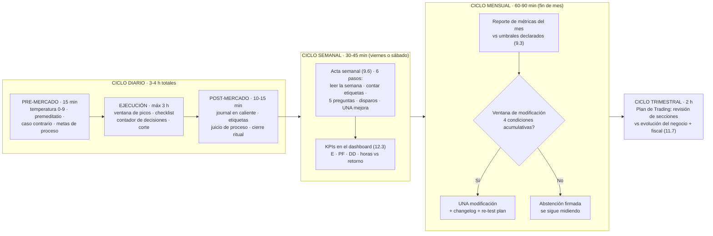

# Lección 12.2 · La rutina semanal del trader — el ciclo que convierte el plan en hábito

| Campo | Detalle |
|---|---|
| ⏱️ Duración estimada | 35–50 min de estudio |
| 🧱 Módulo | [M12 · Plan de Trading y Plan de Negocio](README.md) |
| ⬅️ Anterior | [Lección 12.1 · El Plan de Trading documental](leccion-12-1.md) |
| ➡️ Siguiente | [Lección 12.3 · KPIs del negocio](leccion-12-3.md) |

---

## Por qué importa

El Plan de Trading (12.1) dice QUÉ; esta lección entrega el CUÁNDO — el calendario operativo que convierte el documento en hábito y el hábito en negocio. La rutina semanal no es una lista de buenas intenciones: es la **arquitectura temporal** que ya construiste pieza por pieza (temperatura, ventana, journal, actas, ventanas de modificación) ahora integrada en un ciclo único, con sus horarios, sus duraciones y sus entregables. La razón de la integración es la que el programa repite desde M10: lo que depende de tu memoria y tu ánimo falla exactamente cuando más importa; lo que tiene horario, duración y entregable definidos sobrevive a la fatiga, a la racha y al mes aburrido. Y hay una segunda función, de negocio: la rutina es lo que el Plan de Negocio (12.4) presupuesta en HORAS — el trader que no sabe cuántas horas le cuesta su semana no puede calcular su retorno por hora (12.3). Si terminas con una sola idea: **la rutina no organiza tu tiempo alrededor del mercado — organiza el mercado alrededor de tu negocio.**

## Concepto

**El ciclo completo, dibujado una sola vez:**

**Las 4 duraciones que el Plan de Negocio presupuesta.** Con este ciclo, tu negocio consume *(perfil H1/H4, 2-3 disparos/semana)*: ~3-4 h/día en 3-4 días de mercado de tu ventana (~14 h/semana de operación y registro) + 30-45 min de acta semanal + 60-90 min de mensual + 2 h trimestrales ≈ **~60-70 h/mes** — el número que el KPI de horas vs retorno (12.3) necesita. La regla de honestidad del programa: las horas se REGISTRAN (una columna simple en el acta), no se estiman — el trabajo invisible ("pensé en el mercado 4 horas cada día") no presupuesta y no mide.

**Pre-mercado: los 15 minutos que valen la sesión.** El bloque P del ciclo (10.6-10.7): temperatura con su veredicto, premeditatio (la pérdida posible hoy es estructura), caso contrario escrito, metas de proceso del día. Su función es exactamente la del preflight del piloto: cargar el protocolo ANTES de que el mercado pida decisiones — y su evidencia es la plantilla de diario emocional del laboratorio de M10, que la misión final auditará.

**La semana no es 5 días de trading.** Tu sistema de 2-3 disparos/semana en H1/H4 NO opera cada día: la rutina contempla **días de observación** (temperatura hecha, caso contrario escrito, cero disparos, journal con "no hay señales: día de observación") — y los cuenta como días de negocio plenos, porque la inacción estratégica (10.7) ES ejecución del plan. El amateur cuenta días operados; el profesional cuenta días ejecutados — y la ejecución incluye no estar. La estadística que la acta semanal produce: días ejecutados/planificados = la métrica de disciplina que la Certificación audita.

**El viernes (o sábado): la hora de auditoría.** El bloque SEM del ciclo — el acta semanal de 9.6 en su horario fijo: se lee la semana, se cuentan las etiquetas, se responden las 5 preguntas de auditoría, se revisa la métrica de disparos, se decide LA UNA mejora de ejecución y se llena el dashboard de KPIs (12.3). Su horario fijo no es pedantería: es el mismo mecanismo de la ventana de ejecución aplicado a la auditoría — lo que tiene hora ocurre; lo que ocurre "cuando pueda", no ocurre.

**El fin de mes: la ventana.** El bloque MES — el reporte de métricas contra los umbrales declarados y la decisión de modificación con sus 4 condiciones acumulativas (9.6). Y el trimestre: la revisión de las SECCIONES del plan (¿la identidad sigue siendo esa? ¿la tolerancia al drawdown cambió con tu vida? ¿la fiscalidad necesita reconsulta?) — el único momento donde el PLAN (no el sistema) se revisa por diseño.

## Analogía

El calendario de entrenamiento del maratonista. El corredor profesional no decide cada mañana "hoy entreno o no": su semana está estructurada — series el martes, rodaje el jueves, larga el domingo, descanso y fuerza entre semana, revisión de cargas el lunes con el entrenador. El descanso está en el plan (igual que tu día de observación), la revisión tiene horario (igual que tu acta), y la progresión se decide por ciclos, no por impulsos (igual que tu ventana mensual). El amateur corre "cuando puede, lo que le apetece": entrena demasiado los días buenos y abandona en los malos. La diferencia de resultados no es de talento: es de arquitectura temporal — la misma que tu ciclo diario → semanal → mensual → trimestral le da a tu negocio.

## Cómo se hace: instalar el calendario (30 minutos, una vez)

1. **Bloquea las horas en TU calendario real:** la ventana de ejecución (10.7) de los días de mercado, los 15 min de pre-mercado con alarma, los 10-15 min de post-mercado, el bloque semanal del viernes/sábado y el bloque mensual del último día hábil. Si tu calendario no lo refleja, no es una rutina: es una intención.
2. **Prepara las plantillas fijas:** la hoja de temperatura (M10), la plantilla de acta semanal (9.6), el dashboard de KPIs (12.3, laboratorio) y el índice del expediente fiscal (11.7) — el ciclo corre sobre documentos fijos, no sobre decisiones de cada día.
3. **Registra las horas desde la semana 1** (columna simple en el acta): es la línea base del KPI de 12.3 y la prueba de que la rutina es real.
4. **Define tu día de observación tipo:** qué haces en un día sin señales (temperatura, observación pasiva con límite de tiempo, estudio del diario, NADA de buscar señales en TF menores) — la rutina del día vacío es la que evita el overtrading de aburrimiento (10.3).
5. **Revisa el calendario trimestralmente:** la duración de los bloques se ajusta con evidencia (el acta que sistemáticamente dura 1 h no es un acta de 45 min) — en la ventana, como todo.

## Error común

**(1) "Opero cuando puedo y hago el journal si me queda tiempo."** Ese orden invertido es el fin del negocio: el journal en caliente (10.7) es el registro que sostiene TODO lo demás — una semana sin registro es una semana que no existe para tus métricas (y la Certificación lo auditará). **(2) Confundir rutina con rigidez.** El ciclo fija el ESQUELETO (horarios, duraciones, entregables); el mercado llena el contenido (señales, gestión, observación) — la flexibilidad que importa está DENTRO de la estructura, no en estructurar cada día de nuevo. **(3) Saltarse el acta semanal en las semanas buenas.** La semana ganadora es la más importante de auditar (10.5: la sobreconfianza vive ahí) — el acta de las semanas verdes detecta el riesgo medio subiendo antes que la cuenta. **(4) Estirar la ventana de ejecución "porque hay movimiento".** La ventana y su corte son política del plan (sección 6): el movimiento fuera de los picos es ruido con forma de oportunidad — tu sistema no dispara mejor por mirarlo más (10.7). **(5) No tener rutina para los meses MALOS.** El ciclo no se suspende en el drawdown: se ejecuta IGUAL — temperatura, ventana, journal, actas — y son precisamente las actas de los meses malos las que producen la decisión correcta de la ventana (el changelog o la abstención firmada). La rutina es la infraestructura de la serenidad de 10.6.

## Conexión cuantitativa

**Hacia 12.3:** las horas registradas del ciclo alimentan el KPI "horas vs retorno" — sin rutina medida, ese KPI es una suposición. **Hacia 9.6:** el ciclo semanal/mensual/trimestral es el calendario exacto de las actas y las ventanas — esta lección les pone horario y presupuesto de tiempo. **Hacia 10.7:** el ciclo diario ES la rutina de M10 integrada con los ciclos superiores — el pre/post-mercado ya no son piezas aisladas: son los extremos del día de negocio. **Hacia la Certificación:** 12 semanas de operativa documentada con este ciclo son el tercer requisito de la certificación — el calendario ES la evidencia.

---

## 🎯 Puntos clave

1. El ciclo operativo tiene 4 capas: **diario** (pre 15 min → ejecución ≤ 3 h → post 10-15 min), **semanal** (acta + KPIs, 30-45 min), **mensual** (reporte + ventana de modificación) y **trimestral** (revisión de secciones del plan + fiscal).
2. El negocio consume **~60-70 h/mes** en el perfil H1/H4 del programa — y las horas se REGISTRAN, no se estiman: el KPI de 12.3 las necesita.
3. Los **días de observación son días de negocio plenos**: la inacción estratégica se ejecuta con rutina completa y se cuenta como ejecución — días ejecutados ≠ días operados.
4. El acta semanal tiene **horario fijo** y se audita TAMBIÉN en las semanas ganadoras — es donde la sobreconfianza se detecta antes.
5. La rutina no se suspende en los meses malos: es exactamente ahí donde el ciclo produce su valor — las actas del drawdown hacen la decisión correcta posible.

## 🔄 Autoevaluación rápida

1. Dibuja el ciclo de 4 capas con sus duraciones y entregables. ¿Qué entra a cada capa y qué decisión se toma en cada una (con la lección fuente)?
2. Tu semana: 2 disparos ejecutados (uno ganador +2R, uno E0), 3 días de observación, 1 día de temperatura roja (no operó). ¿Cuántos días ejecutados/planned según el plan y qué dice el acta de esa semana en la métrica de disciplina? ¿Y qué auditó del día de temperatura roja?
3. Un trader "no tuvo tiempo" del acta en su mejor semana (+8R). ¿Qué dos riesgos específicos quedan sin auditar y qué mecánica del programa los habría capturado? Formula la corrección en 2 frases.

Ver respuestas

1. Diario: pre-mercado (temperatura/premeditatio/caso contrario — 10.6-10.7) → ejecución (checklist, contador, corte — 10.7) → post (journal en caliente, juicio de proceso, cierre ritual — 10.6-10.7); decisión: cada operación y la meta de proceso del día. Semanal: acta de 6 pasos + KPIs (9.6 + 12.3); decisión: LA UNA mejora de ejecución. Mensual: reporte vs umbrales (9.3) + ventana (9.6); decisión: UNA modificación con changelog o abstención firmada. Trimestral: secciones del plan + fiscal (12.1 + 11.7); decisión: si el plan sigue siendo tu realidad (o se actualiza con evidencia).
2. Días ejecutados: 5 de 5 planificados (los 3 de observación y el de temperatura roja CUENTAN — la inacción y el respeto al veredicto son ejecución del plan); métrica de disciplina: 100 % — la mejor semana posible de conducta con resultado +2R −1R = +1R neto de las dos operaciones del sistema. El acta auditó del día rojo: que NO se operó (el veredicto se respetó), que se registró igualmente (el diario emocional completo) y que el post-mercado se ejecutó — el día rojo bien ejecutado es una fila más de evidencia para la correlación del reporte M-10.
3. Riesgo 1: la **sobreconfianza** — la semana de +8R es exactamente donde el riesgo medio empieza a subir y el techo se roza (10.5); el acta con la métrica "riesgo medio real vs 1 %" lo captura. Riesgo 2: la **deriva no detectada** — sin contar etiquetas y disparos, las 2-3 desviaciones de una semana extraordinaria se normalizan y entran a la semana siguiente como "así se opera cuando va bien". Corrección: "El acta se ejecuta TODAS las semanas — especialmente las ganadoras: es la única auditoría que ve tu conducta en el pico de la varianza positiva. La semana de +8R sin acta no es una semana buena: es una semana sin evidencia de que lo sea por proceso y no por suerte."

