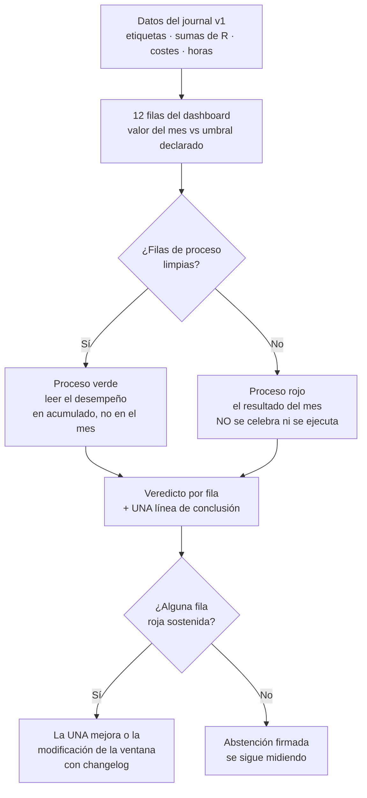

# Lección 12.3 · KPIs del negocio — el dashboard mensual de un solo vistazo

| Campo | Detalle |
|---|---|
| ⏱️ Duración estimada | 40–55 min de estudio |
| 🧱 Módulo | [M12 · Plan de Trading y Plan de Negocio](README.md) |
| ⬅️ Anterior | [Lección 12.2 · La rutina semanal](leccion-12-2.md) |
| ➡️ Siguiente | [Lección 12.4 · Gestión patrimonial](leccion-12-4.md) |

---

## Por qué importa

Un negocio se gestiona con NÚMEROS y un hobby se comenta con sensaciones — esta lección define los números. Los KPIs (*key performance indicators*) del negocio de trading no son nuevos (tu reporte M-9 ya los midió para el sistema): lo nuevo es la AGREGACIÓN — el dashboard mensual de una página que combina los KPIs de desempeño (E, PF, Max DD) con los de negocio real (horas invertidas, costes totales, retorno neto del mes) y los de conducta (disparos, contención, días ejecutados). La función del dashboard es la del tablero de cualquier operación: detectar la deriva ANTES de que sea una crisis, alimentar la ventana de modificación (9.6) con datos y dar al Plan de Negocio (12.4) su materia prima. La regla del programa: **un dashboard de una sola página, llenado con datos del journal — nunca estimado — y leído con umbrales declarados, no con ánimo.** Si terminas con una sola idea: **tu negocio tiene un tablero o tiene un estado de ánimo — y el tablero se llena el mismo día del mes, siempre, aunque (especialmente si) el mes fue malo.**

## Concepto

**Los 12 KPIs del dashboard mensual** *(todos salen de tu journal y de tu calendario — la plantilla del laboratorio trae las fórmulas)*:

| # | KPI | Fórmula / fuente | Umbral del programa (perfil H1/H4) |
|---|---|---|---|
| 1 | **E neta mensual** | Suma de R netos del mes / nº operaciones | Consistente con el IC del sistema (para el caso maestro: [−0,06R, +0,38R] por op a N=100) |
| 2 | **WR del mes** | Ganadoras / total (con IC si N < 50: el intervalo MANDA) | Sin umbral aislado: se lee contra el 40 % ± IC |
| 3 | **R:B medio** | Media de las ganadoras en R | ≥ 1,8 (deriva de gestión si baja) |
| 4 | **PF neto** | Σ ganancias / Σ pérdidas (neto de costes) | ≥ 1,25 (verde) · 1,1-1,25 (ámbar) · < 1,1 (rojo) |
| 5 | **Max DD del mes** | Peak-to-trough de la curva de capital al 1 % | ≤ −6 % esperable · −15 % línea de emergencia (M8) |
| 6 | **Coste total del mes** | Σ (spread + comisión + swap + slippage) | ≤ 0,1R/operación de media — deriva si sube |
| 7 | **Disparos ejecutados/debidos** | Ejecutados / debidos (9.2) | = 100 % (la métrica de M8) |
| 8 | **Tasa de contención** | Abortos cortados / (cortados + ejecutados fuera de plan) | Tendencia creciente (10.3) |
| 9 | **Etiquetas de error** | Conteo E1-E7 del mes | Tendencia decreciente/estable; E0 domina el volumen |
| 10 | **Días ejecutados/planificados** | Rutina completa (12.2) / días del calendario | ≥ 90 % |
| 11 | **Horas invertidas** | Registro del acta semanal (12.2) | Presupuesto: ~60-70 h/mes (dato, no norma) |
| 12 | **Retorno del mes (horas vs dinero)** | R neto del mes / horas invertidas | Sin umbral fijo: es tu métrica de productividad personal — se compara consigo misma |

**Las dos lecturas que el dashboard fuerza.** *(1) Los umbrales se declaran ANTES* — la tabla de arriba es tu plantilla: cada KPI con su umbral escrito en el plan (sección 7-8) y el veredicto del mes (verde/ámbar/rojo por fila) se marca contra ellos, no contra la sensación. Es la decisión de 3 vías (9.3) aplicada a todo el negocio. *(2) El dashboard se lee en CONJUNTO* — el mes con E positiva y disparos 85 % no es un mes verde: es un mes verde de suerte con proceso rojo, y el acta lo trata como tal (10.4). El patrón de lectura del programa: primero las filas de proceso (7-10), después las de desempeño (1-6) — el proceso manda, el resultado firma.

**El KPI que nadie mide y todo el mundo necesita: horas vs retorno.** Con tu presupuesto de ~60-70 h/mes, el KPI 12 divide el R neto del mes entre las horas: si el mes dio +4R con 65 h → 0,06R/h; si dio +4R con 110 h → 0,036R/h — la deriva de horas es la señal temprana del overtrading invisible (más miradas, más revisiones, más "trabajo" sin más negocio). Su función no es pedirte eficiencia extrema: es hacer VISIBLE el coste de oportunidad del tiempo — la variable que el amateur nunca contabiliza y que el profesional presupuesta en el Plan de Negocio (12.4: ¿cuántas horas le dedicarás en la fase siguiente y qué retorno por hora hace sostenible la carrera?).

**El flujo del dashboard, de la fila a la decisión:**

**El dashboard NO es el reporte M-9.** El reporte de métricas (9.3) evalúa el SISTEMA con muestra grande (N=100+); el dashboard evalúa el MES del negocio (N=8-12 operaciones típicas) — y la lección estadística de M9 aplica: con N tan pequeño, el WR del mes es ruido (IC ±20-30 pp); por eso el dashboard pondera el proceso (disparos, contención, errores, días) que SÍ es medible a pequeña N, y deja el desempeño en perspectiva acumulada (la línea de la curva de capital a 12 meses importa más que el punto del mes). El amateur juzga el mes; el profesional acumula los meses.

## Analogía

El panel de instrumentos del avión. Un piloto vuela con panel: altitud, velocidad, rumbo, combustible, y sobre todo las TENDENCIAS (el altímetro de presión marca tasa de ascenso, no solo altura). El piloto no mira el panel cuando "se siente perdido": lo mira cada X minutos por procedimiento — y lee el conjunto: altitud bien + combustible mal = decisión de desvío, no de celebración. Tu dashboard es el panel: 12 instrumentos con umbrales, revisados por procedimiento (el bloque mensual del ciclo 12.2), leídos en conjunto (proceso antes que resultado) y con las tendencias visibles (la columna de 3-6 meses junto a la del mes). El trader sin dashboard es el piloto que vuela "por lo que se ve por la ventanilla": llega, hasta que no.

## Cómo se hace: montar tu dashboard v1.0 (en el laboratorio del módulo)

1. **Estructura la plantilla** (`journal/dashboard.md`): 12 filas de KPI con sus columnas — umbral declarado · valor del mes · veredicto · tendencia (3-6 meses). Cópiala del laboratorio y fija tus umbrales del perfil real.
2. **Automatiza la fuente:** todo sale del journal v1 (conteo de etiquetas, sumas de R, costes) + del registro de horas del acta — si algún KPI requiere buscar en la memoria, tu journal le falta una columna; se corrige en la ventana, no se estima.
3. **Llénelo en el bloque mensual** (60-90 min del ciclo 12.2): primero proceso, después desempeño, el veredicto por fila y UNA línea de conclusión — el dashboard de 20 filas sin conclusión es decoración.
4. **Muestra la tendencia:** guarda los dashboards mensuales y pinta la columna de acumulado (curva de capital + R neto por mes): la serie de 12 meses es la que lee la Certificación y la que decide escalados.
5. **Alimenta las decisiones:** el veredicto del dashboard ENTRA al acta mensual: cada fila roja es candidata a ser "el dato más débil" del reporte (M-9) y a producir la UNA mejora o la modificación — el tablero no informa: decide.

## Error común

**(1) "Como el mes fue bueno, no lleno el tablero."** El mes bueno sin tablero es el mes donde la sobreconfianza (10.5) y el risk creep (10.3) se instalan gratis — el tablero existe precisamente para los meses donde las sensaciones mienten más. **(2) Juzgar el WR de un mes con N=9.** El IC de una muestra así es ±30 pp: tu 55 % del mes y tu 30 % del mes siguiente son la misma estimación estadística — el dashboard pondera proceso a N pequeña y desempeño en acumulado; juzgar el mes por WR es leer el ruido. **(3) Añadir 30 KPIs "por si acaso".** El tablero de una página tiene el poder de ser leído — los 12 del programa cubren proceso, desempeño y economía; cada KPI extra diluye la atención (y casi siempre son vanity metrics). **(4) Medir el retorno en $ sin las horas.** El KPI 12 existe porque el negocio tiene DOS recursos: capital y tiempo — un mes de +6R con 140 h es un negocio cansado; el mismo +6R con 60 h es el negocio sostenible que el plan presupuesta. **(5) Usar el dashboard para juzgarte y no para decidir.** El veredicto rojo de una fila no es una condena: es un candidato a la UNA mejora de la ventana — el tablero que produce culpa produce escondite (y journals embellecidos); el tablero que produce decisiones produce negocio.

## Conexión cuantitativa

**Hacia 9.3:** los KPIs 1-6 son las métricas del reporte a escala mensual — el dashboard hereda sus umbrales y su decisión de 3 vías. **Hacia 8.2-8.3:** el Max DD mensual se lee contra las líneas de M8 (−6 % esperable, −15 % emergencia) — el tablero es el monitor de la cascada entre cascadas. **Hacia 11.7:** el coste total y el retorno neto alimentan el expediente fiscal y el cálculo del impuesto estimado — el tablero es también la puerta de entrada de la fiscalidad al negocio. **Hacia 12.4:** el dashboard es la materia prima del Plan de Negocio: presupuesto de horas, capital de crecimiento y política de retiros se deciden con estos números.

---

## 🎯 Puntos clave

1. El dashboard mensual son **12 KPIs de una página**: 6 de desempeño (E, WR con IC, R:B, PF, Max DD, costes) y 6 de proceso/economía (disparos, contención, etiquetas, días, horas, retorno por hora) — llenados con datos del journal, nunca estimados.
2. Los **umbrales se declaran antes** y el veredicto por fila se marca contra ellos — la decisión de 3 vías de 9.3 aplicada a todo el negocio.
3. El dashboard se lee **proceso primero, desempeño después, y en conjunto**: un mes verde con disparos 85 % es un mes rojo de proceso con suerte.
4. A N pequeña el WR del mes es **ruido estadístico** — el proceso sí es medible al mes y el desempeño se juzga en la serie de 12 meses.
5. El KPI **horas vs retorno** hace visible el segundo recurso del negocio: +4R con 65 h ≠ +4R con 110 h — la deriva de horas es overtrading invisible.

## 🔄 Autoevaluación rápida

1. Enumera los 12 KPIs agrupados en desempeño/proceso-economía, con el umbral de al menos 4 de ellos. ¿Por qué los 4 de proceso (disparos, contención, etiquetas, días) funcionan a N pequeña mientras el WR no?
2. Tu mes: +5R neto, WR 56 % (9 operaciones), PF neto 1,31, disparos 92 %, coste medio 0,09R/ops, 108 h invertidas, Max DD −3,4 %. Llena el veredicto de cada fila y formula la UNA conclusión del dashboard (con la lección que la respalda).
3. Un trader presume "+8R este mes, mi mejor mes". Con N=11 y la tabla de arriba: qué dos preguntas del dashboard le haces y por qué su número, solo, no decide nada.

Ver respuestas

1. Desempeño: (1) E neta mensual, (2) WR con IC, (3) R:B medio (≥ 1,8), (4) PF neto (≥ 1,25 verde), (5) Max DD (≤ −6 % esperable), (6) coste total (≤ 0,1R/ops). Proceso-economía: (7) disparos (= 100 %), (8) contención (creciente), (9) etiquetas (decreciente/estable), (10) días ejecutados (≥ 90 %), (11) horas (presupuesto), (12) retorno/hora (serie propia). Los 4 de proceso funcionan a N pequeña porque son CONTADORES de conducta (frecuencias de decisiones, no estimaciones de parámetro): contar 1 disparo perdido no tiene error muestral de proporción relevante — el WR sí, porque estima un parámetro del sistema (±30 pp a N=9: no distingue nada).
2. Veredictos: E neta +5R (verde); WR 56 % con N=9 → IC ±32 pp → sin lectura aislada (ámbar informativo: se lee el acumulado); R:B — revisar (si ≥ 1,8: verde); PF 1,31 (verde); disparos 92 % (ROJO — la fila más importante: 8 de cada 10 debidos, 1 perdido); coste 0,09R (verde, al borde); horas 108 h vs presupuesto ~65 h (ROJO — 66 % por encima: deriva de miradas); Max DD −3,4 % (verde). UNA conclusión: *"Mes positivo de resultado con proceso en deriva: 92 % de disparos y 108 h señalan sobre-auditoría y energía fuera de la ventana — la mejora de ejecución de la ventana es un límite de horario por sesión y ninguna modificación al sistema"* (respaldado por 12.2 y 10.5: el exceso de horas es la firma del overtrading invisible, y el mes verde es donde se instala).
3. Las dos preguntas: (1) "¿Cuántas operaciones y con qué IC?" — a N=11 el WR es ruido (±28 pp): su +8R puede ser el mejor mes de un sistema medio o la cola buena de su varianza normal (el acumulado decide, no el punto); (2) "¿Disparos, contención y horas del mes?" — si las filas de proceso están limpias, el +8R es negocio; si no, es el mes más peligroso de su carrera (el error premiado de 10.4 con perfil de éxito). Su número, solo, no decide nada porque el resultado es la firma del mercado: el proceso es el que firma el trader.

