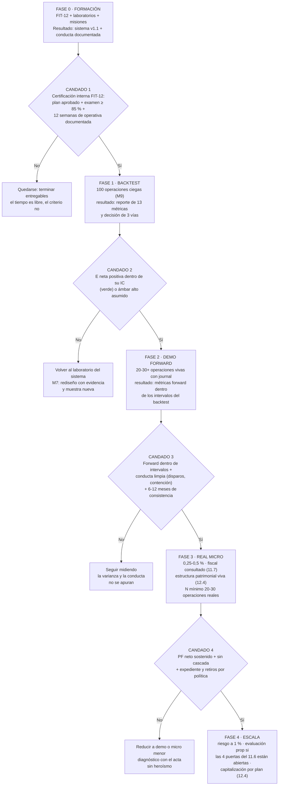

# Lección 12.5 · Hoja de ruta a 12 meses — fases con criterios, no fechas con deseos

| Campo | Detalle |
|---|---|
| ⏱️ Duración estimada | 40–55 min de estudio |
| 🧱 Módulo | [M12 · Plan de Trading y Plan de Negocio](README.md) |
| ⬅️ Anterior | [Lección 12.4 · Gestión patrimonial](leccion-12-4.md) |
| ➡️ Siguiente | [Lección 12.6 · Biblioteca esencial](leccion-12-6.md) |

---

## Por qué importa

Todo el programa construyó piezas; esta lección las ordena en el TIEMPO: la hoja de ruta que convierte tu formación en carrera — con fases, criterios de avance y la regla que la sostiene: **no se sube de fase sin criterio cumplido, sin importar cuánto tiempo tome ni cuántas ganas haya.** La razón es la del embudo de la evidencia (9.4) extendida a la vida del negocio: cada fase existe para fabricar la evidencia que la siguiente exige — y saltarse una fase es exactamente el risk creep (10.3) de la carrera: el avance visible (dinero real, tamaño mayor, fondeo) comprado con evidencia ausente. La hoja de ruta a 12 meses del SYLLABUS (formación → backtest → demo → real micro → evaluación prop) no es una promesa de calendario: es una estructura de puertas con candados medibles — la misma lógica de las 4 puertas del 11.6, aplicada a tu carrera completa. Si terminas con una sola idea: **el tiempo no es el criterio — el criterio es el criterio: la fase se gana con evidencia, y el calendario solo organiza la espera.**

## Concepto

**Las 5 fases del programa, con sus candados:**

**Las reglas estructurales de la hoja de ruta.** *(1) Los candados son acumulativos:* la fase 3 hereda todos los candados anteriores — el examen de la fase N es "todo lo anterior sigue cumpliéndose + el criterio nuevo". *(2) El tiempo es libre; el criterio no:* los "6-12 meses" de la puerta de consistencia (11.6) son un MÍNIMO de maduración, no una garantía de fecha — un trader puede estar 9 meses en la fase 2 construyendo la evidencia, y es la fase correcta mientras el candado siga cerrado. *(3) Se puede BAJAR de fase:* la regla más ignorada y más profesional — el real micro que rompe su cascada vuelve a demo sin dramatismo: es el freno de M8 aplicado a la carrera (la baja planificada es gestión; la insistencia es heroísmo). *(4) Cada fase tiene su presupuesto:* el del tiempo (horas del 12.2), el del capital (12.4: mínimo operativo por fase) y el del riesgo (el % por fase: 0 % demo, 0,25-0,5 % micro, 1 % escala) — el presupuesto de la fase se escribe antes de entrar en ella.

**El perfil de riesgo por fase** — la escalera del riesgo que la hoja de ruta autoriza:

| Fase | Riesgo por operación | Capital | Veredicto esperable |
|---|---|---|---|
| 0-1 (formación + backtest) | 0 % (sin dinero en juego) | Demo / nada | El sistema y la conducta se construyen |
| 2 (demo forward) | 0 % (dinero fuera) | Demo | Métricas forward y conducta a medir |
| 3 (real micro) | **0,25-0,5 %** | Micro (el que la regla del 1 % y tu presupuesto permitan) | La ejecución bajo dinero real — el examen que la demo no puede dar |
| 4 (escala) | **1 %** | Capital operativo por plan (+ fondeo si las 4 puertas) | El negocio a su tamaño de diseño |

La subida de fase sube el riesgo SOLO cuando el candado lo autoriza — y la secuencia es exactamente la inversa del amateur (que empieza al 2 % y "reduce cuando pierde"): el programa empieza en 0 % y gana el derecho al 1 %.

**La regla de "no se sube sin criterio" contra sus tres ataques.** El criterio se defiende de: (1) la **prisa** ("ya me siento listo" — el sentimiento no es evidencia: el candado sí); (2) la **comparación** ("mi colega ya está en real" — la carrera del otro tiene otra distribución: sesgo de supervivencia, 9.1); (3) la **excepción disfrazada** ("solo un mes en real para probar" — eso ES subir de fase: el candado no tiene modo prueba). La herramienta de defensa es el documento: la hoja de ruta con sus candados vive en el Plan de Negocio, firmada — y cada cambio de fase se registra en el changelog de la carrera, con fecha y evidencia.

**La revisión trimestral de la hoja de ruta.** El ciclo trimestral (12.2) incluye la pregunta de carrera: ¿en qué fase estoy, qué candado me separa de la siguiente, qué produjo este trimestre para ese candado? — la hoja de ruta se lee como el dashboard (12.3): con datos del journal, no con sensaciones. Y su versión a 12 meses (la misión M-11 ya la esbozó para el capital; esta la completa para la carrera) incluye: la fase objetivo del año, el candado crítico del periodo, y el plan de producción de su evidencia (N de operaciones, meses de consistencia, entrega de laboratorios).

## Analogía

El sistema de cinturones del judo. Nadie pelea contra el cinturón negro por deseo: cada grado exige tiempo mínimo, dominio demostrado de técnicas y combates ante examinadores — y los criterios son PÚBLICOS: sabes exactamente qué se te examinará. El blanco no "se siente" naranja: ejecuta las técnicas del naranja ante el examen. El sistema protege al estudiante de su propia impaciencia (y al club de los lesionados) — y permite bajar: quien vuelve tras una lesión re-examina el grado anterior. Tu hoja de ruta es el sistema de grados de tu carrera: los candados son los exámenes públicos, el tiempo mínimo es el de maduración del oficio, y la baja de fase es la regla de la lesión: volver al grado anterior sin vergüenza es parte del arte.

## Cómo se hace: tu hoja de ruta personal (1 hora, en el Plan de Negocio)

1. **Ubícate:** escribe tu fase actual con la evidencia de tu journal (no con tu sensación) y lista los candados entre tú y la fase siguiente.
2. **Elige el candado crítico del trimestre:** el UNO que desbloquea más camino (típicamente: N de forward, o meses de consistencia, o el reporte M-9 si no existe) — y su plan de producción: qué harás este trimestre para él, con números.
3. **Escribe los presupuestos de la fase actual:** horas/semana, riesgo por operación (0 % si estás en demo), capital mínimo — el presupuesto que la fase impone, no el que sueñas.
4. **Firma la regla de la baja:** por escrito — "si X ocurre (cascada nivel 2+, PF neto < 1,0 a N≥30, deriva de conducta), bajo de fase y ejecuto el diagnóstico" — la decisión pre-tomada que el futuro tú agradecerá.
5. **Programa la revisión trimestral** en el ciclo (12.2): la pregunta de carrera con su hora fija — la hoja de ruta se audita como todo el negocio.

## Error común

**(1) "La hoja de ruta es muy lenta."** Es la velocidad MÁXIMA segura: cada salto de fase sin candado es un atajo que la varianza cobra con interés (el 90 % de las cuentas muere en el atajo del real prematuro — la estadística del 70-90 % de perdedores es, en gran parte, gente que saltó fases *(lectura estructural, no medida individual)*). **(2) "El candado es para el sistema, no para mí."** Los candados miden sistema Y conducta: el 3 exige tu consistencia de 6-12 meses — tu persona es el objeto de examen tanto como tu sistema (el 85/15 de M1). **(3) Comparar tu fase con la de otros.** Cada carrera tiene su distribución: la comparación horizontal es sesgo puro — tu única comparación válida es tu propio journal mes a mes. **(4) Tratar la baja de fase como fracaso.** Es el mecanismo de preservación de la carrera: el trader que vuelve a demo tras una cascada está ejecutando el plan — el que insiste en real con la cuenta herida es el que la termina. **(5) Planificar 12 meses con resultados.** La hoja de ruta planifica EVIDENCIA (operaciones, meses documentados, entregables), no cifras de P/L: "cerrar el año en +30 %" es un deseo; "estar en fase 3 con 30 operaciones reales documentadas y conducta limpia" es un plan.

## Conexión cuantitativa

**Hacia 9.4:** la hoja de ruta ES el embudo de la evidencia de carrera — las fases 1-3 son el backtest → forward del M9 extendido, con los mismos intervalos mandando. **Hacia 11.6:** la fase 4 con evaluación prop reutiliza las 4 puertas — la carrera y el fondeo comparten el mismo estándar de evidencia. **Hacia 12.4:** los presupuestos de capital por fase y el mínimo operativo conectan la hoja de ruta con la gestión patrimonial — la fase dicta el tamaño, nunca el deseo. **Hacia 12.7:** la mejora continua de la última lección es el mantenimiento de la fase alcanzada — la graduación no es el fin de la hoja de ruta: es su estabilización.

---

## 🎯 Puntos clave

1. La hoja de ruta tiene **5 fases con candados acumulativos** (formación → backtest → demo → real micro → escala): no se sube sin criterio cumplido — el tiempo es libre, el criterio no.
2. La **escalera de riesgo** va 0 % → 0 % → 0,25-0,5 % → 1 %: el programa gana el derecho al riesgo, nunca lo toma — la inversa exacta del amateur.
3. **Se puede bajar de fase** por regla (cascada, PF < 1,0, deriva): la baja planificada es gestión de carrera, no fracaso — se firma antes de necesitarla.
4. Cada fase tiene **presupuesto de tiempo, capital y riesgo** escrito antes de entrar — y el candado se defiende de la prisa, la comparación y la excepción disfrazada.
5. La hoja de ruta planifica **evidencia, no resultados**: "fase 3 con 30 operaciones reales documentadas" es un plan; "+30 % al año" es un deseo con calendario.

## 🔄 Autoevaluación rápida

1. Reproduce las 5 fases con su candado y su riesgo por operación. ¿Qué candado es el ÚNICO que incluye tiempo calendario como criterio y por qué ese sí (y ningún otro)?
2. Tu estado: 100 backtests (ámbar alto: E dentro de IC), 14 semanas de demo forward con conducta limpia, cascada nunca activada, fiscal consultado. ¿En qué fase estás, qué candado te falta y cuál es el plan de producción de su evidencia este trimestre?
3. Un trader está en real micro desde hace 2 meses: cascada nivel 1 activada dos veces, PF neto 0,94 a N=28, conducta con 3 etiquetas E4. ¿Qué dicta su hoja de ruta (el candado 4 exacto) y cuál de los tres ataques al criterio está usando si insiste en seguir? Formula la decisión completa.

Ver respuestas

1. Fases: 0-1 formación/backtest (riesgo 0 %; candado: certificación FIT-12 y reporte con decisión de 3 vías) → 2 demo forward (0 %; candado: forward dentro de intervalos + consistencia de 6-12 meses) → 3 real micro (0,25-0,5 %; candado: PF neto sostenido, sin cascada, retiros por política) → 4 escala (1 %; candado: las 4 puertas del 11.6 para el fondeo + capital por plan). El único candado con calendario es el de la fase 2→3 (6-12 meses de consistencia) porque el objeto de examen es la CONDUCTA sostenida — y la conducta solo se demuestra en el tiempo, incluyendo las rachas adversas que no se pueden apurar: los demás candados son de muestra y métricas, que no dependen del calendario.
2. Estás técnicamente en fase 2 (demo) con la evidencia de la fase 1 completa. Falta: cerrar el candado de 6-12 meses de consistencia documentada (llevas 14 semanas ≈ 3,5 meses: te faltan 2,5-8,5 meses según el extremo del rango que tu agente auditor valide). Plan del trimestre: mantener el ciclo documentado (12.2), acumular N de forward (hacia 30-40), mantener disparos 100 % y contención creciente, y preparar la estructura de la fase 3 (cuenta micro, mínimo operativo, expediente fiscal ya consultado) para que la subida sea administrativa cuando el candado abra.
3. El candado 4 de la fase 3 dice: PF neto sostenido + sin cascada + conducta limpia — su estado falla los tres (PF 0,94 < 1,0, cascada 2 veces, 3 E4). La decisión del candado: **bajar a fase 2 (demo)** con diagnóstico por acta — es la regla firmada. El ataque que está usando: la **excepción disfrazada** ("ya llevo 2 meses, seguiré hasta que se arregle") con un toque de prisa ("la muestra está por llegar a 30") — el candado no tiene modo prueba ni modo insistencia: PF < 1,0 a N≥28 y dos cascadas son exactamente la condición de baja que él mismo firmó. Volver a demo no es castigar el sistema: es proteger la carrera mientras el diagnóstico (¿varianza o deriva?) decide.

