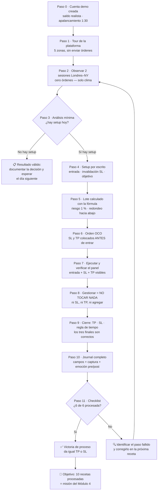

# 🔬 La Receta de tu Primera Operación — Laboratorio de Ejecución

> [!WARNING]
> **Contenido educativo.** La mayoría de los traders minoristas pierde dinero (estudios de reguladores estiman entre 70 % y 90 %). Nada aquí constituye asesoría financiera ni recomendación de bróker.

| Campo | Detalle |
|---|---|
| 🧩 Tipo | Recurso transversal del programa FIT-12 (referenciado por el [Módulo 4](../../01-syllabus/SYLLABUS.md)) |
| 🎯 Objetivo | Tu **primera operación PROCESADA** de principio a fin: analizada → dimensionada → SL puesto antes de entrar → ejecutada → registrada → revisada |
| ❌ Lo que NO es | Una promesa de ganancia. Tampoco una autorización para operar con dinero real antes de la Fase 4 del programa |
| 🔗 Requisitos | Haber aprobado M1 (Carta de Expectativas + quiz ≥ 8/10). Los pasos 3–11 requieren M2–M3 y se ejecutan con M4 |

---

## ⚠️ Cuándo usar cada parte de esta receta

Esta receta se lee completa HOY (ver el camino entero reduce la ansiedad), pero se **ejecuta por etapas**:

| Etapa | Pasos | Cuándo | Riesgo |
|---|---|---|---|
| 🟢 Familiarización | 0, 1, 2 | Ya — esta semana si quieres | Cero: no se envía ninguna orden |
| 🟡 Ejecución asistida | 3 – 11 | Con el Módulo 4 (Plataforma y Primera Ejecución) | Cero real: todo en **cuenta demo** |
| 🔴 Dinero real | — | Fase 4 del programa: tras M9 (*forward testing* en demo) y M12 (Plan de Trading), con riesgo micro 0,25–0,5 % | El que tú decidas no correr todavía |

**Por qué esta restricción:** una receta que termina en "y ahora gana tu primer dólar" es la puerta de entrada del 70-90 % que pierde — convierte la emoción del primer resultado en el criterio para arriesgar capital. El criterio de este programa es otro: **el primer hito es una operación procesada, no un dólar**. Los dólares llegan después, cuando la estadística — no la ilusión — los autoriza.

### Los 3 principios previos (no negociables)

1. **El Stop Loss se coloca ANTES de la entrada. Siempre. Sin excepción.** Una posición sin SL no es una operación: es una apuesta abierta a la ruina.
2. **El tamaño se calcula, nunca se adivina.** El riesgo por operación se define en porcentaje primero (1 % en demo) y el lote sale de la fórmula, no de la intuición.
3. **Si no está en el journal, no ocurrió.** Una operación sin registro no genera dato; sin dato no hay estadística; sin estadística no hay negocio.

### El mapa visual de la receta



---

## Parte 0 · Elegir el terreno: criterios de bróker (sin marcas)

El programa no recomienda marcas (el radar de estafas del Módulo 11 te enseñará a auditarlas tú mismo). Te da los **criterios de due diligence** que debe cumplir cualquier bróker que abras para esta receta:

| Criterio | Qué verificar | Señal de alarma |
|---|---|---|
| 🛡️ Regulación | Entidad supervisora reconocida (por principios: reguladores de jurisdicciones con fondo de compensación y segregación de fondos del cliente) | "Regulado en una isla" sin supervisor real; solo licencias off-shore decorativas |
| 💰 Cuenta demo | Demo gratuita e ilimitada o de duración suficiente (≥ 3 meses), con datos de mercado reales | Demo que expira en 14 días o con precios "mejorados" |
| 📊 Costos declarados | Spread y comisión publicados y estables; swap visible en la especificación del contrato | Spreads "desde 0,0 pips" sin letra pequeña, comisiones ocultas |
| 🏦 Segregación de fondos | El dinero del cliente en cuentas separadas del capital de la empresa | Mezcla de fondos con el balance del bróker |
| 🧾 Retiros | Proceso documentado, plazos declarados | Retiros "en 1 minuto" prometidos con condiciones ilegibles |

> **Nota de contexto universal:** la disponibilidad de brókeres y vehículos varía por país y jurisdicción. Verifica la regulación local aplicable a ti antes de abrir cualquier cuenta — con dinero real. Para la demo de esta receta, cualquier bróker regulado con MT4/MT5 o plataforma equivalente sirve.

---

## 🍳 La receta maestra — EUR/USD en la sesión de Londres–Nueva York

**¿Por qué EUR/USD como maestra?** Es el par más líquido del mundo: spread mínimo, movimientos limpios, horario predecible y abundancia de información. Para aprender mecánica quieres la carretera más lisa, no la más emocionante. El oro y los índices llegan después, como variaciones.

**¿Por qué la sesión Londres–NY?** Concentra el mayor volumen del día en forex: el solapamiento (≈ 12:00–16:00 UTC) es donde el EUR/USD se mueve con la relación señal/ruido más favorable y los spreads más ajustados. Fuera de esas horas, el spread sube y el mercado se arrastra: pagarías más peaje para recorrer menos camino.

> ⏰ **Huso horario de referencia:** todas las horas de esta receta se dan en UTC y se convierten a Bolivia (UTC-4, sin horario de verano). Ojo: durante el horario de verano del norte, Londres y Nueva York se desfasan una hora — verifica siempre en el calendario económico antes de una sesión importante.

---

### Paso 0 · Abrir la cuenta demo (15 min)

1. Elige un bróker que cumpla la tabla de criterios de la Parte 0.
2. Solicita la cuenta **demo** (práctica/simulada). No deposites nada en esta etapa.
3. Configúrala con **realismo deliberado**:
   - **Saldo demo = el capital real que prevés usar** (o 2 000 si aún no lo sabes). Un demo de 100 000 enseña vicios de tamaño que el real no perdona.
   - **Apalancamiento realista** (1:30 — el estándar regulado europeo — o el máximo que usarías de verdad, nunca 1:500).
   - Tipo de cuenta estándar (no ECN con cero comisiones si tu real tendría comisiones: el objetivo es ensayar el negocio real, no el más cómodo).
4. Anota en el journal: `Cuenta demo creada — saldo X — apalancamiento Y — fecha`.

**Verificación del paso:** puedes iniciar sesión en la plataforma y ver tu saldo simulado.

### Paso 1 · Tour de la plataforma (30–45 min)

Localiza y prueba (sin enviar órdenes) las 5 zonas esenciales:

| Zona | Qué es | Qué probar |
|---|---|---|
| 1. Cotizaciones (*watchlist*) | Lista de instrumentos con precio bid/ask en vivo | Añadir EUR/USD, XAU/USD, US30 |
| 2. Gráfico | El precio dibujado en velas | Cambiar temporalidad: D1, H4, H1; zoom; tipo de vela |
| 3. Ventana de orden | Donde se envían market/limit/stop, lote, SL, TP | **NO enviar nada**: solo abrir, leer cada campo, cerrar |
| 4. Panel de posiciones | Operaciones abiertas: P/L flotante, SL/TP activos | Verificar que aparece tras (en el futuro) cada orden |
| 5. Historial | Operaciones cerradas con resultado | Familiarizarte: aquí vivirá tu estadística |

**Verificación del paso:** puedes explicar en voz alta qué hace cada zona sin mirar esta tabla.

### Paso 2 · Elegir activo y sesión (observación, mínimo 2 sesiones)

1. Abre el gráfico de **EUR/USD** en H1.
2. Observa en vivo una sesión de solapamiento Londres-NY (**08:00–12:00 hora Bolivia**, aprox. 12:00–16:00 UTC) **sin enviar ninguna orden**:
   - ¿Cuándo se mueve más: al inicio, a mitad, al cierre?
   - ¿Qué pasa con el spread justo antes de la apertura de Londres (~09:00 Bolivia) y alrededor de las 09:30 ET (datos de EE. UU.)?
   - ¿Cómo es el mercado a las 14:00 Bolivia (últimas horas de Londres)?
3. Repite al día siguiente. Anota tus 3 observaciones principales en el journal.

**Verificación del paso:** 2 sesiones observadas con notas. Ya conoces el "clima" de tu carretera.

> 🟢 **Fin de la etapa de familiarización.** Los pasos 3–11 se ejecutan cuando llegues al Módulo 4. Todo lo que sigue ocurre en DEMO.

### Paso 3 · Análisis mínima del día (15 min, con lo aprendido en M2–M3)

Responde por escrito, antes de mirar el botón de comprar:

1. **Régimen:** ¿el mercado está en tendencia o en rango en H4/D1? (M3: rangos vs tendencias)
2. **Zonas:** ¿dónde están las 1–2 zonas de soporte/resistencia más relevantes cerca del precio?
3. **Dirección tentativa:** ¿compro en retroceso a soporte en tendencia alcista, vendo en retroceso a resistencia en tendencia bajista, o **no hay setup y hoy no se opera**?

> "No hay setup" es una respuesta válida y frecuente. En la receta no se fuerza la operación: se documenta la decisión.

### Paso 4 · Definir el setup por escrito (antes de tocar la plataforma)

Tres líneas en el journal, obligatorias:

```text
Setup M-4 #1 — EUR/USD H1 — 2026-XX-XX
Entrada:  limit en 1.0850 (retroceso a zona de demanda H4)
Invalidación:  SL en 1.0820 (bajo el mínimo del swing) → 30 pips de riesgo
Objetivo:  TP en 1.0910 (resistencia previa) → 60 pips → R:B = 1:2
```

Si no puedes escribir estas tres líneas con precisión, no hay operación — hay impulso. La invalidación se elige por **estructura** (mínimo/máximo del swing, M3), no por "cuánto puedo soportar perder".

### Paso 5 · Calcular el tamaño de la posición (la fórmula que protege el capital)

El riesgo por operación en demo (y después en real micro) = **1 % del saldo**. El lote sale de la fórmula:

$$\text{lote} = \frac{\text{riesgo en \$}}{\text{SL en pips} \times \text{valor del pip por lote}}$$

Valores de pip del EUR/USD (convención estándar): 1 lote estándar (100 000 unidades) = 10 $/pip · 0,1 lote = 1 $/pip · 0,01 lote (micro) = 0,10 $/pip.

**Ejemplo con números cerrados:** saldo demo 2 000 $ → riesgo 1 % = 20 $ → SL de 30 pips:

$$\text{lote} = \frac{20}{30 \times 10} = 0{,}066 \Rightarrow \text{redondear hacia abajo: } 0{,}06 \text{ lotes}$$

Verificación: 0,06 lotes × 30 pips × 10 $/pip/lote = 18 $ de riesgo real (0,9 % ✓). **Siempre se redondea hacia abajo**: el redondeo hacia arriba sube el riesgo sin decírtelo.

### Paso 6 · Colocar SL y TP ANTES de entrar (orden OCO)

Una **OCO** (*One Cancels the Other*) vincula tres órdenes: la entrada y sus dos salidas automáticas. Si el TP se ejecuta, el SL se cancela solo; y viceversa. Configura en la ventana de orden:

- **Stop Loss:** 1.0820 (tu invalidación del Paso 4) — el broker ejecuta solo si el precio llega.
- **Take Profit:** 1.0910 (tu objetivo del Paso 4).

El SL **nunca** se coloca "después, cuando baje la emoción". La receta lo prohíbe porque el mercado no espera tu valentía: entre el momento en que abres sin SL y el momento en que lo colocas, un dato macro puede haberte cobrado el mes.

### Paso 7 · Ejecutar la entrada

- **Limit** (en 1.0850): el sistema compra solo si el precio baja a tu zona. Es la entrada del setup planificado — la que usa esta receta.
- **Market** (ahora): compra al precio bid/ask vigente. Solo si tu setup contemplaba entrada inmediata.

Envía la orden OCO completa y verifica en el panel de posiciones: entrada activa, SL visible, TP visible. **Si algo de los tres falta, corrige o cancela.**

### Paso 8 · Gestionar (la parte más difícil: no hacer nada)

Reglas de gestión de la receta:

1. **No muevas el SL** para "darle aire" (eso rompe el riesgo definido) ni lo acerques por pánico.
2. **No muevas el TP** por codicia ("va más lejos, quito el objetivo").
3. **No agregues posición** a una que va ganando (promedio al alza = el ADN de la martingala).
4. Lo único permitido: observar, y cerrar manualmente SOLO si tu plan de M8 lo contempla (gestión por estructura). En esta primera receta: **no toques nada**.

### Paso 9 · El cierre

Tres finales posibles, todos correctos:

- **Toca el TP** → +60 pips (2R). El sistema hizo su trabajo.
- **Toca el SL** → −30 pips (−1R). **Pérdida ≠ Error** (Lección 1.6): un SL tocado dentro del plan es una operación bien hecha que salió mal, como debe salir el 55-60 % de las veces con un R:B 1:2 sano.
- **Toca tu regla de tiempo** (si el plan la define) → cierre manual documentado.

### Paso 10 · Registrar en el journal (5 min, inmediato al cierre)

Campos mínimos (la plantilla v0 del repo ya los trae en CSV):

```text
Fecha/hora · Instrumento · Dirección (long/short) · Tipo de orden · Lote
Entrada · SL · TP · Resultado (pips y $ / R) · ¿SL puesto antes de entrar? Sí/No
Setup (texto de 1 línea) · Captura de pantalla · Estado emocional pre/post (1-10)
Error detectado (si lo hay) · Lección (1 línea)
```

### Paso 11 · Revisión con checklist: ¿fue PROCESADA?

Marca cada casilla con honestidad radical:

- [ ] Tenía análisis escrito ANTES de la entrada (Paso 3)
- [ ] Entrada, invalidación y objetivo estaban definidos por escrito (Paso 4)
- [ ] El tamaño salió de la fórmula, no de la intuición (Paso 5)
- [ ] SL y TP estaban colocados antes de que la entrada se activara (Paso 6)
- [ ] No toqué el SL, el TP ni agregué posición durante la operación (Paso 8)
- [ ] El registro en journal está completo (Paso 10)

**6/6 = operación PROCESADA.** Ese es el hito. Da igual si tocó TP o SL: una operación perdedora 6/6 es una victoria de proceso; una ganadora 3/6 es una bomba de tiempo que reforzó un mal hábito. Cuando acumules 10 operaciones demo procesadas, habrás completado la misión del Módulo 4 — y la mecánica ya no será tu enemiga.

---

## 🌶️ Fichas de variación por mercado

La receta maestra NO se repite para cada mercado: cambian solo estos parámetros. Todo lo demás (los 12 pasos) es idéntico.

### Ficha · XAU/USD (oro)

| Parámetro | EUR/USD (maestra) | XAU/USD | Por qué importa |
|---|---|---|---|
| Unidad | 1 lote = 100 000 € | 1 lote = 100 onzas | El cálculo de tamaño cambia de fórmula |
| Valor de movimiento | 10 $/pip por lote estándar | 100 $ por cada 1 $ de movimiento del oro (lote estándar); 0,01 lote = 1 oz ≈ 1 $ por cada 1 $ | Un error de lote en oro pesa 10× más |
| Spread típico | ~1–2 pips *(ilustrativo)* | ~0,20–0,40 $ *(ilustrativo — varía por bróker y sesión)* | El costo fijo por operación es mayor |
| Volatilidad | Moderada | Alta: recorridos diarios de decenas de dólares *(ilustrativo)* | Los SL "de forex" se quedan cortos; SL por estructura más amplios → lote más pequeño |
| Sesión preferente | Londres–NY | Nueva York (datos de EE. UU.) | El oro reacciona a tasas y DXY, que se mueven en horario de EE. UU. |
| Drivers | Flujo entre economías | Tasas reales de EE. UU. (inversas), DXY (inverso), apetito de riesgo | El análisis del contexto difiere (M2.6) |

**Ejemplo de tamaño en oro (números cerrados):** saldo 2 000 $ → riesgo 1 % = 20 $ → SL de 4,00 $ por onza → posición = 20/4 = 5 onzas = 0,05 lotes. Verificación: 0,05 × 100 oz × 4 $ = 20 $ ✓.

### Ficha · Índices US30 / NAS100 (CFD)

| Parámetro | EUR/USD (maestra) | Índices CFD | Por qué importa |
|---|---|---|---|
| Horario | 24/5 | Sesión de cash + sesión extendida; **gaps** de apertura | Una posición mantenida overnight puede abrir mañana muy lejos del cierre de hoy |
| Gap de apertura | Casi nulo | Frecuente y de tamaño variable | El SL puede ejecutarse con *slippage* peor que el precio del stop |
| Valor del tick | Estandarizado en pips | **Varía por bróker** — lee la especificación del contrato antes de calcular nada | Calcular el lote con el valor equivocado rompe todo el riesgo |
| Spread típico | ~1–2 pips *(ilustrativo)* | Varios puntos, variable por sesión *(ilustrativo)* | El costo relativo sube en horas muertas |
| Sesión preferente | Londres–NY | Apertura de NY (09:30 ET) y últimas 2 h | Donde se concentra el volumen y la señal |
| Drivers | Flujo entre economías | Tasas, ganancias corporativas, apetito de riesgo | Contexto macro distinto (M2.6) |

**Regla de oro para índices:** antes de la primera operación, abre la pestaña "Especificaciones del contrato" en tu plataforma y anota: valor del tick, tamaño del contrato, horarios y margen. Sin esos 4 datos, el Paso 5 no se puede calcular — y no se opera.

---

## 💵 ¿Y mi primer dólar?

Es la pregunta correcta hecha en el momento equivocado. Aquí está el plan honesto del programa:

| Etapa | Qué ganas | Qué significa |
|---|---|---|
| Demo (M4) | Tus primeros "dólares simulados" | **Evidencia de proceso**: la mecánica funciona bajo tus manos. No es ingreso; es ensayo |
| Demo forward (M9) | Estadística propia: N ≥ 100 operaciones del mismo sistema | **Evidencia de esperanza**: tu E estimado, después de costos, con datos tuyos |
| Real micro (Fase 4) | **Tu primer dólar real** | La consecuencia estadística de A y B, con riesgo 0,25–0,5 % y dinero quemable |

El primer dólar real de un profesional llega pequeño, tarde y sin drama — porque llegó autorizado por la estadística, no perseguido por la necesidad. El del 70-90 % llega primero, grande y con drama, y suele ser el último. La diferencia entre ambos no es el mercado: es **el orden de las etapas**. Esta receta te pone en el orden correcto desde el paso 0.

---

## 🧾 Checklist imprimible (versión de bolsillo)

```text
RECETA DE OPERACIÓN — [instrumento] — [fecha]
□ 0-2  Demo lista · plataforma conocida · sesiones observadas
□ 3    Régimen + zonas + dirección escritos (o "no hay setup")
□ 4    Entrada / SL (invalidación) / TP escritos ANTES
□ 5    Lote calculado con fórmula (riesgo 1 %, redondeo hacia abajo)
□ 6    OCO colocada: SL y TP ANTES de que la entrada se active
□ 7    Orden enviada y verificada en panel (entrada + SL + TP visibles)
□ 8    Nada tocado durante la operación
□ 9    Cierre: TP / SL / regla de tiempo — documentado
□ 10   Journal completo (campos, captura, emoción pre/post)
□ 11   6/6 checklist PROCESADA — sí / no → por qué
```

## 🔗 Conexiones del programa

- **Antes de ejecutar los pasos 3–11:** [M2 · El Motor del Precio](../../02-modulos/mod-02-motor-del-precio/README.md) (sesiones y calendario macro) y [M3 · Anatomía del Gráfico](../../02-modulos/mod-03-anatomia-del-grafico/README.md) (zonas, estructura, régimen).
- **Durante la ejecución:** [M4 · Plataforma y Primera Ejecución](../../02-modulos/mod-04-plataforma-y-primera-ejecucion/README.md) — la misión de 10 operaciones demo es exactamente "10 recetas procesadas".
- **Después:** [M8 · Gestión del Riesgo](../../02-modulos/mod-08-gestion-del-riesgo/README.md) profesionaliza el Paso 5 (tamaño dinámico, correlación de cartera) y el M9 convierte el Paso 10 en tu base de datos de validación.
